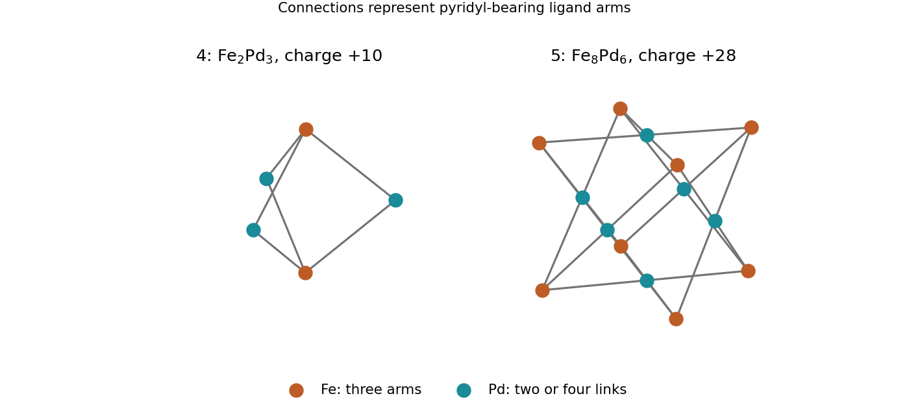

<h1 id="section-e/45/b/solution">Solution</h1>

↑ **Parent:** [B](../b.md)

Each Pd(dppp) unit retains its chelating phosphine and offers two adjacent pyridyl binding sites at an approximately right angle. Three such units bridge pairs of [metalloligands](../../../../../../metalloligand.md), giving **$[\mathrm{Fe}_2\mathrm{Pd}_3L_2(\mathrm{dppp})_3]^{10+}$**, a **trigonal bipyramid** with two Fe vertices and three equatorial Pd vertices. All six outward pyridines are used: $2\times3=3\times2$. The Pd/Fe ratio is $3/2$, matching the reagent dose, and the cation charge is $2(2)+3(2)=10$ because the organic ligands are neutral.

The two donor sites left by dppp are cis, so each equatorial Pd joins one arm from each Fe cap. A mere mass-spectral maximum charge is not an independent structure determination, but its consistency with donor counting and binding geometry strongly selects this model.

**[Figure 4](#section-e/45/b/image-original-connectivity-models-for-the-iron-palladium-bipyramid-and-cube). Original connectivity models for the iron–palladium bipyramid and cube**.

## ↑ Ancestors (14)

1. [B](../b.md)
2. [45](../../45.md)
3. [Section E](../../../section-e.md)
4. [Paper 3](../../../../paper-3-split.md)
5. [2022](../../../../split.md)
6. [Past exam of the chemistry course of the year 4 of the natural sciences course of the University of Cambridge](../../../../../split.md)
7. [Chemistry course of the year 4 of the natural sciences course of the University of Cambridge](../../../../../../chemistry-course-of-the-year-4-of-the-natural-sciences-course-of-the-university-of-cambridge.md)
8. [Year 4 of the natural sciences course of the University of Cambridge](../../../../../../year-4-of-the-natural-sciences-course-of-the-university-of-cambridge.md)
9. [Year of the natural sciences course of the University of Cambridge](../../../../../../year-of-the-natural-sciences-course-of-the-university-of-cambridge.md)
10. [Natural sciences course of the University of Cambridge](../../../../../../natural-sciences-course-of-the-university-of-cambridge.md)
11. [Course of the University of Cambridge](../../../../../../course-of-the-university-of-cambridge.md)
12. [University of Cambridge](../../../../../../university-of-cambridge-split.md)
13. [List of universities](../../../../../../list-of-universities.md)
14. [Codex Wiki](../../../../../../split.md)
