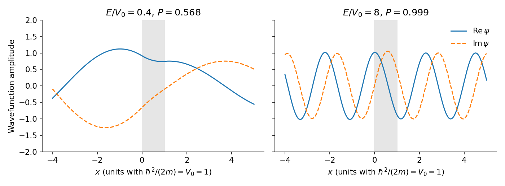

<h1 id="section-f/46/a/iv/a/solution">Solution</h1>

↑ **Parent:** [A](../a.md)

For $0<E<V_0$, put $\alpha=i\kappa$ with $\kappa=\sqrt{2m(V_0-E)}/\hbar$. Since $\sin(i\kappa a)=i\sinh(\kappa a)$, both signs in the quotient change and

$$
\boxed{P(E)=\left[1+\frac{V_0^2\sinh^2(\kappa a)}{4E(V_0-E)}\right]^{-1}}.
$$

It is finite and positive for nonzero incident energy and finite width: this is [quantum tunnelling](../../../../../../../../quantum-tunnelling.md). In a thick barrier $P\simeq[16E(V_0-E)/V_0^2]e^{-2\kappa a}$. Inside, the scattering wave is a combination $Ce^{-\kappa x}+De^{\kappa x}$, not an isolated real decaying exponential; their complex coefficients allow a nonzero conserved current.

**[Figure 5](#section-f/46/a/iv/a/image-original-exact-matched-scattering-wavefunctions-below-and-well-above-a-square-barrier). Original exact matched scattering wavefunctions below and well above a square barrier**.

## ↑ Ancestors (16)

1. [A](../a.md)
2. [Iv](../../iv.md)
3. [A](../../../a.md)
4. [46](../../../../46.md)
5. [Section F](../../../../../section-f.md)
6. [Paper 3](../../../../../../paper-3-split.md)
7. [2022](../../../../../../split.md)
8. [Past exam of the chemistry course of the year 4 of the natural sciences course of the University of Cambridge](../../../../../../../split.md)
9. [Chemistry course of the year 4 of the natural sciences course of the University of Cambridge](../../../../../../../../chemistry-course-of-the-year-4-of-the-natural-sciences-course-of-the-university-of-cambridge.md)
10. [Year 4 of the natural sciences course of the University of Cambridge](../../../../../../../../year-4-of-the-natural-sciences-course-of-the-university-of-cambridge.md)
11. [Year of the natural sciences course of the University of Cambridge](../../../../../../../../year-of-the-natural-sciences-course-of-the-university-of-cambridge.md)
12. [Natural sciences course of the University of Cambridge](../../../../../../../../natural-sciences-course-of-the-university-of-cambridge.md)
13. [Course of the University of Cambridge](../../../../../../../../course-of-the-university-of-cambridge.md)
14. [University of Cambridge](../../../../../../../../university-of-cambridge-split.md)
15. [List of universities](../../../../../../../../list-of-universities.md)
16. [Codex Wiki](../../../../../../../../split.md)
