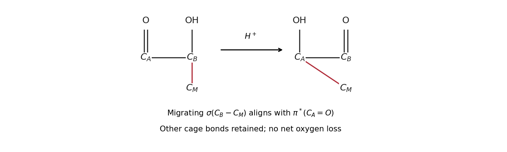

<h1 id="section-g/48/e/solution">Solution</h1>

↑ **Parent:** [E](../e.md)

This is an **acid-catalysed [alpha-ketol rearrangement](../../../../../../alpha-ketol-rearrangement.md)**. Label the original [ketone](../../../../../../ketone.md) [carbon](../../../../../../carbon.md) $C_A$ and the adjacent [tertiary alcohol](../../../../../../tertiary-alcohol.md) [carbon](../../../../../../carbon.md) $C_B$. Protonate the [oxygen](../../../../../../oxygen.md) on $C_A$ to activate that [carbonyl](../../../../../../carbonyl-group.md). The appropriately aligned cage C–C [sigma bond](../../../../../../sigma-bond.md) attached to $C_B$ migrates onto $C_A$, while the hydroxyl [oxygen](../../../../../../oxygen.md) at $C_B$ supplies its lone pair to form the new $C_B=O$ bond. At the same time the old $C_A=O$ [pi bond](../../../../../../pi-bond.md) moves onto [oxygen](../../../../../../oxygen.md), which becomes the new $C_A$–OH. [deprotonation](../../../../../../deprotonation.md) regenerates the acid.

The migration reroutes the bridge rather than removing water: **the original [alcohol](../../../../../../alcohol.md) [carbon](../../../../../../carbon.md) becomes the [ketone](../../../../../../ketone.md), and the original [ketone](../../../../../../ketone.md) [carbon](../../../../../../carbon.md) becomes the [tertiary alcohol](../../../../../../tertiary-alcohol.md)**. A productive conformation aligns the migrating sigma orbital with the accepting [carbonyl](../../../../../../carbonyl-group.md) pi-star orbital; the [oxygen](../../../../../../oxygen.md) lone pair simultaneously overlaps the developing [p orbital](../../../../../../p-orbital.md) at the donor [carbon](../../../../../../carbon.md). The cage's geometry controls which adjacent [sigma bond](../../../../../../sigma-bond.md) has the necessary alignment and which less strained skeletal isomer results. A freely rotating isolated [carbocation](../../../../../../carbocation.md) or a simple proton shift cannot account for the changed cage connectivity.

**[Figure 6](#section-g/48/e/image-original-atom-tracked-alpha-ketol-migration-and-orbital-alignment-model). Original atom-tracked alpha-ketol migration and orbital-alignment model**.

## ↑ Ancestors (14)

1. [E](../e.md)
2. [48](../../48.md)
3. [Section G](../../../section-g.md)
4. [Paper 3](../../../../paper-3-split.md)
5. [2022](../../../../split.md)
6. [Past exam of the chemistry course of the year 4 of the natural sciences course of the University of Cambridge](../../../../../split.md)
7. [Chemistry course of the year 4 of the natural sciences course of the University of Cambridge](../../../../../../chemistry-course-of-the-year-4-of-the-natural-sciences-course-of-the-university-of-cambridge.md)
8. [Year 4 of the natural sciences course of the University of Cambridge](../../../../../../year-4-of-the-natural-sciences-course-of-the-university-of-cambridge.md)
9. [Year of the natural sciences course of the University of Cambridge](../../../../../../year-of-the-natural-sciences-course-of-the-university-of-cambridge.md)
10. [Natural sciences course of the University of Cambridge](../../../../../../natural-sciences-course-of-the-university-of-cambridge.md)
11. [Course of the University of Cambridge](../../../../../../course-of-the-university-of-cambridge.md)
12. [University of Cambridge](../../../../../../university-of-cambridge-split.md)
13. [List of universities](../../../../../../list-of-universities.md)
14. [Codex Wiki](../../../../../../split.md)
