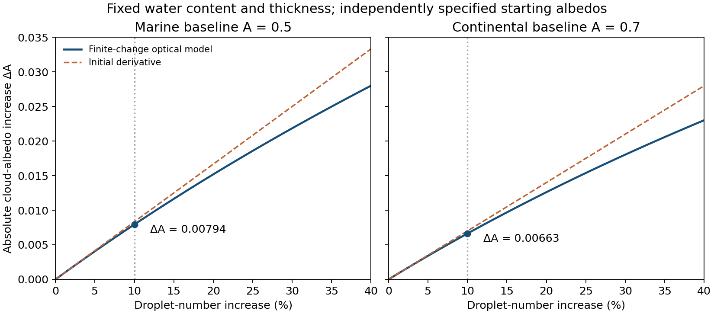

# Interdisciplinary paper IDP1

↑ **Parent:** [2022](../2022.md)

Original paper: [Released original PDF, physical pages 247–252; printed pages 1–6](https://www.whatdotheyknow.com/request/nst_chemistry_past_papers_2022/response/2088679/attach/3/FOI%202022%20476%20Whittaker%20materials.pdf?cookie_passthrough=1#page=247).

**Table of contents**

- [1](#1)
  - [a](#1/a)
    - [i](#1/a/i)
      - [Solution](#1/a/i/solution)
    - [ii](#1/a/ii)
      - [Solution](#1/a/ii/solution)
  - [b](#1/b)
    - [Solution](#1/b/solution)
  - [c](#1/c)
    - [Solution](#1/c/solution)
  - [d](#1/d)
    - [Solution](#1/d/solution)
  - [e](#1/e)
    - [Solution](#1/e/solution)
- [2](#2)
  - [a](#2/a)
    - [Solution](#2/a/solution)
  - [b](#2/b)
    - [Solution](#2/b/solution)
  - [c](#2/c)
    - [Solution](#2/c/solution)
  - [d](#2/d)
    - [i](#2/d/i)
      - [Solution](#2/d/i/solution)
    - [ii](#2/d/ii)
      - [Solution](#2/d/ii/solution)
    - [iii](#2/d/iii)
      - [Solution](#2/d/iii/solution)
  - [e](#2/e)
    - [Solution](#2/e/solution)
- [3](#3)
  - [a](#3/a)
    - [Solution](#3/a/solution)
  - [b](#3/b)
    - [i](#3/b/i)
      - [Solution](#3/b/i/solution)
    - [ii](#3/b/ii)
      - [Solution](#3/b/ii/solution)
    - [iii](#3/b/iii)
      - [Solution](#3/b/iii/solution)
  - [c](#3/c)
    - [Solution](#3/c/solution)
  - [d](#3/d)
    - [i](#3/d/i)
      - [Solution](#3/d/i/solution)
    - [ii](#3/d/ii)
      - [Solution](#3/d/ii/solution)
    - [iii](#3/d/iii)
      - [Solution](#3/d/iii/solution)

## 1

↑ **Parent:** [Interdisciplinary paper IDP1](paper-id.md)

<h3 id="1/a">a</h3>

↑ **Parent:** [1](#1)

<h4 id="1/a/i">i</h4>

↑ **Parent:** [A](#1/a)

<h5 id="1/a/i/solution">Solution</h5>

↑ **Parent:** [I](#1/a/i)

Prefer a replacement that releases little reactive [chlorine](../../chemical-substance.md#chlorine) or [bromine](../../chemical-substance.md#bromine) into the [stratosphere](../../planetary-science.md#stratosphere): ideally omit those elements, or give the parent gas a short [troposphere](../../planetary-science.md#troposphere) removal time compared with transport to the [stratosphere](../../planetary-science.md#stratosphere). A carbon–hydrogen bond can permit rapid attack by the [hydroxyl radical](../../chemistry.md#hydroxyl-radical); other readily oxidized functionality can also shorten the atmospheric residence time. The degradation products must themselves avoid transporting long-lived reactive halogen to altitude. Merely retaining fewer [chlorine](../../chemical-substance.md#chlorine) atoms is less effective than preventing their delivery altogether.

Both [chlorine](../../chemical-substance.md#chlorine) and [bromine](../../chemical-substance.md#bromine) participate in catalytic [ozone](../../chemical-substance.md#ozone) destruction. [Bromine](../../chemical-substance.md#bromine) is much more effective per delivered atom, by a factor of roughly 60 in the usual lower-stratospheric comparison; the precise effectiveness depends on chemical partitioning and location. [Fluorine](../../chemical-substance.md#fluorine) is largely trapped in very stable [hydrogen fluoride](../../electronegativity.md#hydrogen-fluoride) and does not sustain an analogous ozone-destroying cycle. Thus **short-lived gases without [chlorine](../../chemical-substance.md#chlorine) or [bromine](../../chemical-substance.md#bromine) have the smallest direct [ozone-depletion potential](../../chemistry.md#ozone-depletion-potential)**. Fluorination alone does not ensure a small climate impact.[Tropospheric [bromine](../../chemical-substance.md#bromine) and [fluorine](../../chemical-substance.md#fluorine) assessments: per-atom effectiveness and the absence of direct fluorine-driven [ozone](../../chemical-substance.md#ozone) depletion](../../chemistry.md#scientific-assessment-of-ozone-depletion-2022-executive-summary)

<h4 id="1/a/ii">ii</h4>

↑ **Parent:** [A](#1/a)

<h5 id="1/a/ii/solution">Solution</h5>

↑ **Parent:** [Ii](#1/a/ii)

A small [global warming potential](../../exoplanet.md#global-warming-potential) requires both a **small [greenhouse gas radiative efficiency](../../exoplanet.md#greenhouse-gas-radiative-efficiency) per unit emitted [mass](../../classical-mechanics.md#mass) and a short [atmospheric lifetime](../../chemistry.md#atmospheric-lifetime)**. Weak absorption in the terrestrial [atmospheric window](../../optics.md#atmospheric-window) is desirable, particularly where absorption by existing gases is weak; strong carbon–[fluorine](../../chemical-substance.md#fluorine) vibrational bands can make even an ozone-safe substitute an efficient [greenhouse gas](../../exoplanet.md#greenhouse-gas). Rapid removal by lower-atmospheric chemistry limits the integrated burden, provided it does not generate abundant, long-lived radiatively active products. The atmospheric residence time and the absorption spectrum must therefore be assessed separately.

<h3 id="1/b">b</h3>

↑ **Parent:** [1](#1)

<h4 id="1/b/solution">Solution</h4>

↑ **Parent:** [B](#1/b)

In a vertical-beam, effective-wavelength [Beer-Lambert law](../../physical-chemistry.md#beer-lambert-law) approximation, the [optical depth](../../astrophysics.md#optical-depth) above altitude $z$ is $\tau(z)=\sigma_{\mathrm O_2}N_{\mathrm O_2}(z)+\sigma_{\mathrm O_3}N_{\mathrm O_3}(z)$. Using centimetres consistently gives

$$
\tau_{20}=1.50+12.60=14.10,\qquad
\tau_{40}=0.084+0.340=0.424.
$$

The transmitted [photon](../../quantum-mechanics.md#photon) flux is proportional to $e^{-\tau}$. If the parent-gas [absorption cross section](../../quantum-mechanics.md#absorption-cross-section) and [photodissociation](../../chemical-bond.md#photodissociation) yield are otherwise the same, they cancel in the ratio of [photolysis rate coefficients](../../chemical-bond.md#photolysis-rate-coefficient):

$$
\boxed{\frac{J(40\ \mathrm{km})}{J(20\ \mathrm{km})}=e^{\tau_{20}-\tau_{40}}
=e^{13.676}=8.70\times10^5.}
$$

The corresponding fractions of the unattenuated beam are about $7.52\times10^{-7}$ and $0.654$. Strong shielding by the overlying [oxygen](../../chemical-substance.md#oxygen) and especially [ozone](../../chemical-substance.md#ozone) therefore makes destruction vastly faster higher in the [stratosphere](../../planetary-science.md#stratosphere), even though the molecular absorption properties have not changed.

This numerical ratio uses the intended simplified radiation model. A real [photolysis rate coefficient](../../chemical-bond.md#photolysis-rate-coefficient) integrates wavelength-dependent [actinic flux](../../radiometry.md#actinic-flux), [absorption cross section](../../quantum-mechanics.md#absorption-cross-section) and [quantum yield](../../chemical-bond.md#quantum-yield). A nonvertical direct beam would use slant [optical depth](../../astrophysics.md#optical-depth) $\tau/\cos\theta$; diffuse scattering and the true solar spectrum would also matter. The supplied effective cross sections do not specify a unique broadband radiative-transfer calculation.

<h3 id="1/c">c</h3>

↑ **Parent:** [1](#1)

<h4 id="1/c/solution">Solution</h4>

↑ **Parent:** [C](#1/c)

The [global warming potential](../../exoplanet.md#global-warming-potential) compares equal-mass pulses, while the tabulated [greenhouse gas radiative efficiencies](../../exoplanet.md#greenhouse-gas-radiative-efficiency) are per ppb. For a fixed emitted [mass](../../classical-mechanics.md#mass), the initial [mixing ratio](../../chemistry.md#atmospheric-mixing-ratio) is inversely proportional to [molar mass](../../chemistry.md#molar-mass). The molecular formulas give approximately $M_r=151.39\ \mathrm{g\,mol^{-1}}$ for $\mathrm{C_2H_2Cl_3F}$ and $M_{11}=137.36\ \mathrm{g\,mol^{-1}}$ for $\mathrm{CCl_3F}$. Thus the ratio of mass-based [greenhouse gas radiative efficiencies](../../exoplanet.md#greenhouse-gas-radiative-efficiency) is $(0.24/0.26)(M_{11}/M_r)$.

In the standard one-box interpretation, the two quoted removal times represent independent first-order sinks acting on the burden. Their rates add, giving

$$
\tau_r^{-1}=\tau_{\rm trop}^{-1}+\tau_{\rm strat}^{-1},\qquad
\tau_r=\left(\frac1{0.75}+\frac1{20}\right)^{-1}=0.72289\ \mathrm{yr}.
$$

For exponential pulse removal, the time-integrated abundance is proportional to $\tau(1-e^{-H/\tau})$. Dividing the replacement's forcing integral by the CFC-11 integral cancels the unknown carbon-dioxide reference integral:

$$
\begin{aligned}
\mathrm{GWP}_{100,r}
&=5160\frac{0.24}{0.26}\frac{137.36}{151.39}
\frac{0.72289(1-e^{-100/0.72289})}{55(1-e^{-100/55})}\\
&\boxed{\simeq67.8\simeq68.}
\end{aligned}
$$

The finite-horizon factor for CFC-11 is important: $1-e^{-100/55}=0.8377$, not one. Omitting the molar-mass correction would incorrectly compare equal-ppb rather than equal-mass pulses.

This is about 76 times smaller than the stated CFC-11 value, because rapid tropospheric removal outweighs the fairly similar per-ppb [greenhouse gas radiative efficiencies](../../exoplanet.md#greenhouse-gas-radiative-efficiency). It still represents appreciable warming per emitted [mass](../../classical-mechanics.md#mass). If the shorter lifetime alone is used as the troposphere-dominated approximation, the result is $\mathrm{GWP}_{100}\simeq70.4$, close to the combined-rate result. If the two given lifetimes instead describe separate local compartments, an exact two-box calculation would also require exchange rates and burden partitioning; those are not supplied. The boxed result states the usual one-box assumption explicitly.

<h3 id="1/d">d</h3>

↑ **Parent:** [1](#1)

<h4 id="1/d/solution">Solution</h4>

↑ **Parent:** [D](#1/d)

**TODO: user-deferred biological component.** Biological carbon uptake, storage and release are outside the current scope. The physical and ocean-chemistry explanation is given here; the deferred component means this is not a complete all-process answer.

There is no single first-order [atmospheric lifetime](../../chemistry.md#atmospheric-lifetime) for an added [carbon dioxide](../../chemical-substance.md#carbon-dioxide) pulse. Air–sea gas exchange and adjustment of the surface mixed layer act on years-to-decades scales; redistribution into the ocean interior takes centuries to millennia. These transfers partition carbon between atmosphere and ocean rather than making the entire added carbon inventory disappear. Dissolution also changes the ocean's carbonate speciation: conversion among dissolved [carbon dioxide](../../chemical-substance.md#carbon-dioxide), bicarbonate and carbonate buffers the uptake, but provides a finite capacity at a given alkalinity. A substantial perturbation therefore remains airborne after the faster exchanges have adjusted.

Further removal involves dissolution of carbonate sediments and [carbonate compensation](../../chemical-potential.md#carbonate-compensation) over several thousand years, followed by the much slower silicate-weathering and burial pathway, typically tens to hundreds of thousands of years. The exact fractions and times depend on pulse size and model conditions. **A thousand years exceeds the fast exchange times but not the complete ocean–solid-Earth adjustment time**, so a residual atmospheric perturbation is expected. An intercomparison found a substantial long tail after ocean equilibration, with further carbonate neutralization on roughly 3–7 kyr scales.[Table 1 (p. 119), physical ocean/solid-Earth adjustment discussion and conclusions (p. 131)](../../chemistry.md#atmospheric-lifetime-of-fossil-fuel-carbon-dioxide-by-david-archer-and-others)

<h3 id="1/e">e</h3>

↑ **Parent:** [1](#1)

<h4 id="1/e/solution">Solution</h4>

↑ **Parent:** [E](#1/e)

For a gas whose lifetime is much less than the selected horizon, the numerator of its [global warming potential](../../exoplanet.md#global-warming-potential) has nearly saturated: $\int_0^H a_i m_i(t)\,dt\simeq a_i m_i(0)\tau_i$. The carbon-dioxide denominator continues to accumulate because of its long-lived response. Consequently **a shorter horizon usually gives a larger GWP for this short-lived substitute; a longer horizon gives a smaller GWP**. If the horizon becomes comparable to, or shorter than, the substitute's lifetime, the numerator also depends strongly on the horizon and cannot be replaced by its infinite-time limit.

The horizon is a value choice, and integrated forcing is not the same as [temperature](../../temperature.md) at a chosen future date. Equal-GWP pulses can therefore have different near-term warming and long-term [temperature](../../temperature.md) paths. The result also depends on [greenhouse gas radiative efficiency](../../exoplanet.md#greenhouse-gas-radiative-efficiency), background [concentrations](../../mathematical-physics.md#concentration), lifetime estimates and which indirect chemical effects or feedbacks are included. A pulse-based metric does not by itself describe a continuing emissions trajectory, nor does it measure [ozone](../../chemical-substance.md#ozone) depletion or local air-pollution impacts. Comparisons should state the horizon, the emission scenario and the chosen climate outcome.[IPCC AR6 Working Group I, Chapter 7, section 7.6.1: physical emissions metrics and time-horizon dependence](../../chemistry.md#the-earth-s-energy-budget-climate-feedbacks-and-climate-sensitivity-by-piers-forster-and-others)

## 2

↑ **Parent:** [Interdisciplinary paper IDP1](paper-id.md)

<h3 id="2/a">a</h3>

↑ **Parent:** [2](#2)

<h4 id="2/a/solution">Solution</h4>

↑ **Parent:** [A](#2/a)

Take a fixed amount of dry air, with no phase change, moving quasistatically so that its [pressure](../../pressure.md) matches the surrounding atmosphere. From the [first law of thermodynamics](../../first-law-of-thermodynamics.md) and $H=U+pV$,

$$
dH=dU+p\,dV+V\,dp=dq+V\,dp.
$$

For adiabatic motion $dq=0$. Treating the parcel as an [ideal gas](../../ideal-gas.md) of fixed composition makes its [enthalpy](../../enthalpy.md) depend only on [temperature](../../temperature.md), so for $n$ moles $dH=nC_p\,dT$ even though the [pressure](../../pressure.md) changes. Hence $nC_p\,dT=V\,dp$. The environment is in [hydrostatic equilibrium](../../statistical-physics.md#hydrostatic-equilibrium), $dp/dz=-\rho g$, and the parcel is taken to have the ambient density at the displacement point. Using $\rho=nM/V$ gives

$$
nC_p\frac{dT}{dz}=V\frac{dp}{dz}=-nMg,
\qquad\boxed{\frac{dT}{dz}=-\frac{Mg}{C_p}=-\frac{g}{c_p}.}
$$

Here $C_p$ is molar and $c_p=C_p/M$ is mass-specific [heat capacity](../../heat.md#heat-capacity). Positive $z$ points upward; the commonly quoted positive [dry adiabatic lapse rate](../../exoplanet.md#dry-adiabatic-lapse-rate) is $\Gamma_d=-dT/dz$. Approximate constancy of $g$ and [heat capacity](../../heat.md#heat-capacity) gives a constant gradient. Condensation, external heating, [entrainment](../../fluid-mechanics.md#fluid-entrainment) or composition changes invalidate this dry-parcel relation.

<h3 id="2/b">b</h3>

↑ **Parent:** [2](#2)

<h4 id="2/b/solution">Solution</h4>

↑ **Parent:** [B](#2/b)

Convert the [molar mass](../../chemistry.md#molar-mass) to $0.0288\ \mathrm{kg\,mol^{-1}}$ before substitution:

$$
\boxed{\frac{dT}{dz}=-\frac{(0.0288)(9.81)}{29}
=-9.742\times10^{-3}\ \mathrm{K\,m^{-1}}
\simeq-9.74\ \mathrm{K\,km^{-1}}.}
$$

The often-used environmental value near $-6.5\ \mathrm{K\,km^{-1}}$ is less steep because rising moist air can condense [water vapor](../../chemical-substance.md#water-vapor), releasing [latent heat](../../thermodynamic-potential.md#latent-heat) and offsetting some expansion cooling. A saturated parcel therefore follows a smaller-magnitude [moist adiabatic lapse rate](../../exoplanet.md#moist-adiabatic-lapse-rate), which varies with [temperature](../../temperature.md), [pressure](../../pressure.md) and [water](../../chemical-substance.md#water) content. Real environmental profiles also reflect radiation, mixing and weather systems; $6.5\ \mathrm{K\,km^{-1}}$ is a representative profile value, not a universal parcel law.

<h3 id="2/c">c</h3>

↑ **Parent:** [2](#2)

<h4 id="2/c/solution">Solution</h4>

↑ **Parent:** [C](#2/c)

Much stratospheric heating is supplied by absorption of solar [ultraviolet](../../optics.md#ultraviolet) radiation by [oxygen](../../chemical-substance.md#oxygen) and [ozone](../../chemical-substance.md#ozone), whereas [carbon dioxide](../../chemical-substance.md#carbon-dioxide) is an important emitter of thermal infrared radiation. In the usual stratospheric balance, increasing [carbon dioxide](../../chemical-substance.md#carbon-dioxide) enhances net infrared cooling at the original [temperature](../../temperature.md) without supplying a matching increase in the solar heating. [Temperature](../../temperature.md) must fall until infrared emission and absorption again balance the heating.

A useful optically thin schematic is $Q_{\rm solar}=c_{\rm CO_2}K[B(T)-\overline J]$, where $B(T)$ represents the relevant thermal source function and $\overline J$ the incident infrared radiation field. With positive fixed solar heating and an approximately fixed radiation field, increasing $c_{\rm CO_2}$ lowers the required $B(T)-\overline J$, hence lowers $T$. This explains why the surface greenhouse argument cannot simply be applied locally to the [stratosphere](../../planetary-science.md#stratosphere). Spectral blocking of upwelling radiation contributes too; the real response depends on altitude, [ozone](../../chemical-substance.md#ozone) heating and [radiative transfer](../../astrophysics.md#radiative-transfer), rather than emissivity alone.[Earth System Dynamics 7 (2016), abstract and sections on the blocking and indirect solar effects](../../chemistry.md#why-co2-cools-the-middle-atmosphere-a-consolidating-model-perspective-by-helge-f-goessling-and-sebastian-bathiany)

<h3 id="2/d">d</h3>

↑ **Parent:** [2](#2)

<h4 id="2/d/i">i</h4>

↑ **Parent:** [D](#2/d)

<h5 id="2/d/i/solution">Solution</h5>

↑ **Parent:** [I](#2/d/i)

Put $X=[\mathrm O_3]$ and $u=T^{-1}$. The fast [oxygen](../../chemical-substance.md#oxygen)–[ozone](../../chemical-substance.md#ozone) partition obeys

$$
k_4[\mathrm O][\mathrm O_2][\mathrm M]=J_5X,
\qquad [\mathrm O]=\frac{J_5X}{k_4[\mathrm O_2][\mathrm M]}.
$$

Dividing the production–loss balance by two and substituting gives

$$
P=AX^2+BX,\qquad
P=J_1[\mathrm O_2],\quad
A=\frac{k_2J_5}{k_4[\mathrm O_2][\mathrm M]},\quad
B=k_3[\mathrm{NO}].
$$

Under the specified restriction, all [temperature](../../temperature.md) dependence lies in the three rate coefficients: hold the [photodissociation](../../chemical-bond.md#photodissociation) rates and the [concentrations](../../mathematical-physics.md#concentration) of $\mathrm O_2$, $\mathrm M$ and NO fixed. Then $d\ln A/du=-2100-510=-2610\ \mathrm K$ and $d\ln B/du=-1200\ \mathrm K$. Defining $Y=d\ln X/du$, differentiation yields

$$
0=AX^2(-2610+2Y)+BX(-1200+Y).
$$

Therefore

$$
\boxed{\frac{d\ln[\mathrm O_3]}{d(T^{-1})}
=\frac{2610L_C+1200L_N}{2L_C+L_N},\qquad
L_C=k_2[\mathrm O][\mathrm O_3],\quad L_N=k_3[\mathrm{NO}][\mathrm O_3].}
$$

The factor two in the denominator multiplying $L_C$ comes from the additional dependence $[\mathrm O]\propto X/k_4$; ignoring that dependence would give the wrong sensitivity. This derivative has units of kelvin.

<h4 id="2/d/ii">ii</h4>

↑ **Parent:** [D](#2/d)

<h5 id="2/d/ii/solution">Solution</h5>

↑ **Parent:** [Ii](#2/d/ii)

Using the stated loss ratio $L_N=3L_C$ in the derived logarithmic sensitivity gives

$$
\boxed{\frac{d\ln[\mathrm O_3]}{d(T^{-1})}
=\frac{2610+3(1200)}{2+3}=1242\ \mathrm K.}
$$

The positive sign means that cooling, which increases $T^{-1}$, increases the steady [ozone](../../chemical-substance.md#ozone) [concentration](../../mathematical-physics.md#concentration) within this restricted middle-stratosphere model.

<h4 id="2/d/iii">iii</h4>

↑ **Parent:** [D](#2/d)

<h5 id="2/d/iii/solution">Solution</h5>

↑ **Parent:** [Iii](#2/d/iii)

The change in inverse [temperature](../../temperature.md) is $\Delta u=1/290-1/300=1.14943\times10^{-4}\ \mathrm{K^{-1}}$. Treating the sensitivity as approximately constant over the interval,

$$
\Delta\ln[\mathrm O_3]\simeq1242\Delta u=0.142759,
\qquad
\boxed{\frac{[\mathrm O_3]_{290}}{[\mathrm O_3]_{300}}
\simeq e^{0.142759}=1.15345.}
$$

Thus the predicted [concentration](../../mathematical-physics.md#concentration) increases by **about 15.3%**. Linearizing the exponential gives a rougher 14.3% estimate; a logarithmic change is not itself the exact fractional change.

An independent finite-change calculation checks this approximation without keeping the loss ratio artificially fixed. Normalize the initial Chapman and nitrogen-cycle loss terms to 1 and 3, so the initial production is 4. If $r=X_{290}/X_{300}$, the new steady balance is $e^{-2610\Delta u}r^2+3e^{-1200\Delta u}r=4$. Its positive root is $r=1.15342$, essentially the same result.

<h3 id="2/e">e</h3>

↑ **Parent:** [2](#2)

<h4 id="2/e/solution">Solution</h4>

↑ **Parent:** [E](#2/e)

Lower winter temperatures favour formation and persistence of [polar stratospheric clouds](../../planetary-science.md#polar-stratospheric-cloud), providing particle surfaces on which reservoir [chlorine](../../chemical-substance.md#chlorine) can be activated, for example

$$
\mathrm{HCl+ClONO_2\longrightarrow Cl_2+HNO_3},\qquad
\mathrm{HCl+HOCl\longrightarrow Cl_2+H_2O}.
$$

These are heterogeneous surface processes; cooling changes particle abundance, adsorption, phase and reaction uptake, so a simple gas-phase Arrhenius argument is insufficient. Removal of [nitric acid](../../chemical-substance.md#nitric-acid) in sedimenting particles can also delay conversion of active [chlorine](../../chemical-substance.md#chlorine) back into [chlorine nitrate](../../chemistry.md#chlorine-nitrate). The relevant condensation thresholds depend on [pressure](../../pressure.md) and [water](../../chemical-substance.md#water)/nitric-acid abundances, rather than a single universal [temperature](../../temperature.md).

Once sunlight is present, $\mathrm{Cl_2+h\nu\to2Cl}$ provides active [chlorine](../../chemical-substance.md#chlorine). In the [chlorine monoxide dimer cycle](../../chemistry.md#chlorine-monoxide-dimer-cycle),

$$
\begin{aligned}
2(\mathrm{Cl+O_3}&\mathrm{\longrightarrow ClO+O_2}),\\
\mathrm{ClO+ClO+M}&\mathrm{\rightleftharpoons ClOOCl+M},\\
\mathrm{ClOOCl}+h\nu&\mathrm{\longrightarrow Cl+ClOO},\\
\mathrm{ClOO+M}&\mathrm{\longrightarrow Cl+O_2+M}.
\end{aligned}
$$

The net reaction is $\mathrm{2O_3\to3O_2}$, with [chlorine](../../chemical-substance.md#chlorine) regenerated. Low [temperature](../../temperature.md) favours formation of the [ClOOCl dimer](../../chemistry.md#cloocl-dimer) and suppresses its [thermal dissociation](../../chemical-reaction.md#thermal-dissociation), making [photodissociation](../../chemical-bond.md#photodissociation) rather than thermal return of two ClO radicals more competitive. Laboratory flow experiments formed the dimer at 220–240 K and distinguished its infrared and [ultraviolet](../../optics.md#ultraviolet) signatures, supporting the chemical identity needed for this mechanism.[Journal of Physical Chemistry 91 (1987), pp. 433–436; NASA record 19870061046, flow-system generation and spectral identification](../../chemistry.md#production-of-chlorine-oxide-cl2o2-from-the-self-reaction-of-the-chlorine-oxide-clo-radical-by-l-t-molina-and-m-j-molina)

**Colder polar conditions can prepare and sustain greater springtime [ozone](../../chemical-substance.md#ozone) loss, but darkness alone does not drive the photolytic cycle.** In polar night reactive precursors can accumulate; sunlight is required for rapid dimer-cycle [ozone](../../chemical-substance.md#ozone) destruction. This differs from the middle-stratospheric gas-phase cooling response derived above.[Polar [ozone](../../chemical-substance.md#ozone) depletion discussion: low temperatures, heterogeneous activation and sunlight-dependent chemistry](../../chemistry.md#scientific-assessment-of-ozone-depletion-2022-executive-summary)

## 3

↑ **Parent:** [Interdisciplinary paper IDP1](paper-id.md)

<h3 id="3/a">a</h3>

↑ **Parent:** [3](#3)

<h4 id="3/a/solution">Solution</h4>

↑ **Parent:** [A](#3/a)

[Photodissociation](../../chemical-bond.md#photodissociation) of [nitrogen dioxide](../../chemistry.md#nitrogen-dioxide) forms an [oxygen](../../chemical-substance.md#oxygen) atom, followed by [third-body recombination](../../chemical-kinetics.md#third-body-recombination):

$$
\mathrm{NO_2+h\nu\to NO+O},\qquad
\mathrm{O+O_2+M\to O_3+M}.
$$

If NO is converted back to [nitrogen dioxide](../../chemistry.md#nitrogen-dioxide) only by $\mathrm{NO+O_3\to NO_2+O_2}$, this is a null cycle with no net [ozone](../../chemical-substance.md#ozone) production. Oxidation of a [volatile organic compound](../../chemistry.md#volatile-organic-compound) by OH generates organic [peroxy radicals](../../chemistry.md#peroxy-radical), and often [hydroperoxyl radicals](../../chemistry.md#hydroperoxyl-radical), which instead oxidize NO without consuming [ozone](../../chemical-substance.md#ozone):

$$
\mathrm{RO_2+NO\to RO+NO_2},\qquad
\mathrm{HO_2+NO\to OH+NO_2}.
$$

The newly formed [nitrogen dioxide](../../chemistry.md#nitrogen-dioxide) can then photolyse, giving net [ozone](../../chemical-substance.md#ozone) production. These chain reactions require sunlight, radical production and both precursor families.

In an [NOx-limited ozone-production regime](../../chemical-substance.md#nox-limited-ozone-production-regime), NO is too scarce for efficient peroxy-radical conversion; competing peroxide-forming radical termination becomes important. Reducing nitrogen-oxide emissions then reduces [ozone](../../chemical-substance.md#ozone) production. In a [VOC-limited ozone-production regime](../../chemical-substance.md#voc-limited-ozone-production-regime), plentiful [nitrogen oxides](../../chemistry.md#nitrogen-oxides) remove OH through $\mathrm{OH+NO_2+M\to HNO_3+M}$, so organic oxidation and radical supply are limiting. Reducing volatile-organic emissions is effective there, while a modest nitrogen-oxide reduction can initially increase [ozone](../../chemical-substance.md#ozone) by reducing radical termination and NO titration. Sufficiently large nitrogen-oxide reductions can move the system into the limited regime and eventually lower [ozone](../../chemical-substance.md#ozone). The appropriate control therefore depends on the chemical regime and the regional transport history, not merely the largest local emission. The [ozone isopleth diagram](../../chemical-substance.md#ozone-isopleth-diagram) below uses an explicitly schematic response function to show derivative signs, not a fitted [concentration](../../mathematical-physics.md#concentration) or emissions-control prediction.[Journal of Geophysical Research 95 (1990), pp. 1837–1851, model comparison of rural and urban precursor sensitivity](../../chemistry.md#the-sensitivity-of-ozone-to-nitrogen-oxides-and-hydrocarbons-in-regional-ozone-episodes-by-sanford-sillman-and-others)

**[Figure 1](#3/a/image-original-schematic-showing-opposite-local-ozone-responses-to-nitrogen-oxide-controls-in-two-chemical-regimes). Original schematic showing opposite local ozone responses to nitrogen-oxide controls in two chemical regimes**.

<h3 id="3/b">b</h3>

↑ **Parent:** [3](#3)

<h4 id="3/b/i">i</h4>

↑ **Parent:** [B](#3/b)

<h5 id="3/b/i/solution">Solution</h5>

↑ **Parent:** [I](#3/b/i)

The profile shows a low-ozone mixed layer up to approximately **2 km**, with roughly **30 ppb [ozone](../../chemical-substance.md#ozone)**, and an overlying free-tropospheric value of roughly **50 ppb**. The rise occurs through a transition layer extending to about 2.8 km, so these are approximate regime readings, not exact values for every altitude. The horizontal axis is already a [mixing ratio](../../chemistry.md#atmospheric-mixing-ratio); it does not provide a [number density](../../statistical-physics.md#number-density) without additional air-density information.

<h4 id="3/b/ii">ii</h4>

↑ **Parent:** [B](#3/b)

<h5 id="3/b/ii/solution">Solution</h5>

↑ **Parent:** [Ii](#3/b/ii)

Excited $\mathrm O({}^1D)$ has two competing fates. Collisional deactivation returns ground-state [oxygen](../../chemical-substance.md#oxygen), which reforms [ozone](../../chemical-substance.md#ozone) rapidly; reaction with [water](../../chemical-substance.md#water) instead gives net [ozone](../../chemical-substance.md#ozone) loss and two OH radicals. The [chemical branching fraction](../../chemical-kinetics.md#chemical-branching-fraction) for the latter is

$$
f_w=\frac{k_3[\mathrm{H_2O}]}{k_2[\mathrm M]+k_3[\mathrm{H_2O}]}
=\frac{3.30\times10^7}{6.38\times10^8+3.30\times10^7}
=0.0491803.
$$

Thus only about 4.92% of these [ozone](../../chemical-substance.md#ozone) photolyses directly lead to the specified net chemical loss; treating every [photodissociation](../../chemical-bond.md#photodissociation) as permanent removal would overestimate the sink. The corresponding first-order rate is $J_1f_w=9.8361\times10^{-7}\ \mathrm{s^{-1}}$. Converting the given hydroperoxyl [mixing ratio](../../chemistry.md#atmospheric-mixing-ratio) to a [concentration](../../mathematical-physics.md#concentration) gives $[\mathrm{HO_2}]=20\times10^{-12}[\mathrm M]=4.4\times10^8\ \mathrm{cm^{-3}}$, so $k_4[\mathrm{HO_2}]=9.6800\times10^{-7}\ \mathrm{s^{-1}}$.

For a well-mixed [marine atmospheric boundary layer](../../planetary-science.md#marine-atmospheric-boundary-layer) of depth $H=2\times10^5\ \mathrm{cm}$, the downward surface flux is $v_{\rm dep}[\mathrm O_3]$. Dividing by the layer [volume](../../geometry-and-topology.md#volume) per unit area gives a first-order [dry deposition](../../chemistry.md#dry-deposition) rate $v_{\rm dep}/H=7.5\times10^{-7}\ \mathrm{s^{-1}}$. The air density cancels on expressing the entire balance in [ozone](../../chemical-substance.md#ozone) [mixing ratio](../../chemistry.md#atmospheric-mixing-ratio) $\chi$:

$$
\frac{d\chi}{dt}=P_\chi-\left(J_1f_w+k_4[\mathrm{HO_2}]+\frac{v_{\rm dep}}H\right)\chi.
$$

At [steady state](../../chemistry.md#steady-state-chemistry), with $P_\chi=0.25/3600\ \mathrm{ppb\,s^{-1}}$,

$$
\boxed{\chi_{\mathrm O_3}=\frac{0.25/3600}{2.70161\times10^{-6}}
=25.7\ \mathrm{ppb}.}
$$

The effective removal time is about 4.28 days. This calculation assumes a uniform layer of the diagnosed depth, fixed chemical conditions and a local time-independent balance.

<h4 id="3/b/iii">iii</h4>

↑ **Parent:** [B](#3/b)

<h5 id="3/b/iii/solution">Solution</h5>

↑ **Parent:** [Iii](#3/b/iii)

The observed value is about 4 ppb higher than the local chemical–[dry deposition](../../chemistry.md#dry-deposition) balance predicts. [Entrainment](../../fluid-mechanics.md#fluid-entrainment) from the ozone-richer [free troposphere](../../planetary-science.md#free-troposphere) adds a term $(w_e/H)(\chi_{\rm FT}-\chi_{\rm BL})$; horizontal [Advection](../../fluid-mechanics.md#advection) can likewise import [ozone](../../chemical-substance.md#ozone) or longer-lived precursors from other regions. Time dependence, including the day–night cycle of [photodissociation](../../chemical-bond.md#photodissociation) and changes in mixing depth, is also omitted. The approximately four-day model adjustment time means that air arriving at the measurement location need not have attained the assumed local [steady state](../../chemistry.md#steady-state-chemistry). These transport and history terms can raise [ozone](../../chemical-substance.md#ozone) without changing the given local chemical constants.

<h3 id="3/c">c</h3>

↑ **Parent:** [3](#3)

<h4 id="3/c/solution">Solution</h4>

↑ **Parent:** [C](#3/c)

For a liquid [cloud](../../geophysics.md#cloud) at fixed [water](../../chemical-substance.md#water) content and geometrical thickness, more [cloud condensation nuclei](../../chemistry.md#cloud-condensation-nucleus) can produce more, smaller droplets. The increased total extinction area raises [optical depth](../../astrophysics.md#optical-depth) and reflected sunlight: the [Twomey effect](../../chemistry.md#twomey-effect) gives **negative shortwave [radiative forcing](../../geophysics.md#radiative-forcing)**. It is an indirect [aerosol](../../chemistry.md#aerosol) effect mediated by [cloud](../../geophysics.md#cloud) microphysics, rather than direct [aerosol](../../chemistry.md#aerosol) scattering.[Journal of the Atmospheric Sciences 34 (1977), pp. 1149–1152, fixed-water-content droplet-number and reflectance effect](../../chemistry.md#the-influence-of-pollution-on-the-shortwave-albedo-of-clouds-by-s-twomey)

Smaller droplets can also delay [collision-coalescence](../../geophysics.md#collision-coalescence) and drizzle, potentially increasing liquid-water retention, [cloud](../../geophysics.md#cloud) lifetime or coverage; that adjustment would usually strengthen cooling for low reflective [clouds](../../geophysics.md#cloud). It is not universal: evaporation and mixing with dry air can reduce [water](../../chemical-substance.md#water) content or [cloud](../../geophysics.md#cloud) cover, and dynamical changes can oppose the simple lifetime argument. Absorbing particles can heat an atmospheric layer, sometimes evaporating [cloud](../../geophysics.md#cloud) and producing a positive semi-direct forcing, but their vertical position can instead stabilize a [cloud](../../geophysics.md#cloud) layer and reverse the response. [Aerosols](../../chemistry.md#aerosol) can additionally alter ice nucleation and mixed-phase precipitation, with no single forcing sign independent of [cloud](../../geophysics.md#cloud) type. The net response combines shortwave reflection and longwave thermal effects, and depends on [cloud](../../geophysics.md#cloud) height, [optical depth](../../astrophysics.md#optical-depth) and adjustments. Thus **the fixed-water Twomey sign is robust within its assumptions; adjustment and ice-cloud signs require context**.[IPCC AR6 Working Group I, Chapter 7, [aerosol](../../chemistry.md#aerosol)–[cloud](../../geophysics.md#cloud) forcing and cloud-adjustment assessment](../../chemistry.md#the-earth-s-energy-budget-climate-feedbacks-and-climate-sensitivity-by-piers-forster-and-others)

<h3 id="3/d">d</h3>

↑ **Parent:** [3](#3)

<h4 id="3/d/i">i</h4>

↑ **Parent:** [D](#3/d)

<h5 id="3/d/i/solution">Solution</h5>

↑ **Parent:** [I](#3/d/i)

Hold liquid-water content and [cloud](../../geophysics.md#cloud) thickness fixed, as required for a partial sensitivity to droplet number. Then $\tau=K N_d^{1/3}$, so $d\tau/dN_d=\tau/(3N_d)$. Differentiating the [albedo](../../geophysics.md#albedo) relation gives $dA/d\tau=7/(\tau+7)^2$, hence

$$
\frac{dA}{dN_d}=\frac{7\tau}{3N_d(\tau+7)^2}.
$$

Since $A=\tau/(\tau+7)$ and $1-A=7/(\tau+7)$,

$$
\boxed{\frac{dA}{dN_d}=\frac{A(1-A)}{3N_d}.}
$$

The factor $A(1-A)$ peaks at $A=1/2$, so the [albedo](../../geophysics.md#albedo) response to a fixed fractional droplet-number change is greatest at intermediate [albedo](../../geophysics.md#albedo) and weaker near either saturation limit.

<h4 id="3/d/ii">ii</h4>

↑ **Parent:** [D](#3/d)

<h5 id="3/d/ii/solution">Solution</h5>

↑ **Parent:** [Ii](#3/d/ii)

For a small fractional change $\epsilon=\Delta N_d/N_d$, use $\Delta A\simeq A(1-A)\epsilon/3$. With $\epsilon=0.1$ the changes are

$$
\boxed{\Delta A_{\rm marine}\simeq0.00833,\qquad
\Delta A_{\rm continental}\simeq0.00700.}
$$

Thus the respective albedos become approximately **0.5083 and 0.7070** in the first-order calculation. These are increases of 0.83 and 0.70 percentage points, not 0.83% and 0.70% relative changes. Relative to the initial albedos, the increases are about 1.67% and 1.00%.

The exact finite-change version of the stipulated optical model is $A'=sA/(1-A+sA)$ with $s=(1.1)^{1/3}$, giving $A'_{\rm marine}=0.50794$ and $A'_{\rm continental}=0.70663$. Its slightly smaller changes are consistent with curvature neglected in the differential approximation. For equal fractional number increases, the cleaner, intermediate-albedo marine [cloud](../../geophysics.md#cloud) is somewhat more susceptible; for equal absolute number increases its susceptibility would be much greater because of the extra $1/N_d$ factor. The two starting albedos are treated as the supplied separate baselines, not as an exact common-proportionality calibration of the approximate optical-depth law.

**[Figure 2](#3/d/ii/image-original-finite-change-and-tangent-predictions-for-the-two-specified-cloud-albedo-baselines). Original finite-change and tangent predictions for the two specified cloud-albedo baselines**.

<h4 id="3/d/iii">iii</h4>

↑ **Parent:** [D](#3/d)

<h5 id="3/d/iii/solution">Solution</h5>

↑ **Parent:** [Iii](#3/d/iii)

Activation as a [cloud condensation nucleus](../../chemistry.md#cloud-condensation-nucleus) depends primarily on dry particle size, soluble composition and hygroscopicity, together with wetting and surface-tension effects. In [Köhler theory](../../chemistry.md#kohler-theory), droplet curvature raises the equilibrium [vapor pressure](../../thermodynamic-potential.md#vapor-pressure), while dissolved solute lowers [water](../../chemical-substance.md#water) activity. Each particle therefore has a [critical supersaturation](../../chemistry.md#critical-supersaturation); larger or more hygroscopic particles generally activate at a lower value. A size distribution cannot be replaced by an undifferentiated total [aerosol](../../chemistry.md#aerosol) count.[Atmospheric Chemistry and Physics 7 (2007), pp. 1961–1971, dry diameter, hygroscopicity parameter and [critical supersaturation](../../chemistry.md#critical-supersaturation)](../../chemistry.md#a-single-parameter-representation-of-hygroscopic-growth-and-cloud-condensation-nucleus-activity-by-m-d-petters-and-s-m-kreidenweis)

Actual droplet number also depends on the supersaturation attained in the [cloud](../../geophysics.md#cloud) updraught. Adding particles increases competition for condensing [water vapor](../../chemical-substance.md#water-vapor) and can lower the peak supersaturation, leaving some particles unactivated. Updraught speed, [entrainment](../../fluid-mechanics.md#fluid-entrainment) and the [aerosol](../../chemistry.md#aerosol) size distribution therefore make the number of activated droplets a nonlinear function of the available nuclei. **Suitable nuclei need sufficiently low activation thresholds, and additional [aerosol](../../chemistry.md#aerosol) does not guarantee one additional droplet per particle.**

## ↑ Ancestors (10)

1. [2022](../2022.md)
2. [Past exam of the chemistry course of the year 4 of the natural sciences course of the University of Cambridge](../../past-exam-of-the-chemistry-course-of-the-year-4-of-the-natural-sciences-course-of-the-university-of-cambridge.md)
3. [Chemistry course of the year 4 of the natural sciences course of the University of Cambridge](../../university-of-cambridge.md#chemistry-course-of-the-year-4-of-the-natural-sciences-course-of-the-university-of-cambridge)
4. [Year 4 of the natural sciences course of the University of Cambridge](../../university-of-cambridge.md#year-4-of-the-natural-sciences-course-of-the-university-of-cambridge)
5. [Year of the natural sciences course of the University of Cambridge](../../university-of-cambridge.md#year-of-the-natural-sciences-course-of-the-university-of-cambridge)
6. [Natural sciences course of the University of Cambridge](../../university-of-cambridge.md#natural-sciences-course-of-the-university-of-cambridge)
7. [Course of the University of Cambridge](../../university-of-cambridge.md#course-of-the-university-of-cambridge)
8. [University of Cambridge](../../university-of-cambridge.md)
9. [List of universities](../../README.md#list-of-universities)
10. [Codex Wiki](../../README.md)
