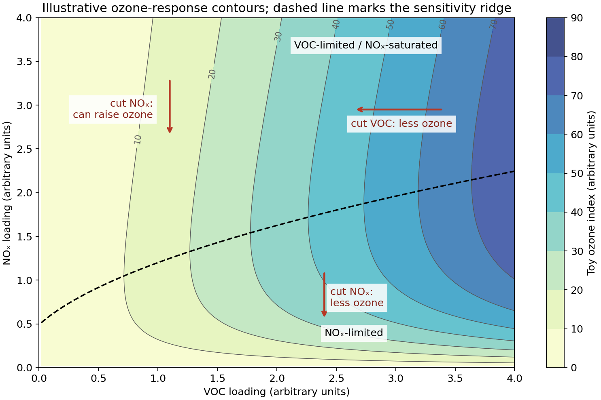

<h1 id="3/a/solution">Solution</h1>

↑ **Parent:** [A](../a.md)

[Photodissociation](../../../../../photodissociation.md) of [nitrogen dioxide](../../../../../nitrogen-dioxide.md) forms an [oxygen](../../../../../oxygen.md) atom, followed by [third-body recombination](../../../../../third-body-recombination.md):

$$
\mathrm{NO_2+h\nu\to NO+O},\qquad
\mathrm{O+O_2+M\to O_3+M}.
$$

If NO is converted back to [nitrogen dioxide](../../../../../nitrogen-dioxide.md) only by $\mathrm{NO+O_3\to NO_2+O_2}$, this is a null cycle with no net [ozone](../../../../../ozone.md) production. Oxidation of a [volatile organic compound](../../../../../volatile-organic-compound.md) by OH generates organic [peroxy radicals](../../../../../peroxy-radical.md), and often [hydroperoxyl radicals](../../../../../hydroperoxyl-radical.md), which instead oxidize NO without consuming [ozone](../../../../../ozone.md):

$$
\mathrm{RO_2+NO\to RO+NO_2},\qquad
\mathrm{HO_2+NO\to OH+NO_2}.
$$

The newly formed [nitrogen dioxide](../../../../../nitrogen-dioxide.md) can then photolyse, giving net [ozone](../../../../../ozone.md) production. These chain reactions require sunlight, radical production and both precursor families.

In an [NOx-limited ozone-production regime](../../../../../nox-limited-ozone-production-regime.md), NO is too scarce for efficient peroxy-radical conversion; competing peroxide-forming radical termination becomes important. Reducing nitrogen-oxide emissions then reduces [ozone](../../../../../ozone.md) production. In a [VOC-limited ozone-production regime](../../../../../voc-limited-ozone-production-regime.md), plentiful [nitrogen oxides](../../../../../nitrogen-oxides.md) remove OH through $\mathrm{OH+NO_2+M\to HNO_3+M}$, so organic oxidation and radical supply are limiting. Reducing volatile-organic emissions is effective there, while a modest nitrogen-oxide reduction can initially increase [ozone](../../../../../ozone.md) by reducing radical termination and NO titration. Sufficiently large nitrogen-oxide reductions can move the system into the limited regime and eventually lower [ozone](../../../../../ozone.md). The appropriate control therefore depends on the chemical regime and the regional transport history, not merely the largest local emission. The [ozone isopleth diagram](../../../../../ozone-isopleth-diagram.md) below uses an explicitly schematic response function to show derivative signs, not a fitted [concentration](../../../../../concentration.md) or emissions-control prediction.[Journal of Geophysical Research 95 (1990), pp. 1837–1851, model comparison of rural and urban precursor sensitivity](../../../../../the-sensitivity-of-ozone-to-nitrogen-oxides-and-hydrocarbons-in-regional-ozone-episodes-by-sanford-sillman-and-others.md)

**[Figure 1](#3/a/image-original-schematic-showing-opposite-local-ozone-responses-to-nitrogen-oxide-controls-in-two-chemical-regimes). Original schematic showing opposite local ozone responses to nitrogen-oxide controls in two chemical regimes**.

## ↑ Ancestors (13)

1. [A](../a.md)
2. [3](../../3.md)
3. [Interdisciplinary paper IDP1](../../../paper-id-split.md)
4. [2022](../../../split.md)
5. [Past exam of the chemistry course of the year 4 of the natural sciences course of the University of Cambridge](../../../../split.md)
6. [Chemistry course of the year 4 of the natural sciences course of the University of Cambridge](../../../../../chemistry-course-of-the-year-4-of-the-natural-sciences-course-of-the-university-of-cambridge.md)
7. [Year 4 of the natural sciences course of the University of Cambridge](../../../../../year-4-of-the-natural-sciences-course-of-the-university-of-cambridge.md)
8. [Year of the natural sciences course of the University of Cambridge](../../../../../year-of-the-natural-sciences-course-of-the-university-of-cambridge.md)
9. [Natural sciences course of the University of Cambridge](../../../../../natural-sciences-course-of-the-university-of-cambridge.md)
10. [Course of the University of Cambridge](../../../../../course-of-the-university-of-cambridge.md)
11. [University of Cambridge](../../../../../university-of-cambridge-split.md)
12. [List of universities](../../../../../list-of-universities.md)
13. [Codex Wiki](../../../../../split.md)
