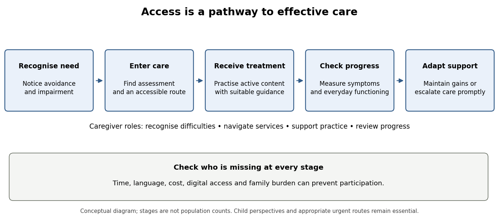

# 2022

↑ **Parent:** [Past exam of the child and adolescent clinical psychology course of the University of Oxford](../past-exam-of-the-child-and-adolescent-clinical-psychology-course-of-the-university-of-oxford.md)

[Child and adolescent clinical psychology](../psychology.md#child-and-adolescent-clinical-psychology), Trinity Term 2022, 1 June at 09:30 BST. The three-hour paper is an undergraduate advanced option classified as Part II in the frozen audit; its cover prints Second Public Examination without a Part number. These essays cover every question and both alternatives in question 2, using an evidence cutoff of 1 June 2022.

Course: [Child and adolescent clinical psychology course of the University of Oxford](../university-of-oxford.md#child-and-adolescent-clinical-psychology-course-of-the-university-of-oxford). Public source: [Oxford-supplied archive, member a17332w1.pdf](https://www.whatdotheyknow.com/request/experimental_psychology_past_exa/response/2757831/attach/3/New%20Compressed%20zipped%20Folder.zip?cookie_passthrough=1).[Cover and all options on page 2, A17332W1](../psychology-bibliography.md#child-and-adolescent-clinical-psychology-2022-by-university-of-oxford)

**Table of contents**

- [1](#1)
  - [Solution](#1/solution)
- [2](#2)
  - [i](#2/i)
    - [Solution](#2/i/solution)
  - [ii](#2/ii)
    - [Solution](#2/ii/solution)
- [3](#3)
  - [Solution](#3/solution)
- [4](#4)
  - [Solution](#4/solution)
- [5](#5)
  - [Solution](#5/solution)
- [6](#6)
  - [Solution](#6/solution)

## 1

↑ **Parent:** [2022](2022.md)

<h3 id="1/solution">Solution</h3>

↑ **Parent:** [1](#1)

Parents should have a negotiated, formulation-led role that helps an [adolescent](../organism.md#adolescent) undertake effective treatment while supporting increasing autonomy. Three roles must be distinguished: facilitating access and practice, changing parental responses that maintain avoidance, and receiving treatment for the parent's own difficulties. A parent being present in more sessions is not a mechanism in itself. The relevant question is which parental action changes which maintaining process, for which [adolescent](../organism.md#adolescent), beyond the effects of [adolescent](../organism.md#adolescent) treatment alone.

Initial assessment should obtain both the young person's and caregiver's perspectives on feared situations, avoidance, [impairment](../psychology.md#functional-impairment) and family responses. Separate discussion with the [adolescent](../organism.md#adolescent) can reveal difficulties they would not disclose in a joint meeting. A shared formulation can then identify whether parents provide repeated reassurance, take over social interactions or organise routines around avoidance. [Accommodation](../psychiatry.md#family-accommodation) can bring immediate relief while reducing opportunities for the [adolescent](../organism.md#adolescent) to learn that uncertainty and distress are manageable. Support can instead combine recognition of distress with confidence in the young person's capacity to approach an agreed activity. These descriptions concern potentially modifiable interactions, rather than assigning parental blame for the disorder's origin.

The role should fit developmental circumstances. A thirteen-year-old dependent on a caregiver for transport may need different practical support from a seventeen-year-old arranging appointments. Parents can help implement between-session practice, notice approach rather than merely the disappearance of distress, and support school coordination. The [adolescent](../organism.md#adolescent) should help decide what information is shared and which sessions are joint, within clearly explained [confidentiality](../psychology.md#confidentiality) and [safeguarding](../psychology.md#safeguarding) arrangements. Parent involvement can undermine treatment if it becomes surveillance, coercion or another route for excessive reassurance. Fathers, other caregivers and relevant family relationships should be considered rather than assuming that the mother is always the appropriate participant.

Adolescent-specific evidence does not support mandatory additional parent sessions for everyone. [Polly Waite](../psychologist.md#polly-waite) and colleagues [randomised](../causal-inference.md#randomization) sixty thirteen- to eighteen-year-olds in routine services to immediate or delayed [Internet CBT](../psychology.md#internet-delivered-cognitive-behavioral-therapy), with an additional random allocation of parent sessions. The parent addition did not significantly improve [remission](../probability-and-statistics.md#diagnostic-remission), either immediately or at follow-up, and the online programme itself did not clearly outperform waiting list on the primary [remission](../probability-and-statistics.md#diagnostic-remission) endpoint. [Confidence intervals](../statistical-inference.md#confidence-interval) were wide. This is evidence against assuming a reliable benefit from that particular addition, rather than proof that parental involvement is useless or that a modest targeted effect is impossible.[Child and Adolescent Mental Health 24, 242–250; randomised parent-session allocation, primary remission and follow-up](../psychology-bibliography.md#a-randomized-controlled-trial-of-internet-delivered-cognitive-behaviour-therapy-for-adolescent-anxiety-disorders-in-a-routine-clinical-care-setting-with-and-without-parent-sessions-by-polly-waite-and-others)

Evidence from younger samples suggests hypotheses about selection. [Vanessa E. Cobham](../psychologist.md#vanessa-e-cobham) and colleagues stratified families by [parental anxiety](../psychology.md#parental-anxiety) before [randomising](../causal-inference.md#randomization) sixty-seven seven- to fourteen-year-olds to [child CBT](../psychology.md#cognitive-behavioral-therapy) with or without [parental anxiety](../psychology.md#parental-anxiety) management. Their findings suggested greater benefit of the addition when a parent was anxious, but results varied across measures. The study motivates a moderator hypothesis; its small subgroups and younger participants limit a general rule for [adolescent](../organism.md#adolescent) treatment.[Journal of Consulting and Clinical Psychology 66, 893–905; parental-anxiety strata and parent anxiety-management addition](../psychology-bibliography.md#the-role-of-parental-anxiety-in-the-treatment-of-childhood-anxiety-by-vanessa-e-cobham-and-others)

A larger test cautions against treating a plausible family risk factor as an established augmentation target. [Cathy Creswell](../psychologist.md#cathy-creswell) and colleagues studied 211 children whose mothers also had [anxiety disorders](../psychiatry.md#anxiety-disorder). All received [child CBT](../psychology.md#cognitive-behavioral-therapy); additions targeted either maternal [anxiety](../psychology.md#anxiety) or mother–[child](../organism.md#child) interaction, with nonspecific contact balanced. The additions changed some maternal outcomes but did not clearly improve the primary [child](../organism.md#child) diagnostic outcome. Treating a parent's [anxiety](../psychology.md#anxiety) may be worthwhile for that parent without necessarily producing an incremental child-treatment effect. Family-risk association, target engagement and improvement in the [child](../organism.md#child)'s disorder are separate evidential steps.[Health Technology Assessment 19(38); 211-family trial, maternal CBT and mother–child interaction arms](../psychology-bibliography.md#treatment-of-childhood-anxiety-disorder-in-the-context-of-maternal-anxiety-disorder-a-randomised-controlled-trial-and-economic-analysis-by-cathy-creswell-and-others)

An alternative is parent-based treatment rather than parental augmentation of [child](../organism.md#child) therapy. [Eli R. Lebowitz](../psychologist.md#eli-r-lebowitz) and colleagues [randomised](../causal-inference.md#randomization) 124 seven- to fourteen-year-olds to [child CBT](../psychology.md#cognitive-behavioral-therapy) or [SPACE treatment](../psychology.md#supportive-parenting-for-anxious-childhood-emotions), a parent intervention reducing [accommodation](../psychiatry.md#family-accommodation) without direct [child](../organism.md#child)–therapist sessions. [SPACE treatment](../psychology.md#supportive-parenting-for-anxious-childhood-emotions) met prespecified [noninferiority](../probability-and-statistics.md#noninferiority-trial) criteria for [anxiety](../psychology.md#anxiety) outcomes and reduced [accommodation](../psychiatry.md#family-accommodation). This supports the possibility that changing caregiver responses can be an effective delivery route. It does not establish that replacing adolescent-focused therapy with parent work is appropriate across the older teenage years, or that the same approach is preferred by every young person.[Journal of the American Academy of Child and Adolescent Psychiatry 59, 362–372; SPACE treatment noninferiority trial, ages 7–14 and accommodation outcomes](../psychology-bibliography.md#parent-based-treatment-as-efficacious-as-cognitive-behavioral-therapy-for-childhood-anxiety-a-randomized-noninferiority-study-of-supportive-parenting-for-anxious-childhood-emotions-by-eli-r-lebowitz-and-others)

Together, these studies favour flexible involvement. A useful [clinical formulation](../psychology.md#clinical-formulation) can identify practical support needs, [accommodation](../psychiatry.md#family-accommodation) that interferes with [learning](../animal-behaviour.md#learning), and [parental anxiety](../psychology.md#parental-anxiety) requiring its own assessment. However, personalised selection rules remain hypotheses unless prospectively tested. Neither a null augmentation trial nor a successful parent-only trial settles the optimal dose of parent contact alongside a given [adolescent](../organism.md#adolescent) therapy. [Treatment fidelity](../psychology.md#treatment-fidelity) also matters: a nominally parent-inclusive programme may differ greatly in whether it rehearses supportive responses, changes [accommodation](../psychiatry.md#family-accommodation) or merely provides information.

A future study should therefore recruit [adolescents](../organism.md#adolescent) with diagnosed [anxiety](../psychology.md#anxiety) across routine services and deliver the same adequate [adolescent](../organism.md#adolescent) [CBT](../psychology.md#cognitive-behavioral-therapy) in every arm. [Randomise](../causal-inference.md#randomization) caregivers to a brief accommodation-focused module or a credible contact-matched education condition; an additional prespecified stratum could examine parents with their own [anxiety disorder](../psychiatry.md#anxiety-disorder). Measure [accommodation](../psychiatry.md#family-accommodation) and [parental anxiety](../psychology.md#parental-anxiety) before allocation, and [power](../probability-and-statistics.md#statistical-power) the study for the specific treatment-by-baseline-characteristic interactions rather than searching retrospectively for successful subgroups. Include age, caregiver availability and [adolescent](../organism.md#adolescent) preference in recruitment and reporting without treating chronological age as a complete measure of autonomy.

[Masked](../design-of-experiments.md#blinding) diagnostic interviews, young-person-rated [impairment](../psychology.md#functional-impairment) and school or social functioning should be assessed after treatment and at six and twelve months. Parent reports should be retained as a separate perspective, not substituted for [adolescent](../organism.md#adolescent) outcomes. Record what parents actually do through agreed observations or structured practice tasks, alongside session attendance and [treatment fidelity](../psychology.md#treatment-fidelity). Measure changes in [accommodation](../psychiatry.md#family-accommodation) repeatedly before the proposed downstream improvement. Temporal [mediation](../statistical-modelling.md#statistical-mediation) would constrain a mechanism, although additional mediator–outcome assumptions would still be needed for a [causal mediation](../causal-inference.md#causal-mediation) claim.

The trial should also measure family burden, [acceptability](../probability-and-statistics.md#treatment-acceptability) and any deterioration in relationships, and examine families unable to attend conventional sessions. An approach that improves completer outcomes while excluding caregivers with work or language barriers may reduce practical access. [Qualitative interviews](../psychology.md#qualitative-interview) can explain why a module helps or fails, while the [randomised](../causal-inference.md#randomization) contrast estimates its incremental effect. The 2022 evidence supports parents as potential partners, change agents and recipients of care, but supports a collaboratively chosen and testable role more strongly than indiscriminate intensification of parental attendance.

## 2

↑ **Parent:** [2022](2022.md)

<h3 id="2/i">i</h3>

↑ **Parent:** [2](#2)

<h4 id="2/i/solution">Solution</h4>

↑ **Parent:** [I](#2/i)

The [Clark–Wells model](../psychiatry.md#clark-wells-model-of-social-anxiety-disorder) is a useful, partly experimentally supported account of [adolescent](../organism.md#adolescent) [social anxiety](../psychology.md#social-anxiety), but its applicability must be assessed at the level of particular processes. It proposes that feared evaluation activates negative assumptions, [self-focused attention](../psychology.md#self-focused-attention) and an internally generated impression of how one appears. [safety behaviors](../animal-behaviour.md#safety-behavior) can interfere with the interaction or make a satisfactory outcome seem dependent on protection. Anticipatory and [post-event processing](../psychiatry.md#post-event-processing) can perpetuate the threat interpretation. Its adult origins do not establish that all these processes operate identically at every developmental stage.[Clinical Child and Family Psychology Review 21, 388–414; cognitive model and developmental qualifications](../psychology-bibliography.md#understanding-social-anxiety-disorder-in-adolescents-and-improving-treatment-outcomes-applying-the-cognitive-model-of-clark-and-wells-1995-by-eleanor-leigh-and-david-m-clark)

For an [adolescent](../organism.md#adolescent), the account gives testable examples. A pupil who believes that visible hesitation will lead to rejection may monitor their voice, mentally rehearse every sentence and speak very little. Monitoring consumes [attention](../psychology.md#attention) that could be used to follow the conversation; silence changes how the interaction proceeds; afterwards, the pupil may treat their felt [anxiety](../psychology.md#anxiety) as evidence that their performance looked disastrous. A [behavioral experiment](../psychology.md#behavioral-experiment) should test the feared prediction and the effects of these strategies, rather than merely reassure the pupil that peers will approve. Actual bullying or exclusion also matters: a clinically useful account must include the social environment, not classify every negative expectation as an error.

[Eleanor Leigh](../psychologist.md#eleanor-leigh) and colleagues provided an experimental test in 57 high- and low-social-anxiety [adolescents](../organism.md#adolescent). Participants held counterbalanced conversations while either focusing internally and using [safety behaviors](../animal-behaviour.md#safety-behavior), or focusing externally and dropping those behaviours. The internal-focus/safety-behaviour condition increased experienced and apparent [anxiety](../psychology.md#anxiety) and undermined performance, using self, conversation-partner and independent ratings. This gives stronger causal evidence than a [correlation](../variance.md#pearson-correlation-coefficient) between [anxiety](../psychology.md#anxiety) and reported strategies. But the two processes were manipulated together, participants were selected by symptom scores rather than all having a [clinical diagnosis](../psychology.md#clinical-diagnosis), and brief instructed behaviour need not reproduce the chronic disorder.[PLOS ONE 16, e0247703; counterbalanced conversations, 57 participants, partner and independent ratings](../psychology-bibliography.md#self-focused-attention-and-safety-behaviours-maintain-social-anxiety-in-adolescents-an-experimental-study-by-eleanor-leigh-and-others)

Treatment evidence is consistent with clinical utility but tests a package. [Jo Magne Ingul](../psychology.md#jo-magne-ingul) and colleagues [randomised](../causal-inference.md#randomization) 57 thirteen- to sixteen-year-olds with primary [social phobia](../psychiatry.md#social-anxiety-disorder) to individual [cognitive therapy](../psychology.md#cognitive-therapy), group [CBT](../psychology.md#cognitive-behavioral-therapy) or attentional [placebo](../probability-and-statistics.md#placebo). Individual [cognitive therapy](../psychology.md#cognitive-therapy) produced greater improvement in symptoms and [impairment](../psychology.md#functional-impairment), with benefits assessed through twelve months. Differences in format and delivery, however, accompany the difference in formulation. Improvement cannot establish which proposed process was necessary, or exclude explanations involving individual [attention](../psychology.md#attention), [exposure](../psychology.md#exposure-therapy) opportunities or treatment competence.[Psychotherapy and Psychosomatics 83, 54–61; 57 adolescents aged 13–16, randomised treatments and twelve-month follow-up](../psychology-bibliography.md#a-randomized-controlled-trial-of-individual-cognitive-therapy-group-cognitive-behaviour-therapy-and-attentional-placebo-for-adolescent-social-phobia-by-jo-magne-ingul-and-others)

Developmental qualifications are substantive. [Adolescents](../organism.md#adolescent)' models of other minds, self-description and ability to notice a mental image are still changing. A failure to articulate a distorted self-image may reflect the measure or interview demands, rather than its absence; conversely, an eloquent account elicited by an interviewer is not proof that the image drives [anxiety](../psychology.md#anxiety) in daily life. Peer evaluation can be particularly consequential because school interactions are repeated and difficult to leave. Parents may arrange or prevent social opportunities, while online interactions introduce different opportunities for rehearsal and concealment. These issues suggest adapting assessment and delivery while testing, rather than presuming, the proposed mechanisms.

An informative new experiment would separate the bundled processes. Recruit a multisite sample of [adolescents](../organism.md#adolescent) with diagnosed [social anxiety disorder](../psychiatry.md#social-anxiety-disorder), alongside an age-matched comparison sample. Within each group, [randomise](../causal-inference.md#randomization) participants to a two-by-two design: internal versus external [attention](../psychology.md#attention), and use versus reduction of individually identified [safety behaviors](../animal-behaviour.md#safety-behavior) during one standardised conversation. A between-participant design avoids [learning](../animal-behaviour.md#learning) and carry-over across four conversations; the required sample should be [powered](../probability-and-statistics.md#statistical-power) for prespecified interactions and meaningful effects, using pilot variability and plausible smallest effects rather than adult [effect sizes](../statistical-inference.md#effect-size) alone. Diagnostic group and age are observed characteristics, so their interactions would moderate the experimental effect without being [randomised](../causal-inference.md#randomization) causes themselves.

The conversation should use a trained, age-appropriate partner following a common script and unaware of allocation. Instructions must be comprehensible, equally credible and checked before the task. Independent coders, [masked](../design-of-experiments.md#blinding) to condition and diagnostic status, would rate video-recorded performance. Record baseline [anxiety](../psychology.md#anxiety) and predicted evaluation before the task, [self-focused attention](../psychology.md#self-focused-attention) and strategy use as [manipulation checks](../design-of-experiments.md#manipulation-check), [anxiety](../psychology.md#anxiety) as the [primary outcome](../probability-and-statistics.md#primary-outcome), and partner evaluations, self–observer discrepancies and [post-event processing](../psychiatry.md#post-event-processing) as secondary outcomes. A physiological measure such as [heart rate](../physiology.md#heart-rate) can characterise [arousal](../physiology.md#physiological-arousal), but should not be treated as a direct measurement of what the [adolescent](../organism.md#adolescent) believes others think.

The model predicts that manipulating the proposed maintaining processes should alter [anxiety](../psychology.md#anxiety) and, potentially, interaction quality. Independent effects would support separating the two processes; an interaction would indicate that one changes the consequences of the other. Effects in the comparison group would not refute the model, because the clinical claim can concern habitual use and persistent feedback rather than a uniquely pathological response to the instruction. A convincing result would relate the manipulation to the specific predicted threat and self–observer gap, rather than to general distress alone.

Several controls sharpen the inference. Measure baseline social competence and verbal ability, [randomise](../causal-inference.md#randomization) the partner/topic allocation, and use [blinded](../design-of-experiments.md#blinding) coding with prespecified reliability checks. Avoid asking the partner to provide genuine humiliation: the experimental contrast concerns [attention](../psychology.md#attention) and strategies in an ordinary interaction. Obtain [informed consent](../biology.md#informed-consent) and assent appropriate to the participants, agree withdrawal procedures and explain the purpose afterwards. Follow participants with a new, uncoached interaction and a brief delayed assessment to examine whether any [learning](../animal-behaviour.md#learning) extends beyond immediate compliance. Prespecify exclusions, primary contrasts, missing-data handling and all subgroup analyses.

A null result is informative only if the manipulation actually changes [attention](../psychology.md#attention) and strategies, measurement is reliable, and [confidence intervals](../statistical-inference.md#confidence-interval) rule out effects worth detecting. If only immediate [self-report](../psychology.md#self-report) changes, demand characteristics remain a serious alternative. If [masked](../design-of-experiments.md#blinding) performance and delayed threat [beliefs](../psychology.md#belief) change in the predicted directions, support for an [adolescent](../organism.md#adolescent) maintaining mechanism becomes stronger, though not a full explanation of onset. By 2022, the model justified focused assessment and promising treatment development; the proposed factorial study would improve on treating a successful adult model or an effective treatment package as a complete developmental validation.

<h3 id="2/ii">ii</h3>

↑ **Parent:** [2](#2)

<h4 id="2/ii/solution">Solution</h4>

↑ **Parent:** [Ii](#2/ii)

Clark's cognitive account offers a plausible explanation of panic in young people when bodily sensations are interpreted as signs of imminent catastrophe. Palpitations may be understood as an impending medical disaster, dizziness as loss of control, or a strange mental sensation as “going mad”. Apprehension can increase [arousal](../physiology.md#physiological-arousal) and [attention](../psychology.md#attention) to the body, generating more of the evidence that seems to confirm danger. Avoidance and [safety behaviors](../animal-behaviour.md#safety-behavior) can prevent correction. The model makes catastrophic meaning central, rather than identifying panic with bodily [arousal](../physiology.md#physiological-arousal) alone.[Behaviour Research and Therapy 24, 461–470; original model of catastrophic misinterpretation](../psychology-bibliography.md#a-cognitive-approach-to-panic-by-david-m-clark)

This distinction is developmentally important. Many children notice a rapid heartbeat after activity without fearing a [panic attack](../psychiatry.md#panic-attack). Conversely, a [child](../organism.md#child) may [fear](../psychology.md#fear) a sensation but lack the vocabulary to describe an adult-style medical catastrophe. Older [adolescents](../organism.md#adolescent) may worry about embarrassment, losing control in public or being unable to obtain help. Assessment should therefore establish the young person's own prediction in accessible language, distinguish recurrent unexpected attacks from ordinary [fear](../psychology.md#fear) in a threatening situation, and assess persistent concern, avoidance and [impairment](../psychology.md#functional-impairment). A parent account can add context without substituting for the young person's experience of an internal sensation.

[Thalia C. Eley](../biologist.md#thalia-c-eley) and colleagues studied 79 eight- to eleven-year-olds using a heartbeat mental-tracking task, [anxiety sensitivity](../psychology.md#anxiety-sensitivity) measures and panic/[somatic symptom](../psychology.md#somatic-symptom) ratings. Better [heartbeat perception](../neuroscience.md#heartbeat-perception) and [fear](../psychology.md#fear) of bodily sensations were associated with higher panic/[somatic symptoms](../psychology.md#somatic-symptom). This supports examining perception and appraisal separately. It does not show that heightened perception causes panic: the sample was not a trial of diagnosed [panic disorder](../psychiatry.md#panic-disorder), only a small subgroup met the study's “good perception” criterion, and heartbeat counting can reflect knowledge and estimation as well as direct perception. Symptom questionnaires and retrospective accounts also cannot establish the temporal order of a particular attack.[Behaviour Research and Therapy 42, 439–448; 79 children aged 8–11, mental tracking and symptom/sensitivity measures](../psychology-bibliography.md#heart-beat-perception-panic-somatic-symptoms-and-anxiety-sensitivity-in-children-by-thalia-c-eley-and-others)

[Donna B. Pincus](../psychologist.md#donna-b-pincus) and colleagues supplied preliminary treatment evidence in [adolescents](../organism.md#adolescent). Twenty-six fourteen- to seventeen-year-olds were [randomised](../causal-inference.md#randomization) to panic-control treatment or a self-monitoring control, thirteen per arm. The active treatment reduced clinician-rated panic severity and several self-reported outcomes, with gains maintained at follow-up. The small study supports feasibility and potential efficacy of a panic-focused package. A self-monitoring comparator does not control all expectations or therapist contact, and a multicomponent intervention cannot identify catastrophic interpretation change as its sole active ingredient.[Journal of Clinical Child and Adolescent Psychology 39, 638–649; PCT-A versus self-monitoring, 26 adolescents aged 14–17](../psychology-bibliography.md#cognitive-behavioral-treatment-of-panic-disorder-in-adolescence-by-donna-b-pincus-and-others)

The evidence is consequently more secure for the usefulness of a panic-focused approach in some [adolescents](../organism.md#adolescent) than for a universal cognitive explanation across childhood. Age differences in interoceptive awareness, interpretation of bodily symptoms and ability to report thoughts need direct study. An absence of a consciously recalled catastrophic thought is not decisive against a rapid or poorly articulated appraisal, but the theory must specify a testable process rather than protect itself by making every unreported appraisal invisible. Physiological or contextual influences can also contribute to sensations and threat, and changes in [arousal](../physiology.md#physiological-arousal) can affect what a person later reports having thought.

An experiment should manipulate interpretation while measuring the bodily input and avoid using a treatment outcome as the only test. Recruit [adolescents](../organism.md#adolescent) with diagnosed [panic disorder](../psychiatry.md#panic-disorder), a comparison group with another [anxiety disorder](../psychiatry.md#anxiety-disorder) and a nonclinical comparison group. Within each group, randomly allocate participants to an age-adapted explanation of benign exercise-related sensations or a credible, contact-matched general health-information condition. Both groups would complete the same brief, developmentally appropriate mild activity under an approved protocol. The activity is a standardised source of ordinary [arousal](../physiology.md#physiological-arousal), not an instruction to provoke severe panic; medical eligibility and stopping rules would be determined beforehand with appropriate clinical oversight.

The apparatus would include [ECG](../biology.md#electrocardiogram) recording for actual [heart rate](../physiology.md#heart-rate) and a simple respiratory measure, together with repeated short ratings of perceived sensations, expected consequences and [fear](../psychology.md#fear). Obtain ratings before information, immediately before activity, during recovery and at a delayed follow-up. The primary contrast should be the [randomised](../causal-inference.md#randomization) difference in panic-related [fear](../psychology.md#fear), with baseline severity accounted for. Separately measure the catastrophic interpretation the intervention is intended to change and the actual physiological response. The key prediction is reduced [fear](../psychology.md#fear) after the benign interpretation despite comparable elicited sensations, rather than success defined merely as a smaller heartbeat increase.

The control condition should match time, adult reassurance and [attention](../psychology.md#attention) without teaching the specific reinterpretation. Assessors of [diagnosis](../psychology.md#clinical-diagnosis) and follow-up behaviour should remain [masked](../design-of-experiments.md#blinding). Include both written and verbally supported interpretation measures, pretested for comprehension, so a developmental effect is not simply a reading test. Prespecify one [primary outcome](../probability-and-statistics.md#primary-outcome), secondary physiological and appraisal measures, meaningful [effect sizes](../statistical-inference.md#effect-size), missing-data handling and diagnostic-group interactions. Age or developmental stage should be measured and the relevant interaction adequately [powered](../probability-and-statistics.md#statistical-power); a nonsignificant age interaction in a small trial would not establish developmental equivalence.

Several patterns would discriminate accounts. If information changes catastrophic expectations and reduces [fear](../psychology.md#fear) while the physiological input is similar, this supports a causal contribution from interpretation. If it reduces [arousal](../physiology.md#physiological-arousal) as well, the overall intervention effect remains meaningful but the appraisal-specific pathway is less isolated. If the effect occurs equally for all [anxiety](../psychology.md#anxiety) groups, the process may be transdiagnostic rather than unique to panic. A successful manipulation with precise null effects on [fear](../psychology.md#fear) would challenge the proposed mechanism under these conditions. A failed manipulation would instead require revising the procedure or measure.

[Mediation](../statistical-modelling.md#statistical-mediation) should be treated cautiously. [Randomising](../causal-inference.md#randomization) the information identifies the effect of that information package; it does not automatically [randomise](../causal-inference.md#randomization) appraisal scores or remove all [confounding](../causal-inference.md#confounding) of appraisal and subsequent [fear](../psychology.md#fear). Temporal sampling and alternative mediator measures improve the argument, but a stronger mechanistic programme would replicate with a different way of changing interpretation and test transfer to naturally occurring sensations. Follow-up should assess avoidance and [impairment](../psychology.md#functional-impairment) as well as laboratory distress, without withholding established care from participants.

By the 2022 evidence base, Clark's model provided a clear set of hypotheses and a promising [adolescent](../organism.md#adolescent) treatment rationale. Associations in younger children and a small [adolescent](../organism.md#adolescent) treatment trial warranted further tests, not a conclusion that every [child](../organism.md#child) panic presentation had already been explained. The proposed experiment would establish whether changing the meaning assigned to matched bodily sensations alters [fear](../psychology.md#fear), and where developmental differences constrain that inference.

## 3

↑ **Parent:** [2022](2022.md)

<h3 id="3/solution">Solution</h3>

↑ **Parent:** [3](#3)

[Exposure](../psychology.md#exposure-therapy) should optimise durable approach and new [learning](../animal-behaviour.md#learning) about feared outcomes, rather than merely maximise distress or make [anxiety](../psychology.md#anxiety) disappear within a session. A [child](../organism.md#child) who approaches a dog, attends class or speaks to an unfamiliar person has an opportunity to test a prediction. The relevant outcome is whether [learning](../animal-behaviour.md#learning) transfers to everyday situations and reduces [impairment](../psychology.md#functional-impairment). What counts as an informative [exposure](../psychology.md#exposure-therapy) therefore depends on the individual formulation, developmental understanding and actual safety of the situation.

There is direct evidence that [exposure](../psychology.md#exposure-therapy) can help young people. [Thomas H. Ollendick](../psychology.md#thomas-h-ollendick) and colleagues [randomised](../causal-inference.md#randomization) 196 seven- to sixteen-year-olds with [specific phobias](../psychiatry.md#specific-phobia) to a concentrated one-session [exposure](../psychology.md#exposure-therapy) treatment, education-support or waiting list. [Exposure](../psychology.md#exposure-therapy) produced better diagnostic and behavioural outcomes than the comparison conditions, with follow-up beyond the immediate treatment session. Its behavioural assessment brought the feared situation into the evaluation rather than relying exclusively on a questionnaire. This supports [exposure](../psychology.md#exposure-therapy) for [specific phobias](../psychiatry.md#specific-phobia), but neither the single-session format nor its optimal ingredients can automatically be generalised to every [adolescent](../organism.md#adolescent) [anxiety disorder](../psychiatry.md#anxiety-disorder).[Journal of Consulting and Clinical Psychology 77, 504–516; 196 youths, exposure, education-support and waiting-list conditions](../psychology-bibliography.md#one-session-treatment-of-specific-phobias-in-youth-a-randomized-clinical-trial-in-the-united-states-and-sweden-by-thomas-h-ollendick-and-others)

A useful theoretical distinction is between [habituation](../animal-behaviour.md#habituation) and [inhibitory learning](../animal-behaviour.md#inhibitory-learning). [Habituation](../animal-behaviour.md#habituation) accounts emphasise reductions in [fear](../psychology.md#fear) with repeated contact. An [inhibitory learning](../animal-behaviour.md#inhibitory-learning) account instead proposes that [exposure](../psychology.md#exposure-therapy) creates a competing association: the cue need not predict the feared consequence. The original association may remain available, helping explain why [fear](../psychology.md#fear) returns after time or a change of context. [Michelle G. Craske](../psychologist.md#michelle-g-craske) and colleagues developed strategies intended to strengthen the alternative [learning](../animal-behaviour.md#learning) and its retrieval, including testing explicit threat expectancies and varying [exposure](../psychology.md#exposure-therapy) contexts. Their 2014 account is a theoretical and translational framework, rather than a definitive [randomised](../causal-inference.md#randomization) comparison of these strategies in anxious children.[Behaviour Research and Therapy 58, 10–23; theoretical framework and illustrative implementation strategies](../psychology-bibliography.md#maximizing-exposure-therapy-an-inhibitory-learning-approach-by-michelle-g-craske-and-others)

This distinction changes what a therapist measures. Suppose a young person predicts that briefly speaking in class will reliably cause visible ridicule. Completing the agreed contribution, observing the actual response and reviewing what was learned directly address that prediction. A reduction from high to low distress during rehearsal is less decisive if the young person attributes safety entirely to reading a perfectly memorised script. Conversely, meaningful expectancy change can occur while some distress remains. Necessary protections against genuine harm should be retained: a [behavioral experiment](../psychology.md#behavioral-experiment) is not a reason to expose a pupil to ongoing bullying or to remove a medically necessary precaution.

Clinical process data question a rigid requirement for within-session [fear](../psychology.md#fear) reduction. [Jeremy S. Peterman](../psychology.md#jeremy-s-peterman) and colleagues examined exposure-related distress ratings in 72 treated youths, with a mean age of about ten and a half. Most hypothesised [habituation](../animal-behaviour.md#habituation) indices did not predict outcomes after treatment or at one year. These observational findings weaken the assumption that a particular distress-reduction trajectory is a necessary marker of success. They do not randomly compare [learning](../animal-behaviour.md#learning) strategies, prove that [habituation](../animal-behaviour.md#habituation) never matters, or establish [inhibitory learning](../animal-behaviour.md#inhibitory-learning) as the only explanation.[Journal of Clinical Child and Adolescent Psychology 48, supplement 1, S34–S44; online 2016; exposure-process predictors in 72 treated youths](../psychology-bibliography.md#testing-the-habituation-based-model-of-exposures-for-child-and-adolescent-anxiety-by-jeremy-s-peterman-and-others)

Development provides another reason to test rather than simply import adult optimisation rules. [Siobhan S. Pattwell](../neuroscientist.md#siobhan-s-pattwell) and colleagues studied [conditioned fear](../animal-behaviour.md#conditioned-fear) [learning](../animal-behaviour.md#learning) and [extinction](../animal-behaviour.md#extinction-learning) across [human](../organism.md#human) age groups and conducted parallel mouse experiments. [Human](../organism.md#human) participants encountered conditioned cues and [extinction](../animal-behaviour.md#extinction-learning) trials, with physiological [fear](../psychology.md#fear) indexed by [skin](../physiology.md#skin) conductance; [adolescents](../organism.md#adolescent) showed attenuated [extinction](../animal-behaviour.md#extinction-learning) relative to children and adults under the experimental conditions. The parallel animal work examined developmental differences in fear-related circuitry and plasticity. These are important motivating experiments, but an age-group difference in laboratory [extinction](../animal-behaviour.md#extinction-learning) is not a [clinical trial](../probability-and-statistics.md#clinical-trial) of [exposure](../psychology.md#exposure-therapy), nor a reason to withhold effective treatment from teenagers.[PNAS 109, 16318–16323; human conditioned-fear/extinction experiment and parallel mouse work](../psychology-bibliography.md#altered-fear-learning-across-development-in-both-mouse-and-human-by-siobhan-s-pattwell-and-others)

Practical optimisation should therefore begin with an understandable, testable prediction. Use concrete language, pictures or behavioural examples when abstract probability questions exceed the [child](../organism.md#child)'s understanding. Agree a feasible approach task and identify what evidence would count against the prediction. Record what happened, including ambiguous outcomes, without demanding a predetermined reassuring conclusion. [Exposure](../psychology.md#exposure-therapy) can be graded to make participation possible, but progression should depend on meaningful [learning](../animal-behaviour.md#learning) and functioning rather than an inflexible rule that [fear](../psychology.md#fear) must halve before moving on.

[safety behaviors](../animal-behaviour.md#safety-behavior) require functional assessment. A caregiver repeatedly speaking for a [child](../organism.md#child) may prevent the [child](../organism.md#child) from discovering that they can manage an interaction. A gradual reduction in that [accommodation](../psychiatry.md#family-accommodation) may improve the experiment. However, a communication aid or accessibility adjustment may make participation possible rather than maintain an irrational threat [belief](../psychology.md#belief). The same outward action can have different functions. [Adolescents](../organism.md#adolescent) should help choose targets and evaluate outcomes; parents can support practice without becoming an additional source of checking or coercion.

Variation across people, settings and occasions is a plausible way to strengthen transfer. Practising a classroom contribution only in a quiet consulting room leaves context-specific [learning](../animal-behaviour.md#learning) untested. Follow-up tasks in ordinary settings can assess whether an alternative expectation is retrieved when [anxiety](../psychology.md#anxiety) returns. Spacing, varied contexts and retrieval prompts are reasonable candidates for investigation, but the 2022 youth evidence does not establish a universal optimum for their timing or combination. Treatment time is also finite: an elaborate preparation routine can displace opportunities for actual approach.

A future factorial trial could compare prediction-focused [exposure](../psychology.md#exposure-therapy) with a credible standard [exposure](../psychology.md#exposure-therapy) protocol, and separately compare practice across several contexts with practice concentrated in one setting. Both conditions should receive adequate treatment, comparable therapist time and the same planned number of approach opportunities. The comparison must specify actual therapist behaviour rather than merely relabel identical exercises. Stratify recruitment by developmental stage and presenting disorder, and [power](../probability-and-statistics.md#statistical-power) the prespecified interactions instead of interpreting an underpowered subgroup null as equivalence.

The [primary outcomes](../probability-and-statistics.md#primary-outcome) should be [masked](../design-of-experiments.md#blinding) diagnostic status and [functional impairment](../psychology.md#functional-impairment) after treatment and at six months. A novel-context [behavioral approach task](../psychology.md#behavioral-approach-task) would test transfer; repeated expectancy and distress ratings would examine proposed processes. Record [fidelity](../psychology.md#treatment-fidelity), completed practice, adverse experiences, [acceptability](../probability-and-statistics.md#treatment-acceptability) and [dropout](../causal-inference.md#study-attrition). If prediction-focused treatment improves outcome without greater within-session distress reduction, this would challenge a strict habituation-success rule. If varying context improves transfer but not immediate [fear](../psychology.md#fear), that pattern would support the proposed retrieval rationale. Repeated mediator measurements help establish temporal order, while [causal mediation](../causal-inference.md#causal-mediation) still requires assumptions beyond treatment randomisation.

[Exposure](../psychology.md#exposure-therapy) optimisation in 2022 consequently had a strong clinical foundation and several promising mechanistic hypotheses, but fewer decisive youth component trials. The most defensible approach combines effective, collaborative approach practice with explicit [learning](../animal-behaviour.md#learning) goals and tests long-term functioning. Developmental neuroscience, distress trajectories and adult [learning](../animal-behaviour.md#learning) theory inform the research questions; they do not by themselves establish the best clinical protocol for every [child](../organism.md#child).

## 4

↑ **Parent:** [2022](2022.md)

<h3 id="4/solution">Solution</h3>

↑ **Parent:** [4](#4)

[Anxiety management](../psychology.md#anxiety-management) techniques cover several different activities: recognising [emotions](../psychology.md#emotion) and bodily sensations, providing [psychoeducation](../psychology.md#psychoeducation), practising relaxation or controlled breathing, and teaching [coping](../psychology.md#coping) or [problem solving](../psychology.md#problem-solving) routines. Their proposed functions also differ. A technique may make treatment understandable, help a young person engage with [exposure](../psychology.md#exposure-therapy), or be claimed to reduce [anxiety](../psychology.md#anxiety) as an active treatment ingredient. Evidence that a multicomponent [CBT](../psychology.md#cognitive-behavioral-therapy) programme works does not establish that every included management technique is necessary or independently effective.

Historically, [child CBT](../psychology.md#cognitive-behavioral-therapy) combined [coping](../psychology.md#coping) skills with practice approaching feared situations. [Philip C. Kendall](../psychologist.md#philip-c-kendall)'s 1994 trial [randomised](../causal-inference.md#randomization) 47 nine- to thirteen-year-olds to a sixteen-session programme or waiting list and found clinical benefits, assessed across several informants and maintained at follow-up. This was important evidence that a structured psychological intervention could help childhood [anxiety](../psychology.md#anxiety). Because skills and [exposure](../psychology.md#exposure-therapy) were delivered together, and the comparator did not match active treatment, the trial did not isolate relaxation, [coping](../psychology.md#coping) statements or [emotion identification](../psychology.md#emotion-identification) as causal ingredients.[Journal of Consulting and Clinical Psychology 62, 100–110; 47 children aged 9–13, sixteen-session CBT and waiting list](../psychology-bibliography.md#treating-anxiety-disorders-in-children-results-of-a-randomized-clinical-trial-by-philip-c-kendall)

The larger [Child](../organism.md#child)/[Adolescent](../organism.md#adolescent) [Anxiety](../psychology.md#anxiety) Multimodal Study provides stronger evidence for the broader treatment package. [John T. Walkup](../psychiatry.md#john-t-walkup) and colleagues [randomised](../causal-inference.md#randomization) 488 seven- to seventeen-year-olds with separation, generalised or [social anxiety](../psychology.md#social-anxiety) to [CBT](../psychology.md#cognitive-behavioral-therapy), sertraline, their combination or pill [placebo](../probability-and-statistics.md#placebo). At twelve weeks, 59.7% receiving [CBT](../psychology.md#cognitive-behavioral-therapy) were rated much or very much improved, compared with 23.7% on [placebo](../probability-and-statistics.md#placebo); combination treatment had an 80.7% response rate. These are global improvement rates, not percentages free of an [anxiety](../psychology.md#anxiety) [diagnosis](../psychology.md#clinical-diagnosis). The [CBT](../psychology.md#cognitive-behavioral-therapy) arm included more than [anxiety management](../psychology.md#anxiety-management) skills, and pill [placebo](../probability-and-statistics.md#placebo) did not match every aspect of psychotherapy contact.[New England Journal of Medicine 359, 2753–2766; CAMS, Table 2 and twelve-week CGI-I response](../psychology-bibliography.md#cognitive-behavioral-therapy-sertraline-or-a-combination-in-childhood-anxiety-by-john-t-walkup-and-others)

Component research offers a more specific but less causally secure picture. [Stephen P. H. Whiteside](../psychology.md#stephen-p-h-whiteside) and colleagues analysed 75 studies containing 111 [CBT](../psychology.md#cognitive-behavioral-therapy) conditions. Greater in-session [exposure](../psychology.md#exposure-therapy) was associated with larger treatment effects, whereas relaxation was associated with smaller effects. The comparison was across differently constituted programmes rather than a random allocation of relaxation within the same [exposure](../psychology.md#exposure-therapy) treatment. Differences in participants, treatment quality or the amount of [exposure](../psychology.md#exposure-therapy) could therefore explain some of the association. It motivates [dismantling trials](../probability-and-statistics.md#dismantling-trial); it does not establish that relaxation harms all anxious children.[Clinical Child and Family Psychology Review 23, 102–121; 75 studies, 111 CBT conditions and component meta-regressions](../psychology-bibliography.md#a-meta-analysis-to-guide-the-enhancement-of-cbt-for-childhood-anxiety-exposure-over-anxiety-management-by-stephen-p-h-whiteside-and-others)

The conceptual issue is what [learning](../animal-behaviour.md#learning) the technique permits or prevents. Consider an [adolescent](../organism.md#adolescent) who believes that an ordinary racing heart means an imminent catastrophe. Using a [breathing exercise](../psychology.md#breathing-exercise) may reduce unpleasant [arousal](../physiology.md#physiological-arousal). If the [adolescent](../organism.md#adolescent) concludes that catastrophe was avoided only because the exercise was performed perfectly, the original threat interpretation may remain intact. A different use of the same exercise, as an optional way to settle before continuing an agreed activity, need not imply that ordinary [arousal](../physiology.md#physiological-arousal) is dangerous. Its function and the young person's explanation matter more than its label.

Similarly, identifying feelings can support communication and enable a [child](../organism.md#child) to describe what they predict. It is not evidence of improvement merely that they can correctly label a worksheet. [Coping](../psychology.md#coping) statements can function as predictions to test, or as reassurance repeated until the young person feels certain. [Problem solving](../psychology.md#problem-solving) is appropriate when a realistic difficulty can be changed; repeatedly solving hypothetical worries can instead become another avoidance routine. These distinctions imply that engagement, immediate [arousal](../physiology.md#physiological-arousal) and durable change in [anxiety disorder](../psychiatry.md#anxiety-disorder) should be measured separately.

Process evidence also cautions against using immediate calm as the sole success criterion. Peterman and colleagues found that most exposure-habituation indices did not predict subsequent outcome in their youth treatment sample. Although not a [randomised](../causal-inference.md#randomization) component test, this challenges the assumption that a treatment exercise is ineffective whenever distress remains elevated. It supports assessing what a young person learns and subsequently does, alongside how they feel during the session.[Journal of Clinical Child and Adolescent Psychology 48, supplement 1, S34–S44; online 2016; exposure-process predictors in 72 treated youths](../psychology-bibliography.md#testing-the-habituation-based-model-of-exposures-for-child-and-adolescent-anxiety-by-jeremy-s-peterman-and-others)

Developmental adaptation may still justify selected management elements. A younger [child](../organism.md#child) may need concrete examples of bodily sensations and a caregiver's help remembering a practice plan. An [adolescent](../organism.md#adolescent) may prefer a collaborative explanation and private monitoring. Comprehension and participation should be checked directly rather than presumed from age. These potential benefits are reasons to study accessible delivery, not to infer that a long preparatory skills phase is essential for everyone. If preparation consumes most of the available sessions, it may reduce the opportunity to practise the behaviour that treatment is intended to change.

A decisive study would hold a competent [exposure](../psychology.md#exposure-therapy) programme constant and [randomise](../causal-inference.md#randomization) an additional clearly specified management module against contact-matched neutral material. Different modules should be distinguished, because a bundle of breathing, relaxation and cognitive work cannot identify the contribution of each. A [factorial design](../design-of-experiments.md#factorial-design) could test an early [psychoeducation](../psychology.md#psychoeducation) or [coping](../psychology.md#coping) module separately from whether it is required during [exposure](../psychology.md#exposure-therapy). [Fidelity](../psychology.md#treatment-fidelity) assessment should record the actual use and meaning of skills, including whether they become perceived safety signals.

There are two relevant service questions. Adding a module while preserving [exposure](../psychology.md#exposure-therapy) estimates its incremental benefit at an additional resource cost. Replacing [exposure](../psychology.md#exposure-therapy) time with that module estimates its value under a fixed session budget. These comparisons should not be conflated. To justify removing a standard module as unnecessary, a sufficiently [powered](../probability-and-statistics.md#statistical-power) [noninferiority](../probability-and-statistics.md#noninferiority-trial) design with a clinically justified margin would be more informative than a small superiority trial that simply fails to find a difference.

Outcomes should include [masked](../design-of-experiments.md#blinding) [diagnosis](../psychology.md#clinical-diagnosis), everyday [impairment](../psychology.md#functional-impairment), approach behaviour and longer-term [return of fear](../animal-behaviour.md#return-of-fear), not only session distress. Early engagement, [dropout](../causal-inference.md#study-attrition), family burden and [acceptability](../probability-and-statistics.md#treatment-acceptability) could reveal a helpful preparatory effect even without an independent symptom benefit. Repeated ratings of threat expectancy and [arousal](../physiology.md#physiological-arousal) would test competing pathways, although mediator–outcome [confounding](../causal-inference.md#confounding) remains possible. Prespecified developmental and diagnostic comparisons would indicate whether a module helps a particular subgroup without encouraging retrospective selection of favourable results.

By 2022, the strongest evidence supported [CBT](../psychology.md#cognitive-behavioral-therapy) packages containing [exposure](../psychology.md#exposure-therapy), with substantially less certainty about the necessity or independent efficacy of generic [anxiety management](../psychology.md#anxiety-management) routines. Selected techniques can have a coherent role when they improve understanding or participation. Their use should be evaluated by whether they support effective [learning](../animal-behaviour.md#learning) and functioning, rather than by an assumption that successful treatment requires eliminating [anxiety](../psychology.md#anxiety) before a young person approaches a feared situation.

## 5

↑ **Parent:** [2022](2022.md)

<h3 id="5/solution">Solution</h3>

↑ **Parent:** [5](#5)

The case for disorder-specific [adolescent](../organism.md#adolescent) [CBT](../psychology.md#cognitive-behavioral-therapy) was promising by 2022, particularly for [social anxiety](../psychology.md#social-anxiety), but a universal claim of established superiority would exceed the evidence. A disorder-specific approach identifies a maintaining mechanism and targets it with a tailored protocol. A generic or transdiagnostic programme can also be individually formulated and include effective [exposure](../psychology.md#exposure-therapy). The relevant comparison is therefore between well-delivered, credible alternatives, rather than specialised treatment and an inadequately implemented generic programme.

[Social anxiety](../psychology.md#social-anxiety) provides a strong theoretical example. The Clark–Wells account focuses on internally directed [attention](../psychology.md#attention), [negative self-imagery](../psychiatry.md#negative-self-imagery) and [safety behaviors](../animal-behaviour.md#safety-behavior) that distort [learning](../animal-behaviour.md#learning) from social encounters. A protocol can directly test these processes through [attention](../psychology.md#attention) shifts, [behavioral experiments](../psychology.md#behavioral-experiment) and feedback. Leigh and colleagues' [adolescent](../organism.md#adolescent) conversation experiment supports a role for combined self-focus and [safety behaviors](../animal-behaviour.md#safety-behavior), but experimentally affecting a process is distinct from proving that a complete specialised therapy is superior to competent [generic CBT](../psychology.md#transdiagnostic-cognitive-behavioral-therapy).[PLOS ONE 16, e0247703; counterbalanced conversations, 57 participants, partner and independent ratings](../psychology-bibliography.md#self-focused-attention-and-safety-behaviours-maintain-social-anxiety-in-adolescents-an-experimental-study-by-eleanor-leigh-and-others)

[Jo Magne Ingul](../psychology.md#jo-magne-ingul) and colleagues supplied relevant clinical evidence: 57 [adolescents](../organism.md#adolescent) aged thirteen to sixteen were [randomised](../causal-inference.md#randomization) to individual [cognitive therapy](../psychology.md#cognitive-therapy), group [CBT](../psychology.md#cognitive-behavioral-therapy) or an attentional [placebo](../probability-and-statistics.md#placebo). The individual treatment had better outcomes, including at follow-up. However, individual versus group format, opportunities for personalised experiments and other delivery differences accompanied the contrast in therapeutic model. The study supports that particular intervention package, while leaving uncertainty about how much benefit specifically required a disorder-specific formulation.[Psychotherapy and Psychosomatics 83, 54–61; 57 adolescents aged 13–16, randomised treatments and twelve-month follow-up](../psychology-bibliography.md#a-randomized-controlled-trial-of-individual-cognitive-therapy-group-cognitive-behaviour-therapy-and-attentional-placebo-for-adolescent-social-phobia-by-jo-magne-ingul-and-others)

[Martina Nordh](../psychology.md#martina-nordh) and colleagues subsequently [randomised](../causal-inference.md#randomization) 103 ten- to seventeen-year-olds with [social anxiety disorder](../psychiatry.md#social-anxiety-disorder) to [Internet-delivered CBT](../psychology.md#internet-delivered-cognitive-behavioral-therapy) or internet supportive therapy. Both included ten youth modules, five parent modules and three video calls. [Masked](../design-of-experiments.md#blinding) clinician-rated severity at three months favoured [CBT](../psychology.md#cognitive-behavioral-therapy), with a between-group [effect size](../statistical-inference.md#effect-size) of 0.67. Matching the delivery mode and substantial contact makes this more informative than a waiting-list comparison. Yet the comparator was supportive therapy, not equally intensive generic [anxiety](../psychology.md#anxiety) [CBT](../psychology.md#cognitive-behavioral-therapy), and the sample included children as well as [adolescents](../organism.md#adolescent).[JAMA Psychiatry 78, 705–713; 103 participants aged 10–17, active comparator and masked severity ratings](../psychology-bibliography.md#therapist-guided-internet-delivered-cognitive-behavioral-therapy-vs-internet-delivered-supportive-therapy-for-children-and-adolescents-with-social-anxiety-disorder-a-randomized-clinical-trial-by-martina-nordh-and-others)

Other disorders offer a thinner adolescent-specific basis for a broad conclusion. [Donna B. Pincus](../psychologist.md#donna-b-pincus) and colleagues' panic-treatment trial involved 26 fourteen- to seventeen-year-olds and compared a specialised [CBT](../psychology.md#cognitive-behavioral-therapy) package with self-monitoring. It supported feasibility and benefit, with maintained gains, but was too small and used too limited a comparator to establish superiority over a competent generic programme. A plausible mechanism and a successful small trial justify further study rather than treating the comparative question as closed.[Journal of Clinical Child and Adolescent Psychology 39, 638–649; PCT-A versus self-monitoring, 26 adolescents aged 14–17](../psychology-bibliography.md#cognitive-behavioral-treatment-of-panic-disorder-in-adolescence-by-donna-b-pincus-and-others)

Conversely, broad [anxiety](../psychology.md#anxiety) [CBT](../psychology.md#cognitive-behavioral-therapy) has substantial evidence. The [Child](../organism.md#child)/[Adolescent](../organism.md#adolescent) [Anxiety](../psychology.md#anxiety) Multimodal Study found benefit across a sample recruited for generalised, separation or [social anxiety](../psychology.md#social-anxiety). Its predominantly younger sample limits adolescent-specific inference, and it was not a head-to-head test of disorder-specific versus [generic CBT](../psychology.md#transdiagnostic-cognitive-behavioral-therapy). Nonetheless, its results prevent assuming that a shared treatment approach is ineffective merely because [diagnoses](../psychology.md#clinical-diagnosis) have distinguishable features.[New England Journal of Medicine 359, 2753–2766; CAMS, Table 2 and twelve-week CGI-I response](../psychology-bibliography.md#cognitive-behavioral-therapy-sertraline-or-a-combination-in-childhood-anxiety-by-john-t-walkup-and-others)

Several mechanisms could explain an advantage from specialisation. A generic protocol might provide insufficient social [exposure](../psychology.md#exposure-therapy) or fail to address the attribution that success depended on a [safety behavior](../animal-behaviour.md#safety-behavior). Alternatively, the advantage might arise from more individual therapist time, higher treatment competence or better engagement. These explanations imply different improvements to routine care. If better [exposure](../psychology.md#exposure-therapy) delivery explains the difference, a flexible generic programme might be improved without creating a wholly separate treatment pathway for every [diagnosis](../psychology.md#clinical-diagnosis).

Diagnostic boundaries also complicate the claim. [Adolescents](../organism.md#adolescent) often have more than one [anxiety](../psychology.md#anxiety) problem, and avoidance, [threat appraisal](../psychology.md#threat-appraisal) and [family accommodation](../psychiatry.md#family-accommodation) can operate across [diagnoses](../psychology.md#clinical-diagnosis). Selecting one [principal diagnosis](../psychology.md#principal-diagnosis) may underrepresent what matters most to the young person. A narrowly applied protocol could overlook [depression](../psychology.md#depression), developmental needs or realistic peer adversity. However, a transdiagnostic label should not become a reason to ignore a clearly identified maintaining process. An integrated formulation can combine shared treatment principles with disorder-relevant experiments and monitor both primary and secondary difficulties.

Developmental specificity must be distinguished from diagnostic specificity. An adult [social anxiety](../psychology.md#social-anxiety) protocol with altered vocabulary is not necessarily adapted to school relationships, caregiver dependence, [confidentiality](../psychology.md#confidentiality) and [adolescents](../organism.md#adolescent)' developing self-representations. Likewise, evidence from a ten- to seventeen-year-old sample does not establish identical effects at ten and seventeen. Trials should report age distributions and recruitment contexts, and avoid treating a nonsignificant, underpowered age interaction as proof of equal applicability.

A strong future trial would compare a specialised protocol with a credible, individually formulated [generic CBT](../psychology.md#transdiagnostic-cognitive-behavioral-therapy) protocol within the same delivery format. Match therapist time, supervision, opportunities for [exposure](../psychology.md#exposure-therapy), outcome-assessment schedules and treatment credibility. Ensure therapists are competent in both approaches, and assess allegiance and [fidelity](../psychology.md#treatment-fidelity) without making one comparator deliberately weak. Recruitment should include prespecified diagnostic strata, especially [social anxiety](../psychology.md#social-anxiety) and panic, with enough participants to estimate clinically meaningful differences rather than pool away the very specificity being tested.

[Masked](../design-of-experiments.md#blinding) diagnostic assessment and [functional impairment](../psychology.md#functional-impairment) should be [primary outcomes](../probability-and-statistics.md#primary-outcome), with youth reports, school or social participation, adverse effects and family burden included. Follow-up should extend beyond immediate symptom change. Analyse participants according to [randomised](../causal-inference.md#randomization) allocation, report [attrition](../causal-inference.md#study-attrition) transparently and examine the consequences of missing data. Record resource use because a modest benefit may or may not justify a more complex training and referral system. If the policy aim is to justify a simpler generic pathway, a prespecified [noninferiority margin](../probability-and-statistics.md#noninferiority-margin) is needed rather than interpreting a null superiority test as equivalence.

Mechanistic measures should be taken before the outcome they are proposed to explain. If the specialised protocol changes [self-focused attention](../psychology.md#self-focused-attention) earlier and improves later functioning, that supports its rationale but does not remove all mediator–outcome [confounding](../causal-inference.md#confounding). A complementary component experiment could vary the specific technique while holding the surrounding treatment constant. Converging experimental and clinical evidence would strengthen the conclusion more than a therapy's success alone.

The defensible 2022 conclusion is therefore conditional: specialised [adolescent](../organism.md#adolescent) [social anxiety](../psychology.md#social-anxiety) treatment had encouraging model-based, experimental and clinical support, while other diagnostic and developmental comparisons remained incomplete. Routine treatment should identify and address specific maintaining processes, but the evidence did not make a universal case that every [adolescent](../organism.md#adolescent) [anxiety disorder](../psychiatry.md#anxiety-disorder) required a separate protocol superior to well-delivered, flexible [CBT](../psychology.md#cognitive-behavioral-therapy).

## 6

↑ **Parent:** [2022](2022.md)

<h3 id="6/solution">Solution</h3>

↑ **Parent:** [6](#6)

Improving access means increasing the proportion of children who receive an effective, acceptable intervention in time, not simply increasing referrals or distributing an app. The pathway includes recognition, deciding that help is needed, finding a service, starting treatment, receiving its active content and obtaining further care when it is insufficient. Parents can influence every stage, while schools and services determine whether practical barriers make that influence effective. Access and clinical benefit should therefore be evaluated together.

[Tessa Reardon](../psychology.md#tessa-reardon) and colleagues interviewed parents of sixteen seven- to eleven-year-olds identified through schools as having [anxiety disorders](../psychiatry.md#anxiety-disorder). The qualitative accounts distinguished recognising a problem, recognising the need for help, contacting professionals and receiving support. This is useful evidence about the pathway and barriers experienced by families. It is not a population estimate of how often each barrier occurs, nor a trial showing that a particular information campaign increases recovery.[European Child and Adolescent Psychiatry 27, 1023–1031; interviews with parents of sixteen school-identified children aged 7–11](../psychology-bibliography.md#barriers-and-facilitators-to-parents-seeking-and-accessing-professional-support-for-anxiety-disorders-in-children-qualitative-interview-study-by-tessa-reardon-and-others)

Recognition can be supported by concrete descriptions of avoidance and [impairment](../psychology.md#functional-impairment) rather than assuming caregivers know diagnostic terminology. School and primary-care routes can offer an initial assessment and an explanation of available options. Information alone, however, cannot remove an inaccessible appointment time, transport cost or long waiting list. Services should provide clear referral instructions, choices of contact mode and a way to ask questions without requiring a caregiver to become an expert navigator. Children whose parents cannot participate still need a route to care.

[Guided parent-delivered CBT](../psychology.md#guided-parent-delivered-cognitive-behavioral-therapy) is one approach to increasing treatment capacity. [Kerstin Thirlwall](../psychology.md#kerstin-thirlwall) and colleagues [randomised](../causal-inference.md#randomization) 194 children to fuller parent guidance, briefer guidance or waiting list. The fuller programme involved four face-to-face and four telephone contacts; the brief version used two of each. Reported recovery from the [principal diagnosis](../psychology.md#principal-diagnosis) was 50%, 39% and 25%, respectively, with clear evidence for the fuller version against waiting list but greater uncertainty for the brief version. Eligibility excluded a current [anxiety disorder](../psychiatry.md#anxiety-disorder) in the primary caregiver, limiting direct extrapolation to families who may themselves need support.[British Journal of Psychiatry 203, 436–444; 194 children, full/brief parent guidance and waiting list; primary-carer eligibility](../psychology-bibliography.md#treatment-of-child-anxiety-disorders-via-guided-parent-delivered-cognitive-behavioural-therapy-by-kerstin-thirlwall-and-others)

The mechanism is not simply giving parents a manual. Guidance can help caregivers identify avoidance, plan manageable approach practice and alter [accommodation](../psychiatry.md#family-accommodation) while receiving feedback from a therapist. This can reduce specialist time spent directly with each [child](../organism.md#child), but shifts some work onto families. Literacy, language, working hours, confidence and the caregiver's own mental health may affect participation. Flexible guidance and practical assistance should be built into delivery rather than interpreting failure to complete as parental unwillingness.

Routine-service evidence is important because research-clinic efficacy does not settle implementation. [Cathy Creswell](../psychologist.md#cathy-creswell) and colleagues [randomised](../causal-inference.md#randomization) 136 five- to twelve-year-olds in four NHS services to brief [Guided parent-delivered CBT](../psychology.md#guided-parent-delivered-cognitive-behavioral-therapy) or solution-focused brief therapy. The trial did not establish a clear difference on global clinical improvement, and the economic analysis suggested a possible efficiency advantage with uncertainty. The improvement endpoint should not be relabelled [diagnostic remission](../probability-and-statistics.md#diagnostic-remission); nor does a nonsignificant superiority result prove equivalence. The study nevertheless directly addresses a real service choice between active interventions.[Lancet Psychiatry 4, 529–539; 136 routine-service participants aged 5–12, CGI-I endpoint and economic uncertainty](../psychology-bibliography.md#clinical-outcomes-and-cost-effectiveness-of-brief-guided-parent-delivered-cognitive-behavioural-therapy-and-solution-focused-brief-therapy-for-treatment-of-childhood-anxiety-disorders-a-randomised-controlled-trial-by-cathy-creswell-and-others)

Digital delivery offers another route, with limits. [Maral Jolstedt](../psychology.md#maral-jolstedt) and colleagues compared therapist-guided [Internet CBT](../psychology.md#internet-delivered-cognitive-behavioral-therapy) with online child-directed play in 131 eight- to twelve-year-olds. Both conditions involved twelve modules and therapist contact. [CBT](../psychology.md#cognitive-behavioral-therapy) improved the principal [anxiety](../psychology.md#anxiety) [diagnosis](../psychology.md#clinical-diagnosis) more often, with 48% versus 15% no longer meeting that [diagnosis](../psychology.md#clinical-diagnosis) at the assessed endpoint. This supports a guided programme with active clinical content and a credible comparator, not the effectiveness of every freely available [anxiety](../psychology.md#anxiety) app or the elimination of therapist input.[Lancet Child and Adolescent Health 2, 792–801; 131 children aged 8–12, internet CBT versus child-directed play](../psychology-bibliography.md#efficacy-and-cost-effectiveness-of-therapist-guided-internet-cognitive-behavioural-therapy-for-paediatric-anxiety-disorders-a-single-centre-single-blind-randomised-controlled-trial-by-maral-jolstedt-and-others)

Results should not be assumed to generalise across ages and programmes. Waite and colleagues did not establish clear [remission](../probability-and-statistics.md#diagnostic-remission) benefits for their routine-service [adolescent](../organism.md#adolescent) online programme or its extra parent sessions. Nordh and colleagues found benefits for a different, disorder-specific internet programme for youth [social anxiety](../psychology.md#social-anxiety) against active support. These findings favour evaluating a specified treatment and delivery system, rather than treating the internet itself as the active ingredient.[Child and Adolescent Mental Health 24, 242–250; randomised parent-session allocation, primary remission and follow-up](../psychology-bibliography.md#a-randomized-controlled-trial-of-internet-delivered-cognitive-behaviour-therapy-for-adolescent-anxiety-disorders-in-a-routine-clinical-care-setting-with-and-without-parent-sessions-by-polly-waite-and-others) [JAMA Psychiatry 78, 705–713; 103 participants aged 10–17, active comparator and masked severity ratings](../psychology-bibliography.md#therapist-guided-internet-delivered-cognitive-behavioral-therapy-vs-internet-delivered-supportive-therapy-for-children-and-adolescents-with-social-anxiety-disorder-a-randomized-clinical-trial-by-martina-nordh-and-others)

Parent-only treatment is also distinct from parent-guided [child](../organism.md#child) treatment. Lebowitz and colleagues' [SPACE treatment](../psychology.md#supportive-parenting-for-anxious-childhood-emotions) trial showed that changing parental [accommodation](../psychiatry.md#family-accommodation) could provide an effective route in a seven- to fourteen-year-old sample without direct [child](../organism.md#child)–therapist treatment sessions. It expands the range of possible offers, but does not justify making parental participation the sole gateway for every older [adolescent](../organism.md#adolescent) or assuming the same evidence covers all family circumstances.[Journal of the American Academy of Child and Adolescent Psychiatry 59, 362–372; SPACE treatment noninferiority trial, ages 7–14 and accommodation outcomes](../psychology-bibliography.md#parent-based-treatment-as-efficacious-as-cognitive-behavioral-therapy-for-childhood-anxiety-a-randomized-noninferiority-study-of-supportive-parenting-for-anxious-childhood-emotions-by-eli-r-lebowitz-and-others)

A sensible service model would offer supported, lower-intensity care where appropriate, measure progress and provide timely escalation when improvement is inadequate. Assessment should identify complexity or urgent need that requires a different pathway immediately. Follow-up should include families who discontinue, because apparently good outcomes among completers can conceal exclusion. Remote and in-person options, interpreters, accessible materials and [attention](../psychology.md#attention) to digital privacy can widen participation; access should also be checked among families without reliable devices or private space.

Parents can support referral, appointments and between-session practice, but the [child](../organism.md#child)'s perspective remains essential. Parent and [child](../organism.md#child) reports may differ, particularly for internal [fears](../psychology.md#fear). For [adolescents](../organism.md#adolescent), involve caregivers in a negotiated way that respects autonomy and explains [confidentiality](../psychology.md#confidentiality). Supportive [accommodation](../psychiatry.md#family-accommodation) reduction should not remove disability-related adjustments or expose the [child](../organism.md#child) to genuine danger. An access intervention that increases coercion or burden may look efficient while reducing [acceptability](../probability-and-statistics.md#treatment-acceptability) and sustained engagement.

A future implementation trial could [randomise](../causal-inference.md#randomization) schools or primary-care networks to an accessible parent-guided pathway with direct supported referral, versus the existing referral pathway. Cluster allocation can reduce contamination when staff change their practices across a whole site. Both pathways should provide appropriate assessment and escalation. Prespecify the eligible population, measure how many are offered help, start, receive the intended content and improve, and analyse outcomes using the cluster structure rather than treating every [child](../organism.md#child) as independently allocated.

The main service endpoint should combine reach with clinically meaningful outcome, accompanied by [masked](../design-of-experiments.md#blinding) diagnostic follow-up and everyday functioning. Report waiting time, therapist resource use, family time, [dropout](../causal-inference.md#study-attrition) and six- or twelve-month outcomes. Examine inequalities by deprivation, language, caregiver [anxiety](../psychology.md#anxiety) and digital access using prespecified comparisons. A programme that reduces therapist hours but transfers an unmanageable burden to parents has not necessarily improved access. The 2022 evidence supports guided parental involvement and selected digital treatments as useful routes, embedded within assessment, support and escalation rather than offered as universal substitutes for care.

**[Figure 1](#6/image-access-to-effective-youth-anxiety-care-as-a-sequence-of-service-stages). Access to effective youth anxiety care as a sequence of service stages**.

## ↑ Ancestors (9)

1. [Past exam of the child and adolescent clinical psychology course of the University of Oxford](../past-exam-of-the-child-and-adolescent-clinical-psychology-course-of-the-university-of-oxford.md)
2. [Child and adolescent clinical psychology course of the University of Oxford](../university-of-oxford.md#child-and-adolescent-clinical-psychology-course-of-the-university-of-oxford)
3. [Year 3 of the psychology (experimental) course of the University of Oxford](../university-of-oxford.md#year-3-of-the-psychology-experimental-course-of-the-university-of-oxford)
4. [Psychology (experimental) course of the University of Oxford](../university-of-oxford.md#psychology-experimental-course-of-the-university-of-oxford)
5. [Undergraduate course of the University of Oxford](../university-of-oxford.md#undergraduate-course-of-the-university-of-oxford)
6. [Course of the University of Oxford](../university-of-oxford.md#course-of-the-university-of-oxford)
7. [University of Oxford](../university-of-oxford.md)
8. [List of universities](../README.md#list-of-universities)
9. [Codex Wiki](../README.md)
