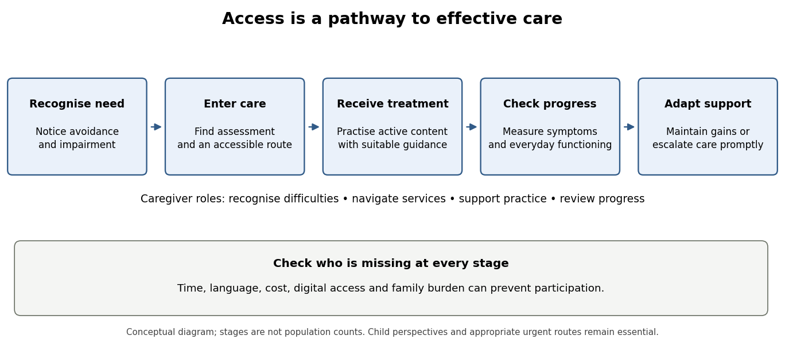

<h1 id="6/solution">Solution</h1>

↑ **Parent:** [6](../6.md)

Improving access means increasing the proportion of children who receive an effective, acceptable intervention in time, not simply increasing referrals or distributing an app. The pathway includes recognition, deciding that help is needed, finding a service, starting treatment, receiving its active content and obtaining further care when it is insufficient. Parents can influence every stage, while schools and services determine whether practical barriers make that influence effective. Access and clinical benefit should therefore be evaluated together.

[Tessa Reardon](../../../tessa-reardon.md) and colleagues interviewed parents of sixteen seven- to eleven-year-olds identified through schools as having [anxiety disorders](../../../anxiety-disorder.md). The qualitative accounts distinguished recognising a problem, recognising the need for help, contacting professionals and receiving support. This is useful evidence about the pathway and barriers experienced by families. It is not a population estimate of how often each barrier occurs, nor a trial showing that a particular information campaign increases recovery.[European Child and Adolescent Psychiatry 27, 1023–1031; interviews with parents of sixteen school-identified children aged 7–11](../../../barriers-and-facilitators-to-parents-seeking-and-accessing-professional-support-for-anxiety-disorders-in-children-qualitative-interview-study-by-tessa-reardon-and-others.md)

Recognition can be supported by concrete descriptions of avoidance and [impairment](../../../functional-impairment.md) rather than assuming caregivers know diagnostic terminology. School and primary-care routes can offer an initial assessment and an explanation of available options. Information alone, however, cannot remove an inaccessible appointment time, transport cost or long waiting list. Services should provide clear referral instructions, choices of contact mode and a way to ask questions without requiring a caregiver to become an expert navigator. Children whose parents cannot participate still need a route to care.

[Guided parent-delivered CBT](../../../guided-parent-delivered-cognitive-behavioral-therapy.md) is one approach to increasing treatment capacity. [Kerstin Thirlwall](../../../kerstin-thirlwall.md) and colleagues [randomised](../../../randomization.md) 194 children to fuller parent guidance, briefer guidance or waiting list. The fuller programme involved four face-to-face and four telephone contacts; the brief version used two of each. Reported recovery from the [principal diagnosis](../../../principal-diagnosis.md) was 50%, 39% and 25%, respectively, with clear evidence for the fuller version against waiting list but greater uncertainty for the brief version. Eligibility excluded a current [anxiety disorder](../../../anxiety-disorder.md) in the primary caregiver, limiting direct extrapolation to families who may themselves need support.[British Journal of Psychiatry 203, 436–444; 194 children, full/brief parent guidance and waiting list; primary-carer eligibility](../../../treatment-of-child-anxiety-disorders-via-guided-parent-delivered-cognitive-behavioural-therapy-by-kerstin-thirlwall-and-others.md)

The mechanism is not simply giving parents a manual. Guidance can help caregivers identify avoidance, plan manageable approach practice and alter [accommodation](../../../family-accommodation.md) while receiving feedback from a therapist. This can reduce specialist time spent directly with each [child](../../../child.md), but shifts some work onto families. Literacy, language, working hours, confidence and the caregiver's own mental health may affect participation. Flexible guidance and practical assistance should be built into delivery rather than interpreting failure to complete as parental unwillingness.

Routine-service evidence is important because research-clinic efficacy does not settle implementation. [Cathy Creswell](../../../cathy-creswell.md) and colleagues [randomised](../../../randomization.md) 136 five- to twelve-year-olds in four NHS services to brief [Guided parent-delivered CBT](../../../guided-parent-delivered-cognitive-behavioral-therapy.md) or solution-focused brief therapy. The trial did not establish a clear difference on global clinical improvement, and the economic analysis suggested a possible efficiency advantage with uncertainty. The improvement endpoint should not be relabelled [diagnostic remission](../../../diagnostic-remission.md); nor does a nonsignificant superiority result prove equivalence. The study nevertheless directly addresses a real service choice between active interventions.[Lancet Psychiatry 4, 529–539; 136 routine-service participants aged 5–12, CGI-I endpoint and economic uncertainty](../../../clinical-outcomes-and-cost-effectiveness-of-brief-guided-parent-delivered-cognitive-behavioural-therapy-and-solution-focused-brief-therapy-for-treatment-of-childhood-anxiety-disorders-a-randomised-controlled-trial-by-cathy-creswell-and-others.md)

Digital delivery offers another route, with limits. [Maral Jolstedt](../../../maral-jolstedt.md) and colleagues compared therapist-guided [Internet CBT](../../../internet-delivered-cognitive-behavioral-therapy.md) with online child-directed play in 131 eight- to twelve-year-olds. Both conditions involved twelve modules and therapist contact. [CBT](../../../cognitive-behavioral-therapy.md) improved the principal [anxiety](../../../anxiety.md) [diagnosis](../../../clinical-diagnosis.md) more often, with 48% versus 15% no longer meeting that [diagnosis](../../../clinical-diagnosis.md) at the assessed endpoint. This supports a guided programme with active clinical content and a credible comparator, not the effectiveness of every freely available [anxiety](../../../anxiety.md) app or the elimination of therapist input.[Lancet Child and Adolescent Health 2, 792–801; 131 children aged 8–12, internet CBT versus child-directed play](../../../efficacy-and-cost-effectiveness-of-therapist-guided-internet-cognitive-behavioural-therapy-for-paediatric-anxiety-disorders-a-single-centre-single-blind-randomised-controlled-trial-by-maral-jolstedt-and-others.md)

Results should not be assumed to generalise across ages and programmes. Waite and colleagues did not establish clear [remission](../../../diagnostic-remission.md) benefits for their routine-service [adolescent](../../../adolescent.md) online programme or its extra parent sessions. Nordh and colleagues found benefits for a different, disorder-specific internet programme for youth [social anxiety](../../../social-anxiety.md) against active support. These findings favour evaluating a specified treatment and delivery system, rather than treating the internet itself as the active ingredient.[Child and Adolescent Mental Health 24, 242–250; randomised parent-session allocation, primary remission and follow-up](../../../a-randomized-controlled-trial-of-internet-delivered-cognitive-behaviour-therapy-for-adolescent-anxiety-disorders-in-a-routine-clinical-care-setting-with-and-without-parent-sessions-by-polly-waite-and-others.md) [JAMA Psychiatry 78, 705–713; 103 participants aged 10–17, active comparator and masked severity ratings](../../../therapist-guided-internet-delivered-cognitive-behavioral-therapy-vs-internet-delivered-supportive-therapy-for-children-and-adolescents-with-social-anxiety-disorder-a-randomized-clinical-trial-by-martina-nordh-and-others.md)

Parent-only treatment is also distinct from parent-guided [child](../../../child.md) treatment. Lebowitz and colleagues' [SPACE treatment](../../../supportive-parenting-for-anxious-childhood-emotions.md) trial showed that changing parental [accommodation](../../../family-accommodation.md) could provide an effective route in a seven- to fourteen-year-old sample without direct [child](../../../child.md)–therapist treatment sessions. It expands the range of possible offers, but does not justify making parental participation the sole gateway for every older [adolescent](../../../adolescent.md) or assuming the same evidence covers all family circumstances.[Journal of the American Academy of Child and Adolescent Psychiatry 59, 362–372; SPACE treatment noninferiority trial, ages 7–14 and accommodation outcomes](../../../parent-based-treatment-as-efficacious-as-cognitive-behavioral-therapy-for-childhood-anxiety-a-randomized-noninferiority-study-of-supportive-parenting-for-anxious-childhood-emotions-by-eli-r-lebowitz-and-others.md)

A sensible service model would offer supported, lower-intensity care where appropriate, measure progress and provide timely escalation when improvement is inadequate. Assessment should identify complexity or urgent need that requires a different pathway immediately. Follow-up should include families who discontinue, because apparently good outcomes among completers can conceal exclusion. Remote and in-person options, interpreters, accessible materials and [attention](../../../attention.md) to digital privacy can widen participation; access should also be checked among families without reliable devices or private space.

Parents can support referral, appointments and between-session practice, but the [child](../../../child.md)'s perspective remains essential. Parent and [child](../../../child.md) reports may differ, particularly for internal [fears](../../../fear.md). For [adolescents](../../../adolescent.md), involve caregivers in a negotiated way that respects autonomy and explains [confidentiality](../../../confidentiality.md). Supportive [accommodation](../../../family-accommodation.md) reduction should not remove disability-related adjustments or expose the [child](../../../child.md) to genuine danger. An access intervention that increases coercion or burden may look efficient while reducing [acceptability](../../../treatment-acceptability.md) and sustained engagement.

A future implementation trial could [randomise](../../../randomization.md) schools or primary-care networks to an accessible parent-guided pathway with direct supported referral, versus the existing referral pathway. Cluster allocation can reduce contamination when staff change their practices across a whole site. Both pathways should provide appropriate assessment and escalation. Prespecify the eligible population, measure how many are offered help, start, receive the intended content and improve, and analyse outcomes using the cluster structure rather than treating every [child](../../../child.md) as independently allocated.

The main service endpoint should combine reach with clinically meaningful outcome, accompanied by [masked](../../../blinding.md) diagnostic follow-up and everyday functioning. Report waiting time, therapist resource use, family time, [dropout](../../../study-attrition.md) and six- or twelve-month outcomes. Examine inequalities by deprivation, language, caregiver [anxiety](../../../anxiety.md) and digital access using prespecified comparisons. A programme that reduces therapist hours but transfers an unmanageable burden to parents has not necessarily improved access. The 2022 evidence supports guided parental involvement and selected digital treatments as useful routes, embedded within assessment, support and escalation rather than offered as universal substitutes for care.

**[Figure 1](#6/image-access-to-effective-youth-anxiety-care-as-a-sequence-of-service-stages). Access to effective youth anxiety care as a sequence of service stages**.

## ↑ Ancestors (11)

1. [6](../6.md)
2. [2022](../../2022-split.md)
3. [Past exam of the child and adolescent clinical psychology course of the University of Oxford](../../split.md)
4. [Child and adolescent clinical psychology course of the University of Oxford](../../../child-and-adolescent-clinical-psychology-course-of-the-university-of-oxford.md)
5. [Year 3 of the psychology (experimental) course of the University of Oxford](../../../year-3-of-the-psychology-experimental-course-of-the-university-of-oxford.md)
6. [Psychology (experimental) course of the University of Oxford](../../../psychology-experimental-course-of-the-university-of-oxford.md)
7. [Undergraduate course of the University of Oxford](../../../undergraduate-course-of-the-university-of-oxford.md)
8. [Course of the University of Oxford](../../../course-of-the-university-of-oxford.md)
9. [University of Oxford](../../../university-of-oxford-split.md)
10. [List of universities](../../../list-of-universities.md)
11. [Codex Wiki](../../../split.md)
