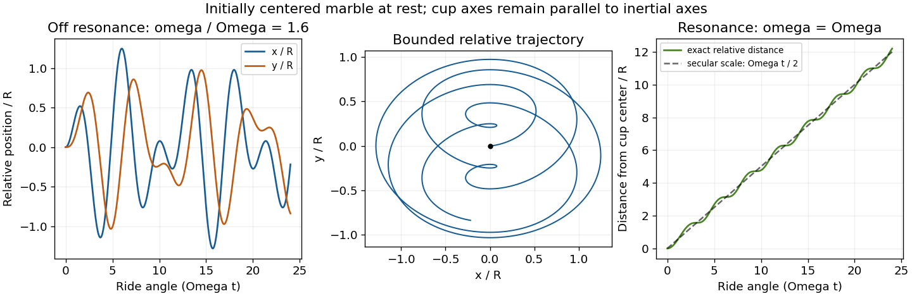

<h1 id="1/d/solution">Solution</h1>

↑ **Parent:** [D](../d.md)

For the original [Lagrangian](../../../../lagrangian.md) of [solution](../c/solution.md), differentiation with respect to the generalized [velocities](../../../../velocity.md) gives

$$
\boxed{p_{x_1}=m(\dot x_1-\nu y_1+R\Omega\sin\phi t),\qquad
p_{y_1}=m(\dot y_1+\nu x_1+R\Omega\cos\phi t).}
$$

In contrast, using $L'$ in the nonrotating case gives $p'_{x_1}=m\dot x_1$, $p'_{y_1}=m\dot y_1$; this is the expected [momentum](../../../../momentum-split.md) shift under adding a [total derivative](../../../../total-derivative.md).

The [Euler-Lagrange equations](../../../../euler-lagrange-equation.md) in the general cup frame are

$$
\ddot{\mathbf q}+2\nu\mathsf J\dot{\mathbf q}+(\omega^2-\nu^2)\mathbf q
=R\Omega^2(\cos\phi t,-\sin\phi t).
$$

These include the Coriolis and centrifugal terms when the cup axes really rotate. Set $z_q=x_1+iy_1$ to obtain

$$
\ddot z_q+2i\nu\dot z_q+(\omega^2-\nu^2)z_q=R\Omega^2e^{-i\phi t}.
$$

For $\omega^2\ne\Omega^2$, its complete solution is

$$
\boxed{z_q(t)=A e^{i(\omega-\nu)t}+B e^{-i(\omega+\nu)t}
+\frac{R\Omega^2}{\omega^2-\Omega^2}e^{-i\phi t},}
$$

where the two complex constants provide the four real initial data. The driving denominator is independent of cup-axis [rotation](../../../../rotation-mathematics.md): [rotation](../../../../rotation-mathematics.md) changes the coordinate description, not the physical trap frequency.

In the requested special case $\nu=0$, an equivalent real form is

$$
\boxed{\begin{aligned}
x_1(t)&=a_x\cos\omega t+b_x\sin\omega t+D\cos\Omega t,\\
y_1(t)&=a_y\cos\omega t+b_y\sin\omega t+D\sin\Omega t,
\qquad D=\frac{R\Omega^2}{\omega^2-\Omega^2}.
\end{aligned}}
$$

For example $a_x=x_1(0)-D$, $b_x=\dot x_1(0)/\omega$, $a_y=y_1(0)$ and $b_y=[\dot y_1(0)-D\Omega]/\omega$ determine the constants.

At [resonance](../../../../resonance.md) $\omega^2=\Omega^2$ with nonzero $\Omega$, replace the particular term by

$$
\boxed{z_{q,\rm res}(t)=-\frac{iR\Omega}{2}\,t\,e^{-i\phi t}.}
$$

In the nonrotating cup frame this has components $(R\Omega t\sin\Omega t/2,-R\Omega t\cos\Omega t/2)$, plus the homogeneous solution. Secular growth eventually invalidates a finite cup or the neglected vertical [kinetic energy](../../../../kinetic-energy.md). If the ride does not rotate, its forcing vanishes and ordinary free oscillations remain.

**[Figure 1](#1/d/image-marble-response-in-a-nonrotating-cup-frame-with-a-circularly-accelerating-origin-bounded-off-resonant-motion-and-secular-resonant-growth-starting-at-the-cup-center-at-rest). Marble response in a nonrotating cup frame with a circularly accelerating origin: bounded off-resonant motion and secular resonant growth, starting at the cup center at rest**.

## ↑ Ancestors (12)

1. [D](../d.md)
2. [1](../../1.md)
3. [2016](../../../2016-split.md)
4. [Past exam of the classical mechanics course of Part B of the physics course of the University of Oxford](../../../split.md)
5. [Classical mechanics course of Part B of the physics course of the University of Oxford](../../../../classical-mechanics-course-of-part-b-of-the-physics-course-of-the-university-of-oxford.md)
6. [Year 3 of the physics course of the University of Oxford](../../../../year-3-of-the-physics-course-of-the-university-of-oxford.md)
7. [Physics course of the University of Oxford](../../../../physics-course-of-the-university-of-oxford.md)
8. [Undergraduate course of the University of Oxford](../../../../undergraduate-course-of-the-university-of-oxford.md)
9. [Course of the University of Oxford](../../../../course-of-the-university-of-oxford.md)
10. [University of Oxford](../../../../university-of-oxford-split.md)
11. [List of universities](../../../../list-of-universities.md)
12. [Codex Wiki](../../../../split.md)
