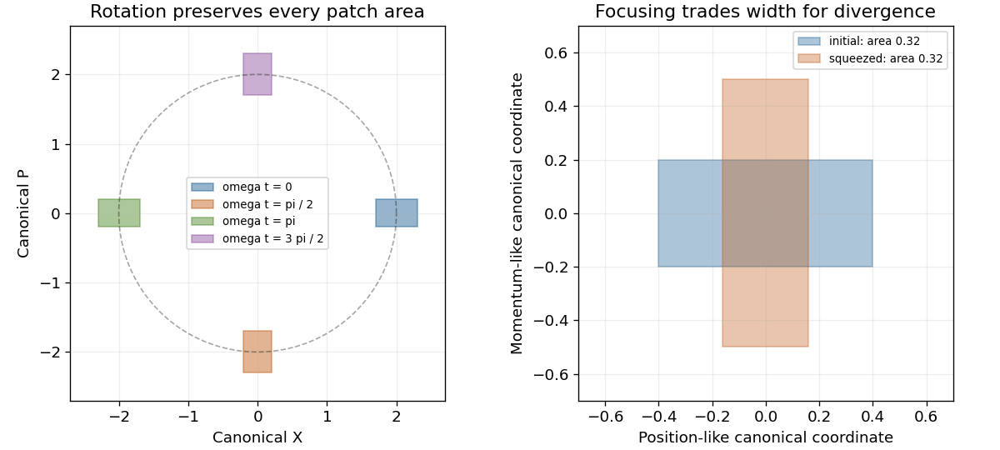

<h1 id="3/c/solution">Solution</h1>

↑ **Parent:** [C](../c.md)

Solving $\dot x=p/m$, $\dot p=-m\omega^2x$ gives the linear phase flow

$$
\begin{pmatrix}x(t)\\p(t)\end{pmatrix}
=\begin{pmatrix}\cos\omega t&\sin\omega t/(m\omega)\\
-m\omega\sin\omega t&\cos\omega t\end{pmatrix}
\begin{pmatrix}x_0\\p_0\end{pmatrix}.
$$

Its [Jacobian determinant](../../../../jacobian-determinant.md) is

$$
\boxed{\frac{\partial(x(t),p(t))}{\partial(x_0,p_0)}
=\cos^2\omega t+\sin^2\omega t=1.}
$$

Hence every patch keeps its area $dx\,dp$, directly verifying [Liouville's theorem](../../../../liouville-theorem.md). The [energy](../../../../energy-split.md) ellipses are also invariant, but area preservation applies to arbitrary patches, not just whole [energy](../../../../energy-split.md) shells.

In scaled [canonical coordinates](../../../../canonical-variables.md) $X=\sqrt{m\omega}\,x$, $P=p/\sqrt{m\omega}$ the flow is a rigid clockwise [rotation](../../../../rotation-mathematics.md), $(X,P)=(X_0\cos\omega t+P_0\sin\omega t,-X_0\sin\omega t+P_0\cos\omega t)$. The following original plot follows an off-center patch and shows equal areas at successive times.

**[Figure 2](#3/c/image-area-preserving-harmonic-oscillator-flow-the-same-phase-space-patch-at-four-times-with-a-focusing-squeeze-that-trades-position-width-against-momentum-width). Area-preserving harmonic-oscillator flow: the same phase-space patch at four times, with a focusing squeeze that trades position width against momentum width**.

## ↑ Ancestors (12)

1. [C](../c.md)
2. [3](../../3.md)
3. [2016](../../../2016-split.md)
4. [Past exam of the classical mechanics course of Part B of the physics course of the University of Oxford](../../../split.md)
5. [Classical mechanics course of Part B of the physics course of the University of Oxford](../../../../classical-mechanics-course-of-part-b-of-the-physics-course-of-the-university-of-oxford.md)
6. [Year 3 of the physics course of the University of Oxford](../../../../year-3-of-the-physics-course-of-the-university-of-oxford.md)
7. [Physics course of the University of Oxford](../../../../physics-course-of-the-university-of-oxford.md)
8. [Undergraduate course of the University of Oxford](../../../../undergraduate-course-of-the-university-of-oxford.md)
9. [Course of the University of Oxford](../../../../course-of-the-university-of-oxford.md)
10. [University of Oxford](../../../../university-of-oxford-split.md)
11. [List of universities](../../../../list-of-universities.md)
12. [Codex Wiki](../../../../split.md)
