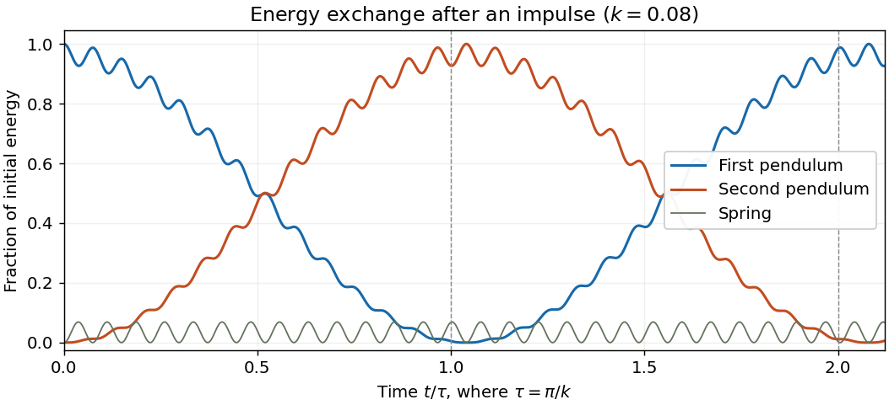

# 2023

↑ **Parent:** [Past exam of the classical mechanics course of the University of Oxford](../past-exam-of-the-classical-mechanics-course-of-the-university-of-oxford.md)

Solutions to all three questions of the [University of Oxford](../university-of-oxford.md) Part B [classical mechanics](../classical-mechanics.md) examination, sat on 16 June 2023. Source: [original released PDF, bundle pages 260–263; paper pages 1–4](https://www.whatdotheyknow.com/request/request_for_mathematics_examinat/response/3129786/attach/3/FOI%20202507%20740%20Data.pdf#page=260).

**Table of contents**

- [1](#1)
  - [a](#1/a)
    - [Solution](#1/a/solution)
  - [b](#1/b)
    - [i](#1/b/i)
      - [Solution](#1/b/i/solution)
    - [ii](#1/b/ii)
      - [Solution](#1/b/ii/solution)
  - [c](#1/c)
    - [Solution](#1/c/solution)
- [2](#2)
  - [a](#2/a)
    - [i](#2/a/i)
      - [Solution](#2/a/i/solution)
    - [ii](#2/a/ii)
      - [Solution](#2/a/ii/solution)
  - [b](#2/b)
    - [i](#2/b/i)
      - [Solution](#2/b/i/solution)
    - [ii](#2/b/ii)
      - [Solution](#2/b/ii/solution)
    - [iii](#2/b/iii)
      - [Solution](#2/b/iii/solution)
    - [iv](#2/b/iv)
      - [Solution](#2/b/iv/solution)
- [3](#3)
  - [a](#3/a)
    - [i](#3/a/i)
      - [Solution](#3/a/i/solution)
    - [ii](#3/a/ii)
      - [Solution](#3/a/ii/solution)
    - [iii](#3/a/iii)
      - [Solution](#3/a/iii/solution)
    - [iv](#3/a/iv)
      - [Solution](#3/a/iv/solution)
    - [v](#3/a/v)
      - [Solution](#3/a/v/solution)
  - [b](#3/b)
    - [i](#3/b/i)
      - [Solution](#3/b/i/solution)
    - [ii](#3/b/ii)
      - [Solution](#3/b/ii/solution)
  - [c](#3/c)
    - [i](#3/c/i)
      - [Solution](#3/c/i/solution)
    - [ii](#3/c/ii)
      - [Solution](#3/c/ii/solution)
    - [iii](#3/c/iii)
      - [Solution](#3/c/iii/solution)

## 1

↑ **Parent:** [2023](2023.md)

<h3 id="1/a">a</h3>

↑ **Parent:** [1](#1)

<h4 id="1/a/solution">Solution</h4>

↑ **Parent:** [A](#1/a)

Each [simple pendulum](../simple-pendulum.md) moves in the vertical plane containing the pivots. Ignoring contact between the ideal rods and [point masses](../classical-mechanics.md#point-mass), each rod can turn through a full [circle](../topology.md#circle). Thus the [configuration space](../classical-mechanics.md#mechanical-configuration-space) is the [torus](../topological-surface.md#torus)

$$
\boxed{\mathcal Q=S^1\times S^1.}
$$

Choose [generalized coordinates](../lagrangian-mechanics.md#generalized-coordinate) $\theta_1,\theta_2$, measured from the downward vertical, positive towards the right and understood modulo $2\pi$. These [angles](../geometry-and-topology.md#angle) are local coordinates on the [torus](../topological-surface.md#torus), rather than a single globally one-to-one real [coordinate chart](../differential-geometry.md#manifold-chart). With upward Cartesian coordinate $y$, the bob [positions](../classical-mechanics.md#position) are

$$
\mathbf r_1=(l\sin\theta_1,-l\cos\theta_1),\qquad
\mathbf r_2=(r+l\sin\theta_2,-l\cos\theta_2).
$$

Their [velocities](../classical-mechanics.md#velocity) satisfy $|\dot{\mathbf r}_j|^2=l^2\dot\theta_j^2$, so [kinetic energy from Cartesian position vectors](../lagrangian-mechanics.md#kinetic-energy-from-cartesian-position-vectors) gives

$$
T=\frac{ml^2}{2}(\dot\theta_1^2+\dot\theta_2^2).
$$

The [spring](../elasticity-physics.md#spring) length is the [Euclidean distance](../topological-analysis.md#euclidean-distance)

$$
d=|\mathbf r_2-\mathbf r_1|
=\sqrt{\bigl(r+l(\sin\theta_2-\sin\theta_1)\bigr)^2+l^2(\cos\theta_2-\cos\theta_1)^2}.
$$

Taking gravitational [potential energy](../energy.md#potential-energy) zero at pivot height gives $V_g=-mgl(\cos\theta_1+\cos\theta_2)$. The [spring](../elasticity-physics.md#spring) [potential energy](../energy.md#potential-energy) is $V_s=k(d-r)^2/2$, since $r$ is its natural length. Consequently the [Lagrangian](../calculus-of-variations.md#lagrangian) is

$$
\boxed{L=T-V_g-V_s
=\frac{ml^2}{2}(\dot\theta_1^2+\dot\theta_2^2)
+mgl(\cos\theta_1+\cos\theta_2)-\frac{k}{2}(d-r)^2.}
$$

In the paper's notation $t(\theta_1,\theta_2)=V_s$; this function is distinct from the time variable. This is the [exact Lagrangian of two spring-coupled pendulums](../simple-pendulum.md#exact-lagrangian-of-two-spring-coupled-pendulums).

One alternative [Lagrangian](../calculus-of-variations.md#lagrangian) is

$$
\boxed{\widetilde L=L-2mgl.}
$$

It corresponds to setting gravitational [potential energy](../energy.md#potential-energy) zero at the downward position. The constant disappears from every [Euler-Lagrange equation](../analysis.md#euler-lagrange-equation). More generally, [total-time-derivative invariance of a Lagrangian](../lagrangian-mechanics.md#total-time-derivative-invariance-of-a-lagrangian) allows $\widetilde L=L+dF(\theta_1,\theta_2,t)/dt$ for any smooth $F$.

<h3 id="1/b">b</h3>

↑ **Parent:** [1](#1)

<h4 id="1/b/i">i</h4>

↑ **Parent:** [B](#1/b)

<h5 id="1/b/i/solution">Solution</h5>

↑ **Parent:** [I](#1/b/i)

Set $l=m=g=1$. At $(\theta_1,\theta_2)=(0,0)$ the [spring](../elasticity-physics.md#spring) has $d=r$, so its [potential energy](../energy.md#potential-energy) has zero [gradient](../multivariable-calculus.md#gradient): $\partial_jV_s=k(d-r)\partial_jd=0$. The gravitational [potential energy](../energy.md#potential-energy) has $\partial_jV_g=\sin\theta_j=0$ there. Zero [velocities](../classical-mechanics.md#velocity) therefore satisfy the [Euler-Lagrange equations](../analysis.md#euler-lagrange-equation), proving this is an [equilibrium](../dynamical-systems.md#equilibrium-point-of-a-dynamical-system).

For fixed $r>0$, let $\varepsilon=\max(|\theta_1|,|\theta_2|)$ and $\delta=\theta_2-\theta_1$. The [Taylor series](../calculus.md#taylor-series) give

$$
\sin\theta_2-\sin\theta_1=\delta+O(\varepsilon^3),\qquad
\cos\theta_2-\cos\theta_1=O(\varepsilon^2).
$$

Thus, near the downward [equilibrium](../dynamical-systems.md#equilibrium-point-of-a-dynamical-system), the horizontal separation is positive and

$$
d=\sqrt{\bigl(r+\delta+O(\varepsilon^3)\bigr)^2+O(\varepsilon^4)}
=r+\delta+O(\varepsilon^3).
$$

In particular, $V_s=k\delta^2/2+O(\varepsilon^4)$ and $V_g=-2+(\theta_1^2+\theta_2^2)/2+O(\varepsilon^4)$. Dropping the additive constant and terms beyond quadratic order gives the [harmonic approximation](../lagrangian-mechanics.md#harmonic-approximation)

$$
\boxed{L_{\mathrm{quadratic}}=\frac12(\dot\theta_1^2+\dot\theta_2^2)
-\frac12\left(\theta_1^2+\theta_2^2+k(\theta_1-\theta_2)^2\right).}
$$

For physical [spring constant](../elasticity-physics.md#spring-constant) $k\geq0$, the quadratic [potential energy](../energy.md#potential-energy) is a [positive-definite quadratic form](../quadratic-form.md#positive-definite-quadratic-form). The downward position is therefore a [stable equilibrium in Lagrangian mechanics](../lagrangian-mechanics.md#stable-equilibrium-in-lagrangian-mechanics), and its nearby motion admits [small oscillations](../lagrangian-mechanics.md#small-oscillation).

<h4 id="1/b/ii">ii</h4>

↑ **Parent:** [B](#1/b)

<h5 id="1/b/ii/solution">Solution</h5>

↑ **Parent:** [Ii](#1/b/ii)

The [Euler-Lagrange equations](../analysis.md#euler-lagrange-equation) of the quadratic [Lagrangian](../calculus-of-variations.md#lagrangian) are

$$
\ddot{\boldsymbol\theta}+\mathsf K\boldsymbol\theta=0,\qquad
\mathsf K=\begin{pmatrix}1+k&-k\\-k&1+k\end{pmatrix}.
$$

The [mechanical mass matrix](../lagrangian-mechanics.md#mechanical-mass-matrix) is the identity. A [normal mode](../wave-equation.md#normal-mode) $\boldsymbol\theta=\mathbf a\cos(\omega t+\phi)$ therefore satisfies the [eigenvalue problem](../linear-operator-theory.md#eigenvalue-problem) $\mathsf K\mathbf a=\omega^2\mathbf a$. Direct multiplication gives

$$
\boxed{\begin{array}{c|c|c}
&\text{angular frequency}&\text{mode vector}\\\hline
\text{in phase}&\omega_+=1&(1,1)\\
\text{opposite phase}&\omega_-=\sqrt{1+2k}&(1,-1)
\end{array}}
$$

These are [normal modes of two spring-coupled equal pendulums](../wave.md#normal-modes-of-two-spring-coupled-equal-pendulums). The corresponding [normal mode coordinates](../classical-mechanics.md#normal-coordinate) $u=\theta_1+\theta_2$ and $v=\theta_1-\theta_2$ obey $\ddot u+u=0$ and $\ddot v+(1+2k)v=0$.

For the in-phase [normal mode](../wave-equation.md#normal-mode), the bobs undergo identical [displacements](../classical-mechanics.md#displacement), leaving their separation exactly $r$. The [spring](../elasticity-physics.md#spring) stays at its natural length and exerts no [force](../force.md), so this [angular frequency](../lagrangian-mechanics.md#angular-frequency) is independent of $k$. The value $1$ is the individual [simple pendulum](../simple-pendulum.md) [angular frequency](../lagrangian-mechanics.md#angular-frequency) $\sqrt{g/l}$ in the chosen units.

<h3 id="1/c">c</h3>

↑ **Parent:** [1](#1)

<h4 id="1/c/solution">Solution</h4>

↑ **Parent:** [C](#1/c)

Write $w=\sqrt{1+2k}$. The [initial conditions](../differential-equation.md#initial-condition) on the [normal mode coordinates](../classical-mechanics.md#normal-coordinate) are $u(0)=v(0)=0$ and $\dot u(0)=\dot v(0)=k$. Solving the two [harmonic oscillator equations](../classical-mechanics.md#simple-harmonic-motion) and recovering the original [angles](../geometry-and-topology.md#angle) gives the exact solution within the [harmonic approximation](../lagrangian-mechanics.md#harmonic-approximation):

$$
\boxed{\theta_1(t)=\frac{k}{2}\left(\sin t+\frac{\sin wt}{w}\right),\qquad
\theta_2(t)=\frac{k}{2}\left(\sin t-\frac{\sin wt}{w}\right).}
$$

Their [angular velocities](../rigid-body-dynamics.md#angular-velocity) are $\dot\theta_1=k(\cos t+\cos wt)/2$ and $\dot\theta_2=k(\cos t-\cos wt)/2$, which verify all four [initial conditions](../differential-equation.md#initial-condition).

To expose the [beat](../physical-optics.md#beat), define $\Delta=w-1$ and $\Omega=(w+1)/2$. Replacing $1/w$ by $1$ changes each [angle](../geometry-and-topology.md#angle) by $O(k^2)$ uniformly in time. The sum-to-product identities then give

$$
\begin{aligned}
\theta_1&=k\sin(\Omega t)\cos(\Delta t/2)+O(k^2),&
\dot\theta_1&=k\cos(\Omega t)\cos(\Delta t/2),\\
\theta_2&=-k\cos(\Omega t)\sin(\Delta t/2)+O(k^2),&
\dot\theta_2&=k\sin(\Omega t)\sin(\Delta t/2).
\end{aligned}
$$

The displayed [angular velocities](../rigid-body-dynamics.md#angular-velocity) are exact in the linear system. The [absolute and signed beat envelopes](../wave.md#absolute-and-signed-beat-envelopes) have leading [amplitudes](../wave.md#wave-amplitude) $k|\cos(\Delta t/2)|$ and $k|\sin(\Delta t/2)|$. Because $\Delta=k+O(k^2)$, at $\tau=\pi/k$ we have $\Delta\tau/2=\pi/2+O(k)$ and $\Omega\tau=\tau+\pi/2+O(k)$. Hence

$$
\boxed{\begin{aligned}
\theta_1(\tau)&=O(k^2),&\dot\theta_1(\tau)&=O(k^2),\\
\theta_2(\tau)&=k\sin\tau+O(k^2),&\dot\theta_2(\tau)&=k\cos\tau+O(k^2).
\end{aligned}}
$$

The first [simple pendulum](../simple-pendulum.md) has negligible [oscillation](../wave.md#oscillation) [amplitude](../wave.md#wave-amplitude). Its [kinetic energy](../energy.md#kinetic-energy) is $T_1(\tau)=O(k^4)$, while the second has $T_2(\tau)=k^2\cos^2\tau/2+O(k^3)$. Thus, to the retained order, all instantaneous [kinetic energy](../energy.md#kinetic-energy) belongs to the second [simple pendulum](../simple-pendulum.md). The fast phase can make that [kinetic energy](../energy.md#kinetic-energy) small: the whole initial [energy](../energy.md) $k^2/2$ is transferred as the second [simple pendulum](../simple-pendulum.md)'s combined [kinetic energy](../energy.md#kinetic-energy) and gravitational [potential energy](../energy.md#potential-energy), since

$$
\frac12\left(\dot\theta_2(\tau)^2+\theta_2(\tau)^2\right)=\frac{k^2}{2}+O(k^3),
\qquad V_s(\tau)=O(k^3).
$$

This is [energy transfer after an impulse in two weakly coupled oscillators](../wave.md#energy-transfer-after-an-impulse-in-two-weakly-coupled-oscillators). It does not require $\cos\tau=1$.

At $2\tau$, $\Delta(2\tau)/2=\pi+O(k)$, so the [beat](../physical-optics.md#beat) has returned the [oscillation](../wave.md#oscillation) to the first [simple pendulum](../simple-pendulum.md):

$$
\boxed{\begin{aligned}
\theta_1(2\tau)&=k\sin(2\tau)+O(k^2),&\dot\theta_1(2\tau)&=k\cos(2\tau)+O(k^2),\\
\theta_2(2\tau)&=O(k^2),&\dot\theta_2(2\tau)&=O(k^2).
\end{aligned}}
$$

The [energy](../energy.md) localization returns, although the fast [oscillation](../wave.md#oscillation) phase need not equal its initial phase. The exact first minimum of the leading [beat](../physical-optics.md#beat) envelope is at $\pi/\Delta$, whose leading value is $\pi/k$. Keeping the slow phase $\Delta t$ is essential: expanding $\sin(wt)$ at fixed $t$ and then using $t=O(1/k)$ would lose the [energy](../energy.md) exchange. Although [angles](../geometry-and-topology.md#angle) are retained only to order $k$, their leading [energies](../energy.md) are of order $k^2$.

**[Figure 1](#1/c/image-pendulum-energy-exchange-after-an-initial-velocity-impulse). Pendulum energy exchange after an initial velocity impulse**. The exact linear solution at $k=0.08$, with each pendulum's kinetic plus uncoupled gravitational potential energy divided by the initial total energy. The small remaining fraction is spring potential energy. Vertical lines mark $t=\pi/k$ and $t=2\pi/k$.

## 2

↑ **Parent:** [2023](2023.md)

<h3 id="2/a">a</h3>

↑ **Parent:** [2](#2)

<h4 id="2/a/i">i</h4>

↑ **Parent:** [A](#2/a)

<h5 id="2/a/i/solution">Solution</h5>

↑ **Parent:** [I](#2/a/i)

Take the origin at the [centre of mass](../classical-mechanics.md#center-of-mass), so $\int_B\rho\mathbf r\,d^3r=0$, and write $r_i=\mathbf r\cdot\mathbf e_i$ in the specified [orthonormal basis](../inner-product.md#orthonormal-basis). The [inertia tensor](../rigid-body-dynamics.md#inertia-tensor) is

$$
\boxed{I_{ij}=\int_B\rho(\mathbf r)\left(|\mathbf r|^2\delta_{ij}-r_ir_j\right)\,d^3r.}
$$

Here $\delta_{ij}$ is the [Kronecker delta](../multilinear-algebra.md#kronecker-delta). For a [rigid body](../rigid-body-dynamics.md) with [angular velocity](../rigid-body-dynamics.md#angular-velocity) $\boldsymbol\omega$, this [tensor](../multilinear-algebra.md#tensor) gives $\mathbf L=\mathbf I\boldsymbol\omega$ and [rotational kinetic energy](../energy.md#rotational-kinetic-energy) $T=\boldsymbol\omega\cdot\mathbf I\boldsymbol\omega/2$.

The [inertia tensor](../rigid-body-dynamics.md#inertia-tensor) is a real [symmetric matrix](../linear-algebra.md#symmetric-matrix), so it admits an [orthonormal basis](../inner-product.md#orthonormal-basis) of [eigenvectors](../linear-operator-theory.md#eigenvector). The lines in these [eigenvector](../linear-operator-theory.md#eigenvector) directions through the [centre of mass](../classical-mechanics.md#center-of-mass) are its [principal axes](../rigid-body-dynamics.md#principal-axis); the corresponding [eigenvalues](../linear-operator-theory.md#eigenvalue) $I_1,I_2,I_3$ are its [principal moments of inertia](../rigid-body-dynamics.md#principal-moment-of-inertia):

$$
\boxed{\mathbf I\mathbf e_i=I_i\mathbf e_i,\qquad
\mathbf I=\operatorname{diag}(I_1,I_2,I_3)\quad\text{in principal axes}.}
$$

If an [eigenvalue](../linear-operator-theory.md#eigenvalue) repeats, the corresponding [principal axes](../rigid-body-dynamics.md#principal-axis) need not be unique.

<h4 id="2/a/ii">ii</h4>

↑ **Parent:** [A](#2/a)

<h5 id="2/a/ii/solution">Solution</h5>

↑ **Parent:** [Ii](#2/a/ii)

Put $\mathbf r=(x,y,z)$ with $\mathbf e_3$ along $z$, and interpret the symmetry as [axisymmetry](../multivariable-calculus.md#axisymmetric-vector-field) of the whole [mass density](../fluid-mechanics.md#density). A half-turn about $\mathbf e_3$ sends $(x,y,z)$ to $(-x,-y,z)$ and leaves the integration domain and [mass density](../fluid-mechanics.md#density) invariant. Therefore $\int\rho xz\,d^3r=\int\rho yz\,d^3r=0$. A quarter-turn sends $(x,y,z)$ to $(-y,x,z)$; it gives

$$
\int\rho xy\,d^3r=-\int\rho xy\,d^3r=0,\qquad
\int\rho x^2\,d^3r=\int\rho y^2\,d^3r.
$$

All off-diagonal entries of the [inertia tensor](../rigid-body-dynamics.md#inertia-tensor) consequently vanish. Writing $s^2=x^2+y^2$, the [principal moments of inertia](../rigid-body-dynamics.md#principal-moment-of-inertia) satisfy

$$
\boxed{I_1=I_2=\int_B\rho\left(\frac{s^2}{2}+z^2\right)\,d^3r,\qquad
I_3=\int_B\rho s^2\,d^3r.}
$$

Thus every [orthonormal basis](../inner-product.md#orthonormal-basis) with third vector along the symmetry axis is a [principal body frame](../rigid-body-dynamics.md#principal-body-frame). This is [axisymmetry of the inertia tensor](../rigid-body-dynamics.md#axisymmetry-of-the-inertia-tensor). In general there is no requirement that $I_3=I_1$.

<h3 id="2/b">b</h3>

↑ **Parent:** [2](#2)

<h4 id="2/b/i">i</h4>

↑ **Parent:** [B](#2/b)

<h5 id="2/b/i/solution">Solution</h5>

↑ **Parent:** [I](#2/b/i)

For a vector $\mathbf A=\sum_i A_i\mathbf e_i$ in the [principal body frame](../rigid-body-dynamics.md#principal-body-frame), the [derivative of a body-fixed basis vector](../rigid-body-dynamics.md#derivative-of-a-body-fixed-basis-vector) is $(d\mathbf e_i/dt)_{\widehat S}=\boldsymbol\omega\times\mathbf e_i$. Differentiating the expansion gives the [rotating-frame derivative formula](../mathematical-physics.md#rotating-frame-derivative-formula), also called the Coriolis formula:

$$
\left(\frac{d\mathbf A}{dt}\right)_{\widehat S}
=\left(\frac{d\mathbf A}{dt}\right)_S+\boldsymbol\omega\times\mathbf A.
$$

Apply this to [angular momentum](../momentum.md#angular-momentum) $\mathbf L=\sum_iI_i\omega_i\mathbf e_i$. The [principal moments of inertia](../rigid-body-dynamics.md#principal-moment-of-inertia) are constant in the [principal body frame](../rigid-body-dynamics.md#principal-body-frame), so external [torque](../momentum.md#torque) balance becomes

$$
\boldsymbol\tau=\mathbf I\dot{\boldsymbol\omega}+\boldsymbol\omega\times(\mathbf I\boldsymbol\omega).
$$

Resolving the [cross product](../vector-space.md#cross-product) gives [Euler's equations](../rigid-body-dynamics.md#euler-s-equations-rigid-body-dynamics):

$$
\boxed{\begin{aligned}
I_1\dot\omega_1+(I_3-I_2)\omega_2\omega_3&=\tau_1,\\
I_2\dot\omega_2+(I_1-I_3)\omega_3\omega_1&=\tau_2,\\
I_3\dot\omega_3+(I_2-I_1)\omega_1\omega_2&=\tau_3.
\end{aligned}}
$$

All components and dotted components in this display refer to the [principal body frame](../rigid-body-dynamics.md#principal-body-frame).

<h4 id="2/b/ii">ii</h4>

↑ **Parent:** [B](#2/b)

<h5 id="2/b/ii/solution">Solution</h5>

↑ **Parent:** [Ii](#2/b/ii)

For the [symmetric top](../rigid-body-dynamics.md#symmetric-top), set $I_1=I_2=J$. The third of [Euler's equations](../rigid-body-dynamics.md#euler-s-equations-rigid-body-dynamics) reduces to $I_3\dot\omega_3=\tau_3=0$. Thus the axial [angular velocity](../rigid-body-dynamics.md#angular-velocity) component is a [conserved quantity](../hamiltonian-mechanics.md#conserved-quantity):

$$
\boxed{\omega_3(t)=\omega_3(0).}
$$

The transverse [angular velocity](../rigid-body-dynamics.md#angular-velocity) components are generally variable. A [torque](../momentum.md#torque) constant in the [principal body frame](../rigid-body-dynamics.md#principal-body-frame) generally rotates in the [inertial frame](../mathematical-physics.md#inertial-frame); constancy in the two frames is different.

<h4 id="2/b/iii">iii</h4>

↑ **Parent:** [B](#2/b)

<h5 id="2/b/iii/solution">Solution</h5>

↑ **Parent:** [Iii](#2/b/iii)

Let $J=I_1=I_2$, $\omega_3=c$ and

$$
z(t)=\omega_1(t)+i\omega_2(t),\qquad
\nu=\frac{(I_3-J)c}{J}.
$$

Here $c$ and $\nu$ are constant. The first two of [Euler's equations](../rigid-body-dynamics.md#euler-s-equations-rigid-body-dynamics) give $\dot\omega_1=-\nu\omega_2+\tau_0/J$ and $\dot\omega_2=\nu\omega_1+\tau_0/J$. Combining them produces

$$
\boxed{\dot z=i\nu z+\frac{\tau_0}{J}(1+i).}
$$

Multiplication by the [integrating factor](../linear-ordinary-differential-equation.md#integrating-factor) $e^{-i\nu t}$ gives, for $\nu\ne0$,

$$
z(t)=z(0)e^{i\nu t}+\frac{\tau_0(1+i)}{i\nu J}\left(e^{i\nu t}-1\right).
$$

For completeness, $\nu=0$ instead gives $z(t)=z(0)+\tau_0(1+i)t/J$. These formulas describe a [symmetric top under constant transverse body torque](../rigid-body-dynamics.md#symmetric-top-under-constant-transverse-body-torque).

The stated [initial conditions](../differential-equation.md#initial-condition) require $b\ne0$ and $I_3\ne J$. They give $c=b/(I_3-J)$, $\nu=b/J$ and $z(0)=i\tau_0/b$. Substitution and simplification yield

$$
z(t)=\frac{\tau_0}{b}\left(e^{ibt/J}-1+i\right).
$$

Taking the [real part](../complex-analysis.md#real-part) and [imaginary part](../complex-analysis.md#imaginary-part), the [angular velocity](../rigid-body-dynamics.md#angular-velocity) in the [principal body frame](../rigid-body-dynamics.md#principal-body-frame) is

$$
\boxed{\boldsymbol\omega(t)=\left(
\frac{\tau_0}{b}\left[\cos\left(\frac{bt}{I_1}\right)-1\right],\quad
\frac{\tau_0}{b}\left[\sin\left(\frac{bt}{I_1}\right)+1\right],\quad
\frac{b}{I_3-I_1}\right).}
$$

Its value at $t=0$ is the required [initial condition](../differential-equation.md#initial-condition); differentiating the first two components verifies both forced [Euler's equations](../rigid-body-dynamics.md#euler-s-equations-rigid-body-dynamics).

<h4 id="2/b/iv">iv</h4>

↑ **Parent:** [B](#2/b)

<h5 id="2/b/iv/solution">Solution</h5>

↑ **Parent:** [Iv](#2/b/iv)

Now take zero [torque](../momentum.md#torque) and $\boldsymbol\omega(0)=(1,0,1)$. The axial [angular velocity](../rigid-body-dynamics.md#angular-velocity) is $\omega_3=1$ and the complex transverse component obeys $\dot z=i\nu z$ with $z(0)=1$ and $\nu=(I_3-I_1)/I_1$. Hence the [angular momentum](../momentum.md#angular-momentum) components in the [principal body frame](../rigid-body-dynamics.md#principal-body-frame) are

$$
\boxed{\mathbf L_S(t)=\left(I_1\cos\nu t,\ I_1\sin\nu t,\ I_3\right),\qquad
\nu=\frac{I_3-I_1}{I_1}.}
$$

The transverse projection therefore traces a [circle](../topology.md#circle) with signed [angular frequency](../lagrangian-mechanics.md#angular-frequency) $\nu$. Its magnitude is constant, $L=\sqrt{I_1^2+I_3^2}$.

In the [inertial frame](../mathematical-physics.md#inertial-frame), zero [torque](../momentum.md#torque) means that $\mathbf L$ is fixed. Using

$$
\mathbf L=I_1\boldsymbol\omega+(I_3-I_1)\omega_3\mathbf e_3
$$

and the [derivative of a body-fixed basis vector](../rigid-body-dynamics.md#derivative-of-a-body-fixed-basis-vector), the symmetry axis satisfies

$$
\dot{\mathbf e}_3=\boldsymbol\omega\times\mathbf e_3
=\frac{\mathbf L}{I_1}\times\mathbf e_3.
$$

Thus there is uniform [torque-free precession of a symmetric top](../rigid-body-dynamics.md#torque-free-precession-of-a-symmetric-top) about the fixed [angular momentum](../momentum.md#angular-momentum), at a constant cone [angle](../geometry-and-topology.md#angle) $\beta$ and space [angular frequency](../lagrangian-mechanics.md#angular-frequency)

$$
\boxed{\cos\beta=\frac{I_3}{\sqrt{I_1^2+I_3^2}},\qquad
\Omega_{\mathrm{space}}=\frac{\sqrt{I_1^2+I_3^2}}{I_1}.}
$$

The cone [angle](../geometry-and-topology.md#angle) stays constant, with no [nutation](../rigid-body-dynamics.md#nutation). The [body-frame and space-frame frequencies of free symmetric-top precession](../rigid-body-dynamics.md#body-frame-and-space-frame-frequencies-of-free-symmetric-top-precession) differ: $\nu$ describes rotating components, whereas $\Omega_{\mathrm{space}}$ describes the symmetry axis in space. The formulas also cover $I_3=I_1$, where the [angular momentum](../momentum.md#angular-momentum) components in the [principal body frame](../rigid-body-dynamics.md#principal-body-frame) are constant.

## 3

↑ **Parent:** [2023](2023.md)

<h3 id="3/a">a</h3>

↑ **Parent:** [3](#3)

<h4 id="3/a/i">i</h4>

↑ **Parent:** [A](#3/a)

<h5 id="3/a/i/solution">Solution</h5>

↑ **Parent:** [I](#3/a/i)

Define the [canonical momenta](../hamiltonian-mechanics.md#canonical-momentum) by

$$
\boxed{p_i=\frac{\partial L}{\partial\dot q_i}(\mathbf q,\dot{\mathbf q},t),\qquad i=1,\ldots,n.}
$$

To obtain an ordinary unconstrained [Hamiltonian](../hamiltonian-mechanics.md#hamiltonian), assume a [regular Lagrangian](../classical-mechanics.md#regular-lagrangian): the velocity [Hessian matrix](../multivariable-calculus.md#hessian-matrix) $\bigl(\partial^2L/\partial\dot q_i\partial\dot q_j\bigr)$ is invertible. The [inverse function theorem](../multivariable-calculus.md#inverse-function-theorem) then lets us solve locally for $\dot{\mathbf q}=\mathbf v(\mathbf q,\mathbf p,t)$. The [phase space](../hamiltonian-mechanics.md#phase-space) is the [cotangent bundle](../symplectic-geometry.md#cotangent-bundle) $T^*\mathcal Q$, with local [canonical coordinates](../hamiltonian-mechanics.md#canonical-variables) $(\mathbf q,\mathbf p)$ and dimension $2n$. The [Legendre transform in mechanics](../classical-mechanics.md#legendre-transform-in-mechanics) defines

$$
\boxed{H(\mathbf q,\mathbf p,t)=\sum_{i=1}^np_iv_i(\mathbf q,\mathbf p,t)
-L\bigl(\mathbf q,\mathbf v(\mathbf q,\mathbf p,t),t\bigr).}
$$

The velocities in this formula have been eliminated in favour of [phase space](../hamiltonian-mechanics.md#phase-space) variables. A [hyperregular Lagrangian](../classical-mechanics.md#hyperregular-lagrangian) makes this construction global; regularity alone guarantees it locally. [Hamilton's equations](../hamiltonian-mechanics.md#hamilton-s-equations) are

$$
\boxed{\dot q_i=\frac{\partial H}{\partial p_i},\qquad
\dot p_i=-\frac{\partial H}{\partial q_i},\qquad i=1,\ldots,n.}
$$

<h4 id="3/a/ii">ii</h4>

↑ **Parent:** [A](#3/a)

<h5 id="3/a/ii/solution">Solution</h5>

↑ **Parent:** [Ii](#3/a/ii)

In [canonical coordinates](../hamiltonian-mechanics.md#canonical-variables) on [phase space](../hamiltonian-mechanics.md#phase-space), the [Poisson bracket](../hamiltonian-mechanics.md#poisson-bracket) is

$$
\boxed{\{f,g\}=\sum_{i=1}^n\left(
\frac{\partial f}{\partial q_i}\frac{\partial g}{\partial p_i}
-\frac{\partial f}{\partial p_i}\frac{\partial g}{\partial q_i}\right).}
$$

It treats $t$ as a parameter. Along a solution of [Hamilton's equations](../hamiltonian-mechanics.md#hamilton-s-equations), the [chain rule](../calculus.md#chain-rule) gives

$$
\frac{df}{dt}=\sum_i\left(f_{q_i}\dot q_i+f_{p_i}\dot p_i\right)+f_t
=\sum_i\left(f_{q_i}H_{p_i}-f_{p_i}H_{q_i}\right)+f_t.
$$

Therefore the [Hamiltonian conservation law](../hamiltonian-mechanics.md#hamiltonian-conservation-law) is

$$
\boxed{\frac{df}{dt}=\{f,H\}+\frac{\partial f}{\partial t}.}
$$

The total [derivative](../calculus.md#derivative) follows the trajectory; the explicit [partial derivative](../multivariable-calculus.md#partial-derivative) holds $(\mathbf q,\mathbf p)$ fixed.

<h4 id="3/a/iii">iii</h4>

↑ **Parent:** [A](#3/a)

<h5 id="3/a/iii/solution">Solution</h5>

↑ **Parent:** [Iii](#3/a/iii)

The [Poisson bracket](../hamiltonian-mechanics.md#poisson-bracket) is antisymmetric, so $\{H,H\}=0$. The [Hamiltonian energy balance](../hamiltonian-mechanics.md#hamiltonian-energy-balance) consequently gives

$$
\boxed{\frac{dH}{dt}=\frac{\partial H}{\partial t}=0.}
$$

For a [regular Lagrangian](../classical-mechanics.md#regular-lagrangian) the [Legendre transform in mechanics](../classical-mechanics.md#legendre-transform-in-mechanics) gives $H_t=-L_t$, evaluated at the corresponding velocity. In particular, a [Lagrangian](../calculus-of-variations.md#lagrangian) with no explicit time dependence has [time-translation symmetry](../calculus-of-variations.md#time-translation-symmetry). [Noether theorem](../calculus-of-variations.md#noether-theorem) associates this continuous [symmetry](../physics.md#symmetry-physics) of the [action](../lagrangian-mechanics.md#action) with the [conserved quantity](../hamiltonian-mechanics.md#conserved-quantity) $\sum_i\dot q_i\partial L/\partial\dot q_i-L=H$. For an ordinary natural mechanical [Lagrangian](../calculus-of-variations.md#lagrangian) $L=T-V$, with $T$ quadratic in the velocities, this quantity is the total [energy](../energy.md) $T+V$.

<h4 id="3/a/iv">iv</h4>

↑ **Parent:** [A](#3/a)

<h5 id="3/a/iv/solution">Solution</h5>

↑ **Parent:** [Iv](#3/a/iv)

Set $D=\partial_t+\{\,\cdot\,,H\}$. The hypotheses mean $Df=Dg=0$ as identities on [phase space](../hamiltonian-mechanics.md#phase-space). By the [Jacobi identity for the Poisson bracket](../hamiltonian-mechanics.md#jacobi-identity-for-the-poisson-bracket),

$$
\{\{f,g\},H\}=\{\{f,H\},g\}+\{f,\{g,H\}\}.
$$

Also, the [product rule](../calculus.md#product-rule) applied to the defining coordinate formula gives

$$
\partial_t\{f,g\}=\{f_t,g\}+\{f,g_t\}.
$$

Adding these identities proves

$$
D\{f,g\}=\{Df,g\}+\{f,Dg\}.
$$

Consequently

$$
\boxed{\frac{d}{dt}\{f,g\}=0.}
$$

This proves the [Poisson bracket of time-dependent conserved quantities](../hamiltonian-mechanics.md#poisson-bracket-of-time-dependent-conserved-quantities) theorem, including explicit time dependence of $f$ and $g$.

<h4 id="3/a/v">v</h4>

↑ **Parent:** [A](#3/a)

<h5 id="3/a/v/solution">Solution</h5>

↑ **Parent:** [V](#3/a/v)

Since $H$ is a [conserved quantity](../hamiltonian-mechanics.md#conserved-quantity), the [Hamiltonian energy balance](../hamiltonian-mechanics.md#hamiltonian-energy-balance) gives $H_t=0$. Since $f$ is a [conserved quantity](../hamiltonian-mechanics.md#conserved-quantity), $f_t+\{f,H\}=0$. Take an explicit [partial derivative](../multivariable-calculus.md#partial-derivative) with respect to time, holding the [phase space](../hamiltonian-mechanics.md#phase-space) coordinates fixed:

$$
f_{tt}+\{f_t,H\}+\{f,H_t\}=0.
$$

The last [Poisson bracket](../hamiltonian-mechanics.md#poisson-bracket) vanishes because $H_t=0$. Thus

$$
\boxed{\frac{d}{dt}\left(\frac{\partial f}{\partial t}\right)
=f_{tt}+\{f_t,H\}=0.}
$$

This is the [time derivative of a conserved quantity for an autonomous Hamiltonian](../hamiltonian-mechanics.md#time-derivative-of-a-conserved-quantity-for-an-autonomous-hamiltonian). The conservation hypotheses are understood to hold for every trajectory, as identities on [phase space](../hamiltonian-mechanics.md#phase-space).

<h3 id="3/b">b</h3>

↑ **Parent:** [3](#3)

<h4 id="3/b/i">i</h4>

↑ **Parent:** [B](#3/b)

<h5 id="3/b/i/solution">Solution</h5>

↑ **Parent:** [I](#3/b/i)

The [canonical momentum](../hamiltonian-mechanics.md#canonical-momentum) of the [harmonic oscillator](../classical-mechanics.md#simple-harmonic-motion) is $p=\partial L_0/\partial\dot q=m\dot q$. Substituting $\dot q=p/m$ into the [Legendre transform in mechanics](../classical-mechanics.md#legendre-transform-in-mechanics) gives

$$
\boxed{p=m\dot q,\qquad
H_0(q,p)=p\dot q-L_0=\frac{p^2}{2m}+\frac{m\omega^2q^2}{2}.}
$$

<h4 id="3/b/ii">ii</h4>

↑ **Parent:** [B](#3/b)

<h5 id="3/b/ii/solution">Solution</h5>

↑ **Parent:** [Ii](#3/b/ii)

Work on $I>0$, with a local choice of the periodic [angle](../geometry-and-topology.md#angle) $\theta$. The inverse formulas are

$$
I=\frac12\left(\alpha q^2+\frac{p^2}{\alpha}\right),\qquad
\theta=\operatorname{atan2}(\alpha q,p)\pmod{2\pi}.
$$

In particular, $\theta_q=p/(2I)$, $\theta_p=-q/(2I)$, $I_q=\alpha q$ and $I_p=p/\alpha$. Their [Poisson bracket](../hamiltonian-mechanics.md#poisson-bracket) is

$$
\boxed{\{\theta,I\}=\frac{p^2}{2I\alpha}+\frac{\alpha q^2}{2I}=1.}
$$

The other fundamental [Poisson brackets](../hamiltonian-mechanics.md#poisson-bracket) vanish by antisymmetry. Thus this is a [canonical transformation](../hamiltonian-mechanics.md#canonical-transformation) for every $\alpha>0$, on local charts away from the origin. At $I=0$ the [angle](../geometry-and-topology.md#angle) is undefined.

In the new coordinates the [harmonic oscillator](../classical-mechanics.md#simple-harmonic-motion) [Hamiltonian](../hamiltonian-mechanics.md#hamiltonian) is

$$
H_0(\theta,I)=I\left(\frac{\alpha}{m}\cos^2\theta
+\frac{m\omega^2}{\alpha}\sin^2\theta\right).
$$

For $I$ to be a [conserved quantity](../hamiltonian-mechanics.md#conserved-quantity) throughout [phase space](../hamiltonian-mechanics.md#phase-space), [Hamilton's equations](../hamiltonian-mechanics.md#hamilton-s-equations) require $\dot I=-\partial_\theta H_0=0$ identically. The two coefficients must coincide. For the usual $m>0$ and $\omega>0$, positivity of $\alpha$ selects

$$
\boxed{\alpha=m\omega,\qquad H_0=\omega I,\qquad
I(t)=I(0),\qquad\theta(t)=\theta(0)+\omega t\pmod{2\pi}.}
$$

These are [harmonic oscillator action-angle variables](../hamiltonian-mechanics.md#harmonic-oscillator-action-angle-variables); the [action variable](../hamiltonian-mechanics.md#action-variable) is $I=H_0/\omega$.

<h3 id="3/c">c</h3>

↑ **Parent:** [3](#3)

<h4 id="3/c/i">i</h4>

↑ **Parent:** [C](#3/c)

<h5 id="3/c/i/solution">Solution</h5>

↑ **Parent:** [I](#3/c/i)

A [type-two generating function for a canonical transformation](../hamiltonian-mechanics.md#type-two-generating-function-for-a-canonical-transformation) uses the mixed variables $(q,P)$ and defines

$$
\boxed{p=\frac{\partial F_2}{\partial q},\qquad
Q=\frac{\partial F_2}{\partial P}.}
$$

For a local invertible [canonical transformation](../hamiltonian-mechanics.md#canonical-transformation), require $F_{2,qP}\ne0$ so that $p=F_{2,q}(q,P)$ can be solved for $P$. The differential identity $dF_2=p\,dq+Q\,dP$ gives $d(F_2-PQ)=p\,dq-P\,dQ$, expressing preservation of the canonical [symplectic form](../symplectic-geometry.md#symplectic-form).

<h4 id="3/c/ii">ii</h4>

↑ **Parent:** [C](#3/c)

<h5 id="3/c/ii/solution">Solution</h5>

↑ **Parent:** [Ii](#3/c/ii)

On the interior of the principal inverse-cosine branch, $0<q<\pi$, the given [canonical transformation](../hamiltonian-mechanics.md#canonical-transformation) has

$$
Q=\cos q\cos P,\qquad
\sqrt{1-Q^2\sec^2P}=\sin q,\qquad
p=-\sin q\sin P.
$$

Integrating $Q=\partial_PF_2$ suggests $F_2=\cos q\sin P+C(q)$. Its other derivative is $\partial_qF_2=-\sin q\sin P+C'(q)$; comparison with $p$ requires $C'(q)=0$. Hence a suitable [type-two generating function for a canonical transformation](../hamiltonian-mechanics.md#type-two-generating-function-for-a-canonical-transformation) is

$$
\boxed{F_2(q,P)=\cos q\sin P.}
$$

Both derivative equations reproduce the specified transformation exactly. Its mixed derivative is $F_{2,qP}=-\sin q\cos P$, so it defines a local [canonical transformation](../hamiltonian-mechanics.md#canonical-transformation) where $0<q<\pi$ and $\cos P\ne0$, equivalently where $|Q/\cos P|<1$. At $q=0,\pi$ or $\cos P=0$, the stated formulas fail to give a regular coordinate chart. These restrictions explain the square-root branch and the local meaning of canonicity. This is a [trigonometric type-two canonical transformation](../hamiltonian-mechanics.md#trigonometric-type-two-canonical-transformation).

<h4 id="3/c/iii">iii</h4>

↑ **Parent:** [C](#3/c)

<h5 id="3/c/iii/solution">Solution</h5>

↑ **Parent:** [Iii](#3/c/iii)

For a time-dependent [type-two generating function for a canonical transformation](../hamiltonian-mechanics.md#type-two-generating-function-for-a-canonical-transformation), the differential identity

$$
p\,dq-H\,dt=P\,dQ-K\,dt+d(F_2-PQ)
$$

gives $K=H+\partial_tF_2$, with the [partial derivative](../multivariable-calculus.md#partial-derivative) taken at fixed $(q,P)$. Here $F_2=\cos q\sin P$ has no explicit time dependence, so the [Hamiltonian](../hamiltonian-mechanics.md#hamiltonian) correction is

$$
\boxed{\Lambda(Q,P,t)=0,\qquad
K(Q,P,t)=H\left(\arccos\frac{Q}{\cos P},
-\sin P\sqrt{1-Q^2\sec^2P},t\right).}
$$

As always, adding a function of time alone to the new [Hamiltonian](../hamiltonian-mechanics.md#hamiltonian) leaves [Hamilton's equations](../hamiltonian-mechanics.md#hamilton-s-equations) unchanged. Choosing a time-independent [type-two generating function for a canonical transformation](../hamiltonian-mechanics.md#type-two-generating-function-for-a-canonical-transformation) fixes that irrelevant freedom and gives the displayed $\Lambda=0$.

## ↑ Ancestors (9)

1. [Past exam of the classical mechanics course of the University of Oxford](../past-exam-of-the-classical-mechanics-course-of-the-university-of-oxford.md)
2. [Classical mechanics course of the University of Oxford](../university-of-oxford.md#classical-mechanics-course-of-the-university-of-oxford)
3. [Year 3 of the mathematics course of the University of Oxford](../university-of-oxford.md#year-3-of-the-mathematics-course-of-the-university-of-oxford)
4. [Mathematics course of the University of Oxford](../university-of-oxford.md#mathematics-course-of-the-university-of-oxford)
5. [Undergraduate course of the University of Oxford](../university-of-oxford.md#undergraduate-course-of-the-university-of-oxford)
6. [Course of the University of Oxford](../university-of-oxford.md#course-of-the-university-of-oxford)
7. [University of Oxford](../university-of-oxford.md)
8. [List of universities](../README.md#list-of-universities)
9. [Codex Wiki](../README.md)
