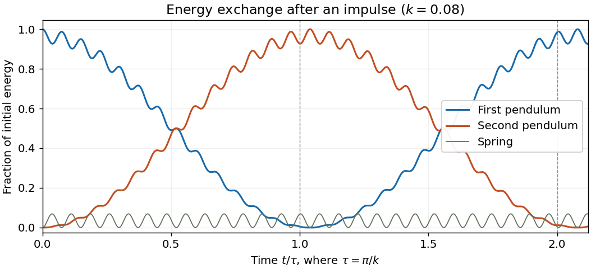

<h1 id="1/c/solution">Solution</h1>

↑ **Parent:** [C](../c.md)

Write $w=\sqrt{1+2k}$. The [initial conditions](../../../../initial-condition.md) on the [normal mode coordinates](../../../../normal-coordinate.md) are $u(0)=v(0)=0$ and $\dot u(0)=\dot v(0)=k$. Solving the two [harmonic oscillator equations](../../../../simple-harmonic-motion.md) and recovering the original [angles](../../../../angle.md) gives the exact solution within the [harmonic approximation](../../../../harmonic-approximation.md):

$$
\boxed{\theta_1(t)=\frac{k}{2}\left(\sin t+\frac{\sin wt}{w}\right),\qquad
\theta_2(t)=\frac{k}{2}\left(\sin t-\frac{\sin wt}{w}\right).}
$$

Their [angular velocities](../../../../angular-velocity.md) are $\dot\theta_1=k(\cos t+\cos wt)/2$ and $\dot\theta_2=k(\cos t-\cos wt)/2$, which verify all four [initial conditions](../../../../initial-condition.md).

To expose the [beat](../../../../beat.md), define $\Delta=w-1$ and $\Omega=(w+1)/2$. Replacing $1/w$ by $1$ changes each [angle](../../../../angle.md) by $O(k^2)$ uniformly in time. The sum-to-product identities then give

$$
\begin{aligned}
\theta_1&=k\sin(\Omega t)\cos(\Delta t/2)+O(k^2),&
\dot\theta_1&=k\cos(\Omega t)\cos(\Delta t/2),\\
\theta_2&=-k\cos(\Omega t)\sin(\Delta t/2)+O(k^2),&
\dot\theta_2&=k\sin(\Omega t)\sin(\Delta t/2).
\end{aligned}
$$

The displayed [angular velocities](../../../../angular-velocity.md) are exact in the linear system. The [absolute and signed beat envelopes](../../../../absolute-and-signed-beat-envelopes.md) have leading [amplitudes](../../../../wave-amplitude.md) $k|\cos(\Delta t/2)|$ and $k|\sin(\Delta t/2)|$. Because $\Delta=k+O(k^2)$, at $\tau=\pi/k$ we have $\Delta\tau/2=\pi/2+O(k)$ and $\Omega\tau=\tau+\pi/2+O(k)$. Hence

$$
\boxed{\begin{aligned}
\theta_1(\tau)&=O(k^2),&\dot\theta_1(\tau)&=O(k^2),\\
\theta_2(\tau)&=k\sin\tau+O(k^2),&\dot\theta_2(\tau)&=k\cos\tau+O(k^2).
\end{aligned}}
$$

The first [simple pendulum](../../../../simple-pendulum-split.md) has negligible [oscillation](../../../../oscillation.md) [amplitude](../../../../wave-amplitude.md). Its [kinetic energy](../../../../kinetic-energy.md) is $T_1(\tau)=O(k^4)$, while the second has $T_2(\tau)=k^2\cos^2\tau/2+O(k^3)$. Thus, to the retained order, all instantaneous [kinetic energy](../../../../kinetic-energy.md) belongs to the second [simple pendulum](../../../../simple-pendulum-split.md). The fast phase can make that [kinetic energy](../../../../kinetic-energy.md) small: the whole initial [energy](../../../../energy-split.md) $k^2/2$ is transferred as the second [simple pendulum](../../../../simple-pendulum-split.md)'s combined [kinetic energy](../../../../kinetic-energy.md) and gravitational [potential energy](../../../../potential-energy.md), since

$$
\frac12\left(\dot\theta_2(\tau)^2+\theta_2(\tau)^2\right)=\frac{k^2}{2}+O(k^3),
\qquad V_s(\tau)=O(k^3).
$$

This is [energy transfer after an impulse in two weakly coupled oscillators](../../../../energy-transfer-after-an-impulse-in-two-weakly-coupled-oscillators.md). It does not require $\cos\tau=1$.

At $2\tau$, $\Delta(2\tau)/2=\pi+O(k)$, so the [beat](../../../../beat.md) has returned the [oscillation](../../../../oscillation.md) to the first [simple pendulum](../../../../simple-pendulum-split.md):

$$
\boxed{\begin{aligned}
\theta_1(2\tau)&=k\sin(2\tau)+O(k^2),&\dot\theta_1(2\tau)&=k\cos(2\tau)+O(k^2),\\
\theta_2(2\tau)&=O(k^2),&\dot\theta_2(2\tau)&=O(k^2).
\end{aligned}}
$$

The [energy](../../../../energy-split.md) localization returns, although the fast [oscillation](../../../../oscillation.md) phase need not equal its initial phase. The exact first minimum of the leading [beat](../../../../beat.md) envelope is at $\pi/\Delta$, whose leading value is $\pi/k$. Keeping the slow phase $\Delta t$ is essential: expanding $\sin(wt)$ at fixed $t$ and then using $t=O(1/k)$ would lose the [energy](../../../../energy-split.md) exchange. Although [angles](../../../../angle.md) are retained only to order $k$, their leading [energies](../../../../energy-split.md) are of order $k^2$.

**[Figure 1](#1/c/image-pendulum-energy-exchange-after-an-initial-velocity-impulse). Pendulum energy exchange after an initial velocity impulse**. The exact linear solution at $k=0.08$, with each pendulum's kinetic plus uncoupled gravitational potential energy divided by the initial total energy. The small remaining fraction is spring potential energy. Vertical lines mark $t=\pi/k$ and $t=2\pi/k$.

## ↑ Ancestors (12)

1. [C](../c.md)
2. [1](../../1.md)
3. [2023](../../../2023-split.md)
4. [Past exam of the classical mechanics course of the University of Oxford](../../../split.md)
5. [Classical mechanics course of the University of Oxford](../../../../classical-mechanics-course-of-the-university-of-oxford.md)
6. [Year 3 of the mathematics course of the University of Oxford](../../../../year-3-of-the-mathematics-course-of-the-university-of-oxford.md)
7. [Mathematics course of the University of Oxford](../../../../mathematics-course-of-the-university-of-oxford.md)
8. [Undergraduate course of the University of Oxford](../../../../undergraduate-course-of-the-university-of-oxford.md)
9. [Course of the University of Oxford](../../../../course-of-the-university-of-oxford.md)
10. [University of Oxford](../../../../university-of-oxford-split.md)
11. [List of universities](../../../../list-of-universities.md)
12. [Codex Wiki](../../../../split.md)
