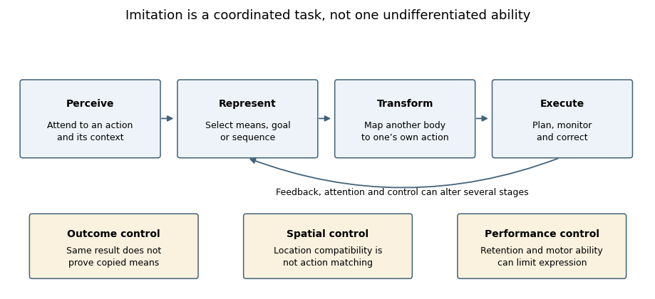
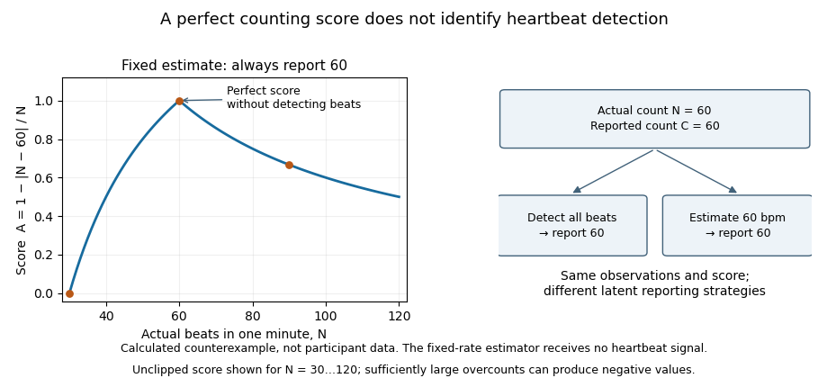

# 2022

↑ **Parent:** [Past exam of the clinical social cognitive neuroscience course of the University of Oxford](../past-exam-of-the-clinical-social-cognitive-neuroscience-course-of-the-university-of-oxford.md)

Study answers to every option in the clinical [social cognition](../psychology.md#social-cognition) examination of 25 May 2022. Source release: [released examination PDF](https://www.whatdotheyknow.com/request/experimental_psychology_past_exa/response/2757831/attach/3/New%20Compressed%20zipped%20Folder.zip?cookie_passthrough=1). The original examination required a choice of three; this resource covers all six without reproducing the statements.

Scientific claims use evidence available by the examination date. Diagnostic groups, individual cognitive profiles and causal mechanisms are distinguished; illustrative calculations are not experimental measurements.

**Table of contents**

- [1](#1)
  - [Solution](#1/solution)
- [2](#2)
  - [Solution](#2/solution)
- [3](#3)
  - [Solution](#3/solution)
- [4](#4)
  - [Solution](#4/solution)
- [5](#5)
  - [Solution](#5/solution)
- [6](#6)
  - [Solution](#6/solution)

## 1

↑ **Parent:** [2022](2022.md)

<h3 id="1/solution">Solution</h3>

↑ **Parent:** [1](#1)

**[Theory of mind](../animal-behaviour.md#theory-of-mind) and [affective empathy](../psychology.md#affective-empathy) are partly dissociable psychological capacities, while [cognitive empathy](../psychology.md#cognitive-empathy) overlaps substantially with mental-state understanding.** A person can understand that another has a mistaken [belief](../psychology.md#belief) without sharing the person’s [emotion](../psychology.md#emotion); conversely, another’s distress can elicit an affective response without accurate reasoning about its cause. These possibilities do not establish wholly independent modules. The central question is which operations, measurements and circumstances can be separated.

[Theory of mind](../animal-behaviour.md#theory-of-mind) concerns representing [mental states](../psychology.md#mental-state) such as [beliefs](../psychology.md#belief), knowledge, [desires](../psychology.md#desire) and [intentions](../psychology.md#intention). It can include non-emotional content: predicting where someone will search after an unseen object transfer need not involve feeling that person’s disappointment. [Affective empathy](../psychology.md#affective-empathy) involves sharing aspects of another’s [affect](../psychology.md#affect) with a [self-other distinction](../psychology.md#self-other-distinction). [Cognitive empathy](../psychology.md#cognitive-empathy) concerns understanding another’s emotional perspective and therefore recruits some of the operations also called [theory of mind](../animal-behaviour.md#theory-of-mind). [Compassion](../psychology.md#compassion), the concern that motivates helping, is different again; [personal distress](../psychology.md#personal-distress) can be intensely aversive to the observer without yielding accurate understanding or useful assistance. Whether “[empathy](../psychology.md#empathy)” dissociates from [mentalizing](../animal-behaviour.md#theory-of-mind) consequently depends partly on which component is meant.

Psychological dissociation requires more than two differently named tasks. A [belief](../psychology.md#belief) story also demands [language](../README.md#language), [working memory](../neuroscience.md#working-memory) and response selection; a [pain](../neuroscience.md#pain) picture demands visual [attention](../psychology.md#attention) and interpretation. Differences between a story test and an emotional-rating scale could therefore reflect [task impurity](../design-of-experiments.md#task-impurity). A single [correlation](../variance.md#pearson-correlation-coefficient) is equally inconclusive: shared verbal skill or a general tendency to endorse questionnaire items can create apparent unity. Conversely, noisy measurements can conceal a genuine association. The strongest designs measure both constructs within the same people, distinguish their target demands and include independent measures of validity.

The [EmpaToM](../animal-behaviour.md#empatom) paradigm provides a useful example. Short autobiographical videos varied emotional content independently of whether a subsequent question required mental-state inference or factual reasoning. [Affect](../psychology.md#affect) and [compassion](../psychology.md#compassion) ratings were obtained separately from reasoning performance. In the large validation experiment, the corresponding behavioural indices related selectively to activity in distinguishable networks, including [anterior insula](../neuroscience.md#anterior-insula) for [affect sharing](../psychology.md#affective-empathy) and temporoparietal regions for [mentalizing](../animal-behaviour.md#theory-of-mind). This supports separability within one task framework, rather than relying solely on unrelated literatures. It does not establish that the constructs never interact or that their measurement is perfectly pure.[Abstract and Experiments 1–2, pp. 6–19: factorial manipulation, behavioural validation and selective brain–behaviour relationships](../psychology-bibliography.md#dissecting-the-social-brain-introducing-the-empatom-to-reveal-distinct-neural-networks-and-brain-behavior-relations-for-empathy-and-theory-of-mind-by-philipp-kanske-and-others)

Earlier imaging studies help specify the contrast. A self/partner [pain](../neuroscience.md#pain) experiment identified shared affect-related activity without identical recruitment of every sensory component of directly experienced [pain](../neuroscience.md#pain). Belief-story experiments contrasted mental representation with nonmental representation, rather than merely contrasting people with objects. Together these findings suggest different component computations; overlapping or distinct blood-oxygenation signals cannot alone establish psychological identity or independence. An anatomical label is not a definition of [empathy](../psychology.md#empathy), and activating a region implicated in several processes cannot uniquely diagnose which process occurred.[Abstract: self-pain versus partner-pain conditions and affective/sensory contrasts](../psychology-bibliography.md#empathy-for-pain-involves-the-affective-but-not-sensory-components-of-pain-by-tania-singer-and-others)[Experiments 1–2: belief versus nonmental-representation controls](../psychology-bibliography.md#people-thinking-about-thinking-people-the-role-of-the-temporo-parietal-junction-in-theory-of-mind-by-rebecca-saxe-and-others)

Lesion evidence can strengthen the inference. A study comparing inferior-frontal and ventromedial-prefrontal lesions reported different patterns of emotional and [cognitive empathy](../psychology.md#cognitive-empathy) impairment, a behavioural [double dissociation](../psychology.md#double-dissociation). That pattern argues against a simple single ability differing only in overall difficulty. However, lesions [affect](../psychology.md#affect) networks as well as local tissue, groups can differ in lesion extent, and the measures operationalize particular components rather than all possible mental-state understanding. The result supports multiple contributions, not a claim that one region contains every affective response and another every social inference.[Abstract and pp. 617–627: lesion-group comparison and cognitive/emotional empathy measures](../psychology-bibliography.md#two-systems-for-empathy-a-double-dissociation-between-emotional-and-cognitive-empathy-in-inferior-frontal-gyrus-versus-ventromedial-prefrontal-lesions-by-simone-g-shamay-tsoory-and-others)

Atypical development also makes [confounding](../causal-inference.md#confounding) visible. In an empathy-for-pain study, [insula](../neuroscience.md#insular-cortex) responses tracked [alexithymia](../psychology.md#alexithymia) across [autistic](../psychiatry.md#autism) and non-[autistic](../psychiatry.md#autism) participants rather than diagnostic group after adjustment. This challenges the inference that a difficulty in one aspect of [social cognition](../psychology.md#social-cognition) necessarily entails an absence of [affect sharing](../psychology.md#affective-empathy). It remains correlational evidence, and a nonsignificant adjusted group difference is not a proof of exact equivalence.[Abstract and anterior-insula analyses: alexithymia assessed across both groups](../psychology-bibliography.md#empathic-brain-responses-in-insula-are-modulated-by-levels-of-alexithymia-but-not-autism-by-geoffrey-bird-and-others)

The capacities can nevertheless cooperate. Understanding that someone is grieving can direct [attention](../psychology.md#attention) toward relevant cues; sharing discomfort can motivate further inquiry into its cause. An observer’s own [emotion](../psychology.md#emotion) may also bias interpretation, so stronger [affect](../psychology.md#affect) is not guaranteed to produce more accurate [mentalizing](../animal-behaviour.md#theory-of-mind). Accurate understanding can support compassionate help or strategic manipulation depending on [motivation](../psychology.md#motivation). These examples distinguish computational interaction from identity: two processes can causally influence one another without being the same process.

The distinction between capacity and spontaneous deployment is especially important. An explicit instruction may elicit reasoning that would not occur automatically in a distracting interaction. A person can also understand another’s state while declining to report an [emotion](../psychology.md#emotion), or feel concern while finding a questionnaire difficult. Better tests combine accuracy, ratings, behavioural choices and physiological measures, while checking [reliability](../psychology.md#psychometric-reliability), [language](../README.md#language) demands and [response bias](../psychology.md#response-bias). Training or perturbation should produce a selective change on independently validated outcomes before being taken as evidence of a psychological separation.

The justified conclusion is therefore graded. Mental-state representation, [affect sharing](../psychology.md#affective-empathy), compassionate concern and self-directed distress can be distinguished conceptually and empirically, with converging task, imaging and lesion evidence. The strongest dissociation concerns [mentalizing](../animal-behaviour.md#theory-of-mind) and [affect sharing](../psychology.md#affective-empathy), rather than every use of the word [empathy](../psychology.md#empathy). Real interactions recruit these components together with [attention](../psychology.md#attention), [learning](../animal-behaviour.md#learning) and [motivation](../psychology.md#motivation); explaining that coordination is more informative than either treating all social understanding as one ability or assuming completely insulated systems.

## 2

↑ **Parent:** [2022](2022.md)

<h3 id="2/solution">Solution</h3>

↑ **Parent:** [2](#2)

**[Mirror neurons](../neuron.md#mirror-neuron) provide an observation–execution matching property that can contribute to action processing; their existence does not establish one exclusive function such as reading [intentions](../psychology.md#intention).** Plausible roles include linking seen actions to motor representations, predicting familiar action sequences and supporting [imitation](../animal-behaviour.md#imitation). The evidence is strongest when a specified task, representation and causal contribution are identified, and weaker when every social capacity is attributed to a broadly defined mirror system.

The original evidence was unusually direct. Single-neuron recordings in macaque premotor area F5 identified cells active both when the animal performed an action and when it observed a related action. Some observation–execution relations were relatively specific, whereas others generalized across aspects of the act. This is evidence about individual recorded cells, rather than merely overlapping brain regions. Yet the experimenter’s action label does not tell us exactly what the cell encodes: movement, object interaction, learned outcome and context can covary.[Summary and pp. 593–609: macaque F5 recordings and observation–execution congruence](../psychology-bibliography.md#action-recognition-in-the-premotor-cortex-by-vittorio-gallese-and-others)

An important extension tested incomplete visual information. Some cells responded when the final object interaction was hidden but could be inferred from the preceding situation. Thus a full visual display of the critical movement was not always necessary for activation. This is compatible with an internally generated action representation or prediction. It is not proof that a [neuron](../neuron.md) understands another person’s [beliefs](../psychology.md#belief), nor that the representation is generated without input from other visual or contextual systems. Familiar-context prediction and mental-state attribution are distinguishable hypotheses.[Abstract and pp. 155–165: responses during visible and occluded action completion](../psychology-bibliography.md#i-know-what-you-are-doing-a-neurophysiological-study-by-maria-alessandra-umilta-and-others)

Human evidence requires care about measurement scale. Functional imaging showing activation during both action observation and execution can involve different cell populations within one voxel. A [motor-evoked potential](../physiology.md#motor-evoked-potential) during observation measures a downstream excitability change, not one cell’s selectivity. Intracranial recordings in a clinical epilepsy sample did identify individual observation–execution matching responses, including in supplementary motor and medial-temporal regions. That establishes relevant human cellular responses in the sampled tissue. Electrode placement was clinically determined, however, so it does not supply a representative census of the putative inferior-frontal/parietal system or of the general population.[Abstract and Experimental Procedures: individual-unit responses, clinical sample and electrode-placement constraints](../psychology-bibliography.md#single-neuron-responses-in-humans-during-execution-and-observation-of-actions-by-roy-mukamel-and-others)

A functional claim then needs a task contrast. Recognizing that a hand grasps an object, anticipating how a lift will unfold, judging the object’s weight and understanding a deceptive [intention](../psychology.md#intention) are not interchangeable forms of “[action understanding](../psychology.md#action-understanding).” Matching circuitry could improve one without being necessary for all. It may supply motor predictions that combine with visual object knowledge and contextual inference. Calling every successful judgment simulation would make the hypothesis difficult to falsify; the account must predict a deficit or response pattern that alternatives do not predict.

A stimulation experiment addressed a narrower causal question. Disrupting left inferior frontal cortex impaired judgments of a box’s weight from a person lifting it, with comparison tasks involving a bouncing ball and stimulus duration and comparison stimulation sites. These controls strengthen the inference that this region contributes to interpreting the action under those conditions. The manipulation still affected a cortical region, not selectively its [mirror neurons](../neuron.md#mirror-neuron). It therefore cannot establish that mirror cells are the sole mechanism, or that the region is necessary for all conceptual understanding of actions.[Summary and Results, pp. 524–529: weight judgments, nonhuman-motion/duration controls and stimulation sites](../psychology-bibliography.md#action-understanding-requires-the-left-inferior-frontal-cortex-by-gorana-pobric-and-others)

Developmental origin is a separate question from present function. In counter-mirror training, participants repeatedly performed one finger action while observing another. Subsequent muscle-specific responses to motor-cortex stimulation changed from the usual matching pattern toward the trained mismatching relation. This supports experience-dependent calibration of the action-observation/motor relationship. It challenges an account in which every relevant mapping is fixed and independent of experience, while leaving open contributions from developmental constraints. The measure was a motor-evoked response, so the experiment did not directly reprogramme an individually recorded mirror cell.[Abstract and pp. 1527–1531: pre/post training muscle-specific responses and reversed sensorimotor pairing](../psychology-bibliography.md#sensorimotor-learning-configures-the-human-mirror-system-by-caroline-catmur-and-others)

This evidence also separates function from adaptation. A learned matching circuit may currently assist prediction or action selection even if it was not selected by evolution specifically to understand minds. Conversely, showing a plausible contribution to [imitation](../animal-behaviour.md#imitation) does not show that every matching response exists for [imitation](../animal-behaviour.md#imitation). The same representation can be used in several tasks. Evolutionary stories require comparative or developmental evidence beyond the presence of useful response properties in an adult laboratory preparation.

Broad clinical explanations supply further tests. In one child study, several goal-imitation and action-representation measures were preserved in [autistic](../psychiatry.md#autism) participants despite poorer theory-of-mind performance. These behavioural results argue against a universal loss of action matching explaining every social difficulty. They do not demonstrate normality of every mirror population, because cells were not directly recorded. The important inference is that different social tasks cannot be assumed to stand in for one another.[Abstract: preserved action-representation measures alongside theory-of-mind differences](../psychology-bibliography.md#imitation-and-action-understanding-in-autistic-spectrum-disorders-how-valid-is-the-hypothesis-of-a-deficit-in-the-mirror-neuron-system-by-antonia-hamilton-and-others)

The most defensible functional account is therefore contributory and conditional. Matching responses provide a route by which action observation can access action-related representations; [learning](../animal-behaviour.md#learning), context and task goals determine how those representations are used. Single-cell recordings establish the property, controlled training tests plasticity, and well-designed perturbations test task-specific necessity. A comprehensive theory must connect all three while allowing other systems to supply object knowledge, [language](../README.md#language), [attention](../psychology.md#attention) and mental-state inference. Existence, selectivity, developmental origin and behavioural usefulness are four questions, not four names for the same finding.

## 3

↑ **Parent:** [2022](2022.md)

<h3 id="3/solution">Solution</h3>

↑ **Parent:** [3](#3)

**[Imitation](../animal-behaviour.md#imitation) requires a usable mapping from another person’s perceived action to one’s own action system, together with retention, selection and execution appropriate to the task.** It does not invariably require explicit [theory of mind](../animal-behaviour.md#theory-of-mind), verbal instruction or conscious [intention](../psychology.md#intention) to copy. Those processes can organize sophisticated [imitation](../animal-behaviour.md#imitation), but simple action matching can occur without them. The first requirement is therefore to establish what was copied and exclude alternative routes to a similar response.

An observer may reproduce an action’s bodily form, its sequence, its object-directed goal or only its environmental outcome. Producing the same outcome by another means is emulation rather than clear evidence of copying the demonstrated movement. Increased object exploration after watching another person is weaker still. A convincing task therefore needs baseline performance and demonstrations that distinguish candidate targets: two demonstrators achieving one goal differently, or the same movement producing different outcomes. Without such contrasts, successful performance does not identify the representation that guided it.

The [motor correspondence problem](../animal-behaviour.md#motor-correspondence-problem) is fundamental. The observer sees another body from an external perspective but controls their own body through motor commands and proprioceptive feedback. Copying a finger lift or facial gesture requires some relation between these different descriptions; literal duplication of retinal coordinates is not enough. A mirror-like spatial response and an anatomical response can even require opposite transformations when facing another person. A system that copies goals can use existing action elements to assemble a new sequence without already possessing a complete motor programme for that sequence.

Experience offers a mechanism for acquiring these relations. Seeing one’s own movements, acting together with others and observing other people imitate oneself can correlate visual and motor events. Counter-mirror training demonstrated that deliberately mismatching observed and executed finger actions changes subsequent matching-related motor responses. Thus correspondence is at least partly learnable. This finding does not prove that all [imitation](../animal-behaviour.md#imitation) is acquired by the same process or that newborn action matching is impossible; it identifies a concrete source of plasticity in adults.[Abstract: sensorimotor training changes the observation–execution relationship](../psychology-bibliography.md#sensorimotor-learning-configures-the-human-mirror-system-by-caroline-catmur-and-others)

[Automatic imitation](../animal-behaviour.md#automatic-imitation) experiments isolate one consequence of a mapping. Participants make an instructed finger movement while an irrelevant observed movement is compatible or incompatible with it. Observed action identity influences performance, even when it is not the relevant cue. Comparisons with symbolic and spatial cues show why the similarity between observed and executed actions matters. However, spatial correspondence must be varied separately from action identity: a faster response to a hand on the response side could otherwise be mislabelled [imitation](../animal-behaviour.md#imitation). The latency cost indicates competition or facilitation, not a complete account of voluntary copying or [empathy](../psychology.md#empathy).[Abstract and Experiments 1–3, pp. 124–143: symbolic, spatial and imitative compatibility](../psychology-bibliography.md#compatibility-between-observed-and-executed-finger-movements-comparing-symbolic-spatial-and-imitative-cues-by-marcel-brass-and-others)

**[Figure 1](#3/image-psychological-operations-supporting-imitation-and-their-experimental-controls). Psychological operations supporting imitation and their experimental controls**. Original functional schematic. The boxes identify task requirements and alternative explanations, not separate anatomical modules. Control and feedback can alter several stages.

Control is as necessary as activation in many circumstances. A person may need to suppress the observed response and execute another instructed response, choose which part of a demonstration matters or adjust movement to a differently sized object. [Attention](../psychology.md#attention) determines which features are encoded; [working memory](../neuroscience.md#working-memory) supports sequences and deferred reproduction; motor planning and feedback determine whether an intended match is physically realized. A performance difference at any stage can reduce overt [imitation](../animal-behaviour.md#imitation), so failure does not uniquely show absence of a visuomotor mapping.

Goals can organize reproduction beyond visible movement. In a failed-action experiment, 18-month-old children often completed an adult’s intended target act even though the adult had not successfully demonstrated it. Control demonstrations and a mechanical-device comparison constrained accounts based simply on reproducing the visible trajectory. The result supports sensitivity to goal-directed human action, but completing the intended outcome is not proof of copying every bodily means or representing an explicit propositional [belief](../psychology.md#belief). Goal inference and movement matching remain separable achievements.[Experiments 1–2, pp. 838–850: failed attempts, completed acts and mechanical-device comparison](../psychology-bibliography.md#understanding-the-intentions-of-others-re-enactment-of-intended-acts-by-18-month-old-children-by-andrew-n-meltzoff)

Infants’ copying can also vary with demonstration context. After seeing an adult activate a lamp using the head, 14-month-olds were more likely to repeat that means when the adult’s hands had been free than when the hands were occupied. One interpretation is that observers evaluate whether an unusual means was chosen freely or forced by a constraint. This motivates rational-imitation accounts. Yet differences in visible hands, [attention](../psychology.md#attention) or demonstration familiarity can also change encoding. Context sensitivity therefore requires explanation, but does not uniquely establish adult-like reasoning about reasons.[Abstract and p. 755: hands-free versus hands-occupied head-touch demonstration](../psychology-bibliography.md#rational-imitation-in-preverbal-infants-by-gyorgy-gergely-and-others)

Claims about prerequisites should also be developmentally precise. Neonatal matching, familiar automatic responses, newly learned gestures and extended technical procedures need not use identical representations or control demands. Disputed longitudinal neonatal findings emphasize the need for selective model-matching and appropriate control gestures rather than counting one commonly elicited action. Whatever their eventual interpretation, newborn findings do not license an inference that sophisticated intentional [imitation](../animal-behaviour.md#imitation) is present at birth, nor does adult [sensorimotor learning](../animal-behaviour.md#sensorimotor-learning) settle every neonatal result.[Abstract: longitudinal tests across multiple modelled actions and early ages](../psychology-bibliography.md#comprehensive-longitudinal-study-challenges-the-existence-of-neonatal-imitation-in-humans-by-janine-oostenbroek-and-others)

The necessary psychological architecture is therefore a coordinated set of functions: detect relevant features, represent what is to be reproduced, transform that representation into feasible actions, retain it when required and control execution using feedback. Explicit [intention](../psychology.md#intention) understanding, social [motivation](../psychology.md#motivation) and [language](../README.md#language) can influence which actions are selected and why. They are not logical prerequisites for every compatibility effect. Good experiments manipulate these contributions separately and distinguish capacity from [attention](../psychology.md#attention), opportunity and willingness to express it.

## 4

↑ **Parent:** [2022](2022.md)

<h3 id="4/solution">Solution</h3>

↑ **Parent:** [4](#4)

**Interoception can contribute to [social cognition](../psychology.md#social-cognition) by shaping emotional experience, the interpretation of others’ [affect](../psychology.md#affect) and the regulation of [attention](../psychology.md#attention) and action; it is not established as a universal prerequisite for understanding minds.** Internal bodily signals are one source of information among visual, linguistic and contextual cues. A useful account must distinguish physiological state, detection of that state and interpretation of its significance.

Interoception includes processing signals related to the internal body. For [social cognition](../psychology.md#social-cognition), a faster heartbeat might contribute to experienced [arousal](../physiology.md#arousal), influence the significance of a threatening face or become evidence in an interpretation of one’s own discomfort during an interaction. The same change could accompany [fear](../psychology.md#fear), effort or excitement. Bodily input therefore does not arrive with an unambiguous social label. Its contribution depends on context, expectations and the person’s ability to distinguish their own state from another’s.

Measurement is consequently central. [Interoceptive accuracy](../neuroscience.md#interoceptive-accuracy) is performance on an objective task; [interoceptive sensibility](../neuroscience.md#interoceptive-sensibility) concerns subjective reports; [interoceptive awareness](../neuroscience.md#interoceptive-awareness), in a more specific metacognitive framework, concerns how well confidence tracks actual performance. A primary comparison found these dimensions empirically dissociable rather than interchangeable. Someone who often attends to the body need not detect its signals accurately, and someone who performs accurately need not know when they are correct. A study connecting a questionnaire to [empathy](../psychology.md#empathy) therefore cannot automatically be interpreted as connecting sensory accuracy to [empathy](../psychology.md#empathy).[Abstract and pp. 65–74: accuracy, sensibility and confidence–accuracy correspondence](../psychology-bibliography.md#knowing-your-own-heart-distinguishing-interoceptive-accuracy-from-interoceptive-awareness-by-sarah-n-garfinkel-and-others)

[Neuroimaging](../neurology.md#neuroimaging) provides a plausible substrate. During heartbeat-timing judgments, right anterior insular/opercular activity related to objective performance, alongside a wider set of responses. This links a region involved in representing bodily state to measured interoceptive behaviour. Other work found affect-related insular recruitment when participants experienced [pain](../neuroscience.md#pain) themselves and when a partner experienced it. These observations support a possible bridge between self-state representation and vicarious [affect](../psychology.md#affect), but anatomical overlap does not prove that exactly the same [neurons](../neuron.md) or computations implement both functions.[Abstract and pp. 189–195: heartbeat-timing task, insular activity and performance](../psychology-bibliography.md#neural-systems-supporting-interoceptive-awareness-by-hugo-d-critchley-and-others)[Abstract: shared affect-related activity for self and partner pain](../psychology-bibliography.md#empathy-for-pain-involves-the-affective-but-not-sensory-components-of-pain-by-tania-singer-and-others)

Manipulating when a social stimulus arrives offers a different test. A cardiac-phase experiment presented emotional faces at [systole](../physiology.md#systole) or [diastole](../physiology.md#diastole), using cardiac monitoring to time stimuli. Fearful faces were detected more easily and judged more intense at [systole](../physiology.md#systole) than [diastole](../physiology.md#diastole); associated imaging showed greater [amygdala](../neuroscience.md#amygdala) responses to fearful faces at [systole](../physiology.md#systole). This shows that the bodily cycle can influence processing of an external affective cue even when the observer is not explicitly reasoning about their own heartbeat. It does not establish that consciously accurate heartbeat detection is necessary for the effect, or that cardiac phase explains every social judgment.[Abstract and Experiments 1–2, pp. 6573–6582: heartbeat-triggered faces, detection and intensity measures](../psychology-bibliography.md#fear-from-the-heart-sensitivity-to-fear-stimuli-depends-on-individual-heartbeats-by-sarah-n-garfinkel-and-others)

Individual-difference evidence suggests another pathway. [Alexithymia](../psychology.md#alexithymia) concerns identifying and describing one’s [emotions](../psychology.md#emotion), not having no [emotions](../psychology.md#emotion). In one study, empathy-related [insula](../neuroscience.md#insular-cortex) responses varied with [alexithymia](../psychology.md#alexithymia) rather than [autism](../psychiatry.md#autism) diagnosis after adjustment. A separate psychophysical study associated [alexithymia](../psychology.md#alexithymia) with interpreting facial expressions, while physical expression discrimination and identity judgments supplied important controls. Together they suggest that access to, or interpretation of, affective states may contribute to selected social-emotional tasks. They do not prove a single bodily-sensing deficit causes all these effects.[Abstract: alexithymia and empathy-for-pain responses across diagnostic groups](../psychology-bibliography.md#empathic-brain-responses-in-insula-are-modulated-by-levels-of-alexithymia-but-not-autism-by-geoffrey-bird-and-others)[Experiments 1–2: emotion attribution versus physical expression and identity discrimination](../psychology-bibliography.md#alexithymia-not-autism-predicts-poor-recognition-of-emotional-facial-expressions-by-richard-cook-and-others)

A direct interoceptive comparison also found that heartbeat-counting performance tracked [alexithymia](../psychology.md#alexithymia) more clearly than [autism](../psychiatry.md#autism) across its tested groups. Its interpretation depends on the validity of the counting task. A common [heartbeat counting score](../neuroscience.md#heartbeat-counting-score) compares recorded counts $N_j>0$ and reported counts $C_j$ over $m$ intervals:

$$
A=\frac1m\sum_{j=1}^m\left(1-\frac{|N_j-C_j|}{N_j}\right).
$$

A [perfect heartbeat-counting score does not establish heartbeat detection](../neuroscience.md#perfect-heartbeat-counting-score-does-not-establish-heartbeat-detection): it only shows that reports matched recorded counts. Someone estimating from prior heart-rate knowledge can match the count without detecting individual beats. The score also depends mechanically on the denominator, so a relationship with actual [heart rate](../physiology.md#heart-rate) needs interpretation. Empirical measurement analyses have exposed such problems; they qualify the inference from counting to [perception](../neuroscience.md#perception), not the existence of bodily influences on [cognition](../psychology.md#cognition).[Abstract and Experiments 1–2: alexithymia, autism and heartbeat-counting performance](../psychology-bibliography.md#alexithymia-not-autism-is-associated-with-impaired-interoception-by-punit-shah-and-others)[Abstract and pp. 12–17: count-score relationships, actual heart rate and interval effects](../psychology-bibliography.md#interoceptive-accuracy-scores-from-the-heartbeat-counting-task-are-problematic-evidence-from-simple-bivariate-correlations-by-giorgia-zamariola-and-others)

**[Figure 2](#4/image-why-a-heartbeat-counting-score-alone-cannot-establish-bodily-signal-detection). Why a heartbeat-counting score alone cannot establish bodily signal detection**. Original calculations for a person always reporting 60 beats during a one-minute interval. A perfect score occurs when the actual count is 60 even though this reporting strategy uses no detected beats. The curve is an illustration of the score formula, not participant data.

The statistical critique also needs qualification. A published reanalysis argued that several bivariate findings arise from analysing a ratio score and are less decisive than first claimed. This does not resolve every strategy or validity concern, and it does not invalidate the logical counterexample above. Mathematical dependence, sensory detection and behavioural usefulness should be tested as separate questions.[Abstract: reanalysis of ratio scores and qualifications to the bivariate criticisms](../psychology-bibliography.md#are-interoceptive-accuracy-scores-from-the-heartbeat-counting-task-problematic-a-comment-on-zamariola-et-al-2018-by-daniel-zimprich-and-others)

A strong interoceptive account must therefore specify the intermediate mechanism. Bodily input may change experienced [affect](../psychology.md#affect), which changes [attention](../psychology.md#attention) to another person; uncertainty about one’s own state may complicate separating self-generated distress from another’s needs; physiological regulation may help sustain a demanding interaction. These are different causal routes. Each requires measurements of its proposed intermediate steps, temporal ordering and controls for general [anxiety](../psychology.md#anxiety), task comprehension and sensory or motor demands. Merely correlating two questionnaires cannot choose among them.

There are also clear limits to generalization. Cardiac detection does not measure every visceral modality, and evidence about recognizing emotional faces does not automatically explain representing a [false belief](../psychology.md#false-belief). A shared insular signal is not a complete theory of interpersonal understanding. Good tests combine validated bodily tasks, objective [physiology](../physiology.md), confidence measures and independently defined social outcomes, ideally manipulating bodily input while testing competing explanations. By the examination date, converging studies supported a contribution to some affective aspects of [social cognition](../psychology.md#social-cognition); the claim that one interoceptive deficit explains all social difficulties was substantially stronger than the evidence.

## 5

↑ **Parent:** [2022](2022.md)

<h3 id="5/solution">Solution</h3>

↑ **Parent:** [5](#5)

**Atypical [social cognition](../psychology.md#social-cognition) has helped decompose typical social functioning into separable perceptual, inferential, affective and control processes.** Its greatest contribution is to reveal mechanisms and boundary conditions that a single average “social ability” score hides. It does not justify treating a diagnostic group as a simple subtraction of one module from an otherwise unchanged mind.

The general strategy resembles an experiment supplied by development or injury. If one function changes while another is relatively preserved, a single undifferentiated account becomes less plausible. But the inference depends on matching task demands, establishing a genuine dissociation and distinguishing acquired injury from lifelong developmental difference. Development reorganizes opportunities and [learning](../animal-behaviour.md#learning) across many years; a lesion can [affect](../psychology.md#affect) connected regions as well as local tissue. Neither is automatically a selective manipulation of a theoretical construct.

Focal [amygdala](../neuroscience.md#amygdala) damage illustrates how a seemingly emotional impairment can have a more specific perceptual mechanism. In a well-studied individual, difficulty recognizing fearful faces was linked to reduced spontaneous fixation of the eye region. Directing [attention](../psychology.md#attention) to the eyes improved recognition. This does not make the [amygdala](../neuroscience.md#amygdala) an isolated [fear](../psychology.md#fear) dictionary; it suggests a contribution to selecting diagnostic information. Typical [emotion recognition](../psychology.md#emotion-recognition) must therefore include where information is sampled, not only how a fully inspected face is categorized. The case supplies a mechanistic hypothesis, with generality limited by its particular lesion and individual history.[Abstract and pp. 68–72: eye sampling, facial fear recognition and instruction](../psychology-bibliography.md#a-mechanism-for-impaired-fear-recognition-after-amygdala-damage-by-ralph-adolphs-and-others)

Lesion comparisons also help separate affective and cognitive contributions to [empathy](../psychology.md#empathy). Different inferior-frontal and ventromedial-prefrontal lesion patterns were associated with different emotional and [cognitive empathy](../psychology.md#cognitive-empathy) measures. This supports a multi-component view, provided task difficulty and lesion-network effects are considered. It is not evidence that every healthy person uses two wholly independent social modules. Rather, typical performance can combine distinguishable operations whose contributions become visible when one is disrupted.[Abstract: cognitive/emotional empathy double dissociation across lesion groups](../psychology-bibliography.md#two-systems-for-empathy-a-double-dissociation-between-emotional-and-cognitive-empathy-in-inferior-frontal-gyrus-versus-ventromedial-prefrontal-lesions-by-simone-g-shamay-tsoory-and-others)

[Autistic](../psychiatry.md#autism) participants have likewise challenged a global deficit account. A primary study found preserved performance on several goal-imitation and action-representation tasks alongside poorer theory-of-mind performance. Thus action matching, goal use and explicit mental-state inference should not be treated as equivalent tests. Typical [social cognition](../psychology.md#social-cognition) also requires an account of how these processes interact, rather than assuming that a single observation–execution matching mechanism supplies them all. Behavioural preservation does not prove every [neural circuit](../neuroscience.md#neural-circuit) is unchanged.[Abstract: action-representation tasks and theory-of-mind comparison](../psychology-bibliography.md#imitation-and-action-understanding-in-autistic-spectrum-disorders-how-valid-is-the-hypothesis-of-a-deficit-in-the-mirror-neuron-system-by-antonia-hamilton-and-others)

Co-occurring characteristics can further change the inferred architecture. Empathy-related [insula](../neuroscience.md#insular-cortex) responses in one cross-group study tracked [alexithymia](../psychology.md#alexithymia) rather than [autism](../psychiatry.md#autism) after adjustment. This suggests that affective and cognitive profiles can cut across diagnoses. The methodological lesson is to measure a candidate mechanism dimensionally instead of attributing every group difference to the diagnostic label. Adjustment is not an experimental manipulation, however: overlapping questionnaires, measurement error and selection can complicate interpretation, and [correlation](../variance.md#pearson-correlation-coefficient) cannot establish which characteristic is causal.[Abstract: dimensional alexithymia analysis across autistic and control groups](../psychology-bibliography.md#empathic-brain-responses-in-insula-are-modulated-by-levels-of-alexithymia-but-not-autism-by-geoffrey-bird-and-others)

A selected [psychopathy](../psychology.md#psychopathy) sample clarifies capacity versus spontaneous use. During uninstructed observation of emotional hand interactions, vicarious responses were reduced; when participants were explicitly asked to empathize, group differences were smaller. This suggests that the conditions recruiting a representation matter as well as whether it can be recruited. It does not establish identical processing throughout the brain or demonstrate normal everyday compassionate behaviour. Typical [social cognition](../psychology.md#social-cognition) must therefore explain [attention](../psychology.md#attention), [motivation](../psychology.md#motivation) and instruction-dependent deployment alongside available representational capacity.[Abstract and observation-versus-instructed-empathy comparison, pp. 2550–2562](../psychology-bibliography.md#reduced-spontaneous-but-relatively-normal-deliberate-vicarious-representations-in-psychopathy-by-harma-meffert-and-others)

Interaction studies challenge the location of a difficulty. In story-transfer chains, autistic-only and non-autistic-only chains conveyed information more effectively than mixed chains under the tested conditions. Success depended on the pairing of communication partners, not simply on assigning each participant a fixed social score. This supports investigating shared conventions and interpersonal fit in typical interaction as well. It does not establish that every cross-neurotype interaction fails, that within-group communication is always effortless or that an information-transfer task captures every support need.[Abstract and Results, pp. 1704–1712: chain composition, information transfer and rapport](../psychology-bibliography.md#autistic-peer-to-peer-information-transfer-is-highly-effective-by-catherine-j-crompton-and-others)

These findings improve theory only if the comparisons are well designed. [Language](../README.md#language), age, intellectual ability, sensory function and task familiarity may [affect](../psychology.md#affect) performance; matching one variable can inadvertently select unrepresentative groups. A group mean cannot classify every individual, and a nonsignificant difference is not proof of equality. Converging tasks should test the same hypothesized process, while discriminant measures check that it is not merely a general performance factor. [Measurement invariance](../psychology.md#measurement-invariance) asks whether a score means the same thing across groups, rather than assuming identical interpretation of questionnaire items.

Causal conclusions also require triangulation. A focal lesion may support a necessary contribution to one task, an instruction manipulation can change deployment, and a correlational trait analysis can reveal heterogeneity. None alone establishes an entire developmental causal chain. Predictions should be tested in people without the original diagnosis or lesion where possible: for example, varying [attention](../psychology.md#attention) to facial features or explicitly separating mental-state inference from [affect sharing](../psychology.md#affective-empathy). Such tests turn an atypical observation into a general model rather than an exceptional anecdote.

The resulting picture of typical [social cognition](../psychology.md#social-cognition) is distributed, componential and relational. It depends on information sampling, learned representations, bodily [affect](../psychology.md#affect), control and a partner’s responses. Atypical profiles have been informative precisely because they violate assumed equivalences among these functions. Their scientific value is greatest when individual variation is respected, findings are replicated across tasks and the explanatory target is a process in context rather than a claim that an entire group lacks social understanding.

## 6

↑ **Parent:** [2022](2022.md)

<h3 id="6/solution">Solution</h3>

↑ **Parent:** [6](#6)

**The strongest explanation is a heterogeneous developmental account in which specific cognitive and sensory differences interact with co-occurring conditions and the social environment.** No single deficit adequately explains all psychological difficulties experienced by [autistic](../psychiatry.md#autism) people. For particular emotional difficulties, [alexithymia](../psychology.md#alexithymia) is a well-motivated candidate mechanism; for interpersonal difficulties, mismatched communication and exclusion are important competing or interacting causes. A useful explanation must say which outcome it explains and distinguish evidence from a broad label.

The outcome itself needs clarification. Differences in [social communication](../psychology.md#social-communication), distress during unpredictable or sensory-demanding situations, difficulty identifying [emotions](../psychology.md#emotion) and [anxiety](../psychology.md#anxiety) are not one psychological variable. An [autistic](../psychiatry.md#autism) person may show one without another, and outwardly similar avoidance can reflect different causes. Diagnostic criteria describe a pattern; they do not identify a single neural lesion, establish an absence of [empathy](../psychology.md#empathy) or determine an individual’s quality of life. A theory should predict a specified process and explain variation within the [autistic](../psychiatry.md#autism) population as well as average differences from a comparison group.

A global theory-of-mind deficit is therefore insufficient. Mental-state reasoning can be difficult in some situations, and [language](../README.md#language), executive demands or spontaneous use can influence performance. Yet explicit task success and fluent conversation need not covary perfectly, while sensory overload and repetitive behaviour are not automatically consequences of failing a false-belief test. Calling every social misunderstanding mindblindness risks redescribing the outcome. The more precise question is which information the person represents, how it is accessed and whether the interaction supplies cues that both participants interpret similarly.

The broken-mirror hypothesis offers a neural mechanism but faces related specificity problems. One child study found preserved goal-imitation and action-representation measures despite differences in theory-of-mind performance. This challenges a universal failure of action matching as the cause of all [autistic](../psychiatry.md#autism) social difficulties. It does not prove every mirror-related response is typical; it shows why evidence about one [imitation](../animal-behaviour.md#imitation) task or one activation contrast cannot stand for an entire diagnostic explanation. The developmental origin, current function and social consequences of a matching response require separate tests.[Abstract: preserved action tasks, contrasting theory-of-mind performance and scope of the global mirror-deficit claim](../psychology-bibliography.md#imitation-and-action-understanding-in-autistic-spectrum-disorders-how-valid-is-the-hypothesis-of-a-deficit-in-the-mirror-neuron-system-by-antonia-hamilton-and-others)

Other single-process theories can contribute without becoming universal explanations. Differences in executive control may [affect](../psychology.md#affect) switching, planning or managing competing demands. Weak-central-coherence accounts emphasize local and contextual processing; social-motivation accounts emphasize orienting, reward and developmental experience. Predictive-processing accounts can formulate differences in expectations or the weight given to sensory evidence. Each needs independent measures and competing predictions. Observed withdrawal alone does not distinguish low social interest from [anxiety](../psychology.md#anxiety), sensory strain or previous rejection, and a flexible account that explains any behaviour after the event is weak evidence for a mechanism.

For identifying [emotions](../psychology.md#emotion) in oneself or others, [alexithymia](../psychology.md#alexithymia) provides a more discriminating hypothesis. Across two psychophysical experiments, [alexithymia](../psychology.md#alexithymia) related to difficulty interpreting emotional expressions, while controls separated expression interpretation from physical discrimination and identity judgments. An interoceptive study likewise associated its measured difficulty more clearly with [alexithymia](../psychology.md#alexithymia) than [autism](../psychiatry.md#autism). These results favour measuring a co-occurring dimension rather than treating emotional difficulty as a necessary feature of [autism](../psychiatry.md#autism). They do not establish that every [autistic](../psychiatry.md#autism) person is alexithymic, or that [alexithymia](../psychology.md#alexithymia) explains every communication or sensory difference.[Experiments 1–2: expression attribution, discrimination and identity controls](../psychology-bibliography.md#alexithymia-not-autism-predicts-poor-recognition-of-emotional-facial-expressions-by-richard-cook-and-others)[Abstract and Experiments 1–2: alexithymia versus autism and heartbeat-counting performance](../psychology-bibliography.md#alexithymia-not-autism-is-associated-with-impaired-interoception-by-punit-shah-and-others)

This account has testable limits. [Alexithymia](../psychology.md#alexithymia) questionnaires require insight into one’s own emotional abilities, and heartbeat counting can be influenced by [beliefs](../psychology.md#belief) and timing strategies. [Anxiety](../psychology.md#anxiety), [language](../README.md#language) and overlapping questionnaire content may create or obscure associations. Consequently, converging behavioural, physiological and longitudinal measures are needed before inferring a causal chain from interoception through [emotion](../psychology.md#emotion) identification to social difficulty. A selective association is useful evidence against diagnostic essentialism, but it is not a complete causal theory of [autism](../psychiatry.md#autism).

A relational explanation addresses another level. The double-empathy proposal treats mutual understanding across differing experiences as a two-way problem. It was initially a theoretical argument, not proof that all difficulties are socially imposed. Experimental story-transfer work subsequently found that mixed-neurotype chains lost information more readily than same-neurotype chains in the tested setting. This is evidence that communication success depends on partner composition. It supports investigating shared expectations and conventions, while leaving open effects of familiarity, recruitment and the particular task.[pp. 883–887: original reciprocity argument, distinguished from experimental evidence](../psychology-bibliography.md#on-the-ontological-status-of-autism-the-double-empathy-problem-by-damian-milton)[Abstract and Results: mixed versus same-neurotype information-transfer chains](../psychology-bibliography.md#autistic-peer-to-peer-information-transfer-is-highly-effective-by-catherine-j-crompton-and-others)

The wider environment can also contribute. In thin-slice studies, non-[autistic](../psychiatry.md#autism) observers formed less favourable first impressions of [autistic](../psychiatry.md#autism) speakers and expressed less willingness to interact; evaluating speech transcripts did not produce the same pattern as audiovisual presentation. Thus some barriers can arise from other people’s reactions to communication style rather than the substantive content conveyed. These controlled judgments do not establish the cause of every real-world relationship difficulty or later mental-health outcome. They nevertheless show why a theory confined to an [autistic](../psychiatry.md#autism) individual’s presumed deficit omits an experimentally demonstrated part of the interaction.[Abstract and Study 1: impression judgments, willingness to interact and transcript comparison](../psychology-bibliography.md#neurotypical-peers-are-less-willing-to-interact-with-those-with-autism-based-on-thin-slice-judgments-by-noah-j-sasson-and-others)

The most plausible explanatory programme combines these levels without treating them as interchangeable. A sensory or cognitive difference may change an interaction; repeated misunderstanding can alter expectations and [anxiety](../psychology.md#anxiety); co-occurring emotion-identification difficulties may complicate recognizing or communicating distress. Those pathways are hypotheses to test prospectively, including [autistic](../psychiatry.md#autism) people with varied [language](../README.md#language) and support needs. Results from verbally fluent research volunteers cannot represent the whole population, and support needs must not be dismissed merely because interpersonal context matters.

The decisive criterion is explanatory specificity. For a facial-emotion task, an alexithymia-related interpretation account can outperform a global autism-deficit explanation. For a difficult conversation, partner mismatch and exclusion may add explanatory power beyond an individual task score. For other outcomes, sensory, developmental or co-occurring clinical factors may dominate. This evidence favours multiple interacting mechanisms and individually measured needs over either a universal inability to understand minds or a claim that the social environment explains everything. It motivates scientifically testable, outcome-specific explanations rather than conclusions about an individual based solely on diagnosis.

## ↑ Ancestors (9)

1. [Past exam of the clinical social cognitive neuroscience course of the University of Oxford](../past-exam-of-the-clinical-social-cognitive-neuroscience-course-of-the-university-of-oxford.md)
2. [Clinical social cognitive neuroscience course of the University of Oxford](../university-of-oxford.md#clinical-social-cognitive-neuroscience-course-of-the-university-of-oxford)
3. [Year 3 of the psychology (experimental) course of the University of Oxford](../university-of-oxford.md#year-3-of-the-psychology-experimental-course-of-the-university-of-oxford)
4. [Psychology (experimental) course of the University of Oxford](../university-of-oxford.md#psychology-experimental-course-of-the-university-of-oxford)
5. [Undergraduate course of the University of Oxford](../university-of-oxford.md#undergraduate-course-of-the-university-of-oxford)
6. [Course of the University of Oxford](../university-of-oxford.md#course-of-the-university-of-oxford)
7. [University of Oxford](../university-of-oxford.md)
8. [List of universities](../README.md#list-of-universities)
9. [Codex Wiki](../README.md)
