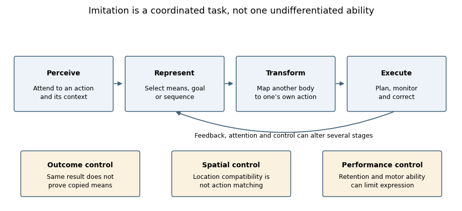

<h1 id="3/solution">Solution</h1>

↑ **Parent:** [3](../3.md)

**[Imitation](../../../imitation.md) requires a usable mapping from another person’s perceived action to one’s own action system, together with retention, selection and execution appropriate to the task.** It does not invariably require explicit [theory of mind](../../../theory-of-mind.md), verbal instruction or conscious [intention](../../../intention.md) to copy. Those processes can organize sophisticated [imitation](../../../imitation.md), but simple action matching can occur without them. The first requirement is therefore to establish what was copied and exclude alternative routes to a similar response.

An observer may reproduce an action’s bodily form, its sequence, its object-directed goal or only its environmental outcome. Producing the same outcome by another means is emulation rather than clear evidence of copying the demonstrated movement. Increased object exploration after watching another person is weaker still. A convincing task therefore needs baseline performance and demonstrations that distinguish candidate targets: two demonstrators achieving one goal differently, or the same movement producing different outcomes. Without such contrasts, successful performance does not identify the representation that guided it.

The [motor correspondence problem](../../../motor-correspondence-problem.md) is fundamental. The observer sees another body from an external perspective but controls their own body through motor commands and proprioceptive feedback. Copying a finger lift or facial gesture requires some relation between these different descriptions; literal duplication of retinal coordinates is not enough. A mirror-like spatial response and an anatomical response can even require opposite transformations when facing another person. A system that copies goals can use existing action elements to assemble a new sequence without already possessing a complete motor programme for that sequence.

Experience offers a mechanism for acquiring these relations. Seeing one’s own movements, acting together with others and observing other people imitate oneself can correlate visual and motor events. Counter-mirror training demonstrated that deliberately mismatching observed and executed finger actions changes subsequent matching-related motor responses. Thus correspondence is at least partly learnable. This finding does not prove that all [imitation](../../../imitation.md) is acquired by the same process or that newborn action matching is impossible; it identifies a concrete source of plasticity in adults.[Abstract: sensorimotor training changes the observation–execution relationship](../../../sensorimotor-learning-configures-the-human-mirror-system-by-caroline-catmur-and-others.md)

[Automatic imitation](../../../automatic-imitation.md) experiments isolate one consequence of a mapping. Participants make an instructed finger movement while an irrelevant observed movement is compatible or incompatible with it. Observed action identity influences performance, even when it is not the relevant cue. Comparisons with symbolic and spatial cues show why the similarity between observed and executed actions matters. However, spatial correspondence must be varied separately from action identity: a faster response to a hand on the response side could otherwise be mislabelled [imitation](../../../imitation.md). The latency cost indicates competition or facilitation, not a complete account of voluntary copying or [empathy](../../../empathy.md).[Abstract and Experiments 1–3, pp. 124–143: symbolic, spatial and imitative compatibility](../../../compatibility-between-observed-and-executed-finger-movements-comparing-symbolic-spatial-and-imitative-cues-by-marcel-brass-and-others.md)

**[Figure 1](#3/image-psychological-operations-supporting-imitation-and-their-experimental-controls). Psychological operations supporting imitation and their experimental controls**. Original functional schematic. The boxes identify task requirements and alternative explanations, not separate anatomical modules. Control and feedback can alter several stages.

Control is as necessary as activation in many circumstances. A person may need to suppress the observed response and execute another instructed response, choose which part of a demonstration matters or adjust movement to a differently sized object. [Attention](../../../attention.md) determines which features are encoded; [working memory](../../../working-memory.md) supports sequences and deferred reproduction; motor planning and feedback determine whether an intended match is physically realized. A performance difference at any stage can reduce overt [imitation](../../../imitation.md), so failure does not uniquely show absence of a visuomotor mapping.

Goals can organize reproduction beyond visible movement. In a failed-action experiment, 18-month-old children often completed an adult’s intended target act even though the adult had not successfully demonstrated it. Control demonstrations and a mechanical-device comparison constrained accounts based simply on reproducing the visible trajectory. The result supports sensitivity to goal-directed human action, but completing the intended outcome is not proof of copying every bodily means or representing an explicit propositional [belief](../../../belief.md). Goal inference and movement matching remain separable achievements.[Experiments 1–2, pp. 838–850: failed attempts, completed acts and mechanical-device comparison](../../../understanding-the-intentions-of-others-re-enactment-of-intended-acts-by-18-month-old-children-by-andrew-n-meltzoff.md)

Infants’ copying can also vary with demonstration context. After seeing an adult activate a lamp using the head, 14-month-olds were more likely to repeat that means when the adult’s hands had been free than when the hands were occupied. One interpretation is that observers evaluate whether an unusual means was chosen freely or forced by a constraint. This motivates rational-imitation accounts. Yet differences in visible hands, [attention](../../../attention.md) or demonstration familiarity can also change encoding. Context sensitivity therefore requires explanation, but does not uniquely establish adult-like reasoning about reasons.[Abstract and p. 755: hands-free versus hands-occupied head-touch demonstration](../../../rational-imitation-in-preverbal-infants-by-gyorgy-gergely-and-others.md)

Claims about prerequisites should also be developmentally precise. Neonatal matching, familiar automatic responses, newly learned gestures and extended technical procedures need not use identical representations or control demands. Disputed longitudinal neonatal findings emphasize the need for selective model-matching and appropriate control gestures rather than counting one commonly elicited action. Whatever their eventual interpretation, newborn findings do not license an inference that sophisticated intentional [imitation](../../../imitation.md) is present at birth, nor does adult [sensorimotor learning](../../../sensorimotor-learning.md) settle every neonatal result.[Abstract: longitudinal tests across multiple modelled actions and early ages](../../../comprehensive-longitudinal-study-challenges-the-existence-of-neonatal-imitation-in-humans-by-janine-oostenbroek-and-others.md)

The necessary psychological architecture is therefore a coordinated set of functions: detect relevant features, represent what is to be reproduced, transform that representation into feasible actions, retain it when required and control execution using feedback. Explicit [intention](../../../intention.md) understanding, social [motivation](../../../motivation.md) and [language](../../../language.md) can influence which actions are selected and why. They are not logical prerequisites for every compatibility effect. Good experiments manipulate these contributions separately and distinguish capacity from [attention](../../../attention.md), opportunity and willingness to express it.

## ↑ Ancestors (11)

1. [3](../3.md)
2. [2022](../../2022-split.md)
3. [Past exam of the clinical social cognitive neuroscience course of the University of Oxford](../../split.md)
4. [Clinical social cognitive neuroscience course of the University of Oxford](../../../clinical-social-cognitive-neuroscience-course-of-the-university-of-oxford.md)
5. [Year 3 of the psychology (experimental) course of the University of Oxford](../../../year-3-of-the-psychology-experimental-course-of-the-university-of-oxford.md)
6. [Psychology (experimental) course of the University of Oxford](../../../psychology-experimental-course-of-the-university-of-oxford.md)
7. [Undergraduate course of the University of Oxford](../../../undergraduate-course-of-the-university-of-oxford.md)
8. [Course of the University of Oxford](../../../course-of-the-university-of-oxford.md)
9. [University of Oxford](../../../university-of-oxford-split.md)
10. [List of universities](../../../list-of-universities.md)
11. [Codex Wiki](../../../split.md)
