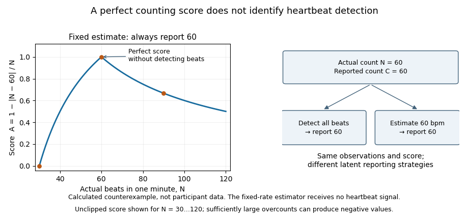

<h1 id="4/solution">Solution</h1>

↑ **Parent:** [4](../4.md)

**Interoception can contribute to [social cognition](../../../social-cognition.md) by shaping emotional experience, the interpretation of others’ [affect](../../../affect.md) and the regulation of [attention](../../../attention.md) and action; it is not established as a universal prerequisite for understanding minds.** Internal bodily signals are one source of information among visual, linguistic and contextual cues. A useful account must distinguish physiological state, detection of that state and interpretation of its significance.

Interoception includes processing signals related to the internal body. For [social cognition](../../../social-cognition.md), a faster heartbeat might contribute to experienced [arousal](../../../arousal.md), influence the significance of a threatening face or become evidence in an interpretation of one’s own discomfort during an interaction. The same change could accompany [fear](../../../fear.md), effort or excitement. Bodily input therefore does not arrive with an unambiguous social label. Its contribution depends on context, expectations and the person’s ability to distinguish their own state from another’s.

Measurement is consequently central. [Interoceptive accuracy](../../../interoceptive-accuracy.md) is performance on an objective task; [interoceptive sensibility](../../../interoceptive-sensibility.md) concerns subjective reports; [interoceptive awareness](../../../interoceptive-awareness.md), in a more specific metacognitive framework, concerns how well confidence tracks actual performance. A primary comparison found these dimensions empirically dissociable rather than interchangeable. Someone who often attends to the body need not detect its signals accurately, and someone who performs accurately need not know when they are correct. A study connecting a questionnaire to [empathy](../../../empathy.md) therefore cannot automatically be interpreted as connecting sensory accuracy to [empathy](../../../empathy.md).[Abstract and pp. 65–74: accuracy, sensibility and confidence–accuracy correspondence](../../../knowing-your-own-heart-distinguishing-interoceptive-accuracy-from-interoceptive-awareness-by-sarah-n-garfinkel-and-others.md)

[Neuroimaging](../../../neuroimaging.md) provides a plausible substrate. During heartbeat-timing judgments, right anterior insular/opercular activity related to objective performance, alongside a wider set of responses. This links a region involved in representing bodily state to measured interoceptive behaviour. Other work found affect-related insular recruitment when participants experienced [pain](../../../pain.md) themselves and when a partner experienced it. These observations support a possible bridge between self-state representation and vicarious [affect](../../../affect.md), but anatomical overlap does not prove that exactly the same [neurons](../../../neuron-split.md) or computations implement both functions.[Abstract and pp. 189–195: heartbeat-timing task, insular activity and performance](../../../neural-systems-supporting-interoceptive-awareness-by-hugo-d-critchley-and-others.md)[Abstract: shared affect-related activity for self and partner pain](../../../empathy-for-pain-involves-the-affective-but-not-sensory-components-of-pain-by-tania-singer-and-others.md)

Manipulating when a social stimulus arrives offers a different test. A cardiac-phase experiment presented emotional faces at [systole](../../../systole.md) or [diastole](../../../diastole.md), using cardiac monitoring to time stimuli. Fearful faces were detected more easily and judged more intense at [systole](../../../systole.md) than [diastole](../../../diastole.md); associated imaging showed greater [amygdala](../../../amygdala.md) responses to fearful faces at [systole](../../../systole.md). This shows that the bodily cycle can influence processing of an external affective cue even when the observer is not explicitly reasoning about their own heartbeat. It does not establish that consciously accurate heartbeat detection is necessary for the effect, or that cardiac phase explains every social judgment.[Abstract and Experiments 1–2, pp. 6573–6582: heartbeat-triggered faces, detection and intensity measures](../../../fear-from-the-heart-sensitivity-to-fear-stimuli-depends-on-individual-heartbeats-by-sarah-n-garfinkel-and-others.md)

Individual-difference evidence suggests another pathway. [Alexithymia](../../../alexithymia.md) concerns identifying and describing one’s [emotions](../../../emotion.md), not having no [emotions](../../../emotion.md). In one study, empathy-related [insula](../../../insular-cortex.md) responses varied with [alexithymia](../../../alexithymia.md) rather than [autism](../../../autism.md) diagnosis after adjustment. A separate psychophysical study associated [alexithymia](../../../alexithymia.md) with interpreting facial expressions, while physical expression discrimination and identity judgments supplied important controls. Together they suggest that access to, or interpretation of, affective states may contribute to selected social-emotional tasks. They do not prove a single bodily-sensing deficit causes all these effects.[Abstract: alexithymia and empathy-for-pain responses across diagnostic groups](../../../empathic-brain-responses-in-insula-are-modulated-by-levels-of-alexithymia-but-not-autism-by-geoffrey-bird-and-others.md)[Experiments 1–2: emotion attribution versus physical expression and identity discrimination](../../../alexithymia-not-autism-predicts-poor-recognition-of-emotional-facial-expressions-by-richard-cook-and-others.md)

A direct interoceptive comparison also found that heartbeat-counting performance tracked [alexithymia](../../../alexithymia.md) more clearly than [autism](../../../autism.md) across its tested groups. Its interpretation depends on the validity of the counting task. A common [heartbeat counting score](../../../heartbeat-counting-score.md) compares recorded counts $N_j>0$ and reported counts $C_j$ over $m$ intervals:

$$
A=\frac1m\sum_{j=1}^m\left(1-\frac{|N_j-C_j|}{N_j}\right).
$$

A [perfect heartbeat-counting score does not establish heartbeat detection](../../../perfect-heartbeat-counting-score-does-not-establish-heartbeat-detection.md): it only shows that reports matched recorded counts. Someone estimating from prior heart-rate knowledge can match the count without detecting individual beats. The score also depends mechanically on the denominator, so a relationship with actual [heart rate](../../../heart-rate.md) needs interpretation. Empirical measurement analyses have exposed such problems; they qualify the inference from counting to [perception](../../../perception.md), not the existence of bodily influences on [cognition](../../../cognition.md).[Abstract and Experiments 1–2: alexithymia, autism and heartbeat-counting performance](../../../alexithymia-not-autism-is-associated-with-impaired-interoception-by-punit-shah-and-others.md)[Abstract and pp. 12–17: count-score relationships, actual heart rate and interval effects](../../../interoceptive-accuracy-scores-from-the-heartbeat-counting-task-are-problematic-evidence-from-simple-bivariate-correlations-by-giorgia-zamariola-and-others.md)

**[Figure 2](#4/image-why-a-heartbeat-counting-score-alone-cannot-establish-bodily-signal-detection). Why a heartbeat-counting score alone cannot establish bodily signal detection**. Original calculations for a person always reporting 60 beats during a one-minute interval. A perfect score occurs when the actual count is 60 even though this reporting strategy uses no detected beats. The curve is an illustration of the score formula, not participant data.

The statistical critique also needs qualification. A published reanalysis argued that several bivariate findings arise from analysing a ratio score and are less decisive than first claimed. This does not resolve every strategy or validity concern, and it does not invalidate the logical counterexample above. Mathematical dependence, sensory detection and behavioural usefulness should be tested as separate questions.[Abstract: reanalysis of ratio scores and qualifications to the bivariate criticisms](../../../are-interoceptive-accuracy-scores-from-the-heartbeat-counting-task-problematic-a-comment-on-zamariola-et-al-2018-by-daniel-zimprich-and-others.md)

A strong interoceptive account must therefore specify the intermediate mechanism. Bodily input may change experienced [affect](../../../affect.md), which changes [attention](../../../attention.md) to another person; uncertainty about one’s own state may complicate separating self-generated distress from another’s needs; physiological regulation may help sustain a demanding interaction. These are different causal routes. Each requires measurements of its proposed intermediate steps, temporal ordering and controls for general [anxiety](../../../anxiety.md), task comprehension and sensory or motor demands. Merely correlating two questionnaires cannot choose among them.

There are also clear limits to generalization. Cardiac detection does not measure every visceral modality, and evidence about recognizing emotional faces does not automatically explain representing a [false belief](../../../false-belief.md). A shared insular signal is not a complete theory of interpersonal understanding. Good tests combine validated bodily tasks, objective [physiology](../../../physiology-split.md), confidence measures and independently defined social outcomes, ideally manipulating bodily input while testing competing explanations. By the examination date, converging studies supported a contribution to some affective aspects of [social cognition](../../../social-cognition.md); the claim that one interoceptive deficit explains all social difficulties was substantially stronger than the evidence.

## ↑ Ancestors (11)

1. [4](../4.md)
2. [2022](../../2022-split.md)
3. [Past exam of the clinical social cognitive neuroscience course of the University of Oxford](../../split.md)
4. [Clinical social cognitive neuroscience course of the University of Oxford](../../../clinical-social-cognitive-neuroscience-course-of-the-university-of-oxford.md)
5. [Year 3 of the psychology (experimental) course of the University of Oxford](../../../year-3-of-the-psychology-experimental-course-of-the-university-of-oxford.md)
6. [Psychology (experimental) course of the University of Oxford](../../../psychology-experimental-course-of-the-university-of-oxford.md)
7. [Undergraduate course of the University of Oxford](../../../undergraduate-course-of-the-university-of-oxford.md)
8. [Course of the University of Oxford](../../../course-of-the-university-of-oxford.md)
9. [University of Oxford](../../../university-of-oxford-split.md)
10. [List of universities](../../../list-of-universities.md)
11. [Codex Wiki](../../../split.md)
