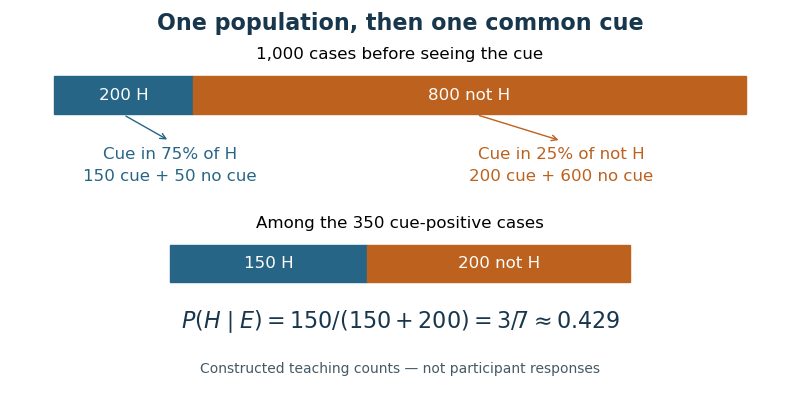

<h1 id="5/solution">Solution</h1>

↑ **Parent:** [5](../5.md)

**People often underweight [base rates](../../../base-rate.md) when a vivid case description competes with them, but the extent of neglect depends on representation, relevance and task.** The normative benchmark is conditional on a known sampling process. If a case is randomly drawn from a population, a prior class proportion $P(H)$ must combine with the case evidence's [likelihood ratio](../../../likelihood-ratio.md). In [Bayes' theorem](../../../bayes-theorem.md),

$$
\frac{P(H\mid E)}{P(\neg H\mid E)}=\frac{P(E\mid H)}{P(E\mid\neg H)}\frac{P(H)}{P(\neg H)}.
$$

Changing prior odds while holding diagnostic evidence fixed should ordinarily change posterior odds. A judgment driven only by resemblance to a class violates that benchmark when the stated premises apply.

In [Daniel Kahneman](../../../daniel-kahneman.md) and [Amos Tversky](../../../amos-tversky.md)'s prediction experiments, descriptions of people were paired with different proportions of engineers and lawyers in the source group. Judgments based on an occupationally suggestive description were surprisingly insensitive to those proportions despite their relevance to a random draw. Without the individualized description, participants could use the stated proportions. This contrast is especially informative: the issue was not simply inability to read a [base rate](../../../base-rate.md), but the way case-specific evidence displaced it. Similarity and [probability](../../../probability.md) can agree in ordinary situations, which helps explain why the substitution is tempting.[1973, category prediction and engineer–lawyer base-rate manipulation](../../../on-the-psychology-of-prediction-by-daniel-kahneman-and-amos-tversky.md)

The first account is the [representativeness heuristic](../../../representativeness-heuristic.md), potentially supplemented by [dual-process theory](../../../dual-process-theory.md). An occupational description quickly evokes similarity to a stereotypical engineer or lawyer. That judgment does not inherently encode class prevalence or evidential reliability, so it can dominate the [probability](../../../probability.md) estimate. More controlled reasoning can integrate the [base rate](../../../base-rate.md), but may fail to engage, misunderstand the statistical structure or fail to override the compelling response. This account predicts errors especially when representativeness and [prior probability](../../../prior-probability.md) conflict, with possible improvement when people deliberately compare alternative hypotheses and their frequencies.

It is too strong to infer from a biased answer that no statistical information was processed. [Wim De Neys](../../../wim-de-neys.md) and colleagues contrasted problems where descriptions and [base rates](../../../base-rate.md) conflicted with control problems where they agreed. Although verbal reports often emphasized the description, measures including decision time, later memory for the [base rates](../../../base-rate.md) and reconsideration behavior indicated sensitivity to the conflict. Statistical information can therefore influence processing without determining the final answer. This challenges a simple account in which analytic monitoring is always absent; it is compatible with incomplete integration or unsuccessful correction.[2008, conflict versus control problems; implicit and verbal measures](../../../conflict-monitoring-in-dual-process-theories-of-thinking-by-wim-de-neys-and-others.md)

The second account emphasizes [ecological rationality](../../../ecological-rationality.md) and information format. [Gerd Gigerenzer](../../../gerd-gigerenzer.md) and [Ulrich Hoffrage](../../../ulrich-hoffrage.md) argued that algorithms adapted to [natural frequencies](../../../natural-frequencies-in-probabilistic-reasoning.md) can perform Bayesian updating more easily than algorithms given separately normalized [probabilities](../../../probability.md). Natural sampling represents the relevant nested sets directly: how many cases belong to each class, and how many within each class produce the evidence. The denominator can then be the whole set of evidence-positive cases, without reconstructing joint counts by multiplying [conditional probabilities](../../../conditional-probability.md).

Their 1995 experiments compared [probability](../../../probability.md) and frequency versions of Bayesian problems while also varying the information menu. Frequency formats substantially increased the use of Bayesian solutions across the problem set, assessed using solution processes as well as final answers. This supports a representational contribution to apparently poor reasoning; it does not show that everyone is spontaneously Bayesian or that every frequency phrasing helps. The preserved nesting and common reference population matter. Normalizing both classes to independent “out of one hundred” samples can remove precisely the base-rate information the natural-frequency representation was meant to preserve.[1995, Study 1 factorial format/menu comparison and algorithm scoring](../../../how-to-improve-bayesian-reasoning-without-instruction-frequency-formats-by-gerd-gigerenzer-and-ulrich-hoffrage.md)

An original numerical illustration makes the distinction explicit. Suppose a randomly sampled population contains $200$ category-$H$ cases and $800$ non-$H$ cases. A cue occurs in $75\%$ of the first class and $25\%$ of the second. There are then $150$ cue-positive $H$ cases and $200$ cue-positive non-$H$ cases, so $P(H\mid E)=150/(150+200)=3/7$, approximately $0.429$. Reporting $0.75$ would confuse the cue's conditional rate in class $H$ with the [probability](../../../probability.md) of class $H$ given the cue. These are constructed teaching counts, not results from a cited experiment.

**[Figure 1](#5/image-nested-counts-expose-both-sources-of-the-same-cue-150-target-class-and-200-other-class-cases). Nested counts expose both sources of the same cue: $150$ target-class and $200$ other-class cases**. Original illustrative population of one thousand cases. All probabilities and counts are constructed for explaining [Bayes' theorem](../../../bayes-theorem.md); they are not participant responses or experimental data. The relevant denominator is all $350$ cue-positive cases.

The two accounts agree that the task representation matters and that naïve answers need not obey the normative model. They disagree in emphasis: the heuristic account highlights substitution and control, while the ecological account highlights a mismatch between the supplied representation and an available inference algorithm. Frequency success alone cannot decide between them, because a clearer nested-set display can also make deliberate correction easier. Conversely, conflict sensitivity constrains an absolute “[base rates](../../../base-rate.md) were never noticed” story without proving successful Bayesian computation.

A discriminating design would cross numerical format with description–base-rate conflict, preserve the sampling assumptions and information content, and measure answers together with process indicators. It should distinguish a failure to encode prevalence, a failure to combine encoded evidence and a rational belief that the stated reference group is irrelevant. Verbal descriptions seldom specify a [likelihood ratio](../../../likelihood-ratio.md), so prior-insensitivity is easier to diagnose than a unique numerical Bayesian answer for every description. If descriptions were selectively rather than randomly sampled, or a [base rate](../../../base-rate.md) were not applicable to the individual, the simple benchmark would change. Accordingly, **[base-rate neglect](../../../base-rate-neglect.md) is a reproducible conditional pattern, not evidence that people invariably ignore statistics or possess no Bayesian competence; both heuristic competition and representational structure help explain when it occurs.**

## ↑ Ancestors (11)

1. [5](../5.md)
2. [2022](../../2022-split.md)
3. [Past exam of the cognition course of the year 2 of the psychology (experimental) course of the University of Oxford](../../split.md)
4. [Cognition course of the year 2 of the psychology (experimental) course of the University of Oxford](../../../cognition-course-of-the-year-2-of-the-psychology-experimental-course-of-the-university-of-oxford.md)
5. [Year 2 of the psychology (experimental) course of the University of Oxford](../../../year-2-of-the-psychology-experimental-course-of-the-university-of-oxford.md)
6. [Psychology (experimental) course of the University of Oxford](../../../psychology-experimental-course-of-the-university-of-oxford.md)
7. [Undergraduate course of the University of Oxford](../../../undergraduate-course-of-the-university-of-oxford.md)
8. [Course of the University of Oxford](../../../course-of-the-university-of-oxford.md)
9. [University of Oxford](../../../university-of-oxford-split.md)
10. [List of universities](../../../list-of-universities.md)
11. [Codex Wiki](../../../split.md)
