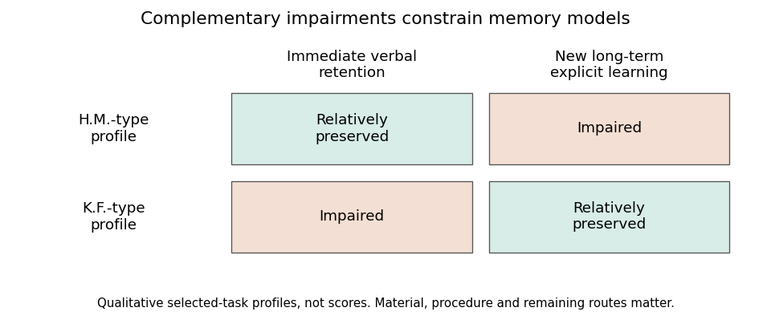
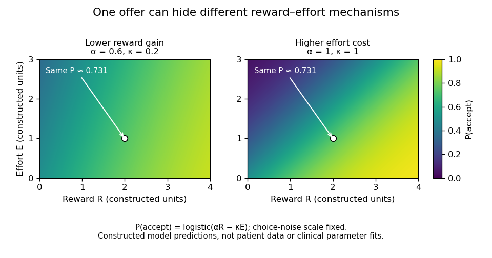

# 2022

↑ **Parent:** [Past exam of the cognitive neurology course of the University of Oxford](../past-exam-of-the-cognitive-neurology-course-of-the-university-of-oxford.md)

Worked essays for all six options in the historical paper dated 30 May 2022. Source release: [Oxford psychology examination release](https://www.whatdotheyknow.com/request/experimental_psychology_past_exa/response/2757831/attach/3/New%20Compressed%20zipped%20Folder.zip?cookie_passthrough=1), member `a15910w1.pdf`. Part II is the audited classification; the cover itself prints Second Public Examination. This study edition answers every alternative, whereas candidates were asked to select three. Scientific findings used here were available before the examination. The original illustrations summarize qualitative logic or constructed models, not copied patient figures or invented clinical measurements.

**Table of contents**

- [1](#1)
  - [Solution](#1/solution)
- [2](#2)
  - [Solution](#2/solution)
- [3](#3)
  - [Solution](#3/solution)
- [4](#4)
  - [Solution](#4/solution)
- [5](#5)
  - [Solution](#5/solution)
- [6](#6)
  - [Solution](#6/solution)

## 1

↑ **Parent:** [2022](2022.md)

<h3 id="1/solution">Solution</h3>

↑ **Parent:** [1](#1)

**Calling [Wernicke's aphasia](../neuroscience.md#wernicke-s-aphasia) receptive identifies a prominent clinical difficulty, but is inadequate as a complete description or mechanism.** [Auditory comprehension](../README.md#auditory-comprehension) is typically impaired, yet fluent output can contain errors in sound structure and meaning, neologisms and poor monitoring, while repetition is also impaired. Fluency describes the ease and quantity of [speech](../README.md#speech), not its informational accuracy. The syndrome is therefore neither an isolated loss of receiving words nor a clean counterpart to an exclusively expressive disorder elsewhere.

The distinction between a syndrome and a computation is crucial. A comprehension failure could arise because the listener cannot analyze the sound pattern, cannot access relevant knowledge, cannot select the contextually relevant meaning, or cannot maintain the sentence and response alternatives. These processes can interact. A [brain lesion](../neuroscience.md#brain-lesion) label such as [Wernicke's area](../neuroscience.md#wernicke-s-area), named after [Carl Wernicke](../neurology.md#carl-wernicke), does not specify which transformation failed, and clinical classifications group patients whose exact [brain lesion](../neuroscience.md#brain-lesion) extent and remaining abilities can differ.

[Holly Robson](../neuroscientist.md#holly-robson) and colleagues directly compared Wernicke-type patients with groups showing [semantic dementia](../neurology.md#semantic-dementia) and [semantic aphasia](../neuroscience.md#semantic-aphasia). Their case-series results supported combined acoustic and [phonological analysis](../README.md#phonological-analysis) deficits together with [semantic control](../neuroscience.md#semantic-control) impairment in [Wernicke's aphasia](../neuroscience.md#wernicke-s-aphasia). The Wernicke group had difficulties on nonverbal as well as verbal comprehension tests, while additional acoustic and phonological difficulties helped explain their particularly poor auditory performance. This is more informative than equating all poor comprehension with destruction of a single semantic store.[2012, direct case-series comparison and verbal/nonverbal comprehension](../psychology-bibliography.md#wernicke-s-aphasia-reflects-a-combination-of-acoustic-phonological-and-semantic-control-deficits-by-holly-robson-and-others)

The experiment motivates a layered account. Spoken input requires analysis of rapidly changing acoustic structure and its relation to [phonological representations](../README.md#phonological-representation). Meaning then depends on stored knowledge and control over its use. A disproportionately severe spoken-word deficit can therefore coexist with semantic difficulty that is also detectable in pictures. Conversely, comparatively better picture performance does not establish entirely intact [conceptual knowledge](../neuroscience.md#conceptual-knowledge): task difficulty, cue availability and the required decisions must be matched before drawing that conclusion.

[Speech production](../neuroscience.md#speech-production) is affected for related reasons. Selecting a word requires access to [conceptual knowledge](../neuroscience.md#conceptual-knowledge) and [lexical access](../README.md#lexical-access), and producing its sound pattern requires organization of [phonological representations](../README.md#phonological-representation). Fluent but inaccurate output, including [paraphasia](../neuroscience.md#paraphasia), cannot simply be classified as preserved expression. Repetition also requires auditory analysis, temporary retention and a mapping to output; it does not supply an independent test of a single receptive faculty. The mechanisms impairing understanding can consequently affect [speech](../README.md#speech) without producing the effortful, reduced output associated with some other aphasic presentations.

Evidence from semantic disorders further separates damaged knowledge from difficulty controlling access. [Elizabeth Jefferies](../neuroscientist.md#elizabeth-jefferies) and colleagues compared comprehension-impaired [stroke](../neurology.md#stroke) patients with [semantic dementia](../neurology.md#semantic-dementia) patients at broadly matched overall impairment. The dementia group showed stronger cross-task/item consistency and familiarity effects; [stroke](../neurology.md#stroke) patients were more sensitive to task demands and benefited from cues in ways consistent with impaired [semantic control](../neuroscience.md#semantic-control). These were not interchangeable forms of “[receptive aphasia](../neuroscience.md#receptive-aphasia).” Nor were all [stroke](../neurology.md#stroke) patients in that study necessarily Wernicke cases, so the result provides a comparison framework rather than a license to assign one mechanism to every Wernicke patient.[2006, matched case-series comparison, consistency, familiarity and control demands](../psychology-bibliography.md#semantic-impairment-in-stroke-aphasia-versus-semantic-dementia-by-elizabeth-jefferies-and-others)

Anatomical evidence also resists a one-area account. [Nina F. Dronkers](../neuroscientist.md#nina-f-dronkers) and colleagues studied sentence comprehension in 64 chronic left-hemisphere [stroke](../neurology.md#stroke) patients, with comparison groups, and related performance to [brain lesions](../neuroscience.md#brain-lesion). The task required choosing the drawing matching an auditory sentence. Multiple temporal, [parietal](../neuroscience.md#parietal-lobe) and frontal regions were implicated rather than a single posterior temporal center explaining all comprehension. Because the task also required sentence retention, visual selection and interpretation, its [brain lesion](../neuroscience.md#brain-lesion) associations should not be read as a pure map of word meaning.[2004, CYCLE-R sentence–picture selection and lesion analyses](../psychology-bibliography.md#lesion-analysis-of-the-brain-areas-involved-in-language-comprehension-by-nina-f-dronkers-and-others)

The distinction from [auditory verbal agnosia](../neuroscience.md#auditory-verbal-agnosia) is useful. A relatively input-specific spoken-language impairment can leave reading and other access to knowledge much better preserved. By contrast, multimodal semantic impairment cannot be explained solely by failure to hear phonological distinctions. A careful assessment should therefore compare auditory discrimination, spoken and written [language comprehension](../README.md#language-comprehension), nonverbal semantic matching, naming and repetition, while checking [hearing](../neuroscience.md#hearing), [vision](../neuroscience.md#vision) and general task demands. [Anomia](../neuroscience.md#anomia) alone is not proof that the object or concept is unknown, and a naming failure is not equivalent to failed comprehension.

There are limits to both behavioral and anatomical inference. [Stroke](../neurology.md#stroke) affects vascularly linked tissue and connections, making neighboring regions difficult to separate statistically. Chronic patients may have reorganized, while case-series samples can omit people unable to complete the tests. An association between [brain lesion](../neuroscience.md#brain-lesion) location and test failure supports a network contribution under those conditions, not a complete computational explanation. Likewise, introducing “[semantic control](../neuroscience.md#semantic-control)” is useful only if it predicts sensitivity to cues, competition and task demands rather than merely renaming every inconsistent answer.

**The receptive label is defensible as shorthand for a dominant presenting impairment, but false if it implies preserved production or a unitary input-only [brain lesion](../neuroscience.md#brain-lesion).** The stronger explanation distinguishes acoustic analysis, [phonological analysis](../README.md#phonological-analysis), representations and control within a connected language system. This preserves what the clinical syndrome tells us while using patient comparisons to explain why comprehension, repetition and fluent [speech](../README.md#speech) can fail together in different proportions.

## 2

↑ **Parent:** [2022](2022.md)

<h3 id="2/solution">Solution</h3>

↑ **Parent:** [2](#2)

**The crossed profiles of [medial temporal lobe](../neuroscience.md#medial-temporal-lobe) amnesia and severe [verbal short-term memory](../neuroscience.md#verbal-short-term-memory) impairment argue against a single undifferentiated [human memory](../neuroscience.md#human-memory) store and against obligatory transfer through one verbal short-term buffer.** They do not establish that all short- and [long-term memory](../neuroscience.md#long-term-memory) processes occupy two isolated anatomical boxes. The tasks, material and type of learning must be specified before converting a clinical dissociation into a theory.

[Henry Molaison](../psychology.md#henry-molaison), originally reported as H.M., developed profound difficulty forming new lasting [declarative memories](../neuroscience.md#declarative-memory) after bilateral [medial temporal lobe](../neuroscience.md#medial-temporal-lobe) surgery. The classic report by [William Beecher Scoville](../neurology.md#william-beecher-scoville) and [Brenda Milner](../psychology.md#brenda-milner) connected substantial new-learning impairment with the operation. Yet immediate retention within a limited span could remain much better than new long-term explicit learning. The contrast shows that retaining a small amount for immediate use and establishing enduring new [declarative memories](../neuroscience.md#declarative-memory) can be disrupted differently.[1957, postoperative amnesia and relatively preserved immediate performance](../psychology-bibliography.md#loss-of-recent-memory-after-bilateral-hippocampal-lesions-by-william-beecher-scoville-and-brenda-milner)

The interpretation is more specific than “all [long-term memory](../neuroscience.md#long-term-memory) was lost.” Earlier knowledge could remain accessible, and different learning systems were affected differently. [Suzanne Corkin](../neuroscientist.md#suzanne-corkin) tested motor-skill acquisition in [Henry Molaison](../psychology.md#henry-molaison) using [rotary pursuit](../neuroscience.md#rotary-pursuit), bimanual tracking and tapping. Performance improved with practice, and retention could be tested after several days on [rotary pursuit](../neuroscience.md#rotary-pursuit). The finding shows lasting learning despite severe amnesia; it does not imply normal performance on every motor task, because absolute performance could still be below that of comparison participants.[1968, practice across sessions and delayed rotary-pursuit retention](../psychology-bibliography.md#acquisition-of-motor-skill-after-bilateral-medial-temporal-lobe-excision-by-suzanne-corkin)

The complementary profile is exemplified by [Patient K. F.](../psychology.md#patient-k-f). [Elizabeth Warrington](../psychology.md#elizabeth-warrington) and [Tim Shallice](../psychology.md#tim-shallice) reported a very restricted span for auditory [verbal short-term memory](../neuroscience.md#verbal-short-term-memory), and subsequent experiments examined free recall, interference, short-delay performance and recognition. Despite the short-term difficulty, long-term verbal learning was relatively good on the tests used. This matters because the impairment was investigated through several procedures rather than inferred from one failed [digit span](../neuroscience.md#digit-span) response.[1969, selective auditory-verbal impairment](../psychology-bibliography.md#the-selective-impairment-of-auditory-verbal-short-term-memory-by-elizabeth-warrington-and-tim-shallice)[1970, five experiments and preserved performance on long-term tasks](../psychology-bibliography.md#independent-functioning-of-verbal-memory-stores-by-tim-shallice-and-elizabeth-warrington)

**[Figure 1](#2/image-two-clinical-profiles-constrain-a-simple-serial-store-account). Two clinical profiles constrain a simple serial-store account**. Original qualitative schematic of relatively preserved versus impaired performance on selected tasks. The cells are not scores, prevalence estimates or a claim that either person performed normally on every task in a broad memory category. Material and procedural differences remain essential to the interpretation.

Together, these profiles are stronger evidence than one patient who fails a difficult delayed test but passes an easier immediate one. A simple general reduction in ability can explain many single dissociations through differing task difficulty. With fixed tasks, [crossed performance rejects a single monotone resource](../psychology.md#crossed-performance-rejects-a-single-monotone-resource): both performances cannot be fixed [nondecreasing functions](../calculus.md#nondecreasing-function) of the same [scalar](../vector-space.md#scalar). Nevertheless, clinical reports do not automatically provide such a perfectly matched experiment: different materials, floor and ceiling effects and [measurement reliability](../psychology.md#measurement-reliability) can distort apparent crossings. Quantitative comparisons and adequate control data strengthen the inference.

The findings also challenge a strong [serial two-store model of memory](../neuroscience.md#serial-two-store-model-of-memory). If the particular verbal short-term store damaged in K.F. were the obligatory gateway for all new long-term encoding, severe impairment there should prevent the relatively preserved long-term learning. Parallel access or alternative routes become plausible. This conclusion does not show that no temporary representation is ever required for learning: visual, semantic or residual verbal processing might support encoding. The result targets a specified mandatory route, not the logical possibility of retaining information transiently by other means.

Later distinctions between [working memory](../neuroscience.md#working-memory), [episodic memory](../neuroscience.md#episodic-memory), [semantic memory](../neuroscience.md#semantic-memory) and [procedural memory](../neuroscience.md#procedural-memory) explain why delay alone is an inadequate taxonomy. Immediate span depends on perceptual coding, rehearsal and response requirements. New episodic learning depends on operations supporting binding and enduring retention. Motor skills can improve through systems not sufficient for explicit recollection. Such functional distinctions can coexist with interaction: prior knowledge helps immediate retention, and [attention](../psychology.md#attention) and temporary maintenance affect what is learned.

Anatomy similarly requires refinement. [Henry Molaison](../psychology.md#henry-molaison)'s operation was not confined to one microscopic hippocampal computation; multiple [medial temporal lobe](../neuroscience.md#medial-temporal-lobe) structures were affected. Conversely, a selective verbal span deficit after a different injury does not locate all short-term storage in one cortical patch. More circumscribed [brain lesion](../neuroscience.md#brain-lesion) evidence and converging task manipulations are needed to separate structures, connections and computations. The duration of a test is not an anatomical label.

Evidence that [medial temporal lobe](../neuroscience.md#medial-temporal-lobe) regions can contribute to online processing of complex objects further qualifies a strict short-delay/long-delay border. [Morgan D. Barense](../psychology.md#morgan-d-barense) and colleagues found that human [medial temporal lobe](../neuroscience.md#medial-temporal-lobe) damage affected tasks involving complex object representations even when demands could not simply be described as conventional long-term learning. This supports examining representational requirements, such as feature conjunctions, rather than assuming every immediate judgment bypasses the [medial temporal lobe](../neuroscience.md#medial-temporal-lobe).[2007, object-processing requirements and online performance](../psychology-bibliography.md#the-human-medial-temporal-lobe-processes-online-representations-of-complex-objects-by-morgan-d-barense-and-others)

The lasting contribution of these cases is methodological as well as theoretical. Selective deficits motivate decomposing [human memory](../neuroscience.md#human-memory) into processes; complementary preservation constrains claims that one process is necessary for another. The resulting theory should predict transfer, interference, cueing and learning across matched tasks, rather than merely attach a store name to each time interval. **[Double dissociations](../psychology.md#double-dissociation) establish important functional separability under the tested conditions, while the broader evidence favors interacting [human memory](../neuroscience.md#human-memory) systems and multiple routes to retention.**

## 3

↑ **Parent:** [2022](2022.md)

<h3 id="3/solution">Solution</h3>

↑ **Parent:** [3](#3)

**Right [parietal](../neuroscience.md#parietal-lobe) damage can produce disturbances of [attention](../psychology.md#attention), spatial representation, action, construction, body awareness and awareness of deficits. They cannot all be reduced to inaccurate visual localization.** Some syndromes contain a localization component, but others concern competition, internally represented space or knowledge of one's own impairment. [Brain lesion](../neuroscience.md#brain-lesion) extent and disconnection also matter: not every syndrome occurs after every injury to the right [parietal lobe](../neuroscience.md#parietal-lobe), and a clinical right-hemisphere [stroke](../neurology.md#stroke) is not necessarily an isolated [parietal](../neuroscience.md#parietal-lobe) experiment.

A prominent syndrome is [hemispatial neglect](../neurology.md#hemispatial-neglect). Patients may fail to orient to or report contralesional events, omit items during cancellation, neglect one side of a drawing or attend disproportionately to one side of their body. Neglect differs from [hemianopia](../neuroscience.md#hemianopia): a primary visual-field defect concerns sensory availability, whereas neglect concerns the selection and use of information. The two can coexist, so visual-field testing and [attention](../psychology.md#attention) tests should be compared rather than allowing one diagnosis to explain every omission.

[Visual extinction](../psychology.md#visual-extinction) makes the competitive component especially clear. A contralesional event may be detected when presented alone but missed when an ipsilesional event appears simultaneously. A simple inability to assign a location to every contralesional stimulus is insufficient when single-stimulus performance is much better. Altered competition, salience and allocation of [attention](../psychology.md#attention) become relevant. Task control is essential, however, because stimulus strength, response demands and unequal sensory deficits can influence apparent extinction.

Neglect can also involve represented rather than currently viewed space. [Edoardo Bisiach](../psychology.md#edoardo-bisiach) and colleagues asked two patients to describe familiar surroundings from imagined viewpoints. Left-sided details were omitted, while changing the imagined viewpoint changed which details were omitted. The Piazza del Duomo experiment is important because the relevant landmarks were not being viewed at that moment: a retinal localization deficit cannot by itself explain selective omission within an internally generated scene.[1978, familiar-scene imagery from different viewpoints](../psychology-bibliography.md#unilateral-neglect-of-representational-space-by-edoardo-bisiach-and-others)

The result does not uniquely settle whether a spatial representation is absent or [attention](../psychology.md#attention) fails to access part of an available representation. The ability to mention a previously omitted landmark from another viewpoint is evidence that information can remain available. Reference frames also matter: a bias can relate to the body, current gaze, an object's own structure or the arrangement imagined in a task. A theory calling all these effects “localization” needs to specify its representations and selection operations; otherwise the label becomes too broad to explain the differences.

Right [parietal](../neuroscience.md#parietal-lobe) damage can impair spatial construction and dressing. A person may misorganize components in copying or assembly, or struggle to relate clothing to the body. These problems can involve spatial relations, [body representation](../neuroscience.md#body-representation), planning and neglect rather than merely estimating the coordinates of an isolated target. Weakness, sensory loss and failure to understand instructions must be separated from [constructional apraxia](../neurology.md#constructional-apraxia) or [dressing apraxia](../neurology.md#dressing-apraxia). An inaccurate drawing alone does not distinguish these possible causes.

A related but distinct syndrome is [optic ataxia](../neurology.md#optic-ataxia): inaccurate visually guided reaching not adequately explained by elementary weakness or visual loss. [Marie-Thérèse Perenin](../psychology.md#marie-therese-perenin) and colleagues studied arm movements in ten patients with unilateral [parietal](../neuroscience.md#parietal-lobe) [brain lesions](../neuroscience.md#brain-lesion), three of them right-sided, using filmed reaching behavior and comparisons across conditions. Their work characterized a disturbance of [visuomotor transformation](../neuroscience.md#visuomotor-transformation) mechanisms. The relationship between target location, hand and gaze can matter, supporting a transformation from visual information into action rather than one general map of consciously perceived position.[1988, unilateral-lesion series and visually directed arm movements](../psychology-bibliography.md#optic-ataxia-a-specific-disruption-in-visuomotor-mechanisms-by-marie-therese-perenin-and-others)

This distinction is not absolute proof of entirely separate [vision](../neuroscience.md#vision)-for-[perception](../neuroscience.md#perception) and [vision](../neuroscience.md#vision)-for-action systems: reaching also requires [attention](../psychology.md#attention), calibration and adequate [perception](../neuroscience.md#perception). It does show why simply asking whether a patient can say where a target is cannot characterize every visuomotor deficit. Moreover, the severe combination of restricted visual awareness, reaching difficulty and impaired voluntary gaze classically associated with bilateral parieto-occipital damage should not be indiscriminately attributed to a single right [parietal](../neuroscience.md#parietal-lobe) [brain lesion](../neuroscience.md#brain-lesion).

Awareness and body-related syndromes provide a still stronger challenge to a purely visual account. Patients can show [anosognosia](../neurology.md#anosognosia) for [hemiplegia](../neurology.md#hemiplegia), fail to acknowledge part of their body ([asomatognosia](../neuroscience.md#asomatognosia)), or misattribute limb ownership ([somatoparaphrenia](../neuroscience.md#somatoparaphrenia)). These phenomena differ from failing to attend to the left side of a page. In a series of 97 right-[brain](../neuroscience.md#brain)-damaged patients, [Edoardo Bisiach](../psychology.md#edoardo-bisiach) and colleagues found dissociations between unawareness of motor or visual-field defects, elementary deficits and personal or extrapersonal neglect. Thus motor incapacity, spatial inattention and awareness of incapacity cannot simply be equated.[1986, anosognosia for hemiplegia/hemianopia and dissociations from neglect](../psychology-bibliography.md#unawareness-of-disease-following-lesions-of-the-right-hemisphere-by-edoardo-bisiach-and-others)

Clinical interpretation should therefore compare cancellation and search, single versus double simultaneous stimulation, field testing, body awareness, copying and visually guided action. Auditory or tactile manifestations also challenge a visual-only account. A patient's report and behavior should be assessed separately, since an inability to perform an action does not imply unawareness of that inability, and a verbal denial can have several cognitive causes.

**The syndromes point to partly dissociable operations within distributed right-hemisphere networks: selecting events, representing space and the body, converting information into action and monitoring one's condition.** Visual localization explains some component demands, but extending it to every symptom would erase the informative dissociations. [Brain lesion](../neuroscience.md#brain-lesion) studies support the necessity of distinguishing those computations while leaving open exactly how [parietal](../neuroscience.md#parietal-lobe) tissue and its connected systems implement them.

## 4

↑ **Parent:** [2022](2022.md)

<h3 id="4/solution">Solution</h3>

↑ **Parent:** [4](#4)

**Set shifting, [working-memory updating](../neuroscience.md#working-memory-updating) and [inhibitory control](../psychology.md#inhibitory-control) are useful distinctions, but patient evidence does not establish them as three exhaustive, anatomically isolated components of [executive function](../psychology.md#executive-function).** They specify important demands on control: changing a currently relevant rule, replacing or manipulating maintained information, and suppressing an inappropriate action. A useful model must explain selective deficits and shared impairments, as well as failures to organize behavior outside a tightly instructed test.

The influential three-component framework drew support from work modeling [latent variables](../latent-variable.md) in healthy participants, including [Akira Miyake](../psychologist.md#akira-miyake) and colleagues' study. That evidence addresses [covariance](../variance.md#covariance) across tasks while reducing some [executive task impurity](../psychology.md#executive-task-impurity). It is not itself a [brain lesion](../neuroscience.md#brain-lesion) experiment or proof that the same structure survives unchanged after [brain](../neuroscience.md#brain) injury. A factor identified in healthy performance need not correspond one-to-one with a cortical region, and two tasks sharing a deficit can share perceptual, [human memory](../neuroscience.md#human-memory) or general-demand requirements as well as an executive computation.[2000, healthy-participant latent-variable framework](../psychology-bibliography.md#the-unity-and-diversity-of-executive-functions-and-their-contributions-to-complex-frontal-lobe-tasks-by-akira-miyake-and-others)

For [task switching](../psychology.md#task-switching), paradigms compare performance when repeating a rule with performance when changing it. [Tim Shallice](../psychology.md#tim-shallice) and colleagues studied 41 patients with focal [prefrontal cortex](../neuroscience.md#prefrontal-cortex) [brain lesions](../neuroscience.md#brain-lesion) and 38 controls, varying the interval between a task cue and the target. [Brain lesion](../neuroscience.md#brain-lesion) subgroups differed in general slowing, [reaction time](../psychology.md#reaction-time) switch costs and errors. Superior medial damage produced both slowing and increased [reaction time](../psychology.md#reaction-time) switch cost; the pattern across groups was not one uniform deficit shared by every frontal [brain lesion](../neuroscience.md#brain-lesion).[2008, focal-lesion groups, cue intervals and distinct speed/error effects](../psychology-bibliography.md#multiple-effects-of-prefrontal-lesions-on-task-switching-by-tim-shallice-and-others)

This supports decomposing switching itself. A participant must perceive the cue, retrieve the rule, maintain readiness, resolve competing mappings and execute a response. A large switch-minus-repeat difference is evidence about the whole contrast, not a direct measurement of one indivisible shifting mechanism. General slowing can also affect raw difference scores. Patient comparisons that examine errors, cue preparation and baseline performance therefore constrain the interpretation more effectively than labeling every poor switching score a failure of flexibility.

For [working-memory updating](../neuroscience.md#working-memory-updating), it is essential to separate replacing obsolete information from simple maintenance and from rearranging retained material. [Aron K. Barbey](../neuroscientist.md#aron-k-barbey) and colleagues compared patients with [dorsolateral prefrontal cortex](../neuroscience.md#dorsolateral-prefrontal-cortex) [brain lesions](../neuroscience.md#brain-lesion), other [brain lesions](../neuroscience.md#brain-lesion) and healthy controls using span-related and [N-back task](../neuroscience.md#n-back-task) measures. Their findings particularly implicated manipulation of verbal and spatial knowledge rather than supporting a universal loss of all [working memory](../neuroscience.md#working-memory) performance. This is evidence for differentiated control operations, but “manipulation” is not automatically identical to every operational definition of [working-memory updating](../neuroscience.md#working-memory-updating).[2013, focal-lesion comparison and maintenance/manipulation distinctions](../psychology-bibliography.md#dorsolateral-prefrontal-contributions-to-human-working-memory-by-aron-k-barbey-and-others)

For [inhibitory control](../psychology.md#inhibitory-control), [Adam R. Aron](../neuroscientist.md#adam-r-aron) and colleagues found impaired performance on the [stop-signal task](../psychology.md#stop-signal-task) after damage to the right [inferior frontal gyrus](../neuroscience.md#inferior-frontal-gyrus). In this task a frequent go response must occasionally be stopped following a signal. The stopping latency is inferred through a model rather than directly timed as an observable movement. The [brain lesion](../neuroscience.md#brain-lesion) result supports a contribution to successful stopping, while the paradigm also requires detecting the signal, maintaining its significance and coordinating competing responses. It consequently does not prove that the region is exclusively an inhibitory module or that every form of interference control is the same process.[2003, focal-lesion evidence from the stop-signal paradigm](../psychology-bibliography.md#stop-signal-inhibition-disrupted-by-damage-to-right-inferior-frontal-gyrus-in-humans-by-adam-r-aron-and-others)

Broader patient findings challenge exhaustiveness. [María Roca](../psychology.md#maria-roca) and colleagues examined how deficits after frontal [brain lesions](../neuroscience.md#brain-lesion) related to [fluid intelligence](../psychology.md#fluid-intelligence). Some traditional executive-test deficits, including [Wisconsin Card Sorting Test](../psychology.md#wisconsin-card-sorting-test), were largely explained statistically by reduced [fluid intelligence](../psychology.md#fluid-intelligence), whereas other tasks retained additional deficits. This favors distinguishing general-demand contributions from more specific processes. Statistical adjustment does not, however, prove that [intelligence](../psychology.md#intelligence) is a separate causal mechanism upstream of [cognitive control](../psychology.md#cognitive-control): the measures can share neural and cognitive requirements.[2010, task-specific differences after accounting for fluid intelligence](../psychology-bibliography.md#executive-function-and-fluid-intelligence-after-frontal-lobe-lesions-by-maria-roca-and-others)

Everyday [goal neglect](../psychology.md#goal-neglect) provides a further problem for a simple three-label account. In a study led by [Tim Shallice](../psychology.md#tim-shallice), three patients with traumatic injury to the [prefrontal cortex](../neuroscience.md#prefrontal-cortex) struggled with open-ended multiple-subgoal tasks over extended periods, often spending too long on individual activities. Their [perception](../neuroscience.md#perception), language and [intelligence](../psychology.md#intelligence) were relatively good, and two performed well on several conventional frontal tests. The authors argued for difficulty reactivating intentions when the situation did not directly cue them, rather than a general [human memory](../neuroscience.md#human-memory) or [motivation](../psychology.md#motivation) failure.[1991, three-patient comparison and open-ended subgoal management](../psychology-bibliography.md#deficits-in-strategy-application-following-frontal-lobe-damage-in-man-by-tim-shallice-and-others)

Such behavior may draw on shifting, [working-memory updating](../neuroscience.md#working-memory-updating) and [inhibitory control](../psychology.md#inhibitory-control), but merely redescribing it as their combined failure does not explain why structured tests can be much better. A theory should specify how intentions are maintained, reactivated and applied over time, how effort is sustained and how progress is monitored. Additional levels of organization or interactions may be needed, even if some lower-level operations are captured by the three components.

Patient inference also has methodological limits. [Brain lesions](../neuroscience.md#brain-lesion) disrupt connections and neighboring processes; location covaries with etiology and severity. Apparent preservation can reflect low task sensitivity, and different [brain lesion](../neuroscience.md#brain-lesion) groups can differ in premorbid characteristics. Strong claims of separability need reliable tasks, matched nonexecutive requirements, convergent measures and formal comparisons, rather than one significant effect in one group and a nonsignificant effect in another.

**The three components remain a productive framework for designing contrasts and interpreting some selective deficits, but they are a working decomposition rather than a complete inventory of [cognitive control](../psychology.md#cognitive-control).** Patient studies reveal differentiation within each category, shared demand-related effects, and additional problems of sustained goal application. The most informative account links these behavioral distinctions to interacting computations and networks while predicting when the distinctions should and should not dissociate.

## 5

↑ **Parent:** [2022](2022.md)

<h3 id="5/solution">Solution</h3>

↑ **Parent:** [5](#5)

**[Associative visual agnosia](../neurology.md#associative-visual-agnosia) concerns impaired recognition through [vision](../neuroscience.md#vision) despite relatively adequate perceptual processing, whereas [semantic dementia](../neurology.md#semantic-dementia) involves progressive loss of [conceptual knowledge](../neuroscience.md#conceptual-knowledge) that can affect several modalities.** Both can impair picture naming and apparent object recognition, so diagnosis and theory cannot rest on those tasks alone. Their comparison separates visual construction, access to meaning, stored knowledge and retrieval of a spoken name.

In a traditional stage account, early [vision](../neuroscience.md#vision) supports a structured representation of an object, which can then be related to stored visual forms and [conceptual knowledge](../neuroscience.md#conceptual-knowledge). [Apperceptive agnosia](../neurology.md#apperceptive-agnosia) involves difficulty forming an adequate perceptual representation; [associative visual agnosia](../neurology.md#associative-visual-agnosia) places the dominant difficulty later, in recognizing the adequately represented object. This is a useful hypothesis about processing, not a guarantee that each patient has one cleanly damaged box.

[Alan B. Rubens](../neurology.md#alan-b-rubens)'s classic report described a patient with severe visual recognition difficulties who could nevertheless copy drawings. The patient also had alexia, color-recognition and face-recognition problems, together with a visual-field defect. The copy–recognition contrast helped motivate an associative account, but the accompanying difficulties show why it would be inaccurate to call all [vision](../neuroscience.md#vision) completely normal. [Brain lesion](../neuroscience.md#brain-lesion) interpretation was also constrained by the anatomical evidence then available.[1971, visual recognition, copying and associated deficits](../psychology-bibliography.md#associative-visual-agnosia-by-alan-b-rubens-and-others)

Distinguishing this from [apperceptive agnosia](../neurology.md#apperceptive-agnosia) requires careful perceptual controls. Copying is useful but has an important limitation. It can demonstrate access to visual detail and an ability to reproduce relations, yet a laborious line-by-line strategy can succeed without normal integration or a stable whole-object representation. Recognition should therefore be compared with shape matching, unfamiliar-view judgments, overlapping or degraded figures, and other tests appropriate to the proposed perceptual impairment. The required motor response and visual-field availability should also be checked before interpreting a poor copy.

Cross-modal tests then distinguish possible later failures. If an object is recognized by touch or from its characteristic sound but not by sight, a visual-specific access problem is more plausible than complete loss of knowledge about it. If the person can demonstrate appropriate use or select a functional associate but cannot supply its name, a naming-access problem such as [optic aphasia](../neuroscience.md#optic-aphasia) is different from agnosia. Conversely, failure across nonverbal knowledge tests makes a purely visual-to-word disconnection inadequate. The comparison should use matched items and consider cue richness rather than assuming every [sensory modality](../neuroscience.md#sensory-modality) supplies equally informative input.

[Semantic dementia](../neurology.md#semantic-dementia) supplies a contrasting pattern. [John R. Hodges](../neurology.md#john-r-hodges) and colleagues described five patients with progressive fluent language, severe naming and word-comprehension difficulties, impoverished [conceptual knowledge](../neuroscience.md#conceptual-knowledge) and [temporal lobe](../neuroscience.md#temporal-lobe) atrophy. Several other abilities, including aspects of [syntax](../README.md#syntax), [phonology](../README.md#phonology) and episodic functioning, were relatively better early in the syndrome. The result was not simply loss of articulation or a global reduction in all cognitive capacities; it implicated knowledge of the meanings shared across words and objects.[1992, five-patient syndrome and relative preservation](../psychology-bibliography.md#semantic-dementia-progressive-fluent-aphasia-with-temporal-lobe-atrophy-by-john-r-hodges-and-others)

Because early descriptions emphasized language, purely nonverbal evidence is crucial. [Sasha Bozeat](../psychology.md#sasha-bozeat) and colleagues investigated [semantic dementia](../neurology.md#semantic-dementia) with assessments designed to minimize verbal input and output, finding nonverbal as well as verbal semantic impairment. This strengthens the claim of degraded [conceptual knowledge](../neuroscience.md#conceptual-knowledge) rather than an isolated failure to understand words or name pictures. It does not mean that every modality and every item must deteriorate at exactly the same rate, or that one task is free of all demands on [perception](../neuroscience.md#perception) and control.[2000, nonverbal assessment and cross-modal semantic deficits](../psychology-bibliography.md#non-verbal-semantic-impairment-in-semantic-dementia-by-sasha-bozeat-and-others)

The error pattern further constrains explanation. In the comparison by [Elizabeth Jefferies](../neuroscientist.md#elizabeth-jefferies) and colleagues, [semantic dementia](../neurology.md#semantic-dementia) patients showed relatively consistent impairment across tasks and repeated testing of items, with strong familiarity/frequency effects. Comprehension-impaired [stroke](../neurology.md#stroke) patients could have similar overall scores but showed a different dependence on control demands and cues. This supports distinguishing degradation of representations from difficulty regulating access, rather than equating every semantic failure with destruction of the knowledge itself.[2006, consistency, familiarity and task/control comparisons](../psychology-bibliography.md#semantic-impairment-in-stroke-aphasia-versus-semantic-dementia-by-elizabeth-jefferies-and-others)

Anatomical and temporal course add converging information. [Associative visual agnosia](../neurology.md#associative-visual-agnosia) is a functional description often investigated after relatively focal acquired injury or disconnection. [Semantic dementia](../neurology.md#semantic-dementia) is a progressive syndrome associated particularly with [anterior temporal lobe](../neuroscience.md#anterior-temporal-lobe) degeneration. The latter pattern supports a role for temporal systems in integrating conceptual information, but progressive atrophy affects networks and changes over time; it does not prove that all semantic features are stored in one homogeneous location. A focal [brain lesion](../neuroscience.md#brain-lesion) similarly does not automatically reveal a single normal processing stage.

There can be overlap. A person with [semantic dementia](../neurology.md#semantic-dementia) may fail to recognize a visually presented object because its meaning has degraded; another patient may have both visual-perceptual and semantic impairments. Labels should follow the pattern across input modalities, perceptual controls, conceptual tests and output tasks, together with the clinical course. Naming alone confounds several of those operations. A useful assessment distinguishes not knowing what the object is from not seeing its shape adequately or not retrieving the word for it.

**The central contrast is between relatively visual-specific recognition/access difficulty and a broader progressive conceptual impairment, with mixed cases and [task impurity](../design-of-experiments.md#task-impurity) treated explicitly.** These conditions helped establish that successful [perception](../neuroscience.md#perception), recognition, semantic knowledge and naming are distinguishable achievements. They also show why a serial diagram is a testable model rather than an automatic diagnosis: one must establish where information is available, when it fails and which alternative access routes remain effective.

## 6

↑ **Parent:** [2022](2022.md)

<h3 id="6/solution">Solution</h3>

↑ **Parent:** [6](#6)

**Human disorders show that [motivation](../psychology.md#motivation) depends on several distinguishable operations: initiating activity, translating incentive value into effort, evaluating outcomes and sustaining goal-directed behavior.** A person may be able to execute an instructed movement yet fail to initiate useful action, or may respond differently to [reward](../animal-behaviour.md#reward) and effort without a global loss of [intelligence](../psychology.md#intelligence). These dissociations argue against equating [motivation](../psychology.md#motivation) with motor strength or with a single quantity of pleasure.

A striking starting point is [auto-activation deficit](../neurology.md#auto-activation-deficit). [Dominique Laplane](../neurology.md#dominique-laplane) and colleagues described three people with marked reduction in spontaneous mental and behavioral activity after toxic encephalopathy and bilateral [basal ganglia](../neuroscience.md#basal-ganglia) [brain lesions](../neuroscience.md#brain-lesion), especially involving the [globus pallidus](../neuroscience.md#globus-pallidus) on the available scans. Intellectual capacities were relatively preserved and motor impairment could be mild. External stimulation could reverse the apparent inactivity. This contrast suggested a problem in self-activation rather than inability to perform every relevant cognitive or motor operation.[1984, spontaneous versus externally elicited activity and CT findings](../psychology-bibliography.md#pure-psychic-akinesia-with-bilateral-lesions-of-basal-ganglia-by-dominique-laplane-and-others)

The cases were mechanistically informative but not anatomically pure experiments. Toxic injury can affect more than the structures visible on a scan, and reduced initiation can interact with executive, emotional and motor processes. The observation therefore implicates [basal ganglia](../neuroscience.md#basal-ganglia)–frontal systems in internally generated activity without showing that one nucleus contains all [motivation](../psychology.md#motivation). It also motivates assessing spontaneous behavior separately from performance after repeated prompting.

[Liane Schmidt](../neuroscientist.md#liane-schmidt) and colleagues tested a more specific incentive-to-action hypothesis. They contrasted an instructed handgrip task, requiring specified force levels, with an incentive task where effort could earn money. Patients with [basal ganglia](../neuroscience.md#basal-ganglia) damage and auto-activation difficulty could use external instructions to produce force but showed abnormal translation of incentives into effort. The apparatus makes the dissociation concrete: an available motor response does not ensure that anticipated [reward](../animal-behaviour.md#reward) will appropriately energize it.[2008, instructed versus incentive-driven handgrip tasks](../psychology-bibliography.md#disconnecting-force-from-money-by-liane-schmidt-and-others)

This helps separate motor capacity from motivational use of that capacity. Nevertheless, monetary incentives also require understanding task contingencies, representing value and maintaining the goal. A reduced force response does not uniquely identify absence of pleasure. The strength of the design is the contrasting instruction condition; the remaining question is which valuation, activation or control operation prevents self-driven use of the preserved response.

[Parkinson's disease](../neurology.md#parkinson-s-disease) offers converging evidence while introducing its own confounds. [Campbell Le Heron](../neurology.md#campbell-le-heron) and colleagues tested 39 patients, with and without clinical [apathy](../neurology.md#apathy), ON and OFF their usual dopaminergic medication, alongside 32 controls. Choices varied both monetary [reward](../animal-behaviour.md#reward) and required physical effort. [Apathy](../neurology.md#apathy) and medication state were associated with different patterns across the [reward](../animal-behaviour.md#reward)–effort space, rather than one uniform decrease in willingness to act. This supports distinguishing clinical motivational difficulty from the complete set of effects produced by changing [dopamine](../neuron.md#dopamine) availability.[2018, reward/effort choice, apathy groups and ON/OFF comparison](../psychology-bibliography.md#distinct-effects-of-apathy-and-dopamine-on-effort-based-decision-making-in-parkinson-s-disease-by-campbell-le-heron-and-others)

The design is stronger than comparing raw movement speed alone, but an ON/OFF contrast is not a selective perturbation of one psychological computation. Medication changes motor function and potentially learning, alertness and response vigor. [Apathy](../neurology.md#apathy) groups are not randomly assigned, and comprehension, [depression](../psychology.md#depression), fatigue and motor capacity can differ. Interpreting choice patterns therefore requires suitable calibration and comparison measures. [Dopamine](../neuron.md#dopamine) sensitivity does not justify the statement that [dopamine](../neuron.md#dopamine) is simply a pleasure signal.

A small [statistical model](../statistical-model.md) illustrates why [effort-based decision-making](../probability-theory.md#effort-based-decision-making) experiments must vary both benefits and costs. Suppose acceptance depends on $U=\alpha R-\kappa E$, where $R$ is [reward](../animal-behaviour.md#reward), $E$ effort, $\alpha$ [reward](../animal-behaviour.md#reward) gain and $\kappa$ effort cost. With a fixed [logistic function](../statistical-learning.md#logistic-function) as the choice rule, a lower [reward](../animal-behaviour.md#reward) gain and a higher effort cost can produce exactly the same acceptance [probability](../probability-theory.md#probability) at one offer. This [single-offer reward-effort ambiguity](../probability-theory.md#single-offer-reward-effort-ambiguity) motivates varying both dimensions to distinguish their predictions within the model. These are alternative explanations to test, not parameter estimates obtained merely by diagnosing [apathy](../neurology.md#apathy).

**[Figure 2](#6/image-one-offer-cannot-distinguish-reduced-reward-gain-from-increased-effort-cost). One offer cannot distinguish reduced reward gain from increased effort cost**. Original constructed logistic-choice illustration. The two parameter settings predict identical acceptance at the marked offer but different patterns elsewhere. The heatmaps are not patient responses, fitted clinical models or a reproduction of the Parkinson's study. Choice-noise scale is fixed for this illustration.

Patients with [prefrontal cortex](../neuroscience.md#prefrontal-cortex) damage reveal another component: evaluation of actions across outcomes and time. [Antoine Bechara](../neuroscientist.md#antoine-bechara) and colleagues introduced the procedure now called the [Iowa gambling task](../probability-theory.md#iowa-gambling-task), in which choices offered different short-term gains and longer-term consequences. Patients with [ventromedial prefrontal cortex](../neuroscience.md#ventromedial-prefrontal-cortex) damage continued making disadvantageous choices despite relatively preserved conventional intellectual abilities. This linked real-world decision difficulty to experimentally observable valuation and learning demands.[1994, gambling-task comparison and disadvantageous choices](../psychology-bibliography.md#insensitivity-to-future-consequences-following-damage-to-human-prefrontal-cortex-by-antoine-bechara-and-others)

The result supports a role in using consequences to guide behavior, but the task combines [reward learning](../animal-behaviour.md#reward-learning), loss sensitivity, reversal, uncertainty and [human memory](../neuroscience.md#human-memory). It does not uniquely establish one bodily-feedback mechanism or prove that the patients have no emotional responses. Similarly, [anhedonia](../psychiatry.md#anhedonia), reduced initiation and willingness to expend effort should be measured separately rather than treated as synonyms. Several mechanisms can produce superficially similar inactivity, and a change in one response measure does not imply a change in every form of [motivation](../psychology.md#motivation).

Across these disorders, the most useful inference is computational and relational. [Basal ganglia](../neuroscience.md#basal-ganglia) injury distinguishes instructed action from self-activation and incentive translation; Parkinsonian comparisons distinguish aspects of [reward](../animal-behaviour.md#reward)–effort choice from medication-related motor and motivational effects; prefrontal damage reveals difficulty applying future consequences. These operations interact through connected systems and need not map to one region each. **Patient studies have transformed [motivation](../psychology.md#motivation) from a vague explanation of behavior into separable hypotheses about initiation, valuation, effort and control, while demanding that the preserved capacities and competing explanations be tested explicitly.**

## ↑ Ancestors (9)

1. [Past exam of the cognitive neurology course of the University of Oxford](../past-exam-of-the-cognitive-neurology-course-of-the-university-of-oxford.md)
2. [Cognitive neurology course of the University of Oxford](../university-of-oxford.md#cognitive-neurology-course-of-the-university-of-oxford)
3. [Year 3 of the psychology (experimental) course of the University of Oxford](../university-of-oxford.md#year-3-of-the-psychology-experimental-course-of-the-university-of-oxford)
4. [Psychology (experimental) course of the University of Oxford](../university-of-oxford.md#psychology-experimental-course-of-the-university-of-oxford)
5. [Undergraduate course of the University of Oxford](../university-of-oxford.md#undergraduate-course-of-the-university-of-oxford)
6. [Course of the University of Oxford](../university-of-oxford.md#course-of-the-university-of-oxford)
7. [University of Oxford](../university-of-oxford.md)
8. [List of universities](../README.md#list-of-universities)
9. [Codex Wiki](../README.md)
