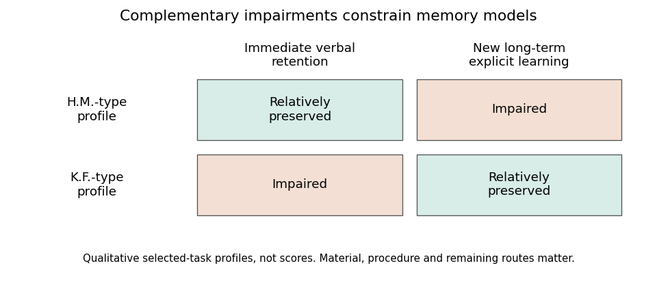

<h1 id="2/solution">Solution</h1>

↑ **Parent:** [2](../2.md)

**The crossed profiles of [medial temporal lobe](../../../medial-temporal-lobe.md) amnesia and severe [verbal short-term memory](../../../verbal-short-term-memory.md) impairment argue against a single undifferentiated [human memory](../../../human-memory.md) store and against obligatory transfer through one verbal short-term buffer.** They do not establish that all short- and [long-term memory](../../../long-term-memory.md) processes occupy two isolated anatomical boxes. The tasks, material and type of learning must be specified before converting a clinical dissociation into a theory.

[Henry Molaison](../../../henry-molaison.md), originally reported as H.M., developed profound difficulty forming new lasting [declarative memories](../../../declarative-memory.md) after bilateral [medial temporal lobe](../../../medial-temporal-lobe.md) surgery. The classic report by [William Beecher Scoville](../../../william-beecher-scoville.md) and [Brenda Milner](../../../brenda-milner.md) connected substantial new-learning impairment with the operation. Yet immediate retention within a limited span could remain much better than new long-term explicit learning. The contrast shows that retaining a small amount for immediate use and establishing enduring new [declarative memories](../../../declarative-memory.md) can be disrupted differently.[1957, postoperative amnesia and relatively preserved immediate performance](../../../loss-of-recent-memory-after-bilateral-hippocampal-lesions-by-william-beecher-scoville-and-brenda-milner.md)

The interpretation is more specific than “all [long-term memory](../../../long-term-memory.md) was lost.” Earlier knowledge could remain accessible, and different learning systems were affected differently. [Suzanne Corkin](../../../suzanne-corkin.md) tested motor-skill acquisition in [Henry Molaison](../../../henry-molaison.md) using [rotary pursuit](../../../rotary-pursuit.md), bimanual tracking and tapping. Performance improved with practice, and retention could be tested after several days on [rotary pursuit](../../../rotary-pursuit.md). The finding shows lasting learning despite severe amnesia; it does not imply normal performance on every motor task, because absolute performance could still be below that of comparison participants.[1968, practice across sessions and delayed rotary-pursuit retention](../../../acquisition-of-motor-skill-after-bilateral-medial-temporal-lobe-excision-by-suzanne-corkin.md)

The complementary profile is exemplified by [Patient K. F.](../../../patient-k-f.md). [Elizabeth Warrington](../../../elizabeth-warrington.md) and [Tim Shallice](../../../tim-shallice.md) reported a very restricted span for auditory [verbal short-term memory](../../../verbal-short-term-memory.md), and subsequent experiments examined free recall, interference, short-delay performance and recognition. Despite the short-term difficulty, long-term verbal learning was relatively good on the tests used. This matters because the impairment was investigated through several procedures rather than inferred from one failed [digit span](../../../digit-span.md) response.[1969, selective auditory-verbal impairment](../../../the-selective-impairment-of-auditory-verbal-short-term-memory-by-elizabeth-warrington-and-tim-shallice.md)[1970, five experiments and preserved performance on long-term tasks](../../../independent-functioning-of-verbal-memory-stores-by-tim-shallice-and-elizabeth-warrington.md)

**[Figure 1](#2/image-two-clinical-profiles-constrain-a-simple-serial-store-account). Two clinical profiles constrain a simple serial-store account**. Original qualitative schematic of relatively preserved versus impaired performance on selected tasks. The cells are not scores, prevalence estimates or a claim that either person performed normally on every task in a broad memory category. Material and procedural differences remain essential to the interpretation.

Together, these profiles are stronger evidence than one patient who fails a difficult delayed test but passes an easier immediate one. A simple general reduction in ability can explain many single dissociations through differing task difficulty. With fixed tasks, [crossed performance rejects a single monotone resource](../../../crossed-performance-rejects-a-single-monotone-resource.md): both performances cannot be fixed [nondecreasing functions](../../../nondecreasing-function.md) of the same [scalar](../../../scalar.md). Nevertheless, clinical reports do not automatically provide such a perfectly matched experiment: different materials, floor and ceiling effects and [measurement reliability](../../../measurement-reliability.md) can distort apparent crossings. Quantitative comparisons and adequate control data strengthen the inference.

The findings also challenge a strong [serial two-store model of memory](../../../serial-two-store-model-of-memory.md). If the particular verbal short-term store damaged in K.F. were the obligatory gateway for all new long-term encoding, severe impairment there should prevent the relatively preserved long-term learning. Parallel access or alternative routes become plausible. This conclusion does not show that no temporary representation is ever required for learning: visual, semantic or residual verbal processing might support encoding. The result targets a specified mandatory route, not the logical possibility of retaining information transiently by other means.

Later distinctions between [working memory](../../../working-memory.md), [episodic memory](../../../episodic-memory.md), [semantic memory](../../../semantic-memory.md) and [procedural memory](../../../procedural-memory.md) explain why delay alone is an inadequate taxonomy. Immediate span depends on perceptual coding, rehearsal and response requirements. New episodic learning depends on operations supporting binding and enduring retention. Motor skills can improve through systems not sufficient for explicit recollection. Such functional distinctions can coexist with interaction: prior knowledge helps immediate retention, and [attention](../../../attention.md) and temporary maintenance affect what is learned.

Anatomy similarly requires refinement. [Henry Molaison](../../../henry-molaison.md)'s operation was not confined to one microscopic hippocampal computation; multiple [medial temporal lobe](../../../medial-temporal-lobe.md) structures were affected. Conversely, a selective verbal span deficit after a different injury does not locate all short-term storage in one cortical patch. More circumscribed [brain lesion](../../../brain-lesion.md) evidence and converging task manipulations are needed to separate structures, connections and computations. The duration of a test is not an anatomical label.

Evidence that [medial temporal lobe](../../../medial-temporal-lobe.md) regions can contribute to online processing of complex objects further qualifies a strict short-delay/long-delay border. [Morgan D. Barense](../../../morgan-d-barense.md) and colleagues found that human [medial temporal lobe](../../../medial-temporal-lobe.md) damage affected tasks involving complex object representations even when demands could not simply be described as conventional long-term learning. This supports examining representational requirements, such as feature conjunctions, rather than assuming every immediate judgment bypasses the [medial temporal lobe](../../../medial-temporal-lobe.md).[2007, object-processing requirements and online performance](../../../the-human-medial-temporal-lobe-processes-online-representations-of-complex-objects-by-morgan-d-barense-and-others.md)

The lasting contribution of these cases is methodological as well as theoretical. Selective deficits motivate decomposing [human memory](../../../human-memory.md) into processes; complementary preservation constrains claims that one process is necessary for another. The resulting theory should predict transfer, interference, cueing and learning across matched tasks, rather than merely attach a store name to each time interval. **[Double dissociations](../../../double-dissociation.md) establish important functional separability under the tested conditions, while the broader evidence favors interacting [human memory](../../../human-memory.md) systems and multiple routes to retention.**

## ↑ Ancestors (11)

1. [2](../2.md)
2. [2022](../../2022-split.md)
3. [Past exam of the cognitive neurology course of the University of Oxford](../../split.md)
4. [Cognitive neurology course of the University of Oxford](../../../cognitive-neurology-course-of-the-university-of-oxford.md)
5. [Year 3 of the psychology (experimental) course of the University of Oxford](../../../year-3-of-the-psychology-experimental-course-of-the-university-of-oxford.md)
6. [Psychology (experimental) course of the University of Oxford](../../../psychology-experimental-course-of-the-university-of-oxford.md)
7. [Undergraduate course of the University of Oxford](../../../undergraduate-course-of-the-university-of-oxford.md)
8. [Course of the University of Oxford](../../../course-of-the-university-of-oxford.md)
9. [University of Oxford](../../../university-of-oxford-split.md)
10. [List of universities](../../../list-of-universities.md)
11. [Codex Wiki](../../../split.md)
