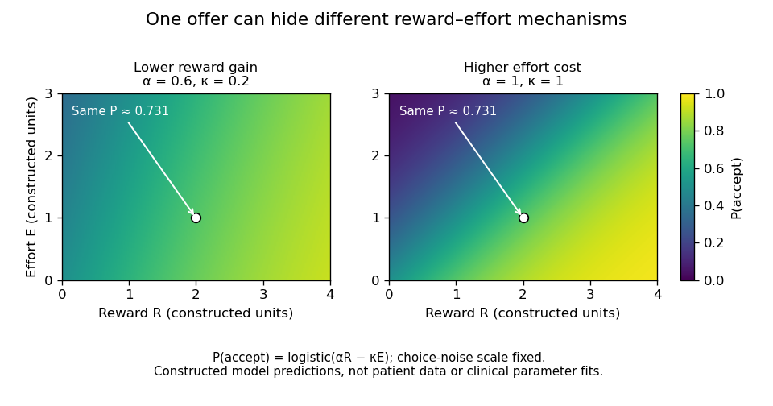

<h1 id="6/solution">Solution</h1>

↑ **Parent:** [6](../6.md)

**Human disorders show that [motivation](../../../motivation.md) depends on several distinguishable operations: initiating activity, translating incentive value into effort, evaluating outcomes and sustaining goal-directed behavior.** A person may be able to execute an instructed movement yet fail to initiate useful action, or may respond differently to [reward](../../../reward.md) and effort without a global loss of [intelligence](../../../intelligence.md). These dissociations argue against equating [motivation](../../../motivation.md) with motor strength or with a single quantity of pleasure.

A striking starting point is [auto-activation deficit](../../../auto-activation-deficit.md). [Dominique Laplane](../../../dominique-laplane.md) and colleagues described three people with marked reduction in spontaneous mental and behavioral activity after toxic encephalopathy and bilateral [basal ganglia](../../../basal-ganglia.md) [brain lesions](../../../brain-lesion.md), especially involving the [globus pallidus](../../../globus-pallidus.md) on the available scans. Intellectual capacities were relatively preserved and motor impairment could be mild. External stimulation could reverse the apparent inactivity. This contrast suggested a problem in self-activation rather than inability to perform every relevant cognitive or motor operation.[1984, spontaneous versus externally elicited activity and CT findings](../../../pure-psychic-akinesia-with-bilateral-lesions-of-basal-ganglia-by-dominique-laplane-and-others.md)

The cases were mechanistically informative but not anatomically pure experiments. Toxic injury can affect more than the structures visible on a scan, and reduced initiation can interact with executive, emotional and motor processes. The observation therefore implicates [basal ganglia](../../../basal-ganglia.md)–frontal systems in internally generated activity without showing that one nucleus contains all [motivation](../../../motivation.md). It also motivates assessing spontaneous behavior separately from performance after repeated prompting.

[Liane Schmidt](../../../liane-schmidt.md) and colleagues tested a more specific incentive-to-action hypothesis. They contrasted an instructed handgrip task, requiring specified force levels, with an incentive task where effort could earn money. Patients with [basal ganglia](../../../basal-ganglia.md) damage and auto-activation difficulty could use external instructions to produce force but showed abnormal translation of incentives into effort. The apparatus makes the dissociation concrete: an available motor response does not ensure that anticipated [reward](../../../reward.md) will appropriately energize it.[2008, instructed versus incentive-driven handgrip tasks](../../../disconnecting-force-from-money-by-liane-schmidt-and-others.md)

This helps separate motor capacity from motivational use of that capacity. Nevertheless, monetary incentives also require understanding task contingencies, representing value and maintaining the goal. A reduced force response does not uniquely identify absence of pleasure. The strength of the design is the contrasting instruction condition; the remaining question is which valuation, activation or control operation prevents self-driven use of the preserved response.

[Parkinson's disease](../../../parkinson-s-disease.md) offers converging evidence while introducing its own confounds. [Campbell Le Heron](../../../campbell-le-heron.md) and colleagues tested 39 patients, with and without clinical [apathy](../../../apathy.md), ON and OFF their usual dopaminergic medication, alongside 32 controls. Choices varied both monetary [reward](../../../reward.md) and required physical effort. [Apathy](../../../apathy.md) and medication state were associated with different patterns across the [reward](../../../reward.md)–effort space, rather than one uniform decrease in willingness to act. This supports distinguishing clinical motivational difficulty from the complete set of effects produced by changing [dopamine](../../../dopamine.md) availability.[2018, reward/effort choice, apathy groups and ON/OFF comparison](../../../distinct-effects-of-apathy-and-dopamine-on-effort-based-decision-making-in-parkinson-s-disease-by-campbell-le-heron-and-others.md)

The design is stronger than comparing raw movement speed alone, but an ON/OFF contrast is not a selective perturbation of one psychological computation. Medication changes motor function and potentially learning, alertness and response vigor. [Apathy](../../../apathy.md) groups are not randomly assigned, and comprehension, [depression](../../../depression.md), fatigue and motor capacity can differ. Interpreting choice patterns therefore requires suitable calibration and comparison measures. [Dopamine](../../../dopamine.md) sensitivity does not justify the statement that [dopamine](../../../dopamine.md) is simply a pleasure signal.

A small [statistical model](../../../statistical-model-split.md) illustrates why [effort-based decision-making](../../../effort-based-decision-making.md) experiments must vary both benefits and costs. Suppose acceptance depends on $U=\alpha R-\kappa E$, where $R$ is [reward](../../../reward.md), $E$ effort, $\alpha$ [reward](../../../reward.md) gain and $\kappa$ effort cost. With a fixed [logistic function](../../../logistic-function.md) as the choice rule, a lower [reward](../../../reward.md) gain and a higher effort cost can produce exactly the same acceptance [probability](../../../probability.md) at one offer. This [single-offer reward-effort ambiguity](../../../single-offer-reward-effort-ambiguity.md) motivates varying both dimensions to distinguish their predictions within the model. These are alternative explanations to test, not parameter estimates obtained merely by diagnosing [apathy](../../../apathy.md).

**[Figure 2](#6/image-one-offer-cannot-distinguish-reduced-reward-gain-from-increased-effort-cost). One offer cannot distinguish reduced reward gain from increased effort cost**. Original constructed logistic-choice illustration. The two parameter settings predict identical acceptance at the marked offer but different patterns elsewhere. The heatmaps are not patient responses, fitted clinical models or a reproduction of the Parkinson's study. Choice-noise scale is fixed for this illustration.

Patients with [prefrontal cortex](../../../prefrontal-cortex.md) damage reveal another component: evaluation of actions across outcomes and time. [Antoine Bechara](../../../antoine-bechara.md) and colleagues introduced the procedure now called the [Iowa gambling task](../../../iowa-gambling-task.md), in which choices offered different short-term gains and longer-term consequences. Patients with [ventromedial prefrontal cortex](../../../ventromedial-prefrontal-cortex.md) damage continued making disadvantageous choices despite relatively preserved conventional intellectual abilities. This linked real-world decision difficulty to experimentally observable valuation and learning demands.[1994, gambling-task comparison and disadvantageous choices](../../../insensitivity-to-future-consequences-following-damage-to-human-prefrontal-cortex-by-antoine-bechara-and-others.md)

The result supports a role in using consequences to guide behavior, but the task combines [reward learning](../../../reward-learning.md), loss sensitivity, reversal, uncertainty and [human memory](../../../human-memory.md). It does not uniquely establish one bodily-feedback mechanism or prove that the patients have no emotional responses. Similarly, [anhedonia](../../../anhedonia.md), reduced initiation and willingness to expend effort should be measured separately rather than treated as synonyms. Several mechanisms can produce superficially similar inactivity, and a change in one response measure does not imply a change in every form of [motivation](../../../motivation.md).

Across these disorders, the most useful inference is computational and relational. [Basal ganglia](../../../basal-ganglia.md) injury distinguishes instructed action from self-activation and incentive translation; Parkinsonian comparisons distinguish aspects of [reward](../../../reward.md)–effort choice from medication-related motor and motivational effects; prefrontal damage reveals difficulty applying future consequences. These operations interact through connected systems and need not map to one region each. **Patient studies have transformed [motivation](../../../motivation.md) from a vague explanation of behavior into separable hypotheses about initiation, valuation, effort and control, while demanding that the preserved capacities and competing explanations be tested explicitly.**

## ↑ Ancestors (11)

1. [6](../6.md)
2. [2022](../../2022-split.md)
3. [Past exam of the cognitive neurology course of the University of Oxford](../../split.md)
4. [Cognitive neurology course of the University of Oxford](../../../cognitive-neurology-course-of-the-university-of-oxford.md)
5. [Year 3 of the psychology (experimental) course of the University of Oxford](../../../year-3-of-the-psychology-experimental-course-of-the-university-of-oxford.md)
6. [Psychology (experimental) course of the University of Oxford](../../../psychology-experimental-course-of-the-university-of-oxford.md)
7. [Undergraduate course of the University of Oxford](../../../undergraduate-course-of-the-university-of-oxford.md)
8. [Course of the University of Oxford](../../../course-of-the-university-of-oxford.md)
9. [University of Oxford](../../../university-of-oxford-split.md)
10. [List of universities](../../../list-of-universities.md)
11. [Codex Wiki](../../../split.md)
