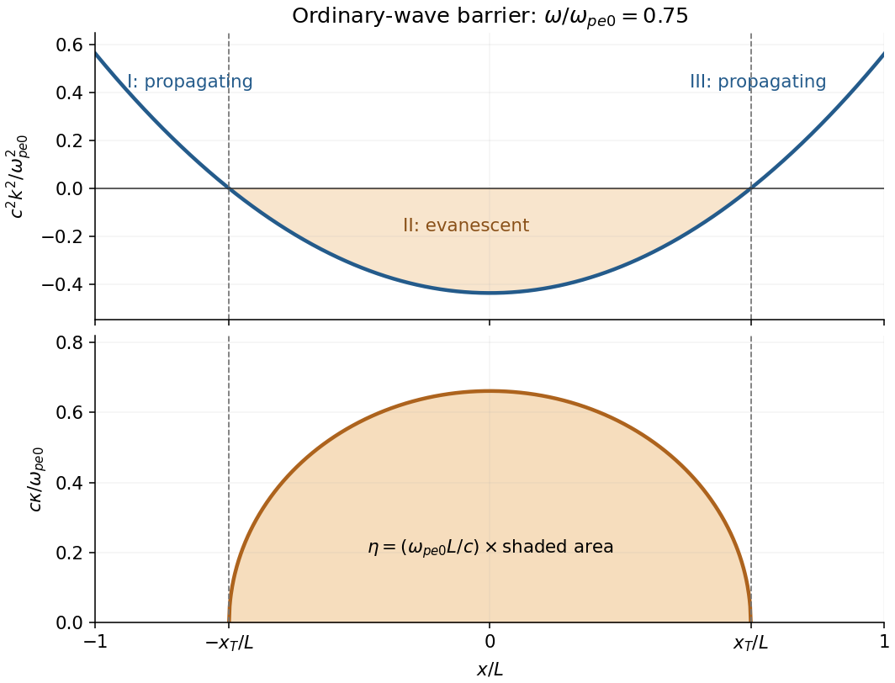

<h1 id="2/h/solution">Solution</h1>

↑ **Parent:** [H](../h.md)

The barrier [wavenumber](../../../../wavenumber.md) is $\kappa=\omega_{pe0}\sqrt{x_T^2-x^2}/(cL)$. The substitution $x=x_T\sin u$ gives

$$
\begin{aligned}
\eta&=\frac{\omega_{pe0}}{cL}\int_{-x_T}^{x_T}\sqrt{x_T^2-x^2}\,dx
=\frac{\omega_{pe0}x_T^2}{cL}\int_{-\pi/2}^{\pi/2}\cos^2u\,du\\
&=\boxed{\frac{\pi\omega_{pe0}L}{2c}\left(1-\frac{\omega^2}{\omega_{pe0}^2}\right).}
\end{aligned}
$$

Thus the leading [transmission coefficient](../../../../transmission-coefficient.md) is

$$
\boxed{T\simeq\exp\!\left[-\frac{\pi\omega_{pe0}L}{c}\left(1-\frac{\omega^2}{\omega_{pe0}^2}\right)\right].}
$$

At fixed $\omega/\omega_{pe0}$, increasing the column width or peak [plasma frequency](../../../../plasma-frequency.md) suppresses transmission exponentially. Raising $\omega$ towards $\omega_{pe0}$ narrows the evanescent region and increases transmission. However, when $\eta$ becomes order one or smaller the two [wave turning points](../../../../wave-turning-point.md) interact; the opaque-barrier [WKB approximation](../../../../wkb-approximation.md) cannot be extrapolated to claim $T\to1$ at $\omega=\omega_{pe0}$. Smooth matching to an exterior is also implicit in the leading result; at $|x|=L$ the stated profile joins continuously to [vacuum](../../../../vacuum.md).

**[Figure 1](#2/h/image-local-squared-wavenumber-and-evanescent-barrier-for-an-ordinary-plasma-wave). Local squared wavenumber and evanescent barrier for an ordinary plasma wave**.

The shaded area in the lower panel is $\eta$ after restoring the factor $\omega_{pe0}L/c$.

## ↑ Ancestors (12)

1. [H](../h.md)
2. [2](../../2.md)
3. [2025](../../../2025-split.md)
4. [Past exam of the collisionless plasma physics course of the University of Oxford](../../../split.md)
5. [Collisionless plasma physics course of the University of Oxford](../../../../collisionless-plasma-physics-course-of-the-university-of-oxford.md)
6. [Year 4 of the mathematical and theoretical physics course of the University of Oxford](../../../../year-4-of-the-mathematical-and-theoretical-physics-course-of-the-university-of-oxford.md)
7. [Mathematical and theoretical physics course of the University of Oxford](../../../../mathematical-and-theoretical-physics-course-of-the-university-of-oxford.md)
8. [Undergraduate course of the University of Oxford](../../../../undergraduate-course-of-the-university-of-oxford.md)
9. [Course of the University of Oxford](../../../../course-of-the-university-of-oxford.md)
10. [University of Oxford](../../../../university-of-oxford-split.md)
11. [List of universities](../../../../list-of-universities.md)
12. [Codex Wiki](../../../../split.md)
