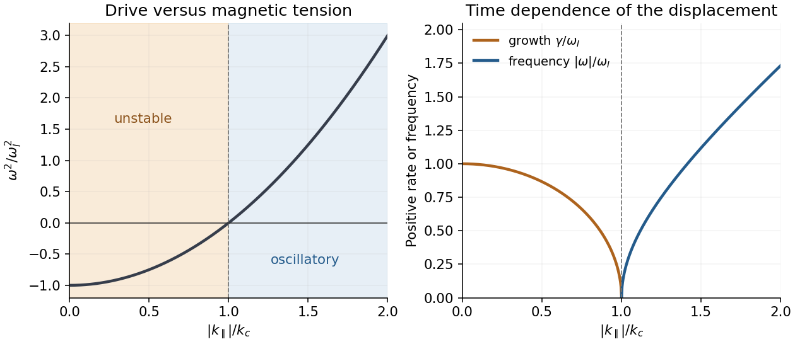

<h1 id="3/e/solution">Solution</h1>

↑ **Parent:** [E](../e.md)

Assume the stated outward-decreasing [pressure](../../../../pressure-split.md), $L_p>0$, and set

$$
\omega_I^2=\frac{2p_0}{\rho_0RL_p}=\frac{\beta v_A^2}{RL_p},\qquad
\boxed{k_c=\frac{\omega_I}{v_A}=\sqrt{\frac\beta{RL_p}}.}
$$

For $|k_\parallel|<k_c$, the [interchange instability](../../../../interchange-instability.md) has

$$
\omega=\pm i\gamma,\qquad\gamma=\sqrt{\omega_I^2-k_\parallel^2v_A^2},\qquad
\xi_x=C_+e^{\gamma t}+C_-e^{-\gamma t}.
$$

An outward-displaced [flux tube](../../../../flux-tube.md) carries higher [pressure](../../../../pressure-split.md) than its new surroundings. In the unfavorable [magnetic field-line curvature](../../../../magnetic-field-line-curvature.md) of the [Z-pinch](../../../../z-pinch.md), the resulting imbalance drives it farther outward. Parallel variation bends field lines, and [magnetic tension](../../../../magnetic-tension.md) supplies the stabilizing $k_\parallel^2v_A^2$ term. The fastest local interchange is at $k_\parallel=0$, with $\gamma=\omega_I$; this endpoint is understood as the limit of the stated Alfvénic ordering. There is no leading $k_y$ dependence once $k_y\gg k_\parallel$.

For $|k_\parallel|>k_c$, the two real [frequencies](../../../../frequency.md) are $\omega=\pm\sqrt{k_\parallel^2v_A^2-\omega_I^2}$: the displacement oscillates as a curvature-modified [Alfvén wave](../../../../alfven-wave.md). At $|k_\parallel|=k_c$, the leading equation is $\ddot\xi_x=0$, so the marginal solutions are a constant and a term linear in time; neglected corrections determine finer behavior. For a favorable reversed [pressure gradient](../../../../pressure-gradient.md), $L_p<0$, this drive is stabilizing.

The leading [dispersion relation](../../../../dispersion-relation-split.md) is the same in [ideal magnetohydrodynamics](../../../../ideal-magnetohydrodynamics-split.md). Its adiabatic law gives $\delta p=-\xi_xp_0'-\Gamma p_0\nabla\cdot\boldsymbol\xi$; the compressive part is smaller than the steep-gradient advection by $O(L_p/R)$ or $O(\beta)$, giving the same leading $\delta p=-\xi_xp_0'$. Relaxing those orderings introduces compression, field-strength and field-length changes, and [pressure anisotropy](../../../../pressure-anisotropy.md); the [drift-kinetic equation](../../../../drift-kinetic-equation.md) can then introduce parallel [kinetic phase mixing](../../../../free-transport-phase-mixing.md) and [Landau damping](../../../../landau-damping.md). At larger [plasma beta](../../../../plasma-beta.md), coupling to compressive branches matters; if [pressure anisotropy](../../../../pressure-anisotropy.md) develops, [mirror instability](../../../../mirror-instability.md) and [firehose instability](../../../../firehose-instability.md) may also become relevant. These are possibilities beyond the derived leading equation, not additional roots already established here.

**[Figure 2](#3/e/image-magnetic-tension-stabilizes-the-local-interchange-instability-above-its-critical-parallel-wavenumber). Magnetic tension stabilizes the local interchange instability above its critical parallel wavenumber**.

## ↑ Ancestors (12)

1. [E](../e.md)
2. [3](../../3.md)
3. [2025](../../../2025-split.md)
4. [Past exam of the collisionless plasma physics course of the University of Oxford](../../../split.md)
5. [Collisionless plasma physics course of the University of Oxford](../../../../collisionless-plasma-physics-course-of-the-university-of-oxford.md)
6. [Year 4 of the mathematical and theoretical physics course of the University of Oxford](../../../../year-4-of-the-mathematical-and-theoretical-physics-course-of-the-university-of-oxford.md)
7. [Mathematical and theoretical physics course of the University of Oxford](../../../../mathematical-and-theoretical-physics-course-of-the-university-of-oxford.md)
8. [Undergraduate course of the University of Oxford](../../../../undergraduate-course-of-the-university-of-oxford.md)
9. [Course of the University of Oxford](../../../../course-of-the-university-of-oxford.md)
10. [University of Oxford](../../../../university-of-oxford-split.md)
11. [List of universities](../../../../list-of-universities.md)
12. [Codex Wiki](../../../../split.md)
