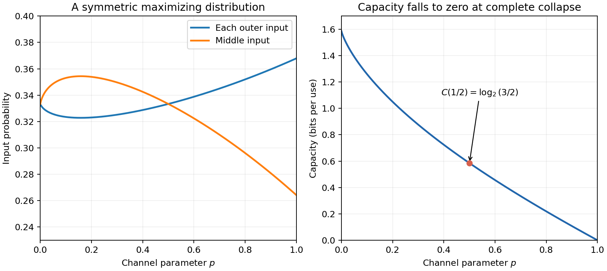

# 2007

↑ **Parent:** [Past exam of the communication Theory course of the University of Oxford](../past-exam-of-the-communication-theory-course-of-the-university-of-oxford.md)

Communication Theory, Mathematics Part B and the Mathematics and Philosophy and Mathematics and Statistics joint schools; Thursday 14 June 2007, 9.30am–11.15am. The complete four-page source is privately transcribed from original Part B bundle pages 61–64, supplied through [the past-papers disclosure](https://www.whatdotheyknow.com/request/maths_past_papers_3). No exact worked-answer advertisement was found in the bounded availability check. Source coding uses the positive-probability source support. Logarithms and information quantities are in base two unless indicated otherwise.

**Table of contents**

- [1](#1)
  - [a](#1/a)
    - [Solution](#1/a/solution)
  - [b](#1/b)
    - [Solution](#1/b/solution)
  - [c](#1/c)
    - [Solution](#1/c/solution)
- [2](#2)
  - [a](#2/a)
    - [Solution](#2/a/solution)
  - [b](#2/b)
    - [Solution](#2/b/solution)
  - [c](#2/c)
    - [Solution](#2/c/solution)
- [3](#3)
  - [a](#3/a)
    - [Solution](#3/a/solution)
  - [b](#3/b)
    - [Solution](#3/b/solution)
  - [c](#3/c)
    - [Solution](#3/c/solution)
- [4](#4)
  - [a](#4/a)
    - [i](#4/a/i)
      - [Solution](#4/a/i/solution)
    - [ii](#4/a/ii)
      - [Solution](#4/a/ii/solution)
    - [iii](#4/a/iii)
      - [Solution](#4/a/iii/solution)
    - [Solution](#4/a/solution)
  - [b](#4/b)
    - [Solution](#4/b/solution)

## 1

↑ **Parent:** [2007](2007.md)

<h3 id="1/a">a</h3>

↑ **Parent:** [1](#1)

<h4 id="1/a/solution">Solution</h4>

↑ **Parent:** [A](#1/a)

Use the convention $0\log_20=0$. On the positive support of $p$, the given logarithm inequality gives

$$
D(p,q)=-\sum_{p_r>0}p_r\log_2(q_r/p_r)\ge c\sum_{p_r>0}(p_r-q_r)\ge0.
$$

The logarithm is strictly concave, so its supporting line at one has equality only there. More explicitly, the given global bound forces $c=1/\log_e2$ by differentiation at one, and $x-1-\log_ex$ vanishes only at one. Equality above therefore requires $p_r=q_r$ on the positive support, and no mass of $q$ outside it. Thus **equality holds exactly when $p=q$**.

For the uniform distribution $q_r=1/n$, the divergence is $D(p,q)=\log_2n-H(p)$. Its nonnegativity gives $\boxed{H(p)\le\log_2n}$, with equality precisely for the uniform law.

<h3 id="1/b">b</h3>

↑ **Parent:** [1](#1)

<h4 id="1/b/solution">Solution</h4>

↑ **Parent:** [B](#1/b)

[Conditional entropy](../information-theory.md#conditional-entropy) is $H(U\mid V)=\sum_vP(V=v)H(U\mid V=v)$. Factor the joint probabilities as $P(U=u,V=v)=P(V=v)P(U=u\mid V=v)$ and expand their logarithms. This gives $H(X,Y)=H(Y)+H(X\mid Y)$. Applying the same identity within each conditional law given $Z=z$ and averaging gives $H(X,Y\mid Z)=H(X\mid Z)+H(Y\mid X,Z)$.

Put $E=\mathbf1_{\{X\ne Y\}}$ and $\varepsilon=P(E=1)$. Since $E$ is a function of $X,Y$, the conditional [chain rule](../calculus.md#chain-rule) gives

$$
H(X\mid Y)=H(E\mid Y)+H(X\mid E,Y).
$$

By [Gibbs inequality](../f-divergence.md#gibbs-inequality), the first term is at most $h(\varepsilon)\le1$. When $E=0$, $Y$ determines $X$. When $E=1$, there are at most $n-1$ possibilities for $X$ given $Y$, so its [conditional entropy](../information-theory.md#conditional-entropy) is at most $\log_2(n-1)$. Therefore

$$
H(X\mid Y)\le h(\varepsilon)+\varepsilon\log_2(n-1)\le1+\varepsilon\log_2(n-1).
$$

For $n>2$, rearrangement proves

$$
\boxed{P(X\ne Y)\ge\frac{H(X\mid Y)-1}{\log_2(n-1)}}.
$$

The printed division presupposes $n>2$. For $n=2$ its denominator is zero, and the meaningful statement is the stronger undivided inequality $H(X\mid Y)\le h(\varepsilon)$. For $n=1$ the variables agree surely.

<h3 id="1/c">c</h3>

↑ **Parent:** [1](#1)

<h4 id="1/c/solution">Solution</h4>

↑ **Parent:** [C](#1/c)

[Independence](../random-variable.md#independent-random-variables) gives $P(X=Y)=\sum_rp_rq_r=\mathbb E_p[2^{\log_2q_X}]$. The given exponential convexity inequality therefore yields

$$
P(X=Y)\ge2^{\sum_rp_r\log_2q_r}=2^{-H(X)-D(p,q)}.
$$

Taking complementary probabilities proves

$$
\boxed{P(X\ne Y)\le1-2^{-H(X)-D(p,q)}}.
$$

The strict positivity of the entries of $q$ makes all logarithms appearing in this finite expectation well defined.

## 2

↑ **Parent:** [2007](2007.md)

<h3 id="2/a">a</h3>

↑ **Parent:** [2](#2)

<h4 id="2/a/solution">Solution</h4>

↑ **Parent:** [A](#2/a)

A binary [prefix code](../coding-theory.md#prefix-code) assigns distinct finite binary strings to the source symbols, with no assigned string a prefix of another. It is instantaneous because a complete codeword is recognized without needing the next word's bits.

Associate a word of length $\ell$ with its dyadic subinterval of $[0,1)$ of length $2^{-\ell}$. A prefix relation corresponds to interval containment. Prefix-free words therefore give disjoint intervals, whose total length is at most one. This proves necessity of [Kraft inequality](../coding-theory.md#kraft-mcmillan-inequality).

For sufficiency, sort the requested nonnegative integer lengths increasingly and construct a code greedily in a binary tree. At depth $\ell_j$, the preceding codewords forbid exactly $\sum_{i<j}2^{\ell_j-\ell_i}$ nodes. The assumed inequality, retaining the positive contribution of the present word, bounds this integer by $2^{\ell_j}-1$. Thus at least one node is available; choose it. It is not below an earlier codeword, and the nondecreasing lengths prevent it from being a proper ancestor of an earlier word. Continue to obtain a [prefix code](../coding-theory.md#prefix-code) of all the required lengths. Hence

$$
\boxed{\text{Such a code exists exactly when }\sum_k2^{-\ell_k}\le1}.
$$

<h3 id="2/b">b</h3>

↑ **Parent:** [2](#2)

<h4 id="2/b/solution">Solution</h4>

↑ **Parent:** [B](#2/b)

Work on the source support, so its listed probabilities are positive; zero-probability symbols may be omitted. An optimal binary [prefix code](../coding-theory.md#prefix-code) minimizes the [expected codeword length](../information-theory.md#expected-codeword-length) for that distribution. The same optimal expected length is attained when optimization is over uniquely decipherable codes, by the converse and existence parts of [Kraft–McMillan inequality](../coding-theory.md#kraft-mcmillan-inequality).

Choose Shannon lengths $\ell_k=\lceil-\log_2p_k\rceil$. They satisfy $2^{-\ell_k}\le p_k$, so the preceding existence theorem gives a [prefix code](../coding-theory.md#prefix-code) with those lengths. Also $\ell_k<-\log_2p_k+1$ for every symbol, including the integer cases. Thus its expected length is less than $H(X)+1$. An optimal code cannot have a larger expected length, proving

$$
\boxed{\sum_kp_k\ell_k<H(X)+1}.
$$

For a deterministic one-symbol source the empty word has length zero, consistent with this bound.

<h3 id="2/c">c</h3>

↑ **Parent:** [2](#2)

<h4 id="2/c/solution">Solution</h4>

↑ **Parent:** [C](#2/c)

At an interior tree node write $A,B$ for the total masses in its two children, and $S=A+B$. Counting path lengths and telescoping the [Shannon entropy](../information-entropy.md) over the binary decisions gives

$$
\bar s=\sum_vS_v,\qquad H(X)=\sum_vS_vh(A_v/S_v).
$$

Indeed each symbol contributes its probability once per ancestral interior node to the first sum. In the second sum, expanding $S h(A/S)=S\log_2S-A\log_2A-B\log_2B$ cancels the interior terms and leaves the source [Shannon entropy](../information-entropy.md). The supplied inequality now bounds redundancy by

$$
\bar s-H(X)\le\sum_v|A_v-B_v|.
$$

Consider the cut between adjacent symbols $k,k+1$ made at one node. If its left side is heavier, moving its last symbol to the right must not improve the chosen cut. Writing $\Delta=A-B\ge0$, this says $|\Delta-2p_k|\ge\Delta$, which implies $\Delta\le p_k$; when the left side is a singleton the same bound is immediate. If the right side is heavier, the corresponding argument gives $|A-B|\le p_{k+1}$. In all cases

$$
|A-B|\le\max(p_k,p_{k+1})\le p_k+p_{k+1}.
$$

Recursive subdivision of contiguous blocks uses each original gap exactly once. Summing over the $m-1$ gaps therefore gives

$$
\bar s-H(X)\le2-p_1-p_m<2,
$$

proving **$\bar s<H(X)+2$**. If probabilities are already nonincreasing, each maximum is $p_k$ and the improved bound is $\bar s-H(X)\le1-p_m<1$. Thus **the sorted version has expected length less than $H(X)+1$**, although it need not be optimal. For one symbol the assertions hold directly. This is the [Fano slice code redundancy bound](../coding-theory.md#fano-slice-code-redundancy-bound).

## 3

↑ **Parent:** [2007](2007.md)

<h3 id="3/a">a</h3>

↑ **Parent:** [3](#3)

<h4 id="3/a/solution">Solution</h4>

↑ **Parent:** [A](#3/a)

The channel matrix has entries $M_{xy}=P(Y=y\mid X=x)$, with nonnegative entries and each row summing to one. For an input distribution $\pi$, it induces the joint law $P(X=x,Y=y)=\pi_xM_{xy}$. Its capacity in bits per use is

$$
\boxed{C=\max_\pi I(X;Y)},\qquad I(X;Y)=H(Y)-H(Y\mid X).
$$

On finite alphabets the maximum exists by [continuity](../calculus.md#continuous-function) on the [compact](../topology.md#compact-space) [probability simplex](../algebraic-topology.md#probability-simplex).

<h3 id="3/b">b</h3>

↑ **Parent:** [3](#3)

<h4 id="3/b/solution">Solution</h4>

↑ **Parent:** [B](#3/b)

[Gibbs inequality](../f-divergence.md#gibbs-inequality) makes [mutual information](../information-theory.md#mutual-information) nonnegative, so $C\ge0$. The two conditional-[Shannon entropy](../information-entropy.md) expressions give

$$
I(X;Y)=H(X)-H(X\mid Y)=H(Y)-H(Y\mid X)\le\min(H(X),H(Y)).
$$

Each [Shannon entropy](../information-entropy.md) is bounded by the base-two logarithm of its alphabet size. Maximizing over the input distribution therefore gives $\boxed{0\le C\le\log_2m}$ for the smaller size $m$.

<h3 id="3/c">c</h3>

↑ **Parent:** [3](#3)

<h4 id="3/c/solution">Solution</h4>

↑ **Parent:** [C](#3/c)

Exchanging the first and third inputs, together with the corresponding outputs, leaves the channel unchanged. [Concavity](../real-analysis.md#concave-function) therefore shows that averaging an input distribution with its exchanged distribution cannot reduce [mutual information](../information-theory.md#mutual-information). We may take input probabilities $(a,1-2a,a)$.

For $p<1$, put $b=1-p$ and $t=2ab$, so $0\le t\le b$. The output distribution is $(t/2,1-t,t/2)$ and the mean conditional output [Shannon entropy](../information-entropy.md) is $2ah(p)=t h(p)/b$. Hence

$$
I=h(t)+t\left(1-\frac{h(p)}b\right).
$$

Its [strict concavity](../real-analysis.md#strict-concavity) gives the unique stationary value $t_*=[1+2^{h(p)/b-1}]^{-1}$. This lies in the allowed interval: for $0<p<1$, the derivative at $t=b$ is $(\log_2p+b)/b<0$, while it tends to positive infinity at zero. At $p=0$ the stationary value is $2/3<1$ directly. Consequently an achieving input distribution is

$$
\boxed{(a,1-2a,a),\qquad a=\frac1{(1-p)(2+2^{h(p)/(1-p)})}}.
$$

The resulting capacity is $C=\log_2(1+2^{1-h(p)/(1-p)})$. In particular at $p=1/2$, $a=1/3$ and

$$
\boxed{C=\log_2(3/2)}.
$$

At $p=1$ all outputs are the middle symbol, so $C=0$ and every input distribution achieves it; the divided formula is not used at that endpoint.

**[Figure 1](#3/c/image-the-maximizing-input-and-capacity-as-noise-varies). The maximizing input and capacity as noise varies**. The two outer input probabilities coincide by symmetry. The formulas apply below p equal to one; at complete collapse every input distribution attains zero capacity.

## 4

↑ **Parent:** [2007](2007.md)

<h3 id="4/a">a</h3>

↑ **Parent:** [4](#4)

<h4 id="4/a/i">i</h4>

↑ **Parent:** [A](#4/a)

<h5 id="4/a/i/solution">Solution</h5>

↑ **Parent:** [I](#4/a/i)

[Maximum a posteriori decoding](../coding-theory.md#maximum-a-posteriori-decoding) chooses an input with the largest posterior probability given the received word. By Bayes' theorem this maximizes $P(X=x)p(y\mid x)$ over candidate codewords, minimizing the average probability of a decoding error.

<h4 id="4/a/ii">ii</h4>

↑ **Parent:** [A](#4/a)

<h5 id="4/a/ii/solution">Solution</h5>

↑ **Parent:** [Ii](#4/a/ii)

[Maximum-likelihood decoding](../coding-theory.md#maximum-likelihood-decoding) chooses a codeword maximizing $p(y\mid x)$ for the received word $y$. It uses the [likelihood](../maximum-likelihood-estimation.md#likelihood-function) alone, without weighting by the prior probabilities of the codewords.

<h4 id="4/a/iii">iii</h4>

↑ **Parent:** [A](#4/a)

<h5 id="4/a/iii/solution">Solution</h5>

↑ **Parent:** [Iii](#4/a/iii)

[Minimum-distance decoding](../coding-theory.md#minimum-distance-decoding) with [Hamming distance](../coding-theory.md#hamming-distance) chooses a codeword minimizing the number of positions in which it differs from the received word. Ties may be resolved by a fixed rule.

<h4 id="4/a/solution">Solution</h4>

↑ **Parent:** [A](#4/a)

With equally likely codewords, the prior factor in the ideal-observer criterion is constant, so it agrees with maximum [likelihood](../maximum-likelihood-estimation.md#likelihood-function). On the [binary symmetric channel](../coding-theory.md#binary-symmetric-channel),

$$
p(y\mid x)=p^{d_H(x,y)}(1-p)^{n-d_H(x,y)}.
$$

For $0<p<1/2$ this is strictly decreasing in [Hamming distance](../coding-theory.md#hamming-distance), so the [likelihood](../maximum-likelihood-estimation.md#likelihood-function) maximizers are precisely the nearest codewords. With the same tie convention all three decoders therefore agree. At $p=0$ every possible received word equals its transmitted codeword, and the rules agree on all positive-probability outputs; outputs having zero probability need no posterior assignment.

<h3 id="4/b">b</h3>

↑ **Parent:** [4](#4)

<h4 id="4/b/solution">Solution</h4>

↑ **Parent:** [B](#4/b)

A radius-$r$ Hamming decoder outputs the unique codeword within distance $r$ of the received word, if there is one. Ambiguous cases and absent candidates can be declared errors, or assigned arbitrarily for an error bound. The average error is the mean of the conditional error probabilities over the equally likely transmitted messages.

Let $V_n(r)=\sum_{j=0}^r\binom nj$ be the size of a [Hamming ball](../coding-theory.md#hamming-ball). For any transmitted random codeword, the channel noise weight is $U\sim\operatorname{Bin}(n,p)$. Decoding can fail only if $U>r$ or another codeword lies within distance $r$ of the output. Conditional on the output, each independently sampled competing codeword is still uniform on the whole word space, so has probability $2^{-n}V_n(r)$ of lying in that ball. A [union bound](../probability-inequality.md#boole-s-inequality) yields

$$
\boxed{\mathbb E_{\mathcal A}\bar e(\mathcal A)\le(2M-1)2^{-n}V_n(r)+P(U>r)}.
$$

This is an average over the random code construction as well as over messages and noise. It implies existence of at least one deterministic codebook with average error no greater than this bound, rather than asserting the same inequality for every randomly sampled book.

Choose a target rate $R<1-h(p)$ and a small $\delta>0$ such that $p+\delta<1/2$ and $R<1-h(p+\delta)$. Let $M_n=\lfloor2^{nR}\rfloor$ and $r=\lfloor n(p+\delta)\rfloor$. The standard Hamming-volume estimate is $V_n(r)\le2^{nh(r/n)}$: for $s=r/n\le1/2$, each binomial probability term $s^j(1-s)^{n-j}$ with $j\le r$ is at least $s^r(1-s)^{n-r}$, and summing proves this bound. Thus the union-bound term decays exponentially, while $P(U>r)\to0$ by the [law of large numbers](../convergence-of-random-variables.md#law-of-large-numbers) or a [Chernoff bound](../probability-inequality.md#chernoff-bound).

There exists a $2M_n$-message book with average error $\varepsilon_n\to0$. At least half its messages have individual error at most $2\varepsilon_n$, by [Markov's inequality](../probability-inequality.md#markov-s-inequality) on the uniformly chosen message. Keep $M_n$ of these and discard the rest. Restricting the decoder's candidate set cannot spoil a previously unique successful decoding. The retained book therefore has maximum error at most $2\varepsilon_n\to0$. For large $n$ its retained codewords must be distinct: identical words could not both have conditional error below one half. This [expurgation of a codebook](../coding-theory.md#expurgation-of-a-codebook) proves reliable communication at every rate below $1-h(p)$, while converting an average-error estimate into the requested maximum-error conclusion.

## ↑ Ancestors (9)

1. [Past exam of the communication Theory course of the University of Oxford](../past-exam-of-the-communication-theory-course-of-the-university-of-oxford.md)
2. [Communication Theory course of the University of Oxford](../university-of-oxford.md#communication-theory-course-of-the-university-of-oxford)
3. [Year 3 of the mathematics course of the University of Oxford](../university-of-oxford.md#year-3-of-the-mathematics-course-of-the-university-of-oxford)
4. [Mathematics course of the University of Oxford](../university-of-oxford.md#mathematics-course-of-the-university-of-oxford)
5. [Undergraduate course of the University of Oxford](../university-of-oxford.md#undergraduate-course-of-the-university-of-oxford)
6. [Course of the University of Oxford](../university-of-oxford.md#course-of-the-university-of-oxford)
7. [University of Oxford](../university-of-oxford.md)
8. [List of universities](../README.md#list-of-universities)
9. [Codex Wiki](../README.md)
