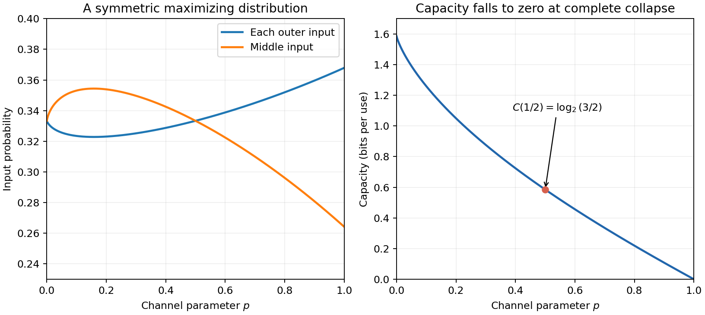

<h1 id="3/c/solution">Solution</h1>

↑ **Parent:** [C](../c.md)

Exchanging the first and third inputs, together with the corresponding outputs, leaves the channel unchanged. [Concavity](../../../../concave-function.md) therefore shows that averaging an input distribution with its exchanged distribution cannot reduce [mutual information](../../../../mutual-information.md). We may take input probabilities $(a,1-2a,a)$.

For $p<1$, put $b=1-p$ and $t=2ab$, so $0\le t\le b$. The output distribution is $(t/2,1-t,t/2)$ and the mean conditional output [Shannon entropy](../../../../information-entropy-split.md) is $2ah(p)=t h(p)/b$. Hence

$$
I=h(t)+t\left(1-\frac{h(p)}b\right).
$$

Its [strict concavity](../../../../strict-concavity.md) gives the unique stationary value $t_*=[1+2^{h(p)/b-1}]^{-1}$. This lies in the allowed interval: for $0<p<1$, the derivative at $t=b$ is $(\log_2p+b)/b<0$, while it tends to positive infinity at zero. At $p=0$ the stationary value is $2/3<1$ directly. Consequently an achieving input distribution is

$$
\boxed{(a,1-2a,a),\qquad a=\frac1{(1-p)(2+2^{h(p)/(1-p)})}}.
$$

The resulting capacity is $C=\log_2(1+2^{1-h(p)/(1-p)})$. In particular at $p=1/2$, $a=1/3$ and

$$
\boxed{C=\log_2(3/2)}.
$$

At $p=1$ all outputs are the middle symbol, so $C=0$ and every input distribution achieves it; the divided formula is not used at that endpoint.

**[Figure 1](#3/c/image-the-maximizing-input-and-capacity-as-noise-varies). The maximizing input and capacity as noise varies**. The two outer input probabilities coincide by symmetry. The formulas apply below p equal to one; at complete collapse every input distribution attains zero capacity.

## ↑ Ancestors (12)

1. [C](../c.md)
2. [3](../../3.md)
3. [2007](../../../2007-split.md)
4. [Past exam of the communication Theory course of the University of Oxford](../../../split.md)
5. [Communication Theory course of the University of Oxford](../../../../communication-theory-course-of-the-university-of-oxford.md)
6. [Year 3 of the mathematics course of the University of Oxford](../../../../year-3-of-the-mathematics-course-of-the-university-of-oxford.md)
7. [Mathematics course of the University of Oxford](../../../../mathematics-course-of-the-university-of-oxford.md)
8. [Undergraduate course of the University of Oxford](../../../../undergraduate-course-of-the-university-of-oxford.md)
9. [Course of the University of Oxford](../../../../course-of-the-university-of-oxford.md)
10. [University of Oxford](../../../../university-of-oxford-split.md)
11. [List of universities](../../../../list-of-universities.md)
12. [Codex Wiki](../../../../split.md)
