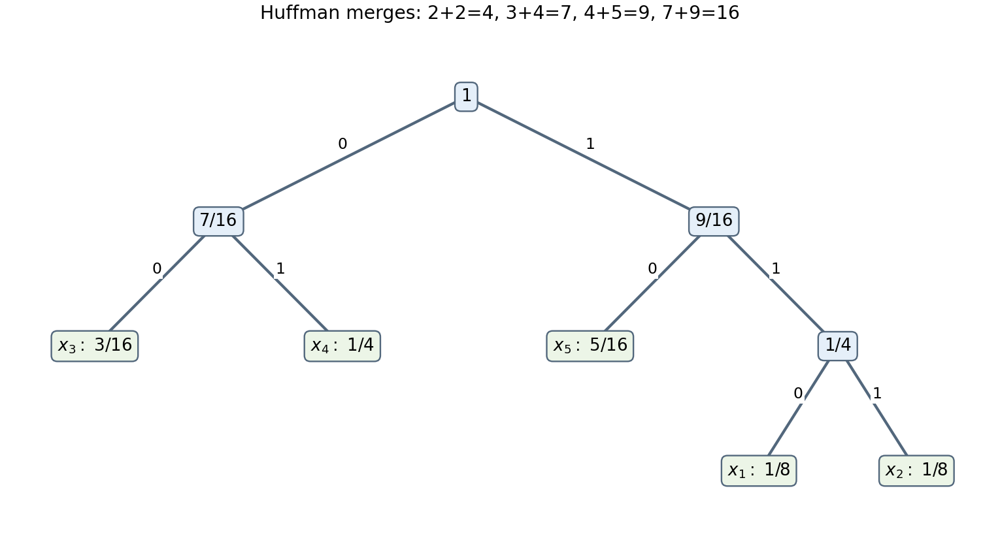

# 2008

↑ **Parent:** [Past exam of the communication Theory course of the University of Oxford](../past-exam-of-the-communication-theory-course-of-the-university-of-oxford.md)

Communication Theory, Mathematics Part B and the corresponding joint schools; Thursday 12 June 2008, 9.30am–11.15am. The complete three-page source and intact cover are preserved in a private editable transcription from original Part B bundle pages 127–129, supplied through [the past-papers disclosure](https://www.whatdotheyknow.com/request/maths_past_papers_3). No exact worked-answer advertisement was found in the bounded availability check. All logarithms in these solutions are to base two unless another base is shown.

**Table of contents**

- [1](#1)
  - [a](#1/a)
    - [i](#1/a/i)
      - [Solution](#1/a/i/solution)
    - [ii](#1/a/ii)
      - [Solution](#1/a/ii/solution)
  - [b](#1/b)
    - [Solution](#1/b/solution)
- [2](#2)
  - [a](#2/a)
    - [Solution](#2/a/solution)
  - [b](#2/b)
    - [Solution](#2/b/solution)
  - [c](#2/c)
    - [i](#2/c/i)
      - [Solution](#2/c/i/solution)
    - [ii](#2/c/ii)
      - [Solution](#2/c/ii/solution)
- [3](#3)
  - [a](#3/a)
    - [Solution](#3/a/solution)
  - [b](#3/b)
    - [Solution](#3/b/solution)
  - [c](#3/c)
    - [Solution](#3/c/solution)
- [4](#4)
  - [a](#4/a)
    - [i](#4/a/i)
      - [Solution](#4/a/i/solution)
    - [ii](#4/a/ii)
      - [Solution](#4/a/ii/solution)
  - [b](#4/b)
    - [Solution](#4/b/solution)

## 1

↑ **Parent:** [2008](2008.md)

<h3 id="1/a">a</h3>

↑ **Parent:** [1](#1)

<h4 id="1/a/i">i</h4>

↑ **Parent:** [A](#1/a)

<h5 id="1/a/i/solution">Solution</h5>

↑ **Parent:** [I](#1/a/i)

Write $p_{xy}=\mathbb P(X=x,Y=y)$, $p_x=\sum_y p_{xy}$, and $q_y=\sum_x p_{xy}$. In bits the [mutual information](../information-theory.md#mutual-information) is

$$
I(X;Y)=\sum_{p_{xy}>0}p_{xy}\log_2\frac{p_{xy}}{p_xq_y}.
$$

Terms with zero joint probability contribute zero. On its positive support apply $-\log t\ge1-t$ with $t=p_xq_y/p_{xy}$:

$$
(\log_e2)I(X;Y)\ge\sum_{p_{xy}>0}(p_{xy}-p_xq_y)
=1-\sum_{p_{xy}>0}p_xq_y\ge0.
$$

Equality requires equality in every logarithmic inequality and no product mass outside the joint support, hence $p_{xy}=p_xq_y$ everywhere. Conversely that factorization makes every term zero. Thus **[mutual information](../information-theory.md#mutual-information) is nonnegative and vanishes exactly for [independence](../random-variable.md#independent-random-variables)**. For countable alphabets the same conclusion follows from the [relative-entropy inequality](../f-divergence.md#gibbs-inequality), allowing the value $+\infty$.

<h4 id="1/a/ii">ii</h4>

↑ **Parent:** [A](#1/a)

<h5 id="1/a/ii/solution">Solution</h5>

↑ **Parent:** [Ii](#1/a/ii)

The [entropy chain rule](../information-entropy.md#chain-rule-for-information-entropy) gives

$$
I(X;Y)=H(X)-H(X\mid Y)=H(Y)-H(Y\mid X).
$$

[Conditional entropy](../information-theory.md#conditional-entropy) is nonnegative, so $I(X;Y)\le\min(H(X),H(Y))$. For finite [entropies](../information-entropy.md), if $H(X)\le H(Y)$, equality holds exactly when $H(X\mid Y)=0$, meaning **$X$ is a [function](../function.md) of $Y$ almost surely**. If $H(Y)\le H(X)$, interchange the variables. When their [entropies](../information-entropy.md) are equal, equality requires both functional relations. Zero [conditional entropy](../information-theory.md#conditional-entropy) has this characterization because each conditional [probability distribution](../probability-distribution.md) must be a [point mass](../classical-mechanics.md#point-mass).

<h3 id="1/b">b</h3>

↑ **Parent:** [1](#1)

<h4 id="1/b/solution">Solution</h4>

↑ **Parent:** [B](#1/b)

The conditional output distributions are permutations of the same triple, so both [conditional entropies](../information-theory.md#conditional-entropy) equal

$$
H_0=H(1/6,1/3,1/2).
$$

With input probability $p$, the three output probabilities are $q_1=(2-p)/6$, $q_2=(1+2p)/6$, and $q_3=(3-p)/6$. Therefore

$$
\boxed{I(p)=-\sum_{j=1}^3q_j\log_2q_j-H_0}.
$$

Differentiating, the constant terms cancel because $\sum q_j'=0$:

$$
I'(p)=\frac16\log_2\frac{(2-p)(3-p)}{(1+2p)^2},\qquad
I''(p)=-\frac1{\log_e2}\sum_j\frac{(q_j')^2}{q_j}<0.
$$

Thus there is a unique maximum. Its stationary equation reduces to $3p^2+9p-5=0$, whose root in $[0,1]$ is

$$
\boxed{p_{\max}=\frac{\sqrt{141}-9}{6}}.
$$

The other root is negative; [strict concavity](../real-analysis.md#strict-concavity) proves this is the global maximum.

## 2

↑ **Parent:** [2008](2008.md)

<h3 id="2/a">a</h3>

↑ **Parent:** [2](#2)

<h4 id="2/a/solution">Solution</h4>

↑ **Parent:** [A](#2/a)

For a finite [probability distribution](../probability-distribution.md),

$$
H(X)=-\sum_{p_i>0}p_i\log_2p_i,
$$

with $0\log_20=0$. If the positive support has size $s\le n$, apply the given strict [Jensen inequality](../real-analysis.md#jensen-s-inequality) to the [random variable](../random-variable.md) $Z=1/p_X$:

$$
H(X)=\mathbb E\log_2 Z\le\log_2\mathbb EZ=\log_2s\le\log_2n.
$$

Equality requires $s=n$ and $Z$ constant almost surely, so all probabilities are $1/n$. Conversely the uniform distribution attains this bound. Thus $\boxed{H(X)\le\log_2n}$, with exactly that equality case.

<h3 id="2/b">b</h3>

↑ **Parent:** [2](#2)

<h4 id="2/b/solution">Solution</h4>

↑ **Parent:** [B](#2/b)

Define $H(X\mid Y)=\sum_y\mathbb P(Y=y)H(X\mid Y=y)$. The joint [entropy](../information-entropy.md) identity $H(X,Y)=H(Y)+H(X\mid Y)$ follows by writing $p_{xy}=q_yp_{x\mid y}$ and expanding its logarithm. If $Y=g(X)$, then $H(Y\mid X)=0$ and $H(X,Y)=H(X)$, giving the desired decomposition.

[Group](../group.md) the first two symbols together and keep the third separate. If $c<1$, the identity becomes

$$
H(a,b,c)=h(c)+(1-c)h\!\left(\frac a{1-c}\right),
$$

where $h(t)=-t\log_2t-(1-t)\log_2(1-t)$. [Binary entropy](../information-entropy.md#binary-entropy) is at most one, with equality precisely at $1/2$. Hence

$$
H(a,b,c)\le h(c)+1-c=H((1-c)/2,(1-c)/2,c).
$$

Equality holds exactly when $a=b=(1-c)/2$. When $c=1$, $a=b=0$, so the same conclusion holds at the boundary.

<h3 id="2/c">c</h3>

↑ **Parent:** [2](#2)

<h4 id="2/c/i">i</h4>

↑ **Parent:** [C](#2/c)

<h5 id="2/c/i/solution">Solution</h5>

↑ **Parent:** [I](#2/c/i)

The capacity of a [discrete memoryless channel](../coding-theory.md#discrete-memoryless-channel) is $C=\max_{P_X}I(X;Y)$, in bits per channel use. For the [binary symmetric channel](../coding-theory.md#binary-symmetric-channel) with crossover probability $p$, $H(Y\mid X)=h(p)$ and $H(Y)\le1$. A uniform input makes the output uniform, attaining

$$
\boxed{C_M=1-h(p)}.
$$

For the [binary erasure channel](../coding-theory.md#binary-erasure-channel), let $E$ be its erasure indicator. This flag is visible in the output and [independent](../random-variable.md#independent-random-variables) of the input. If there is no erasure, the output reveals the input; otherwise it reveals nothing. Consequently

$$
I(X;Y)=(1-\epsilon)H(X),\qquad\boxed{C_N=1-\epsilon},
$$

again attained by a uniform input. These formulas include crossover probabilities zero and one, and complete erasure.

<h4 id="2/c/ii">ii</h4>

↑ **Parent:** [C](#2/c)

<h5 id="2/c/ii/solution">Solution</h5>

↑ **Parent:** [Ii](#2/c/ii)

Let $X$ be the original input, $U$ the output of the first channel, and $Y$ the final output. The [independent](../random-variable.md#independent-random-variables) erasure flag is observable from $Y$. The [mutual information](../information-theory.md#mutual-information) chain rule, conditioning on that flag, gives

$$
I(X;Y)=(1-\epsilon)I(X;U)+\epsilon\cdot0.
$$

The same uniform input maximizes $I(X;U)$ as in the [binary symmetric channel](../coding-theory.md#binary-symmetric-channel). Thus

$$
\boxed{C=(1-\epsilon)(1-h(p))}.
$$

This scaling works because the erasure event is [independent](../random-variable.md#independent-random-variables) of both the input and the first channel noise.

## 3

↑ **Parent:** [2008](2008.md)

<h3 id="3/a">a</h3>

↑ **Parent:** [3](#3)

<h4 id="3/a/solution">Solution</h4>

↑ **Parent:** [A](#3/a)

Unique decipherability makes the map from $(X_1,\ldots,X_m)$ to the concatenated binary string $M$ [injective](../algebra.md#injective-function). [Entropy](../information-entropy.md) is unchanged by an [injective](../algebra.md#injective-function) relabelling, and [memorylessness](../information-theory.md#memoryless-classical-information-source) gives [independence](../random-variable.md#independent-random-variables), hence

$$
H(M)=H(X_1,\ldots,X_m)=mH(X).
$$

Given $L=\ell$, the string has at most $2^\ell$ possibilities. The [entropy](../information-entropy.md) bound for finite alphabets therefore gives $H(M\mid L=\ell)\le\ell$. Averaging,

$$
H(M\mid L)\le\mathbb EL=m\mathbb E|c(X)|.
$$

The random length cannot simply be discarded: it can also carry information. Let $\ell_{\max}$ be the maximum [codeword length](../coding-theory.md#codeword-length), finite since the alphabet is finite. Since $L$ is a [function](../function.md) of $M$ and takes at most $m\ell_{\max}+1$ values,

$$
mH(X)=H(L)+H(M\mid L)\le\log_2(m\ell_{\max}+1)+m\mathbb E|c(X)|.
$$

Divide by $m$ and let $m\to\infty$. This proves $\boxed{\mathbb E|c(X)|\ge H(X)}$. The conclusion also covers a deterministic source; the source's lowercase $x$ in its final [expectation](../expected-value.md) denotes the random source letter.

<h3 id="3/b">b</h3>

↑ **Parent:** [3](#3)

<h4 id="3/b/solution">Solution</h4>

↑ **Parent:** [B](#3/b)

The [entropy](../information-entropy.md) is

$$
\boxed{H(S)=\frac{13}{4}-\frac{3\log_23+5\log_25}{16}}.
$$

To construct a [Huffman code](../information-theory.md#huffman-code), work with [integer](../integer.md) weights $2,2,3,4,5$. Merge the two twos to make four. Of the remaining weights $3,4,4,5$, merge three with the original four to make seven, and merge the new four with five to make nine. Finally merge seven with nine. Resolving the tie in this way gives, for example,

$$
c(x_1)=110,\quad c(x_2)=111,\quad c(x_3)=00,\quad c(x_4)=01,\quad c(x_5)=10.
$$

This is a [prefix code](../coding-theory.md#prefix-code) and [Huffman's optimality theorem](../information-theory.md#huffman-coding) makes it optimal. Its expected length is

$$
\boxed{\bar\ell=3(1/8+1/8)+2(3/16+1/4+5/16)=9/4}.
$$

Different choices at a tied merge can give different optimal codewords with the same expected length.

**[Figure 1](#3/b/image-an-optimal-five-symbol-huffman-tree). An optimal five-symbol Huffman tree**. Edge labels give the binary digits, leaf labels give the source symbols and their probabilities, and interior labels give total descendant probability.

<h3 id="3/c">c</h3>

↑ **Parent:** [3](#3)

<h4 id="3/c/solution">Solution</h4>

↑ **Parent:** [C](#3/c)

Let $\bar\ell=\mathbb E|c(X)|$. The [Huffman encoder](../information-theory.md#huffman-coding) emits an average of $w\bar\ell$ binary digits per minute. Shannon's [noisy-channel coding theorem](../coding-theory.md#noisy-channel-coding-theorem) states that for a [discrete memoryless channel](../coding-theory.md#discrete-memoryless-channel) of capacity $K$, every information rate strictly below $K$ bits per use is achievable with error probability tending to zero as block length grows; rates above $K$ are not achievable for unrestricted messages.

Thus a channel code carrying the [Huffman bitstream](../information-theory.md#huffman-coding) reliably with buffering and arbitrarily long blocks can be chosen whenever

$$
\boxed{rK>w\bar\ell,\qquad r>\frac{w\bar\ell}{K}}.
$$

The strict inequality supplies positive coding and buffering slack. [Huffman's expected-length bound](../information-theory.md#huffman-codeword-length-bounds) is $H(X)\le\bar\ell<H(X)+1$ for a nontrivial finite source. Therefore the simpler bound $r>w(H(X)+1)/K$ is sufficient without knowing its exact Huffman lengths.

Distinguish this bitstream construction from the absolute source-channel limit. The [noiseless source coding theorem](../coding-theory.md#shannon-s-source-coding-theorem) permits long source blocks to be compressed to any rate above $H(X)$ bits per source symbol, with arbitrarily small overhead. Together with channel coding, this gives the sharper limiting requirement $rK>wH(X)$; $rK<wH(X)$ is impossible by the source-channel converse. Further compression can exploit [redundancy](../coding-theory.md#redundancy-of-a-binary-prefix-code) remaining in a single-symbol Huffman stream, so $w\bar\ell/K$ need not be the universal minimum channel symbol rate. At $K=0$ a positive-[entropy](../information-entropy.md) source cannot be sent reliably at a finite rate.

## 4

↑ **Parent:** [2008](2008.md)

<h3 id="4/a">a</h3>

↑ **Parent:** [4](#4)

<h4 id="4/a/i">i</h4>

↑ **Parent:** [A](#4/a)

<h5 id="4/a/i/solution">Solution</h5>

↑ **Parent:** [I](#4/a/i)

A binary [prefix code](../coding-theory.md#prefix-code) assigns each source symbol a distinct finite binary word, with no assigned word a prefix of another. It is instantaneous because a decoder can identify the symbol as soon as its last digit arrives, without reading digits from the next word. Such a code is optimal when it minimizes

$$
\bar\ell=\sum_xp_x|c(x)|
$$

among all binary prefix codes for that source distribution. Symbols of zero probability may be removed from the optimization.

<h4 id="4/a/ii">ii</h4>

↑ **Parent:** [A](#4/a)

<h5 id="4/a/ii/solution">Solution</h5>

↑ **Parent:** [Ii](#4/a/ii)

Make a rooted [binary tree](../data-structure.md#binary-tree) with an edge labelled zero for the first branch and one for the second branch at each interior node. Put each source symbol at the leaf reached by following the successive digits of its [codeword](../coding-theory.md#codeword). The prefix property ensures no assigned word ends at an ancestor of another assigned word.

The route of a [codeword](../coding-theory.md#codeword) is its root-to-leaf path; its length is the number of edges on that path, equal to the number of binary digits in the word. For an optimal tree with positive leaf probabilities, every interior node has two children: a node with just one child could be contracted, shortening all words below it and strictly reducing the expected length. The diagram in the earlier Huffman calculation is one such full [binary tree](../data-structure.md#binary-tree).

<h3 id="4/b">b</h3>

↑ **Parent:** [4](#4)

<h4 id="4/b/solution">Solution</h4>

↑ **Parent:** [B](#4/b)

The [redundancy](../coding-theory.md#redundancy-of-a-binary-prefix-code) is $R=\bar\ell-H(X)$, measured in bits per source symbol. Write $s_v=\sigma_0(v)+\sigma_1(v)$ for the total mass passing through interior node $v$. Counting each [codeword](../coding-theory.md#codeword)'s length as one for each interior node its route visits gives

$$
\bar\ell=\sum_xp_x\sum_{v\text{ on its route}}1=\sum_{v\in N}s_v.
$$

The [entropy](../information-entropy.md) can be split into the conditional binary decisions along that route. Algebraically each node contributes

$$
s_v h(\sigma_0(v)/s_v)=s_v\log_2s_v-\sigma_0(v)\log_2\sigma_0(v)-\sigma_1(v)\log_2\sigma_1(v).
$$

Summing telescopes: each non-root interior mass appears once positively as a parent and once negatively as a child. The root term is $1\log_21=0$ and the remaining leaf terms sum to $-\sum_xp_x\log_2p_x=H(X)$. Hence

$$
H(X)=\sum_{v\in N}s_vh(\sigma_0(v)/s_v).
$$

Subtracting this identity from the expected-length identity proves

$$
\boxed{R=\sum_{v\in N}(\sigma_0(v)+\sigma_1(v))\left[1-h\!\left(\frac{\sigma_0(v)}{\sigma_0(v)+\sigma_1(v)}\right)\right]}.
$$

Thus [redundancy](../coding-theory.md#redundancy-of-a-binary-prefix-code) is the sum of the probability-weighted imbalances of the binary branch decisions. Nodes with no mass contribute zero by [continuity](../calculus.md#continuous-function). The formula holds for every full prefix tree, even without optimality.

## ↑ Ancestors (9)

1. [Past exam of the communication Theory course of the University of Oxford](../past-exam-of-the-communication-theory-course-of-the-university-of-oxford.md)
2. [Communication Theory course of the University of Oxford](../university-of-oxford.md#communication-theory-course-of-the-university-of-oxford)
3. [Year 3 of the mathematics course of the University of Oxford](../university-of-oxford.md#year-3-of-the-mathematics-course-of-the-university-of-oxford)
4. [Mathematics course of the University of Oxford](../university-of-oxford.md#mathematics-course-of-the-university-of-oxford)
5. [Undergraduate course of the University of Oxford](../university-of-oxford.md#undergraduate-course-of-the-university-of-oxford)
6. [Course of the University of Oxford](../university-of-oxford.md#course-of-the-university-of-oxford)
7. [University of Oxford](../university-of-oxford.md)
8. [List of universities](../README.md#list-of-universities)
9. [Codex Wiki](../README.md)
