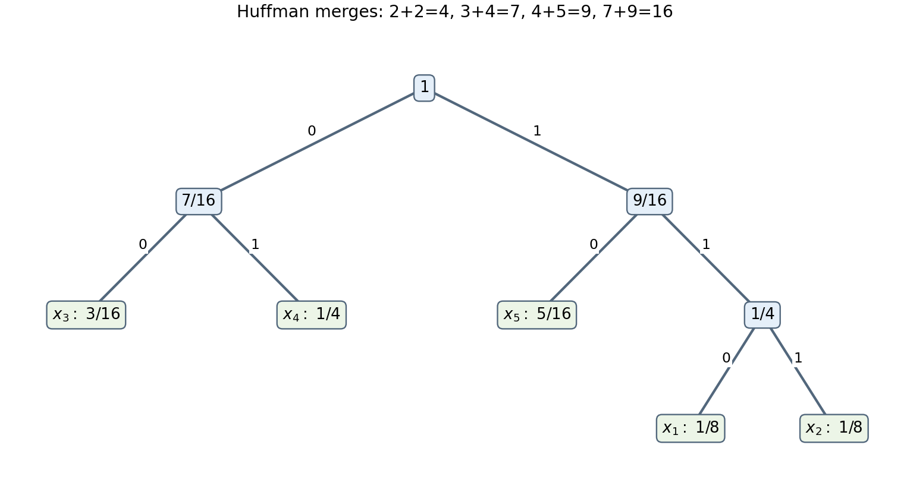

<h1 id="3/b/solution">Solution</h1>

↑ **Parent:** [B](../b.md)

The [entropy](../../../../information-entropy-split.md) is

$$
\boxed{H(S)=\frac{13}{4}-\frac{3\log_23+5\log_25}{16}}.
$$

To construct a [Huffman code](../../../../huffman-code.md), work with [integer](../../../../integer-split.md) weights $2,2,3,4,5$. Merge the two twos to make four. Of the remaining weights $3,4,4,5$, merge three with the original four to make seven, and merge the new four with five to make nine. Finally merge seven with nine. Resolving the tie in this way gives, for example,

$$
c(x_1)=110,\quad c(x_2)=111,\quad c(x_3)=00,\quad c(x_4)=01,\quad c(x_5)=10.
$$

This is a [prefix code](../../../../prefix-code.md) and [Huffman's optimality theorem](../../../../huffman-coding.md) makes it optimal. Its expected length is

$$
\boxed{\bar\ell=3(1/8+1/8)+2(3/16+1/4+5/16)=9/4}.
$$

Different choices at a tied merge can give different optimal codewords with the same expected length.

**[Figure 1](#3/b/image-an-optimal-five-symbol-huffman-tree). An optimal five-symbol Huffman tree**. Edge labels give the binary digits, leaf labels give the source symbols and their probabilities, and interior labels give total descendant probability.

## ↑ Ancestors (12)

1. [B](../b.md)
2. [3](../../3.md)
3. [2008](../../../2008-split.md)
4. [Past exam of the communication Theory course of the University of Oxford](../../../split.md)
5. [Communication Theory course of the University of Oxford](../../../../communication-theory-course-of-the-university-of-oxford.md)
6. [Year 3 of the mathematics course of the University of Oxford](../../../../year-3-of-the-mathematics-course-of-the-university-of-oxford.md)
7. [Mathematics course of the University of Oxford](../../../../mathematics-course-of-the-university-of-oxford.md)
8. [Undergraduate course of the University of Oxford](../../../../undergraduate-course-of-the-university-of-oxford.md)
9. [Course of the University of Oxford](../../../../course-of-the-university-of-oxford.md)
10. [University of Oxford](../../../../university-of-oxford-split.md)
11. [List of universities](../../../../list-of-universities.md)
12. [Codex Wiki](../../../../split.md)
