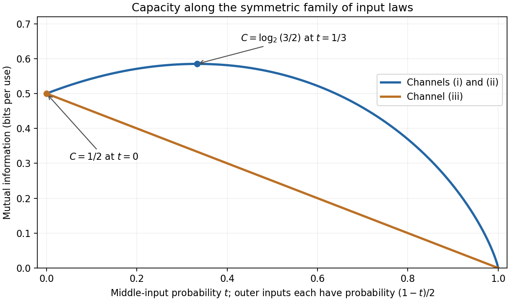

<h1 id="3/c/iii/solution">Solution</h1>

↑ **Parent:** [Iii](../iii.md)

Let the input law again be $(s,t,u)$. The second output symbol has [probability](../../../../../probability.md) $1/2$ regardless of the input, and the two remaining output probabilities [sum](../../../../../sum.md) to $1/2$. Hence

$$
H(Y)\leq h_2(1/2)+\frac12\cdot1=\frac32,
$$

with equality when the first and third output symbols each have [probability](../../../../../probability.md) $1/4$. The row entropies are $1,3/2,1$, so

$$
H(Y\mid X)=1+\frac t2,
\qquad I(X;Y)\leq\frac12-\frac t2\leq\frac12.
$$

Take $t=0$ and $s=u=1/2$. The output is $(1/4,1/2,1/4)$ and both bounds are attained. Therefore

$$
\boxed{p_X=(1/2,0,1/2),\qquad C=1/2\text{ bit per use}.}
$$

The equality conditions also show uniqueness of the optimum input law. The middle row is the average of the outer rows and carries extra [conditional entropy](../../../../../conditional-entropy.md) without introducing a new output law; [removing a redundant input symbol from a channel](../../../../../removing-a-redundant-input-symbol-from-a-channel.md) explains why it need not be used.

**[Figure 1](#3/c/iii/image-mutual-information-along-symmetric-input-distributions-for-the-three-channels). Mutual information along symmetric input distributions for the three channels**. The first two channels attain log2(3/2) at uniform input, while the third attains one half bit by omitting its middle input.

## ↑ Ancestors (13)

1. [Iii](../iii.md)
2. [C](../../c.md)
3. [3](../../../3.md)
4. [2010](../../../../2010-split.md)
5. [Past exam of the communication Theory course of the University of Oxford](../../../../split.md)
6. [Communication Theory course of the University of Oxford](../../../../../communication-theory-course-of-the-university-of-oxford.md)
7. [Year 3 of the mathematics course of the University of Oxford](../../../../../year-3-of-the-mathematics-course-of-the-university-of-oxford.md)
8. [Mathematics course of the University of Oxford](../../../../../mathematics-course-of-the-university-of-oxford.md)
9. [Undergraduate course of the University of Oxford](../../../../../undergraduate-course-of-the-university-of-oxford.md)
10. [Course of the University of Oxford](../../../../../course-of-the-university-of-oxford.md)
11. [University of Oxford](../../../../../university-of-oxford-split.md)
12. [List of universities](../../../../../list-of-universities.md)
13. [Codex Wiki](../../../../../split.md)
