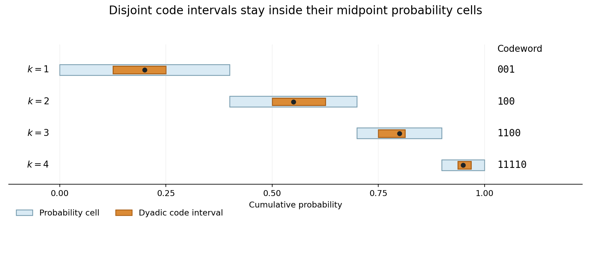

# 2011

↑ **Parent:** [Past exam of the communication Theory course of the University of Oxford](../past-exam-of-the-communication-theory-course-of-the-university-of-oxford.md)

Source paper: [FOI request thread](https://www.whatdotheyknow.com/request/maths_past_papers_3). The cover identifies Communication Theory, B11a, Friday 24 June 2011, 2.30pm to 4.00pm. Its four readable pages are original private Part B bundle pages 312–315.

**Table of contents**

- [1](#1)
  - [a](#1/a)
    - [Solution](#1/a/solution)
  - [b](#1/b)
    - [i](#1/b/i)
      - [Solution](#1/b/i/solution)
    - [ii](#1/b/ii)
      - [Solution](#1/b/ii/solution)
    - [iii](#1/b/iii)
      - [Solution](#1/b/iii/solution)
  - [c](#1/c)
    - [Solution](#1/c/solution)
- [2](#2)
  - [a](#2/a)
    - [i](#2/a/i)
      - [Solution](#2/a/i/solution)
    - [ii](#2/a/ii)
      - [Solution](#2/a/ii/solution)
  - [b](#2/b)
    - [i](#2/b/i)
      - [Solution](#2/b/i/solution)
    - [ii](#2/b/ii)
      - [Solution](#2/b/ii/solution)
  - [c](#2/c)
    - [Solution](#2/c/solution)
- [3](#3)
  - [a](#3/a)
    - [i](#3/a/i)
      - [Solution](#3/a/i/solution)
    - [ii](#3/a/ii)
      - [Solution](#3/a/ii/solution)
  - [b](#3/b)
    - [i](#3/b/i)
      - [Solution](#3/b/i/solution)
    - [ii](#3/b/ii)
      - [Solution](#3/b/ii/solution)
  - [c](#3/c)
    - [Solution](#3/c/solution)

## 1

↑ **Parent:** [2011](2011.md)

<h3 id="1/a">a</h3>

↑ **Parent:** [1](#1)

<h4 id="1/a/solution">Solution</h4>

↑ **Parent:** [A](#1/a)

Use the [continuous](../calculus.md#continuous-function) convention $0\log_2(0/q)=0$. Let $S=\{r:p_r>0\}$. Applying the allowed [logarithm](../calculus.md#logarithm) [inequality](../arithmetic.md#inequality-mathematics) to $q_r/p_r$ for $r\in S$ gives

$$
-d(p,q)=\sum_{r\in S}p_r\log_2\frac{q_r}{p_r}
\leq c\sum_{r\in S}(q_r-p_r)=c\left(\sum_{r\in S}q_r-1\right)\leq0.
$$

Hence $d(p,q)\geq0$. [Equality](../set-theory.md#equality-mathematics) forces $\sum_{r\in S}q_r=1$. Since every $q_r$ is strictly positive, this makes $S$ the entire [alphabet](../information-theory.md#alphabet). [Equality](../set-theory.md#equality-mathematics) in every weighted [logarithm](../calculus.md#logarithm) [inequality](../arithmetic.md#inequality-mathematics) then forces $q_r/p_r=1$ for every $r$. Conversely $p=q$ makes every summand zero. Thus

$$
\boxed{d(p,q)\geq0,\qquad d(p,q)=0\iff p=q.}
$$

This is [Gibbs inequality](../f-divergence.md#gibbs-inequality) for [relative entropy](../f-divergence.md#kullback-leibler-divergence), with zero [probabilities](../probability-theory.md#probability) in the first argument handled explicitly.

<h3 id="1/b">b</h3>

↑ **Parent:** [1](#1)

<h4 id="1/b/i">i</h4>

↑ **Parent:** [B](#1/b)

<h5 id="1/b/i/solution">Solution</h5>

↑ **Parent:** [I](#1/b/i)

For the [uniform distribution](../continuous-probability-distribution.md#continuous-uniform-distribution) $u_r=1/n$, direct expansion gives

$$
d(p_X,u)=\sum_rp_X(r)\log_2p_X(r)+\log_2n=\log_2n-H(X).
$$

Part (a) therefore proves

$$
\boxed{H(X)\leq\log_2n,}
$$

with [equality](../set-theory.md#equality-mathematics) exactly for $p_X(r)=1/n$ for every $r$. Thus the [uniform distribution](../continuous-probability-distribution.md#continuous-uniform-distribution) is the unique [entropy](../information-entropy.md) maximizer.

<h4 id="1/b/ii">ii</h4>

↑ **Parent:** [B](#1/b)

<h5 id="1/b/ii/solution">Solution</h5>

↑ **Parent:** [Ii](#1/b/ii)

Normalize the candidate distribution by setting

$$
q_r=c2^{-r},\qquad c=\frac1{1-2^{-n}}=\frac{2^n}{2^n-1}.
$$

The supplied [finite sum](../arithmetic.md#finite-sum) gives its [mean](../expected-value.md)

$$
\sum_{r=1}^nrq_r=c\left(2-(n+2)2^{-n}\right)=\frac{2^{n+1}-(n+2)}{2^n-1}=m.
$$

Thus it meets the [constraint](../classical-mechanics.md#constraint-mechanics). Since $\log_2q_r=\log_2c-r$, every other distribution $p$ with [mean](../expected-value.md) $m$ satisfies

$$
d(p,q)=-H(p)-\log_2c+m=H(q)-H(p).
$$

Nonnegativity and the [equality](../set-theory.md#equality-mathematics) case in part (a) prove

$$
\boxed{p_Y(r)=\frac{2^n}{2^n-1}\,2^{-r},\qquad H(Y)_{\max}=m-\log_2\frac{2^n}{2^n-1}.}
$$

The [maximum](../set.md#maximum-of-a-subset-of-a-total-order) is unique; the [entropy](../information-entropy.md) comparison uses the fixed [mean](../expected-value.md) rather than an unconstrained optimization.

<h4 id="1/b/iii">iii</h4>

↑ **Parent:** [B](#1/b)

<h5 id="1/b/iii/solution">Solution</h5>

↑ **Parent:** [Iii](#1/b/iii)

The given logarithmic moment is

$$
\ell=\frac2{n(n+1)}\sum_{r=1}^nr\log_2r,
$$

where the $r=1$ term is zero. It is attained by the positive distribution

$$
q_r=\frac{2r}{n(n+1)},
$$

whose [probabilities](../probability-theory.md#probability) [sum](../arithmetic.md#sum) to one. Write $A=2/[n(n+1)]$, so $\log_2q_r=\log_2A+\log_2r$. For any distribution $p$ with the required logarithmic moment,

$$
d(p,q)=-H(p)-\log_2A-\ell=H(q)-H(p).
$$

Consequently the unique maximizer and its [entropy](../information-entropy.md) are

$$
\boxed{p_Z(r)=\frac{2r}{n(n+1)},\qquad H(Z)_{\max}=\log_2\frac{n(n+1)}2-\ell.}
$$

The increasing weights are consistent with the prescribed moment; they need not be a decreasing [power law](../analysis.md#power-law).

<h3 id="1/c">c</h3>

↑ **Parent:** [1](#1)

<h4 id="1/c/solution">Solution</h4>

↑ **Parent:** [C](#1/c)

Write $w_i=(Aq)_i$. For each row put $S_i=\{j:a_{ij}>0\}$; the positive row entries $\alpha_i=(a_{ij})_{j\in S_i}$ form a [probability distribution](../probability-distribution.md) because the row [sum](../arithmetic.md#sum) is one. When $w_i>0$, define the [probability distribution](../probability-distribution.md)

$$
r_i(j)=\frac{a_{ij}q_j}{w_i}\qquad(j\in S_i).
$$

Part (a), applied on this row [support](../function.md#support), gives $d(r_i,\alpha_i)\geq0$. Its weighted [sum](../arithmetic.md#sum) expands as

$$
\begin{aligned}
\sum_{i:w_i>0}w_i d(r_i,\alpha_i)
&=\sum_{i,j}a_{ij}q_j\log_2\frac{q_j}{w_i}\\
&=\sum_jq_j\log_2q_j\sum_i a_{ij}-\sum_iw_i\log_2w_i\\
&=H(w)-H(q).
\end{aligned}
$$

Rows with $w_i=0$ contribute zero, since all $a_{ij}q_j$ in such a row vanish. Using the convention that zero-weight logarithmic terms are zero, the result is

$$
\boxed{H(W)-H(V)=\sum_{i:w_i>0}w_i d(r_i,\alpha_i)\geq0.}
$$

Both stochasticity conditions have a role: row sums normalize the comparison distributions, while column sums preserve the total contribution from $q$.

This is [entropy increase under doubly stochastic mixing](../vector-space.md#entropy-increase-under-doubly-stochastic-mixing).

## 2

↑ **Parent:** [2011](2011.md)

<h3 id="2/a">a</h3>

↑ **Parent:** [2](#2)

<h4 id="2/a/i">i</h4>

↑ **Parent:** [A](#2/a)

<h5 id="2/a/i/solution">Solution</h5>

↑ **Parent:** [I](#2/a/i)

A binary code assigns a finite binary word $c_k$ to each source symbol $x_k$. In the ordinary unframed convention these [codewords](../coding-theory.md#codeword) are nonempty. It is [uniquely decodable](../coding-theory.md#decipherable-code) when [concatenation](../foundations-of-mathematics.md#concatenation) gives an [injective](../algebra.md#injective-function) map from finite symbol strings to [bit](../information-theory.md#bit) strings:

$$
\boxed{c_{i_1}\cdots c_{i_r}=c_{j_1}\cdots c_{j_s}\quad\Longrightarrow\quad r=s\text{ and }i_t=j_t\text{ for all }t.}
$$

The decoder can recover the entire symbol sequence without being told where [codewords](../coding-theory.md#codeword) end. This is stronger than merely assigning distinct words to individual symbols.

<h4 id="2/a/ii">ii</h4>

↑ **Parent:** [A](#2/a)

<h5 id="2/a/ii/solution">Solution</h5>

↑ **Parent:** [Ii](#2/a/ii)

An [instantaneous code](../coding-theory.md#prefix-code) can decode each symbol as soon as its final [bit](../information-theory.md#bit) arrives, without waiting for later [bits](../information-theory.md#bit). Equivalently it is [prefix-free](../coding-theory.md#prefix-code): no [codeword](../coding-theory.md#codeword) is a proper prefix of another, and different symbols receive different [codewords](../coding-theory.md#codeword).

For nonempty [codewords](../coding-theory.md#codeword), decoding greedily from the start of the [bit](../information-theory.md#bit) string identifies the first [codeword](../coding-theory.md#codeword) unambiguously; repeating identifies the whole sequence. Thus **an instantaneous code is uniquely decodable** under the ordinary nonempty-word convention.

<h3 id="2/b">b</h3>

↑ **Parent:** [2](#2)

<h4 id="2/b/i">i</h4>

↑ **Parent:** [B](#2/b)

<h5 id="2/b/i/solution">Solution</h5>

↑ **Parent:** [I](#2/b/i)

The [codeword](../coding-theory.md#codeword) lengths are [integers](../integer.md). For necessity, take $L=\max_k l_k$ and view [codewords](../coding-theory.md#codeword) as [nodes](../dynamical-systems.md#node-dynamical-systems) of the [binary tree](../data-structure.md#binary-tree). A [codeword](../coding-theory.md#codeword) of length $l_k$ has $2^{L-l_k}$ descendant words at depth $L$. [Prefix-freeness](../coding-theory.md#prefix-code) makes these descendant [sets](../set.md) disjoint, so

$$
\sum_k2^{L-l_k}\leq2^L,\qquad\text{hence}\quad\sum_k2^{-l_k}\leq1.
$$

For sufficiency, reorder the lengths nondecreasingly. Assign words successively. At depth $l_k$, words extending previously assigned [codewords](../coding-theory.md#codeword) number

$$
\sum_{i<k}2^{l_k-l_i}.
$$

The asserted [inequality](../arithmetic.md#inequality-mathematics), even after dropping the later nonnegative terms, gives

$$
\sum_{i<k}2^{l_k-l_i}+1\leq2^{l_k}.
$$

Thus at least one depth-$l_k$ word does not extend an earlier word. Choose it. Since lengths are nondecreasing, it cannot be a proper prefix of a shorter earlier word, and equal-length duplicates have been excluded. [Induction](../foundations-of-mathematics.md#mathematical-induction) constructs the required code. Therefore [Kraft inequality](../coding-theory.md#kraft-mcmillan-inequality) is necessary and sufficient:

$$
\boxed{\text{a binary prefix code with these lengths exists}\iff\sum_k2^{-l_k}\leq1.}
$$

<h4 id="2/b/ii">ii</h4>

↑ **Parent:** [B](#2/b)

<h5 id="2/b/ii/solution">Solution</h5>

↑ **Parent:** [Ii](#2/b/ii)

First consider any instantaneous code. Put $K_0=\sum_k2^{-l_k}\leq1$ and $q_k=2^{-l_k}/K_0$. Part 1(a) gives

$$
0\leq d(p,q)=-H(X)+\mathbb EL+\log_2K_0,
$$

so $\mathbb EL\geq H(X)-\log_2K_0\geq H(X)$.

For the construction, take the Shannon lengths $l_k=\lceil-\log_2p_k\rceil$. Then $2^{-l_k}\leq p_k$, so Kraft's condition holds. Also $l_k<-\log_2p_k+1$ for every $k$. Averaging gives

$$
\boxed{H(X)\leq\mathbb EL<H(X)+1.}
$$

For a nontrivial [alphabet](../information-theory.md#alphabet) all $p_k<1$, so these lengths are positive and the ordinary code convention applies. For a deterministic one-symbol source, the usual zero-bit convention uses $l_1=0$ when the number of source symbols is externally known. If strictly nonempty [codewords](../coding-theory.md#codeword) and arbitrary unframed message lengths are required instead, that degenerate case has $\mathbb EL\geq1$ and cannot satisfy the printed strict upper bound. This convention issue does not affect sources with at least two symbols.

<h3 id="2/c">c</h3>

↑ **Parent:** [2](#2)

<h4 id="2/c/solution">Solution</h4>

↑ **Parent:** [C](#2/c)

Let $F_k=\sum_{r<k}p_r$ and let $J_k=[F_k,F_k+p_k)$ be the [probability](../probability-theory.md#probability) cell of symbol $k$. Its [midpoint](../convex-set.md#midpoint) is $G_k=F_k+p_k/2$. Use the [binary expansion](../arithmetic.md#binary-expansion) terminating in zeros at a [dyadic rational](../arithmetic.md#dyadic-rational), so truncation to $l_k$ [bits](../information-theory.md#bit) gives

$$
a_k=2^{-l_k}\lfloor2^{l_k}G_k\rfloor.
$$

The chosen [codeword](../coding-theory.md#codeword) corresponds to the [dyadic interval](../real-analysis.md#dyadic-interval) $D_k=[a_k,a_k+2^{-l_k})$. It contains $G_k$, and its width satisfies $2^{-l_k}\leq p_k/2$. Consequently

$$
a_k>G_k-2^{-l_k}\geq F_k,\qquad a_k+2^{-l_k}\leq G_k+2^{-l_k}\leq F_k+p_k.
$$

Thus $D_k\subseteq J_k$. The [probability](../probability-theory.md#probability) cells are disjoint, so the code [intervals](../real-analysis.md#interval-mathematics) are disjoint. If one binary [codeword](../coding-theory.md#codeword) were a prefix of another, its [dyadic interval](../real-analysis.md#dyadic-interval) would contain the other's [interval](../real-analysis.md#interval-mathematics), contradicting this disjointness. Hence the code is instantaneous.

Finally, $l_k=\lceil-\log_2p_k\rceil+1<-\log_2p_k+2$. Multiplying by $p_k$ and summing yields

$$
\boxed{\mathbb EL<H(X)+2.}
$$

This is the [Shannon-Fano-Elias code](../coding-theory.md#shannon-fano-elias-code): the extra [bit](../information-theory.md#bit) makes the [dyadic interval](../real-analysis.md#dyadic-interval) narrow enough to remain inside the cell around its [midpoint](../convex-set.md#midpoint).

**[Figure 1](#2/c/image-midpoint-coding-places-disjoint-dyadic-intervals-inside-probability-cells). Midpoint coding places disjoint dyadic intervals inside probability cells**. An original example with probabilities two fifths, three tenths, one fifth, and one tenth. Each orange dyadic code interval contains its black midpoint and lies inside its blue probability cell, proving that the displayed codewords cannot be prefixes of one another.

## 3

↑ **Parent:** [2011](2011.md)

<h3 id="3/a">a</h3>

↑ **Parent:** [3](#3)

<h4 id="3/a/i">i</h4>

↑ **Parent:** [A](#3/a)

<h5 id="3/a/i/solution">Solution</h5>

↑ **Parent:** [I](#3/a/i)

For finite-valued [random variables](../random-variable.md), their [mutual information](../information-theory.md#mutual-information) is

$$
\boxed{I(X;Y)=H(X)+H(Y)-H(X,Y)=H(Y)-H(Y\mid X)=H(X)-H(X\mid Y).}
$$

Equivalently,

$$
I(X;Y)=\sum_{x,y}p(x,y)\log_2\frac{p(x,y)}{p_X(x)p_Y(y)},
$$

with zero joint-probability terms omitted. It is the [relative entropy](../f-divergence.md#kullback-leibler-divergence) of the joint law from the product of its marginals and is nonnegative, with [equality](../set-theory.md#equality-mathematics) exactly when the two variables are [independent](../random-variable.md#independent-random-variables).

<h4 id="3/a/ii">ii</h4>

↑ **Parent:** [A](#3/a)

<h5 id="3/a/ii/solution">Solution</h5>

↑ **Parent:** [Ii](#3/a/ii)

A [discrete memoryless channel](../coding-theory.md#discrete-memoryless-channel) has finite input and output [alphabets](../information-theory.md#alphabet) and fixed [conditional probabilities](../probability-theory.md#conditional-probability) $M_{ij}=\mathbb P(Y=j\mid X=i)$, whose rows [sum](../arithmetic.md#sum) to one. Memorylessness means that for successive uses, conditional on the input sequence, the output [probabilities](../probability-theory.md#probability) factor as the product of these one-use [conditional probabilities](../probability-theory.md#conditional-probability).

Its information [capacity](../information-theory.md#channel-capacity) in [bits](../information-theory.md#bit) per use is

$$
\boxed{C=\max_{p_X}I(X;Y)=\max_{p_X}\left[H(Y)-\sum_i p_X(i)H(M_{i\cdot})\right].}
$$

The maximization varies the input distribution while keeping the [channel](../information-theory.md#communication-channel) [matrix](../vector-space.md#matrix) fixed. The output distribution is $p_XM$ in the row-vector convention.

<h3 id="3/b">b</h3>

↑ **Parent:** [3](#3)

<h4 id="3/b/i">i</h4>

↑ **Parent:** [B](#3/b)

<h5 id="3/b/i/solution">Solution</h5>

↑ **Parent:** [I](#3/b/i)

Let $B$ be the selected block, and write $\alpha=\mathbb P(B=1)$. Because both the input and output [alphabets](../information-theory.md#alphabet) are disjoint across blocks, $B$ is determined by either the input or the output. The mutual-information chain rule therefore gives

$$
I(X;Y)=H(B)+I(X;Y\mid B)\leq h_2(\alpha)+\alpha C_1+(1-\alpha)C_2.
$$

For any fixed $\alpha$, [equality](../set-theory.md#equality-mathematics) is achievable by using a capacity-achieving distribution inside each block. It remains to maximize this binary expression.

Put $S=2^{C_1}+2^{C_2}$ and $r=2^{C_1}/S$. A direct expansion of [binary relative entropy](../f-divergence.md#binary-relative-entropy) yields

$$
h_2(\alpha)+\alpha C_1+(1-\alpha)C_2
=\log_2S-d\bigl((\alpha,1-\alpha),(r,1-r)\bigr).
$$

Part 1(a) makes the [maximum](../set.md#maximum-of-a-subset-of-a-total-order) $\log_2S$, uniquely at $\alpha=r$. Hence

$$
\boxed{C=\log_2(2^{C_1}+2^{C_2}),\qquad\mathbb P(B=i)=\frac{2^{C_i}}{2^{C_1}+2^{C_2}}.}
$$

The block choice itself communicates information, in addition to any information sent within the selected block.

This is [capacity of a disjoint sum of channels](../information-theory.md#capacity-of-a-disjoint-sum-of-channels).

<h4 id="3/b/ii">ii</h4>

↑ **Parent:** [B](#3/b)

<h5 id="3/b/ii/solution">Solution</h5>

↑ **Parent:** [Ii](#3/b/ii)

There are three distinguishable output groups: columns $\{1,2\}$ can arise only from input one; column $\{3\}$ can arise from inputs two or three, whose rows are identical; and columns $\{4,5\}$ can arise only from input four.

Each group has zero internal [channel capacity](../information-theory.md#channel-capacity). A block with one input cannot carry a variable input choice, and the middle block has identical output laws for both of its inputs. Combining the three disjoint zero-capacity blocks therefore gives

$$
\boxed{C_N=\log_2(1+1+1)=\log_2 3\text{ bits per use}.}
$$

Equivalently, the output identifies exactly which of these three groups was used, so [mutual information](../information-theory.md#mutual-information) is the [entropy](../information-entropy.md) of that group label. It is maximized when all group [probabilities](../probability-theory.md#probability) are one third. The capacity-achieving input distributions are precisely

$$
p_1=p_4=\frac13,\qquad p_2+p_3=\frac13.
$$

Splitting the middle [probability](../probability-theory.md#probability) arbitrarily cannot communicate an extra distinction because its two [channel](../information-theory.md#communication-channel) rows agree.

<h3 id="3/c">c</h3>

↑ **Parent:** [3](#3)

<h4 id="3/c/solution">Solution</h4>

↑ **Parent:** [C](#3/c)

For any chosen input distribution, the chain rule and nonnegativity of [conditional mutual information](../information-theory.md#conditional-mutual-information) give

$$
I(U;V,W)=I(U;V)+I(U;W\mid V)\geq I(U;V),
$$

and likewise $I(U;V,W)\geq I(U;W)$. Choosing an input distribution attaining either marginal [capacity](../information-theory.md#channel-capacity) proves $K\geq\max\{K_1,K_2\}$.

For the upper bound, [conditional independence](../random-variable.md#conditional-independence) implies $H(V,W\mid U)=H(V\mid U)+H(W\mid U)$, while [entropy](../information-entropy.md) subadditivity gives $H(V,W)\leq H(V)+H(W)$. Therefore

$$
\begin{aligned}
I(U;V,W)&=H(V,W)-H(V,W\mid U)\\
&\leq H(V)+H(W)-H(V\mid U)-H(W\mid U)\\
&=I(U;V)+I(U;W)\leq K_1+K_2.
\end{aligned}
$$

Maximizing over the input law gives

$$
\boxed{\max\{K_1,K_2\}\leq K\leq K_1+K_2.}
$$

More precisely, under the conditional-independence assumption,

$$
I(U;V,W)=I(U;V)+I(U;W)-I(V;W).
$$

The outputs may be dependent through the common input, and this final term measures the information they share rather than add independently.

This is [information from two conditionally independent observations](../information-theory.md#information-from-two-conditionally-independent-observations).

## ↑ Ancestors (9)

1. [Past exam of the communication Theory course of the University of Oxford](../past-exam-of-the-communication-theory-course-of-the-university-of-oxford.md)
2. [Communication Theory course of the University of Oxford](../university-of-oxford.md#communication-theory-course-of-the-university-of-oxford)
3. [Year 3 of the mathematics course of the University of Oxford](../university-of-oxford.md#year-3-of-the-mathematics-course-of-the-university-of-oxford)
4. [Mathematics course of the University of Oxford](../university-of-oxford.md#mathematics-course-of-the-university-of-oxford)
5. [Undergraduate course of the University of Oxford](../university-of-oxford.md#undergraduate-course-of-the-university-of-oxford)
6. [Course of the University of Oxford](../university-of-oxford.md#course-of-the-university-of-oxford)
7. [University of Oxford](../university-of-oxford.md)
8. [List of universities](../README.md#list-of-universities)
9. [Codex Wiki](../README.md)
