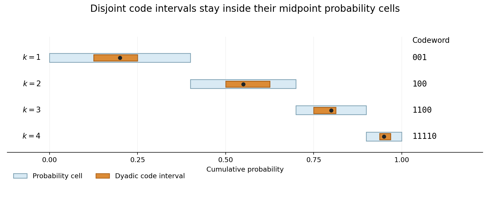

<h1 id="2/c/solution">Solution</h1>

↑ **Parent:** [C](../c.md)

Let $F_k=\sum_{r<k}p_r$ and let $J_k=[F_k,F_k+p_k)$ be the [probability](../../../../probability.md) cell of symbol $k$. Its [midpoint](../../../../midpoint.md) is $G_k=F_k+p_k/2$. Use the [binary expansion](../../../../binary-expansion.md) terminating in zeros at a [dyadic rational](../../../../dyadic-rational.md), so truncation to $l_k$ [bits](../../../../bit.md) gives

$$
a_k=2^{-l_k}\lfloor2^{l_k}G_k\rfloor.
$$

The chosen [codeword](../../../../codeword.md) corresponds to the [dyadic interval](../../../../dyadic-interval.md) $D_k=[a_k,a_k+2^{-l_k})$. It contains $G_k$, and its width satisfies $2^{-l_k}\leq p_k/2$. Consequently

$$
a_k>G_k-2^{-l_k}\geq F_k,\qquad a_k+2^{-l_k}\leq G_k+2^{-l_k}\leq F_k+p_k.
$$

Thus $D_k\subseteq J_k$. The [probability](../../../../probability.md) cells are disjoint, so the code [intervals](../../../../interval-mathematics.md) are disjoint. If one binary [codeword](../../../../codeword.md) were a prefix of another, its [dyadic interval](../../../../dyadic-interval.md) would contain the other's [interval](../../../../interval-mathematics.md), contradicting this disjointness. Hence the code is instantaneous.

Finally, $l_k=\lceil-\log_2p_k\rceil+1<-\log_2p_k+2$. Multiplying by $p_k$ and summing yields

$$
\boxed{\mathbb EL<H(X)+2.}
$$

This is the [Shannon-Fano-Elias code](../../../../shannon-fano-elias-code.md): the extra [bit](../../../../bit.md) makes the [dyadic interval](../../../../dyadic-interval.md) narrow enough to remain inside the cell around its [midpoint](../../../../midpoint.md).

**[Figure 1](#2/c/image-midpoint-coding-places-disjoint-dyadic-intervals-inside-probability-cells). Midpoint coding places disjoint dyadic intervals inside probability cells**. An original example with probabilities two fifths, three tenths, one fifth, and one tenth. Each orange dyadic code interval contains its black midpoint and lies inside its blue probability cell, proving that the displayed codewords cannot be prefixes of one another.

## ↑ Ancestors (12)

1. [C](../c.md)
2. [2](../../2.md)
3. [2011](../../../2011-split.md)
4. [Past exam of the communication Theory course of the University of Oxford](../../../split.md)
5. [Communication Theory course of the University of Oxford](../../../../communication-theory-course-of-the-university-of-oxford.md)
6. [Year 3 of the mathematics course of the University of Oxford](../../../../year-3-of-the-mathematics-course-of-the-university-of-oxford.md)
7. [Mathematics course of the University of Oxford](../../../../mathematics-course-of-the-university-of-oxford.md)
8. [Undergraduate course of the University of Oxford](../../../../undergraduate-course-of-the-university-of-oxford.md)
9. [Course of the University of Oxford](../../../../course-of-the-university-of-oxford.md)
10. [University of Oxford](../../../../university-of-oxford-split.md)
11. [List of universities](../../../../list-of-universities.md)
12. [Codex Wiki](../../../../split.md)
