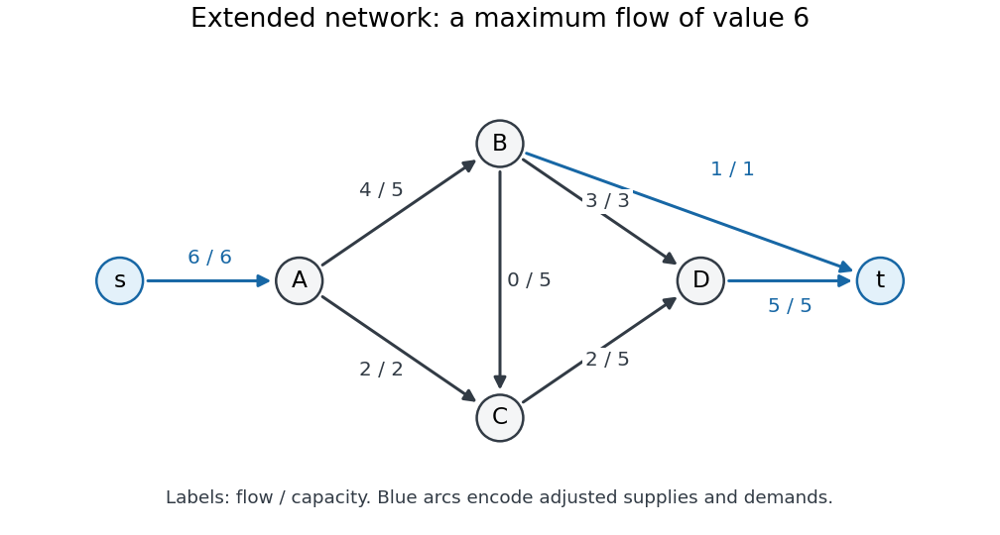

# Advanced data structures and algorithms

↑ **Parent:** [2015](../2015.md)

Solutions to the paper dated 5 June 2015.[Cover, formal code A10399W1; question pages 2–3](../../computer-science-bibliography.md#advanced-data-structures-and-algorithms-examination-paper-by-the-university-of-oxford-2015) All thirteen numbered subparts are treated. The original cover and both question pages have been checked, including the directions and labels of the [flow network](../../flow-network.md) diagram. The [binary counter](../../electrical-engineering.md#binary-counter) and [decimal counter](../../data-structure.md#decimal-counter) analyses use the conventional all-zero initial state; the effect of allowing a different initial state is stated explicitly.

**Table of contents**

- [1](#1)
  - [a](#1/a)
    - [Solution](#1/a/solution)
  - [b](#1/b)
    - [Solution](#1/b/solution)
  - [c](#1/c)
    - [Solution](#1/c/solution)
  - [d](#1/d)
    - [Solution](#1/d/solution)
- [2](#2)
  - [a](#2/a)
    - [Solution](#2/a/solution)
  - [b](#2/b)
    - [Solution](#2/b/solution)
  - [c](#2/c)
    - [Solution](#2/c/solution)
  - [d](#2/d)
    - [Solution](#2/d/solution)
- [3](#3)
  - [a](#3/a)
    - [Solution](#3/a/solution)
  - [b](#3/b)
    - [Solution](#3/b/solution)
  - [c](#3/c)
    - [Solution](#3/c/solution)
  - [d](#3/d)
    - [Solution](#3/d/solution)
  - [e](#3/e)
    - [Solution](#3/e/solution)

## 1

↑ **Parent:** [Advanced data structures and algorithms](advanced-data-structures-and-algorithms.md)

<h3 id="1/a">a</h3>

↑ **Parent:** [1](#1)

<h4 id="1/a/solution">Solution</h4>

↑ **Parent:** [A](#1/a)

The [accounting method](../../theoretical-computer-science.md#accounting-method) assigns each operation a charge, its [amortized cost](../../theoretical-computer-science.md#amortized-cost), that can differ from its actual cost. Cheap operations save the excess charge as credits associated with the [data structure](../../data-structure.md) or its entries. An expensive operation spends these previously saved credits. The essential [invariant](../../mathematics.md#invariant-mathematics) is that the credit balance never becomes negative.

If the initial balance is zero, operation $i$ has actual cost $c_i$, charge $\widehat c_i$, and leaves balance $B_i$, then

$$
B_i=B_{i-1}+\widehat c_i-c_i,\qquad
\sum_{i=1}^n c_i=\sum_{i=1}^n\widehat c_i-B_n\leq\sum_{i=1}^n\widehat c_i.
$$

Thus **a nonnegative credit balance makes the total charge an upper bound on the total actual cost for every operation sequence**. In particular, a [constant time](../../theoretical-computer-science.md#constant-time) charge proves a [linear time](../../theoretical-computer-science.md#linear-time) total. The argument is a deterministic [amortized analysis](../../theoretical-computer-science.md#amortized-analysis); it requires no [probability distribution](../../probability-distribution.md) on the operations. A nonzero initial balance must be included as an additive term in the bound.

<h3 id="1/b">b</h3>

↑ **Parent:** [1](#1)

<h4 id="1/b/solution">Solution</h4>

↑ **Parent:** [B](#1/b)

**Yes: starting from zero, $n$ increments of the [decimal counter](../../data-structure.md#decimal-counter) cost $\Theta(n)$ [digit](../../integer.md#numerical-digit) changes**, uniformly in the number $k$ of [digits](../../integer.md#numerical-digit). An increment changes the trailing [digits](../../integer.md#numerical-digit) equal to $9$ into $0$ and increases the next [digit](../../integer.md#numerical-digit). Number [digits](../../integer.md#numerical-digit) from $0$ at the least significant end. [Digit](../../integer.md#numerical-digit) $i$ changes once every $10^i$ increments, so the exact number of changes is

$$
C_{10}(n,k)=\sum_{i=0}^{k-1}\left\lfloor\frac{n}{10^i}\right\rfloor
\leq n\sum_{i=0}^{\infty}10^{-i}=\frac{10n}{9}.
$$

Here the [floor function](../../calculus.md#floor-function) counts carries reaching each position, and the last equality sums a [geometric series](../../sequence-and-series.md#geometric-series). Since [digit](../../integer.md#numerical-digit) $0$ changes on every increment, $C_{10}(n,k)\geq n$ for $k\geq1$. The loop tests and carry handling add only a constant amount per changed [digit](../../integer.md#numerical-digit) and per operation, giving the same [time complexity](../../theoretical-computer-science.md#time-complexity).

An [accounting method](../../theoretical-computer-science.md#accounting-method) explanation is also possible. Charge two credits for each change of [digit](../../integer.md#numerical-digit) $0$: one pays for that change and one joins a common bank. For $n$ increments the higher [digits](../../integer.md#numerical-digit) change at most $n/9$ times, so their costs can be covered from that bank; the displayed prefix bound ensures that it never goes negative.

The formula allows wraparound modulo $10^k$; alternatively, restrict to increments before overflow. Initializing the [array](../../data-structure.md#array-data-structure) itself costs $\Theta(k)$ if that is counted separately. If the initial [digits](../../integer.md#numerical-digit) are arbitrary, the number of changes at position $i$ is at most $\lceil n/10^i\rceil$, giving $O(n+k)$ in [Big O notation](../../real-analysis.md#big-o-notation). Starting with all [digits](../../integer.md#numerical-digit) equal to $9$ makes the first increment cost $k$, so the initial-state convention matters.

<h3 id="1/c">c</h3>

↑ **Parent:** [1](#1)

<h4 id="1/c/solution">Solution</h4>

↑ **Parent:** [C](#1/c)

For an initially zero [binary counter](../../electrical-engineering.md#binary-counter), [bit](../../information-theory.md#bit) $i$ changes precisely on increments whose indices are divisible by $2^i$. Weighting each such change by $2^i$ gives the exact total

$$
\boxed{C(n,k)=\sum_{i=0}^{k-1}2^i\left\lfloor\frac{n}{2^i}\right\rfloor.}
$$

For $n\geq1$ and $k\geq1$, put $r=\min\{k,1+\lfloor\log_2 n\rfloor\}$. All summands with $i\geq r$ vanish; each of the other summands is at most $n$. Therefore

$$
\boxed{C(n,k)\leq nr=O\!\left(n\min\{k,1+\log_2 n\}\right).}
$$

This is sharper than simply charging $n$ for each of all $k$ positions when $n$ is small. To show that the order is best possible, use $\lfloor x\rfloor\geq x/2$ for $x\geq1$. For every $0\leq i<r$,

$$
2^i\left\lfloor\frac{n}{2^i}\right\rfloor\geq\frac n2,
\qquad
\frac{nr}{2}\leq C(n,k)\leq nr.
$$

Thus the [asymptotic analysis](../../real-analysis.md#asymptotic-analysis) gives a tight bound. If wraparound is excluded, $n<2^k$, and this becomes $\Theta(n(1+\log_2 n))$, often written $\Theta(n\log n)$ for $n\geq2$. If wraparound is allowed and $n\geq2^k$, it becomes $\Theta(nk)$. For $n=0$, the cost is zero.

For completeness, the same conclusion cannot be asserted uniformly over arbitrary initial [binary counter](../../electrical-engineering.md#binary-counter) states. An initial value $2^k-1$ makes the first increment change every [bit](../../information-theory.md#bit), costing $2^k-1$. A general upper bound follows by replacing each [floor function](../../calculus.md#floor-function) in the count by a [ceiling function](../../calculus.md#ceiling-function):

$$
C_{\mathrm{arbitrary}}(n,k)
\leq\sum_{i=0}^{k-1}2^i\left\lceil\frac n{2^i}\right\rceil
\leq nr+2^k-1.
$$

To see the second inequality, split at $r$: for $i<r$, use $\lceil n/2^i\rceil\leq n/2^i+1$, and for $i\geq r$, use $\lceil n/2^i\rceil=1$. For $n\geq1$ the worst initial-state cost is consequently $\Theta(nr+2^k)$. This qualification separates initialization from the usual [amortized analysis](../../theoretical-computer-science.md#amortized-analysis) starting at zero.

<h3 id="1/d">d</h3>

↑ **Parent:** [1](#1)

<h4 id="1/d/solution">Solution</h4>

↑ **Parent:** [D](#1/d)

Use two permanent [stacks](../../data-structure.md#stack-data-structure), $F$ and $B$, and one temporary [stack](../../data-structure.md#stack-data-structure), $T$. At operation boundaries $T$ is empty. Maintain the [representation invariant](../../computer-science.md#representation-invariant) that the [deque](../../data-structure.md#double-ended-queue), read from front to back, is the top-to-bottom contents of $F$ followed by the bottom-to-top contents of $B$. Thus the tops of $F$ and $B$ are the two accessible ends. Maintain their sizes using two counters, requiring only $O(1)$ additional storage in [Big O notation](../../real-analysis.md#big-o-notation).

Adding at the front pushes onto $F$; adding at the back pushes onto $B$. Removing at an end whose permanent [stack](../../data-structure.md#stack-data-structure) is nonempty simply pops that [stack](../../data-structure.md#stack-data-structure). If both permanent [stacks](../../data-structure.md#stack-data-structure) are empty, report an empty [deque](../../data-structure.md#double-ended-queue).

Suppose a front removal finds $F$ empty and $B$ contains $m>0$ elements. Rebalance as follows:

- Move the top $\lfloor m/2\rfloor$ elements of $B$ onto $T$.
- Move all remaining $\lceil m/2\rceil$ elements of $B$ onto $F$.
- Move all elements of $T$ back onto $B$.
- Pop and return the top of $F$.

The parked elements are the back half of the [deque](../../data-structure.md#double-ended-queue); the unparked elements are the front half. Moving the front half onto $F$ reverses their [stack](../../data-structure.md#stack-data-structure) order and exposes the correct front element. Parking and restoring the back half reverses it twice, preserving its original order in $B$. The temporary [stack](../../data-structure.md#stack-data-structure) is empty again. For a back removal with $B$ empty, exchange the roles of $F$ and $B$ throughout. **Rebalance approximately half the elements, so both ends retain accessible elements after a large transfer.**

For the [amortized analysis](../../theoretical-computer-science.md#amortized-analysis), count each push or pop as one unit and use the [potential method](../../theoretical-computer-science.md#potential-method) with

$$
\Phi=3\bigl||F|-|B|\bigr|.
$$

Initially the [deque](../../data-structure.md#double-ended-queue) is empty, so $\Phi=0$, and $\Phi$ is always nonnegative. An ordinary insertion or removal costs one unit and changes the size difference by at most one, giving [amortized cost](../../theoretical-computer-science.md#amortized-cost) at most $4$.

For a rebalancing removal, let $h=\lfloor m/2\rfloor$. The parked half makes two transfers per element and the other half makes one; each transfer is a pop and a push. Including the final removal, the actual cost is

$$
c=4h+2(m-h)+1=2m+2h+1\leq3m+1.
$$

Before rebalancing the absolute size difference is $m$. Immediately after the split it is at most $1$, and after the removal it is at most $2$. Hence

$$
\widehat c=c+\Delta\Phi\leq(3m+1)+3(2-m)=7.
$$

Size tests and counter updates change only these constants. Summing the [amortized costs](../../theoretical-computer-science.md#amortized-cost) and using nonnegative final potential proves **$O(1)$ amortized running time for all four operations, with three [stacks](../../data-structure.md#stack-data-structure) and $O(1)$ additional storage**. An individual rebalancing operation can still take [linear time](../../theoretical-computer-science.md#linear-time) in the current size.

## 2

↑ **Parent:** [Advanced data structures and algorithms](advanced-data-structures-and-algorithms.md)

<h3 id="2/a">a</h3>

↑ **Parent:** [2](#2)

<h4 id="2/a/solution">Solution</h4>

↑ **Parent:** [A](#2/a)

A [flow network](../../flow-network.md) is a finite [directed graph](../../graph-theory.md#directed-graph) $G=(V,E)$ with nonnegative [flow network edge capacities](../../flow-network.md#flow-network-edge-capacity) $c_e$, together with distinct source and sink [vertices](../../graph.md#vertex-graph-theory) $s,t$. A [feasible flow](../../graph-theory.md#feasible-flow) in the nonnegative directed-[edge](../../graph-theory.md#edge-of-a-graph) convention is a [function](../../function.md) $f:E\to\mathbb R_{\geq0}$ satisfying the [capacity constraints](../../flow-network.md#capacity-constraint) and [flow conservation](../../flow-network.md#flow-conservation):

$$
0\leq f_{uv}\leq c_{uv}\quad(uv\in E),\qquad
\sum_{u:uv\in E}f_{uv}=\sum_{w:vw\in E}f_{vw}\quad(v\notin\{s,t\}).
$$

Its [flow value](../../flow-network.md#strength-of-a-flow) is the net outflow at the source,

$$
|f|=\sum_{w:sw\in E}f_{sw}-\sum_{u:us\in E}f_{us},
$$

which equals the net inflow at the sink by [flow conservation](../../flow-network.md#flow-conservation).

A [cut of a flow network](../../flow-network.md#cut-of-a-flow-network) is a [partition of a set](../../set.md#partition-of-a-set) $(S,V\setminus S)$ with $s\in S$ and $t\notin S$. Its [cut capacity](../../flow-network.md#cut-capacity) counts only directed [edges](../../graph-theory.md#edge-of-a-graph) leaving $S$:

$$
c(S,V\setminus S)=\sum_{u\in S,\ v\notin S:\,uv\in E}c_{uv}.
$$

The net [flow](../../flow-network.md#flow) across the [cut of a flow network](../../flow-network.md#cut-of-a-flow-network) subtracts [flow](../../flow-network.md#flow) on [edges](../../graph-theory.md#edge-of-a-graph) returning into $S$, and equals $|f|$.

For the following parts, a [circulation with vertex demands](../../flow-network.md#circulation-with-vertex-demands) has no exceptional source or sink in the original [directed graph](../../graph-theory.md#directed-graph). Instead it satisfies net inflow minus net outflow equal to $d_v$ at every [vertex](../../graph.md#vertex-graph-theory). Thus positive demands consume [flow](../../flow-network.md#flow), and negative demands supply [flow](../../flow-network.md#flow).

<h3 id="2/b">b</h3>

↑ **Parent:** [2](#2)

<h4 id="2/b/solution">Solution</h4>

↑ **Parent:** [B](#2/b)

Write [flow balance](../../graph-theory.md#flow-balance) using the positive-inflow convention

$$
\sum_{u:uv\in E}f_{uv}-\sum_{w:vw\in E}f_{vw}=d_v.
$$

Remove the [lower bounds on network flow](../../flow-network.md#lower-bounds-on-network-flow) by writing $f_{uv}=\ell_{uv}+x_{uv}$, where only $\ell_{BC}=4$ is nonzero. Then $0\leq x_{uv}\leq c_{uv}-\ell_{uv}$, and its required [flow balance](../../graph-theory.md#flow-balance) is

$$
d'_v=d_v-\left(\sum_u\ell_{uv}-\sum_w\ell_{vw}\right).
$$

In the order $A,B,C,D$, the lower-bound contribution is $(0,-4,4,0)$, so

$$
(d'_A,d'_B,d'_C,d'_D)=(-6,1,0,5).
$$

The resulting [flow network edge capacities](../../flow-network.md#flow-network-edge-capacity) are

$$
c'_{AB}=5,\quad c'_{AC}=2,\quad c'_{BC}=5,\quad c'_{BD}=3,\quad c'_{CD}=5.
$$

Add a new source $s$ with an [edge](../../graph-theory.md#edge-of-a-graph) $s\to A$ of [flow network edge capacity](../../flow-network.md#flow-network-edge-capacity) $6$, and a new sink $t$ with [edges](../../graph-theory.md#edge-of-a-graph) $B\to t$ and $D\to t$ of [flow network edge capacities](../../flow-network.md#flow-network-edge-capacity) $1$ and $5$. A [feasible flow](../../graph-theory.md#feasible-flow) saturating these new [edges](../../graph-theory.md#edge-of-a-graph) is equivalent to a solution for $x$: ordinary [flow conservation](../../flow-network.md#flow-conservation) in the enlarged [flow network](../../flow-network.md) produces exactly the residual supplies and demands above. All source and sink [edges](../../graph-theory.md#edge-of-a-graph) must be saturated, requiring [flow value](../../flow-network.md#strength-of-a-flow) $6$.

**[Figure 1](#2/b/image-extended-flow-network-after-removing-the-lower-bound-labels-show-final-flow-divided-by-flow-network-edge-capacity). Extended flow network after removing the lower bound; labels show final flow divided by flow network edge capacity**. The auxiliary [edges](../../graph-theory.md#edge-of-a-graph) are blue. The displayed [flow](../../flow-network.md#flow) saturates the auxiliary source and sink [edges](../../graph-theory.md#edge-of-a-graph), certifying that all adjusted demands are met. The original [edge](../../graph-theory.md#edge-of-a-graph) $BC$ regains its four-unit lower bound only after this auxiliary problem is solved.

Start the [Edmonds–Karp algorithm](../../flow-network.md#edmonds-karp-algorithm) at zero [flow](../../flow-network.md#flow). Repeated [breadth-first search](../../tree-graph-theory.md#breadth-first-search) in the [residual network](../../flow-network.md#residual-network) permits the following shortest [augmenting paths](../../flow-network.md#augmenting-path); when paths tie, choose the one through $B$ first.

| Step | [Augmenting path](../../flow-network.md#augmenting-path) | Added [flow](../../flow-network.md#flow) | Total [flow value](../../flow-network.md#strength-of-a-flow) |
| --- | --- | --- | --- |
| $1$ | $s\to A\to B\to t$ | $\min(6,5,1)=1$ | $1$ |
| $2$ | $s\to A\to B\to D\to t$ | $\min(5,4,3,5)=3$ | $4$ |
| $3$ | $s\to A\to C\to D\to t$ | $\min(2,2,5,2)=2$ | $6$ |

The first [augmenting path](../../flow-network.md#augmenting-path) has three [edges](../../graph-theory.md#edge-of-a-graph). Once $B\to t$ is saturated, the next shortest possibilities have four [edges](../../graph-theory.md#edge-of-a-graph), so steps $2$ and $3$ respect the [breadth-first search](../../tree-graph-theory.md#breadth-first-search) rule. Each augmentation adds the usual backward [edges](../../graph-theory.md#edge-of-a-graph) to the [residual network](../../flow-network.md#residual-network), though these particular augmentations need only forward [edges](../../graph-theory.md#edge-of-a-graph). Now $s\to A$ is saturated, so no further [augmenting path](../../flow-network.md#augmenting-path) exists. The [cut of a flow network](../../flow-network.md#cut-of-a-flow-network) with source side $\{s\}$ has [cut capacity](../../flow-network.md#cut-capacity) $6$, proving that the obtained [flow](../../flow-network.md#flow) is a [maximum flow](../../flow-network.md#maximum-flow-problem).

The original-[edge](../../graph-theory.md#edge-of-a-graph) values for $x$ are $(4,2,0,3,2)$ in the order $AB,AC,BC,BD,CD$. Restore the lower bound to obtain

$$
\boxed{(f_{AB},f_{AC},f_{BC},f_{BD},f_{CD})=(4,2,4,3,2).}
$$

All original [capacity constraints](../../flow-network.md#capacity-constraint) hold, and $f_{BC}=4$ meets its lower bound. The net inflows at $A,B,C,D$ are respectively

$$
-4-2=-6,\qquad 4-4-3=-3,\qquad 2+4-2=4,\qquad 3+2=5.
$$

**The original network therefore admits a feasible [circulation with vertex demands](../../flow-network.md#circulation-with-vertex-demands).**

<h3 id="2/c">c</h3>

↑ **Parent:** [2](#2)

<h4 id="2/c/solution">Solution</h4>

↑ **Parent:** [C](#2/c)

For any feasible [circulation with vertex demands](../../flow-network.md#circulation-with-vertex-demands), sum its defining [flow balance](../../graph-theory.md#flow-balance) over all [vertices](../../graph.md#vertex-graph-theory):

$$
\sum_{v\in V}d_v
=\sum_{v\in V}\sum_{u:uv\in E}f_{uv}
-\sum_{v\in V}\sum_{w:vw\in E}f_{vw}.
$$

Every directed [edge](../../graph-theory.md#edge-of-a-graph) $ab\in E$ contributes $+f_{ab}$ exactly once to the first sum, at its head $b$, and $-f_{ab}$ exactly once to the second, at its tail $a$. The two sums therefore contain exactly the same terms. They cancel, giving

$$
\boxed{\sum_{v\in V}d_v=0.}
$$

This is global [flow conservation](../../flow-network.md#flow-conservation): internal transport cannot create or destroy the total amount. [Lower bounds on network flow](../../flow-network.md#lower-bounds-on-network-flow) and [capacity constraints](../../flow-network.md#capacity-constraint) restrict which [flows](../../flow-network.md#flow) are feasible but do not affect the cancellation. The condition is necessary, not sufficient: insufficient [flow network edge capacities](../../flow-network.md#flow-network-edge-capacity) can still prevent satisfying balanced demands.

<h3 id="2/d">d</h3>

↑ **Parent:** [2](#2)

<h4 id="2/d/solution">Solution</h4>

↑ **Parent:** [D](#2/d)

For each user define its [set](../../set.md) of eligible ads by

$$
E_i=\{j:\mathcal S^i\cap\mathcal S_j\ne\varnothing\}.
$$

This uses the [intersection](../../set.md#set-intersection) of demographic-group memberships: belonging to one advertised group suffices, because the eligibility condition is a [set union](../../set.md#set-union). A user in several groups still receives at most one ad.

A direct [algorithm](../../algorithm.md) is to process users independently. For user $u_i$, scan ads $a_j$ until finding one for which some group $S_\ell$ belongs to both $\mathcal S^i$ and $\mathcal S_j$. Assign that ad and stop processing this user. If no such ad exists, leave the user unassigned. There is no upper bound on the number of different users who can receive the same ad, so these decisions do not compete for an ad resource.

For correctness, every produced impression has a shared permitted group, and the stopping rule assigns at most one ad to each user. Conversely, a user with $E_i=\varnothing$ cannot receive an ad in any [feasible solution](../../mathematical-optimization.md#feasible-point). Since every other user can contribute at most one impression, every [feasible solution](../../mathematical-optimization.md#feasible-point) has value at most

$$
\bigl|\{i:E_i\ne\varnothing\}\bigr|.
$$

The [algorithm](../../algorithm.md) attains this bound, proving

$$
\boxed{\text{maximum impressions}=\bigl|\{i:\mathcal S^i\cap\mathcal S_j\ne\varnothing\text{ for some }j\}\bigr|.}
$$

Represent each membership [set](../../set.md) by a length-$k$ [array](../../data-structure.md#array-data-structure) of [Boolean variables](../../theoretical-computer-science.md#boolean-variable). Testing one user-ad pair costs $O(k)$, so all tests and input setup take $O(nmk+(n+m)k+n+m+k)$ time in [Big O notation](../../real-analysis.md#big-o-notation), which is [polynomial time](../../theoretical-computer-science.md#polynomial-time) in all three parameters. For positive $n,m,k$, this simplifies to $O(nmk)$.

A [maximum flow](../../flow-network.md#maximum-flow-problem) formulation gives the same result if desired: add [edges](../../graph-theory.md#edge-of-a-graph) $s\to u_i$ with [flow network edge capacity](../../flow-network.md#flow-network-edge-capacity) $1$, $u_i\to a_j$ with [flow network edge capacity](../../flow-network.md#flow-network-edge-capacity) $1$ exactly when $j\in E_i$, and $a_j\to t$ with [flow network edge capacity](../../flow-network.md#flow-network-edge-capacity) $n$. By the [integral max-flow theorem](../../flow-network.md#integral-max-flow-theorem), an integral [maximum flow](../../flow-network.md#maximum-flow-problem) selects valid impressions. Setting the last [flow network edge capacity](../../flow-network.md#flow-network-edge-capacity) to $1$ would impose an extra restriction absent from this paper.

## 3

↑ **Parent:** [Advanced data structures and algorithms](advanced-data-structures-and-algorithms.md)

<h3 id="3/a">a</h3>

↑ **Parent:** [3](#3)

<h4 id="3/a/solution">Solution</h4>

↑ **Parent:** [A](#3/a)

Using the [standard maximum form of a linear program](../../linear-programming.md#standard-maximum-form-of-a-linear-program), write

$$
\boxed{\max c^Tx\quad\text{subject to }Ax\leq b,\quad x\geq0,}
$$

where $x\in\mathbb R^n$, $A\in\mathbb R^{m\times n}$, $b\in\mathbb R^m$, and $c\in\mathbb R^n$. The inequalities are coordinatewise, and $c^Tx$ is the [objective function](../../mathematical-optimization.md#objective-function). General [linear programs](../../linear-programming.md) can be put in this form: reverse the sign of a minimization [objective function](../../mathematical-optimization.md#objective-function), reverse lower-bound [linear inequalities](../../arithmetic.md#linear-inequality), replace an equality by two opposite [linear inequalities](../../arithmetic.md#linear-inequality), and replace each unrestricted variable by the difference of two nonnegative variables. Some conventions instead call the equality-constraint version standard form; the convention here is the maximum-with-upper-bounds convention.

Introduce nonnegative [slack variables](../../linear-programming.md#slack-variable) $x_{n+i}=b_i-\sum_{j=1}^n a_{ij}x_j$. The equivalent [slack form of a linear program](../../linear-programming.md#slack-form-of-a-linear-program) is

$$
\boxed{
\begin{aligned}
z&=\sum_{j=1}^n c_jx_j,\\
x_{n+i}&=b_i-\sum_{j=1}^n a_{ij}x_j\quad(1\leq i\leq m),\\
x_j&\geq0\quad(1\leq j\leq n+m).
\end{aligned}}
$$

The original variables are initially nonbasic and the [slack variables](../../linear-programming.md#slack-variable) basic. More generally, a [slack form of a linear program](../../linear-programming.md#slack-form-of-a-linear-program) specifies disjoint index [sets](../../set.md) $N,B$ and writes

$$
z=v+\sum_{j\in N}c_jx_j,\qquad
x_i=b_i-\sum_{j\in N}a_{ij}x_j\quad(i\in B),\qquad
x_i\geq0\quad(i\in N\cup B).
$$

Thus each [basic variable](../../linear-programming.md#basic-variable) and the [objective function](../../mathematical-optimization.md#objective-function) are expressed using only [nonbasic variables](../../linear-programming.md#nonbasic-variable). Setting all [nonbasic variables](../../linear-programming.md#nonbasic-variable) to zero gives the associated [basic solution](../../linear-programming.md#basic-solution), which is a [feasible solution](../../mathematical-optimization.md#feasible-point) exactly when the resulting basic values are nonnegative. The [slack form of a linear program](../../linear-programming.md#slack-form-of-a-linear-program) does not itself require that initial [basic solution](../../linear-programming.md#basic-solution) to be feasible.

<h3 id="3/b">b</h3>

↑ **Parent:** [3](#3)

<h4 id="3/b/solution">Solution</h4>

↑ **Parent:** [B](#3/b)

A [vertex cover](../../graph-theory.md#vertex-cover) of an [undirected graph](../../graph-theory.md#undirected-graph) $G=(V,E)$ is a [subset](../../set.md#subset) $C\subseteq V$ containing at least one endpoint of every [edge](../../graph-theory.md#edge-of-a-graph). The optimization version of the [vertex cover](../../graph-theory.md#vertex-cover) problem minimizes $|C|$; the [vertex cover decision problem](../../graph-theory.md#vertex-cover-decision-problem) asks whether a cover of size at most a given bound exists.

Let $x_v=1$ mean that [vertex](../../graph.md#vertex-graph-theory) $v$ is selected. An [integer program](../../mathematical-optimization.md#integer-programming) for minimum-size [vertex cover](../../graph-theory.md#vertex-cover) is

$$
\boxed{
\begin{aligned}
\min\quad&\sum_{v\in V}x_v\\
\text{subject to}\quad&x_u+x_v\geq1&& (uv\in E),\\
&x_v\in\{0,1\}&& (v\in V).
\end{aligned}}
$$

The [linear programming relaxation](../../linear-programming.md#linear-programming-relaxation) replaces $x_v\in\{0,1\}$ by $0\leq x_v\leq1$. The [edge](../../graph-theory.md#edge-of-a-graph) inequalities enforce coverage, and the [objective function](../../mathematical-optimization.md#objective-function) counts selected [vertices](../../graph.md#vertex-graph-theory) in the [integer program](../../mathematical-optimization.md#integer-programming).

For a [graph triangle](../../graph.md#triangle-in-a-graph) with [vertices](../../graph.md#vertex-graph-theory) $1,2,3$, the three covering constraints are

$$
x_1+x_2\geq1,\qquad x_2+x_3\geq1,\qquad x_3+x_1\geq1.
$$

Adding them gives $2(x_1+x_2+x_3)\geq3$. Therefore the relaxed [objective function](../../mathematical-optimization.md#objective-function) is at least $3/2$. The [feasible solution](../../mathematical-optimization.md#feasible-point) $x_1=x_2=x_3=1/2$ attains that lower bound, so

$$
\boxed{\operatorname{OPT}_{\mathrm{LP}}=\frac32.}
$$

In contrast, one [vertex](../../graph.md#vertex-graph-theory) leaves the opposite [edge](../../graph-theory.md#edge-of-a-graph) uncovered and any two [vertices](../../graph.md#vertex-graph-theory) cover all three [edges](../../graph-theory.md#edge-of-a-graph), giving integer optimum $2$. The example exhibits a genuinely non-integer optimal value, rather than merely a fractional [feasible solution](../../mathematical-optimization.md#feasible-point).

<h3 id="3/c">c</h3>

↑ **Parent:** [3](#3)

<h4 id="3/c/solution">Solution</h4>

↑ **Parent:** [C](#3/c)

Assume job sizes $t_i\geq0$ and machine speeds $s_j>0$, with at least one machine. Let $y_{ij}\geq0$ be the amount of job $T_i$ assigned to machine $M_j$, and let $T\geq0$ be the proposed [makespan](../../mathematical-optimization.md#makespan). Use the [linear program](../../linear-programming.md)

$$
\boxed{
\begin{aligned}
\min\quad&T\\
\text{subject to}\quad&\sum_{j=1}^m y_{ij}=t_i&& (1\leq i\leq n),\\
&\sum_{i=1}^n y_{ij}\leq s_jT&& (1\leq j\leq m),\\
&y_{ij}\geq0&& (1\leq i\leq n,\ 1\leq j\leq m),\\
&T\geq0.
\end{aligned}}
$$

The first family of constraints assigns every job completely. The second bounds each machine's completion time by $T$, since $L_j/s_j\leq T$ is equivalent to $L_j\leq s_jT$. It is a [linear inequality](../../arithmetic.md#linear-inequality) because $s_j$ is an input constant. There is no integrality restriction: jobs are divisible as specified in this [scheduling](../../mathematical-optimization.md#scheduling) model.

To verify the formulation, any actual allocation defines the variables above, with $T$ equal to its largest completion time, and satisfies every constraint. Conversely, from a [feasible solution](../../mathematical-optimization.md#feasible-point), assign amount $y_{ij}$ to machine $M_j$ and process its assigned pieces consecutively. Its total time is at most $T$, so the [linear program](../../linear-programming.md) realizes the claimed [makespan](../../mathematical-optimization.md#makespan).

There is also a useful exact check. Put $W=\sum_i t_i$ and $S=\sum_j s_j$. Summing machine constraints gives $W\leq ST$, so $T\geq W/S$. Assigning

$$
y_{ij}=t_i\frac{s_j}{S}
$$

makes every machine's completion time $W/S$, proving

$$
\boxed{T^*=\frac{\sum_i t_i}{\sum_j s_j}.}
$$

This relies on the paper's divisible-work model, in which machine completion times depend only on total assigned size. If $W=0$, the optimum is $0$.

<h3 id="3/d">d</h3>

↑ **Parent:** [3](#3)

<h4 id="3/d/solution">Solution</h4>

↑ **Parent:** [D](#3/d)

A [feasible point](../../mathematical-optimization.md#feasible-point) $x$ is an [extreme point](../../convex-set.md#extreme-point) solution of a [linear program](../../linear-programming.md) if it cannot be written as a nontrivial [convex combination](../../convex-set.md#convex-combination) of two distinct [feasible points](../../mathematical-optimization.md#feasible-point). Explicitly, if

$$
x=\lambda y+(1-\lambda)z,\qquad y,z\text{ feasible},\quad0<\lambda<1,
$$

then $y=z=x$. Equivalently, **$x$ lies in no open [line segment](../../convex-set.md#line-segment) joining two distinct [feasible points](../../mathematical-optimization.md#feasible-point)**. Being an [extreme point](../../convex-set.md#extreme-point) concerns the [feasible region](../../mathematical-optimization.md#feasible-region); it does not by itself mean that $x$ optimizes the [objective function](../../mathematical-optimization.md#objective-function).

<h3 id="3/e">e</h3>

↑ **Parent:** [3](#3)

<h4 id="3/e/solution">Solution</h4>

↑ **Parent:** [E](#3/e)

Let $G=(L\cup R,E)$ be the given [bipartite graph](../../bipartite-graph.md). A [matching in a graph](../../matching-graph-theory.md) selects [edges](../../graph-theory.md#edge-of-a-graph) with no shared endpoint. For each [edge](../../graph-theory.md#edge-of-a-graph) $e$, introduce an indicator $x_e$ for selection. The [integer program](../../mathematical-optimization.md#integer-programming) for a [maximum cardinality matching](../../matching-graph-theory.md#maximum-cardinality-matching) is

$$
\boxed{
\begin{aligned}
\max\quad&\sum_{e\in E}x_e\\
\text{subject to}\quad&\sum_{e\ni v}x_e\leq1&& (v\in L\cup R),\\
&x_e\in\{0,1\}&& (e\in E).
\end{aligned}}
$$

Its [linear programming relaxation](../../linear-programming.md#linear-programming-relaxation) is

$$
P=\left\{x\in\mathbb R^E:x_e\geq0\ (e\in E),\quad\sum_{e\ni v}x_e\leq1\ (v\in L\cup R)\right\},
$$

with the same [objective function](../../mathematical-optimization.md#objective-function). Explicit upper bounds $x_e\leq1$ may be included, but they already follow from a constraint at either endpoint.

We prove that every [extreme point](../../convex-set.md#extreme-point) of $P$ is integral by showing that any [feasible point](../../mathematical-optimization.md#feasible-point) with a fractional coordinate admits a two-sided perturbation. Given such an $x$, form the [fractional support graph](../../matching-graph-theory.md#fractional-support-graph-of-a-matching-relaxation) $H$ with exactly those [edges](../../graph-theory.md#edge-of-a-graph) for which $0<x_e<1$. This is a nonempty [bipartite graph](../../bipartite-graph.md). A [vertex](../../graph.md#vertex-graph-theory) incident to one of these [edges](../../graph-theory.md#edge-of-a-graph) cannot also meet an [edge](../../graph-theory.md#edge-of-a-graph) with value $1$, because its incident sum would exceed $1$.

First suppose $H$ contains a [graph cycle](../../graph-theory.md#cycle-in-a-graph). Choose a simple one, $e_1,\ldots,e_q$. Its length $q$ is even since $H$ is a [bipartite graph](../../bipartite-graph.md). Define a nonzero [vector](../../vector-space.md#vector) $h$ by alternating $+1,-1$ along the [graph cycle](../../graph-theory.md#cycle-in-a-graph) and putting $0$ on other [edges](../../graph-theory.md#edge-of-a-graph). At each [vertex](../../graph.md#vertex-graph-theory) on the [graph cycle](../../graph-theory.md#cycle-in-a-graph), the two changed coordinates have opposite signs, so its incident sum is unchanged. Choose

$$
0<\varepsilon<\min_{e\text{ on the cycle}}\{x_e,1-x_e\}.
$$

Then $x^+=x+\varepsilon h$ and $x^-=x-\varepsilon h$ are distinct [feasible points](../../mathematical-optimization.md#feasible-point): no coordinate leaves $[0,1]$ and all incident sums are unchanged. Since $x=(x^++x^-)/2$, it is not an [extreme point](../../convex-set.md#extreme-point).

Otherwise $H$ is a [forest](../../tree-graph-theory.md#forest). Choose a [connected component of a graph](../../graph.md#component-graph-theory) containing an [edge](../../graph-theory.md#edge-of-a-graph), and a simple [graph path](../../graph-theory.md#path-in-a-graph) in it between two [tree leaves](../../tree-graph-theory.md#leaf-of-a-tree). Alternate $+1,-1$ along the [graph path](../../graph-theory.md#path-in-a-graph) to define $h$. Every internal [vertex](../../graph.md#vertex-graph-theory) of the [graph path](../../graph-theory.md#path-in-a-graph) still has unchanged incident sum, including any additional [edges](../../graph-theory.md#edge-of-a-graph) branching from it. At either endpoint, exactly one incident [edge](../../graph-theory.md#edge-of-a-graph) has fractional value; all other incident coordinates are $0$, since a coordinate $1$ is impossible there. Thus each endpoint has strictly positive slack $1-\sum_{e\ni v}x_e$ in its degree constraint. Choose $\varepsilon>0$ smaller than these two slacks and smaller than every $x_e$ and $1-x_e$ along the [graph path](../../graph-theory.md#path-in-a-graph). Both $x+\varepsilon h$ and $x-\varepsilon h$ remain feasible: the endpoint sums can increase or decrease by $\varepsilon$, and the internal sums do not change. Again $x$ is the midpoint of distinct [feasible points](../../mathematical-optimization.md#feasible-point), contradicting extremality.

Both cases exclude fractional coordinates at an [extreme point](../../convex-set.md#extreme-point). Therefore

$$
\boxed{\text{every extreme point of }P\text{ has }x_e\in\{0,1\}\text{ and represents a matching}.}
$$

The nonempty bounded [linear polyhedron](../../linear-programming.md#linear-polyhedron) $P$ has an optimal [extreme point](../../convex-set.md#extreme-point) for the stated [linear function](../../vector-space.md#linear-function), so the relaxation yields a [maximum cardinality matching](../../matching-graph-theory.md#maximum-cardinality-matching). This is stronger than the existence of one integral optimum: it proves integrality of every [extreme point](../../convex-set.md#extreme-point). It does not claim that every optimal [feasible point](../../mathematical-optimization.md#feasible-point) is integral; convex mixtures of distinct optimal [matchings in a graph](../../matching-graph-theory.md) can be fractional.

## ↑ Ancestors (8)

1. [2015](../2015.md)
2. [Past exam of the computer science course of the University of Oxford](../../past-exam-of-the-computer-science-course-of-the-university-of-oxford.md)
3. [Computer science course of the University of Oxford](../../university-of-oxford.md#computer-science-course-of-the-university-of-oxford)
4. [Undergraduate course of the University of Oxford](../../university-of-oxford.md#undergraduate-course-of-the-university-of-oxford)
5. [Course of the University of Oxford](../../university-of-oxford.md#course-of-the-university-of-oxford)
6. [University of Oxford](../../university-of-oxford.md)
7. [List of universities](../../README.md#list-of-universities)
8. [Codex Wiki](../../README.md)
