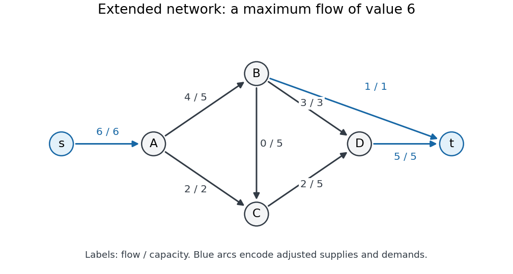

<h1 id="2/b/solution">Solution</h1>

↑ **Parent:** [B](../b.md)

Write [flow balance](../../../../../flow-balance.md) using the positive-inflow convention

$$
\sum_{u:uv\in E}f_{uv}-\sum_{w:vw\in E}f_{vw}=d_v.
$$

Remove the [lower bounds on network flow](../../../../../lower-bounds-on-network-flow.md) by writing $f_{uv}=\ell_{uv}+x_{uv}$, where only $\ell_{BC}=4$ is nonzero. Then $0\leq x_{uv}\leq c_{uv}-\ell_{uv}$, and its required [flow balance](../../../../../flow-balance.md) is

$$
d'_v=d_v-\left(\sum_u\ell_{uv}-\sum_w\ell_{vw}\right).
$$

In the order $A,B,C,D$, the lower-bound contribution is $(0,-4,4,0)$, so

$$
(d'_A,d'_B,d'_C,d'_D)=(-6,1,0,5).
$$

The resulting [flow network edge capacities](../../../../../flow-network-edge-capacity.md) are

$$
c'_{AB}=5,\quad c'_{AC}=2,\quad c'_{BC}=5,\quad c'_{BD}=3,\quad c'_{CD}=5.
$$

Add a new source $s$ with an [edge](../../../../../edge-of-a-graph.md) $s\to A$ of [flow network edge capacity](../../../../../flow-network-edge-capacity.md) $6$, and a new sink $t$ with [edges](../../../../../edge-of-a-graph.md) $B\to t$ and $D\to t$ of [flow network edge capacities](../../../../../flow-network-edge-capacity.md) $1$ and $5$. A [feasible flow](../../../../../feasible-flow.md) saturating these new [edges](../../../../../edge-of-a-graph.md) is equivalent to a solution for $x$: ordinary [flow conservation](../../../../../flow-conservation.md) in the enlarged [flow network](../../../../../flow-network-split.md) produces exactly the residual supplies and demands above. All source and sink [edges](../../../../../edge-of-a-graph.md) must be saturated, requiring [flow value](../../../../../strength-of-a-flow.md) $6$.

**[Figure 1](#2/b/image-extended-flow-network-after-removing-the-lower-bound-labels-show-final-flow-divided-by-flow-network-edge-capacity). Extended flow network after removing the lower bound; labels show final flow divided by flow network edge capacity**. The auxiliary [edges](../../../../../edge-of-a-graph.md) are blue. The displayed [flow](../../../../../flow.md) saturates the auxiliary source and sink [edges](../../../../../edge-of-a-graph.md), certifying that all adjusted demands are met. The original [edge](../../../../../edge-of-a-graph.md) $BC$ regains its four-unit lower bound only after this auxiliary problem is solved.

Start the [Edmonds–Karp algorithm](../../../../../edmonds-karp-algorithm.md) at zero [flow](../../../../../flow.md). Repeated [breadth-first search](../../../../../breadth-first-search.md) in the [residual network](../../../../../residual-network.md) permits the following shortest [augmenting paths](../../../../../augmenting-path.md); when paths tie, choose the one through $B$ first.

| Step | [Augmenting path](../../../../../augmenting-path.md) | Added [flow](../../../../../flow.md) | Total [flow value](../../../../../strength-of-a-flow.md) |
| --- | --- | --- | --- |
| $1$ | $s\to A\to B\to t$ | $\min(6,5,1)=1$ | $1$ |
| $2$ | $s\to A\to B\to D\to t$ | $\min(5,4,3,5)=3$ | $4$ |
| $3$ | $s\to A\to C\to D\to t$ | $\min(2,2,5,2)=2$ | $6$ |

The first [augmenting path](../../../../../augmenting-path.md) has three [edges](../../../../../edge-of-a-graph.md). Once $B\to t$ is saturated, the next shortest possibilities have four [edges](../../../../../edge-of-a-graph.md), so steps $2$ and $3$ respect the [breadth-first search](../../../../../breadth-first-search.md) rule. Each augmentation adds the usual backward [edges](../../../../../edge-of-a-graph.md) to the [residual network](../../../../../residual-network.md), though these particular augmentations need only forward [edges](../../../../../edge-of-a-graph.md). Now $s\to A$ is saturated, so no further [augmenting path](../../../../../augmenting-path.md) exists. The [cut of a flow network](../../../../../cut-of-a-flow-network.md) with source side $\{s\}$ has [cut capacity](../../../../../cut-capacity.md) $6$, proving that the obtained [flow](../../../../../flow.md) is a [maximum flow](../../../../../maximum-flow-problem.md).

The original-[edge](../../../../../edge-of-a-graph.md) values for $x$ are $(4,2,0,3,2)$ in the order $AB,AC,BC,BD,CD$. Restore the lower bound to obtain

$$
\boxed{(f_{AB},f_{AC},f_{BC},f_{BD},f_{CD})=(4,2,4,3,2).}
$$

All original [capacity constraints](../../../../../capacity-constraint.md) hold, and $f_{BC}=4$ meets its lower bound. The net inflows at $A,B,C,D$ are respectively

$$
-4-2=-6,\qquad 4-4-3=-3,\qquad 2+4-2=4,\qquad 3+2=5.
$$

**The original network therefore admits a feasible [circulation with vertex demands](../../../../../circulation-with-vertex-demands.md).**

## ↑ Ancestors (11)

1. [B](../b.md)
2. [2](../../2.md)
3. [Advanced data structures and algorithms](../../../advanced-data-structures-and-algorithms-split.md)
4. [2015](../../../split.md)
5. [Past exam of the computer science course of the University of Oxford](../../../../split.md)
6. [Computer science course of the University of Oxford](../../../../../computer-science-course-of-the-university-of-oxford.md)
7. [Undergraduate course of the University of Oxford](../../../../../undergraduate-course-of-the-university-of-oxford.md)
8. [Course of the University of Oxford](../../../../../course-of-the-university-of-oxford.md)
9. [University of Oxford](../../../../../university-of-oxford-split.md)
10. [List of universities](../../../../../list-of-universities.md)
11. [Codex Wiki](../../../../../split.md)
