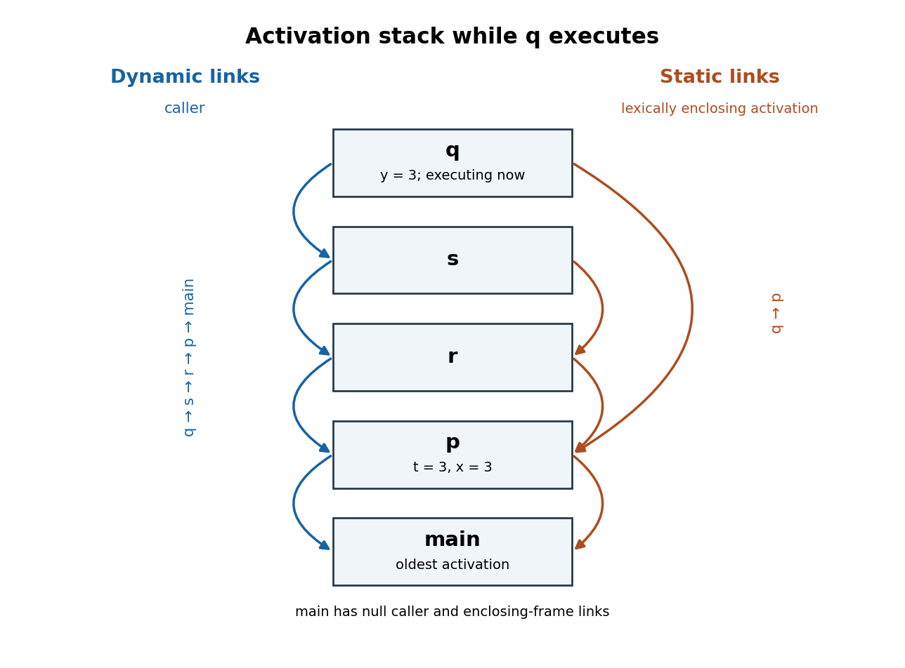

# Compilers

↑ **Parent:** [2015](../2015.md)

Solutions to the paper dated 4 June 2015. The original cover gives a ninety-minute examination with a choice of two questions; all three questions are solved here.[Cover and pages 2-4, A10401W1](../../computer-science-bibliography.md#oxford-compilers-examination-paper-2015)

**Table of contents**

- [1](#1)
  - [a](#1/a)
    - [Solution](#1/a/solution)
  - [b](#1/b)
    - [Solution](#1/b/solution)
  - [c](#1/c)
    - [Solution](#1/c/solution)
- [2](#2)
  - [a](#2/a)
    - [Solution](#2/a/solution)
  - [b](#2/b)
    - [Solution](#2/b/solution)
  - [c](#2/c)
    - [Solution](#2/c/solution)
  - [d](#2/d)
    - [Solution](#2/d/solution)
  - [e](#2/e)
    - [Solution](#2/e/solution)
  - [f](#2/f)
    - [Solution](#2/f/solution)
- [3](#3)
  - [a](#3/a)
    - [Solution](#3/a/solution)
  - [b](#3/b)
    - [Solution](#3/b/solution)
  - [c](#3/c)
    - [Solution](#3/c/solution)
  - [d](#3/d)
    - [Solution](#3/d/solution)
  - [e](#3/e)
    - [Solution](#3/e/solution)

## 1

↑ **Parent:** [Compilers](compilers.md)

<h3 id="1/a">a</h3>

↑ **Parent:** [1](#1)

<h4 id="1/a/solution">Solution</h4>

↑ **Parent:** [A](#1/a)

Use an [abstract syntax tree](../../programming-language.md#abstract-syntax-tree) with the following constructors. Here `Expr` denotes the separate [abstract syntax tree](../../programming-language.md#abstract-syntax-tree) type for a [program expression](../../programming-language.md#program-expression), `Name` identifies a [variable assignment](../../programming-language.md#variable-assignment) target, and the square brackets denote an ordered [list](../../data-structure.md#list-abstract-data-type).

```
Stmt = Assign(Name, Expr)
     | Seq(Stmt, Stmt)
     | Case(Expr, [(Expr, Stmt)])
```

The [list](../../data-structure.md#list-abstract-data-type) in `Case` must be nonempty. Its first field is the controlling [program expression](../../programming-language.md#program-expression); each pair contains a label [program expression](../../programming-language.md#program-expression) and the corresponding body. Keep the pairs in source order and keep repeated labels: this is an ordered search, with the first successful [equality](../../set-theory.md#equality-mathematics) test choosing the body. A label is an [abstract syntax tree](../../programming-language.md#abstract-syntax-tree) for a [program expression](../../programming-language.md#program-expression), not a previously evaluated [integer](../../integer.md) or a key in a [map data structure](../../data-structure.md#associative-array). Evaluating or reordering labels during [compilation](../../programming-language.md#compilation) would change the specified [programming language semantics](../../programming-language.md#programming-language-semantics).

`Seq(s,t)` executes `s` before `t`. The delimiters `begin` and `end` need no surviving constructor: the [parser](../../programming-language.md#parser) uses them to determine the [abstract syntax tree](../../programming-language.md#abstract-syntax-tree)'s grouping and then returns the enclosed tree. There are no declarations in these blocks that would require a separate binding environment. A [list](../../data-structure.md#list-abstract-data-type) of statements could replace binary `Seq`; below we choose right-associated binary trees so that the [semantic actions](../../foundations-of-mathematics.md#semantic-action) are precise.

**The essential representation is an ordered, nonempty list of expression/body pairs, together with assignment and sequencing nodes.** In constructor notation,

$$
\boxed{\operatorname{Case}(e,[(e_1,s_1),\ldots,(e_n,s_n)]),\quad n\geq 1.}
$$

<h3 id="1/b">b</h3>

↑ **Parent:** [1](#1)

<h4 id="1/b/solution">Solution</h4>

↑ **Parent:** [B](#1/b)

Take the [lexical tokens](../../programming-language.md#lexical-token) `ID`, `ASSIGN`, `SEMI`, `BEGIN`, `END`, `CASE`, `OF`, `COLON`, and `BAR`, corresponding to identifiers and the displayed punctuation or keywords. Let `E` be the already defined [context-free grammar](../../foundations-of-mathematics.md#context-free-grammar) category for a [program expression](../../programming-language.md#program-expression), with attribute `E.tree`; expressions do not consume statement delimiters except inside their own explicitly delimited constructs. `ID.name` is the recognized [program identifier](../../programming-language.md#program-identifier). The following [context-free grammar](../../foundations-of-mathematics.md#context-free-grammar) uses `S` for a statement, `C` for a closed elementary statement, `D` for a nonempty sequence of closed statements, and `A` for a nonempty arm list. The braces in this display are [semantic actions](../../foundations-of-mathematics.md#semantic-action), not input [lexical tokens](../../programming-language.md#lexical-token).

```
S -> C                       { S.tree = C.tree }
S -> C SEMI S1               { S.tree = Seq(C.tree, S1.tree) }
S -> CASE E OF A             { S.tree = Case(E.tree, A.arms) }

C -> ID ASSIGN E             { C.tree = Assign(ID.name, E.tree) }
C -> BEGIN S END             { C.tree = S.tree }

D -> C                       { D.tree = C.tree }
D -> C SEMI D1               { D.tree = Seq(C.tree, D1.tree) }

A -> E COLON S               { A.arms = [(E.tree, S.tree)] }
A -> E COLON D BAR A1        { A.arms = [(E.tree, D.tree)] ++ A1.arms }
```

Here `++` is [list concatenation](../../data-structure.md#list-concatenation), and distinct suffixes distinguish occurrences of the same [nonterminal symbol](../../foundations-of-mathematics.md#nonterminal-symbol). Every statement and arm body is nonempty; no empty statement or optional trailing semicolon is needed for the supplied language.

The distinction between `D` and `S` resolves both possible sources of [grammar ambiguity](../../foundations-of-mathematics.md#ambiguous-grammar). First, an unbracketed `CASE` can occur only at the right end of an `S`: there is no production `S -> S SEMI S`. Consequently all semicolon-separated statements after such a `CASE` enter its last arm. Enclosing that whole `CASE` in `BEGIN ... END` turns it into a `C`, which can be followed by another statement outside the `CASE`.

Second, an arm followed by another arm at the same level must have a `D` body. Such a body contains no unbracketed `CASE`. If an arm body does contain an unbracketed `CASE`, only the final-arm production `A -> E COLON S` can apply, and every following `BAR` before the enclosing `END` or end of input must be consumed by the inner `CASE`. Thus each bar belongs to the nearest preceding `CASE` whose block has not ended. A `CASE` inside `BEGIN ... END` is hidden from that rule outside its block.

For uniqueness, at any statement level an initial `ID` or `BEGIN` determines a `C`; an immediately following `SEMI` determines the recursive sequence production. An initial `CASE` determines the third `S` production. In an arm, a bar at the current block level either follows an entirely closed body, forcing the second `A` production, or follows an unbracketed nested `CASE`, forcing it into that inner arm list. With an unambiguous expression sublanguage these choices leave a unique [parse tree](../../foundations-of-mathematics.md#parse-tree). **Closed bodies before an outer bar, and a possibly open body only in the final arm, enforce the required interpretation.** Thus the [context-free grammar](../../foundations-of-mathematics.md#context-free-grammar) implements

$$
\boxed{\text{nearest open case for each bar; following statements enter its last arm}.}
$$

<h3 id="1/c">c</h3>

↑ **Parent:** [1](#1)

<h4 id="1/c/solution">Solution</h4>

↑ **Parent:** [C](#1/c)

Let `expr(e)` generate [postfix code](../../theoretical-computer-science.md#postfix-code) that evaluates a [program expression](../../programming-language.md#program-expression) once, leaving one value above an otherwise unchanged evaluation [stack](../../data-structure.md#stack-data-structure). Let `stmt(s)` preserve the evaluation [stack](../../data-structure.md#stack-data-structure)'s height. Use `EQ` to pop two [integers](../../integer.md) and push their [Boolean](../../programming-language.md#boolean-data-type) [equality](../../set-theory.md#equality-mathematics) result; `JZ L` pops that result and jumps to `L` when it is false. `JMP` is unconditional. All labels returned by `fresh()` are distinct, including labels inside recursively generated bodies.

```
generateCase(Case(control, arms)):
    done := fresh()
    emit expr(control)
    for (labelExpression, body) in arms, in source order:
        next := fresh()
        emit DUP
        emit expr(labelExpression)
        emit EQ
        emit JZ next
        emit POP
        emit stmt(body)
        emit JMP done
        emit LABEL next
    emit POP
    emit LABEL done
```

To verify the [stack invariant](../../data-structure.md#stack-invariant), write the incoming evaluation [stack](../../data-structure.md#stack-data-structure) as $sigma$. Immediately before any label test it is $sigma,v$, where $v$ is the controlling value. `DUP`, evaluation of the label with value $w$, and `EQ` change this to $sigma,v,[v=w]$. `JZ` removes the [Boolean](../../programming-language.md#boolean-data-type). On failure the surviving $v$ is available for the next label; on success `POP` removes it before the body runs. The body therefore starts and ends with $sigma$ and jumps past every remaining label. If every label fails, the final `POP` restores $sigma$.

**The controlling expression is evaluated once, each reached label is evaluated once, and no later label or arm is evaluated after a match.** Keeping $v$ on the evaluation [stack](../../data-structure.md#stack-data-structure) also preserves its original value if a label evaluation has a [side effect](../../programming-language.md#side-effect-computer-science) that changes a variable appearing in the controlling [program expression](../../programming-language.md#program-expression). A nested `Case` uses the same [stack invariant](../../data-structure.md#stack-invariant) relative to whatever [stack](../../data-structure.md#stack-data-structure) it receives. The concise contract is

$$
\boxed{N_{\mathrm{control}}=1,\quad N_{\mathrm{reached\ label}}=1,\quad \Delta h_{\mathrm{stack}}=0.}
$$

## 2

↑ **Parent:** [Compilers](compilers.md)

<h3 id="2/a">a</h3>

↑ **Parent:** [2](#2)

<h4 id="2/a/solution">Solution</h4>

↑ **Parent:** [A](#2/a)

The surviving [call stack](../../data-structure.md#call-stack), from oldest to newest, is `main, p, r, s, q`. A [dynamic link](../../data-structure.md#dynamic-link) identifies the caller's [stack frame](../../data-structure.md#stack-frame), whereas a [static link](../../data-structure.md#static-link) identifies the current activation of the lexically enclosing procedure. These need not identify the same [stack frame](../../data-structure.md#stack-frame).

<a id="2/a/image-the-call-stack-during-q-with-dynamic-links-on-the-left-and-static-links-on-the-right-arrows-point-to-older-stack-frames"></a>


**[Figure 1](#2/a/image-the-call-stack-during-q-with-dynamic-links-on-the-left-and-static-links-on-the-right-arrows-point-to-older-stack-frames). The call stack during `q`, with dynamic links on the left and static links on the right; arrows point to older stack frames**.

The [dynamic chain](../../data-structure.md#dynamic-chain) is

$$
q\longrightarrow s\longrightarrow r\longrightarrow p\longrightarrow\mathrm{main}.
$$

The individual [static links](../../data-structure.md#static-link) are

$$
\boxed{q\longrightarrow p,\qquad s\longrightarrow r,\qquad r\longrightarrow p,\qquad p\longrightarrow\mathrm{main}.}
$$

`main` has no enclosing procedure; its links can be null. The `p` [stack frame](../../data-structure.md#stack-frame) contains `t=3` and `x=3`, and the `q` [stack frame](../../data-structure.md#stack-frame) contains `y=3`. Return addresses are code addresses, not links to another [stack frame](../../data-structure.md#stack-frame). **In particular, `q` returns dynamically to `s` while obtaining `x` statically from `p`.**

<h3 id="2/b">b</h3>

↑ **Parent:** [2](#2)

<h4 id="2/b/solution">Solution</h4>

↑ **Parent:** [B](#2/b)

We specify a small [stack machine](../../theoretical-computer-science.md#stack-machine) instruction convention because the paper does not prescribe instruction spellings or numeric [stack frame](../../data-structure.md#stack-frame) offsets. `PUSHFP` pushes the current [frame pointer](../../data-structure.md#frame-pointer). `LOAD k` replaces a [stack](../../data-structure.md#stack-data-structure)-top frame address by the value at fixed offset `k` in that frame. Let `SL` be the [static link](../../data-structure.md#static-link) offset, `X` the offset of `p`'s `x`, and `Y` the offset of `q`'s parameter `y`. `ADD` pops two [integers](../../integer.md) and pushes their sum. `RETVAL` returns the [stack](../../data-structure.md#stack-data-structure)-top value, removes the current activation and restores the caller through the usual [calling convention](../../programming-language.md#calling-convention).

```
PUSHFP       ; address of q's frame
LOAD SL      ; q's static link: address of p's frame
LOAD X       ; value of p.x
PUSHFP       ; address of q's frame, above x
LOAD Y       ; q's local parameter y
ADD          ; x + y
RETVAL       ; return the sum to s
```

One [static link](../../data-structure.md#static-link) traversal suffices for `x`, despite three intervening calls in the [dynamic chain](../../data-structure.md#dynamic-chain). `y` is local to `q`. In this execution the two loads produce $3$ and $3$, so the returned [integer](../../integer.md) is $\boxed{6}$.

<h3 id="2/c">c</h3>

↑ **Parent:** [2](#2)

<h4 id="2/c/solution">Solution</h4>

↑ **Parent:** [C](#2/c)

Continue the instruction convention above. The current [stack frame](../../data-structure.md#stack-frame) is now `s`'s. Its [static chain](../../data-structure.md#static-chain) passes through `r` to `p`; `q` is declared directly inside `p`, so the new `q` activation must receive a [static link](../../data-structure.md#static-link) to that same `p` [stack frame](../../data-structure.md#stack-frame). Let `T` be the offset of `p`'s parameter `t`.

Define `CALL q,1` to expect, above the pre-existing evaluation [stack](../../data-structure.md#stack-data-structure), the [static link](../../data-structure.md#static-link) for `q` followed by its one argument. It consumes these, creates `q`'s [stack frame](../../data-structure.md#stack-frame) with its [dynamic link](../../data-structure.md#dynamic-link) pointing to the current `s` activation, and leaves one return value when `q` returns. This explicit convention avoids dependence on a particular real [instruction set architecture](../../computer-science.md#instruction-set-architecture).

```
PUSHFP       ; s
LOAD SL      ; r
LOAD SL      ; p, the required static parent of q
DUP          ; preserve p for CALL while also using it to read t
LOAD T       ; replace the duplicate p address by p.t
CALL q,1     ; q(p.t), with static parent p and dynamic caller s
RETVAL       ; return q's result from s to r
```

Immediately before `CALL`, the evaluation [stack](../../data-structure.md#stack-data-structure) ends in `p-frame, 3`. **Two [static link](../../data-structure.md#static-link) traversals find both the argument's environment and the environment to pass to `q`.** In terms of the hidden argument and ordinary argument,

$$
\boxed{\mathrm{SL}_{q}=\mathrm{frame}_{p},\qquad y=t=3.}
$$

 An implementation that places the hidden [static link](../../data-structure.md#static-link) after the ordinary argument could use a different ordering of these same operations.

<h3 id="2/d">d</h3>

↑ **Parent:** [2](#2)

<h4 id="2/d/solution">Solution</h4>

↑ **Parent:** [D](#2/d)

Use [mathematical induction](../../foundations-of-mathematics.md#mathematical-induction) on the sequence of call and return events. The invariant concerns the [static chain](../../data-structure.md#static-chain) of the currently executing activation: every [stack frame](../../data-structure.md#stack-frame) on that chain is the most recent surviving activation of the procedure it represents. It need not hold for the saved chain of an arbitrary suspended caller while a recursive callee is running.

Initially only `main` is active, so the claim holds. Suppose it holds just before a direct call to a procedure $R$, whose lexical parent is $P$. Without [procedural parameters](../../programming-language.md#procedural-parameter), visibility of $R$ means that its declaration lies in the current procedure or in a lexically enclosing procedure. Therefore the activation of $P$ needed for the call is on the caller's [static chain](../../data-structure.md#static-chain). By the [induction hypothesis](../../foundations-of-mathematics.md#induction-hypothesis), it is the newest surviving activation of $P$.

Create a new activation of $R$ whose [static link](../../data-structure.md#static-link) points to this $P$ activation. The inherited chain is a suffix of the caller's chain, so its [stack frames](../../data-structure.md#stack-frame) still represent the newest surviving activations of their procedures. Adding $R$ does not make any of those inherited activations out of date: $R$ cannot be its own lexical ancestor. The new $R$ activation itself is plainly the newest activation of $R$. This covers recursive calls too: an older activation of $R$ may survive on the [dynamic chain](../../data-structure.md#dynamic-chain), but is absent from the new activation's [static chain](../../data-structure.md#static-chain).

On return, the callee and every call it made have finished. The caller's saved [stack frame](../../data-structure.md#stack-frame) and [static chain](../../data-structure.md#static-chain) are restored. Any temporarily newer activation of a procedure represented on that chain has returned, so each restored activation is again the most recent surviving one. Thus return preserves the invariant as well.

**The claim holds for the executing procedure's [static chain](../../data-structure.md#static-chain) throughout every execution using direct calls under [lexical scope](../../programming-language.md#lexical-scope).** Equivalently, writing $P_F$ for the procedure represented by a [stack frame](../../data-structure.md#stack-frame) $F$,

$$
\boxed{F\in\mathrm{staticChain}_{\mathrm{executing}}\ \Longrightarrow\ F=\mathrm{newestSurviving}(P_F).}
$$

<h3 id="2/e">e</h3>

↑ **Parent:** [2](#2)

<h4 id="2/e/solution">Solution</h4>

↑ **Parent:** [E](#2/e)

Searching the [dynamic chain](../../data-structure.md#dynamic-chain) would require identifying the procedure associated with each visited [stack frame](../../data-structure.md#stack-frame). More seriously, the search length is bounded by the number $h$ of active calls, not by lexical nesting depth. Recursion in procedures unrelated to the desired enclosing declaration can make $h$ arbitrarily large. Thus a single [nonlocal variable](../../programming-language.md#nonlocal-variable) access can take $O(h)$ [time complexity](../../theoretical-computer-science.md#time-complexity), whereas a conventional [static chain](../../data-structure.md#static-chain) access needs only $d$ traversals for lexical distance $d$.

Instead give each procedure $P$ a known global [pointer](../../computer-memory.md#pointer-computer-programming) cell `current[P]`. On entry to $P$, save its previous value in the new [stack frame](../../data-structure.md#stack-frame) and set `current[P]` to the new [frame pointer](../../data-structure.md#frame-pointer). On return, restore the saved value. A [nonlocal variable](../../programming-language.md#nonlocal-variable) declared in $P$ is then loaded using `current[P]` and its known frame offset. The proof in part (d) justifies that lookup in the absence of [procedural parameters](../../programming-language.md#procedural-parameter). This is a procedure-indexed version of a [display for lexical scope](../../data-structure.md#display-for-lexical-scope); a conventional [display for lexical scope](../../data-structure.md#display-for-lexical-scope) can instead use lexical levels as indices.

With $m$ procedures and $h$ active calls, the procedure-indexed table needs $O(m)$ additional global words and one saved previous [pointer](../../computer-memory.md#pointer-computer-programming) per active [stack frame](../../data-structure.md#stack-frame), hence $O(h)$ activation storage. The saved word can replace the conventional per-frame [static link](../../data-structure.md#static-link) if that link is no longer needed. A conventional [static chain](../../data-structure.md#static-chain) has one [pointer](../../computer-memory.md#pointer-computer-programming) per active [stack frame](../../data-structure.md#stack-frame) and no such $m$-entry table. Both schemes retain ordinary [dynamic links](../../data-structure.md#dynamic-link) and return information.

The table gives **constant-time nonlocal access and constant-time save/restore work on each entry/return**, independently of lexical distance. Conventional [static chain](../../data-structure.md#static-chain) access costs $O(d)$ per access, and establishing the callee's [static link](../../data-structure.md#static-link) may also require following an appropriate portion of the caller's chain. For a fixed program $d$ is statically bounded, but it still affects generated instruction counts. These costs assume constant-cost [pointer](../../computer-memory.md#pointer-computer-programming) operations and omit shared ordinary call overhead. For the procedure-indexed table,

$$
\boxed{T_{\mathrm{access}}=O(1),\quad T_{\mathrm{entry/return}}=O(1),\quad S_{\mathrm{environment}}=O(m+h).}
$$

<h3 id="2/f">f</h3>

↑ **Parent:** [2](#2)

<h4 id="2/f/solution">Solution</h4>

↑ **Parent:** [F](#2/f)

**No: a procedural parameter can carry an older lexical environment past a newer recursive activation.** Here is typed, Pascal-like pseudocode; a function-valued parameter is represented by a [programming closure](../../programming-language.md#closure-computer-programming), comprising code and its defining environment.

```
procedure dummy(): integer;
begin return 0 end;

procedure P(n: integer; f: procedure(): integer): integer;
    var x: integer;
    procedure Q(): integer;
    begin return x end;
begin
    x := n;
    if n = 1 then return P(2, Q)
             else return f()
end;

begin print P(1, dummy) end.
```

Call the first `P` activation $P_1$. It sets its own `x` to $1$ and passes the [programming closure](../../programming-language.md#closure-computer-programming) $(Q,P_1)$ into a recursive activation $P_2$. That activation sets its own `x` to $2$ and calls its parameter `f`. The resulting activation of `Q` has its [static link](../../data-structure.md#static-link) pointing to $P_1$, because that is where the passed procedure was defined. Its [dynamic link](../../data-structure.md#dynamic-link) points to $P_2$, because that is where it was called.

During this call the [dynamic chain](../../data-structure.md#dynamic-chain) contains `Q, P2, P1, main`, while `Q`'s [static chain](../../data-structure.md#static-chain) contains `Q, P1, main`. The newest surviving activation of `P` is $P_2$, but the [static chain](../../data-structure.md#static-chain) deliberately uses $P_1$. Correct [lexical scope](../../programming-language.md#lexical-scope) therefore prints $\boxed{1}$; blindly consulting `current[P]` would produce $2$. Both enclosing activations remain alive, so no issue of a returned procedure or dangling [pointer](../../computer-memory.md#pointer-computer-programming) is involved.

The failed step in part (d) is precisely the assumption that the callee's lexical environment is a suffix of the direct caller's [static chain](../../data-structure.md#static-chain). A passed [programming closure](../../programming-language.md#closure-computer-programming) can specify a different, still surviving environment. An implementation supporting such calls must preserve that environment; a table implementation requires additional environment installation and restoration rather than merely consulting newest activations.

## 3

↑ **Parent:** [Compilers](compilers.md)

<h3 id="3/a">a</h3>

↑ **Parent:** [3](#3)

<h4 id="3/a/solution">Solution</h4>

↑ **Parent:** [A](#3/a)

Use the following explicit tree notation for the [intermediate representation](../../programming-language.md#intermediate-representation). `C(k)` is a constant, `R(r)` a [processor register](../../computer-science.md#processor-register), `M(e)` a word load from [memory address](../../computer-memory.md#memory-address) `e`, `ADD` [addition](../../arithmetic.md#addition), and `SHL(e,2)` a [left shift](../../dynamical-systems.md#left-shift) by two [bits](../../information-theory.md#bit). `MOVE(destination,source)` assigns either a [processor register](../../computer-science.md#processor-register) or the [computer memory](../../computer-memory.md) word designated by `M`. Parentheses show complete tree structure, so these displays specify trees rather than already shared [Directed acyclic graphs](../../combinatorics.md#directed-acyclic-graph).

Let $A$ be the constant base [memory address](../../computer-memory.md#memory-address) of the global [array](../../data-structure.md#array-data-structure) `a`, and $I$ the constant offset of local `i` from the [frame pointer](../../data-structure.md#frame-pointer) `fp`. Each [integer](../../integer.md) occupies four [bytes](../../computer-memory.md#byte), and array indices are zero-based; a fixed nonzero lower bound can instead be absorbed into $A$. Local `t` is represented by `R(t)`. After replacing [multiplication](../../arithmetic.md#multiplication) by four with a [left shift](../../dynamical-systems.md#left-shift), the three trees are:

```
MOVE(R(t),
     M(ADD(C(A),
           SHL(M(ADD(C(A),
                     SHL(M(ADD(R(fp),C(I))),2))),2))))

MOVE(M(ADD(C(A),
           SHL(M(ADD(C(A),
                     SHL(M(ADD(R(fp),C(I))),2))),2))),
     M(ADD(C(A),SHL(M(ADD(R(fp),C(I))),2))))

MOVE(M(ADD(C(A),SHL(M(ADD(R(fp),C(I))),2))),
     R(t))
```

Every `M(ADD(R(fp),C(I)))` loads `i`; the next enclosing `M` loads `a[i]`; the outermost `M` in the first tree loads `a[a[i]]`. **Each [array](../../data-structure.md#array-data-structure) index is converted to a [byte](../../computer-memory.md#byte) offset by a [left shift](../../dynamical-systems.md#left-shift) of two [bits](../../information-theory.md#bit).** The address rule used in all three trees is

$$
\boxed{\mathrm{addr}(a[k])=A+(k\ll 2)=A+4k.}
$$

 The source language's [array bounds](../../data-structure.md#array-bounds) checks are omitted as requested.

<h3 id="3/b">b</h3>

↑ **Parent:** [3](#3)

<h4 id="3/b/solution">Solution</h4>

↑ **Parent:** [B](#3/b)

The useful repeated [program expressions](../../programming-language.md#program-expression), nested inside one another, are the [memory address](../../computer-memory.md#memory-address) of `a[i]`, its value, and the [memory address](../../computer-memory.md#memory-address) of `a[a[i]]`. Materialize each maximal reusable tree at the level at which it is shared, using fresh [temporary variables](../../programming-language.md#temporary-variable) `u`, `v`, and `w`:

```
MOVE(R(u), ADD(C(A),SHL(M(ADD(R(fp),C(I))),2)))
MOVE(R(v), M(R(u)))
MOVE(R(w), ADD(C(A),SHL(R(v),2)))
MOVE(R(t), M(R(w)))
MOVE(M(R(w)), R(v))
MOVE(M(R(u)), R(t))
```

Thus `u` is a saved [memory address](../../computer-memory.md#memory-address), `v` the old [integer](../../integer.md) value of `a[i]`, `w` the second saved [memory address](../../computer-memory.md#memory-address), and `t` the old value at that second location. The two large address trees occur both in loads and as store destinations. After extracting them, the repeated load of `a[i]` inside the second address and as the middle assignment's source becomes `v`. Extracting every smaller nested tree again would add no benefit.

The relevant [alias analysis](../../programming-language.md#alias-analysis) facts are that local `i` does not occupy any location written through global `a`, that [frame pointer](../../data-structure.md#frame-pointer) `fp` and base $A$ stay fixed, and that `t,u,v,w` are distinct [processor registers](../../computer-science.md#processor-register) or otherwise nonoverlapping [temporary variables](../../programming-language.md#temporary-variable). There are no intervening calls, [volatile memory accesses](../../computer-memory.md#volatile-memory-access), or concurrent changes. Under these assumptions, loading `i` once remains valid even across the array stores. Before the middle store, no array location has yet changed, so both its target [memory address](../../computer-memory.md#memory-address) and its source value can be computed and saved earlier.

**No assumption that the two array locations are distinct is required.** The middle store may change `a[i]` when its target coincides with it, but `v` is not loaded again afterwards: only the saved address `u` is needed for the final store. It would be unsound to retain an arbitrary array load across an aliasing store and then treat it as the new contents; that is not what these trees do.

For a language with a true global [array](../../data-structure.md#array-data-structure), a distinct local variable, and no arbitrary means of fabricating [pointers](../../computer-memory.md#pointer-computer-programming) to unrelated storage, these facts follow simply from declarations and the [stack frame](../../data-structure.md#stack-frame) layout. Accesses must denote valid [array](../../data-structure.md#array-data-structure) elements. In an unrestricted low-level language with overlapping storage, arbitrary [pointer](../../computer-memory.md#pointer-computer-programming) arithmetic or unchecked out-of-range accesses, that conclusion requires extra guarantees. Omitting emitted [array bounds](../../data-structure.md#array-bounds) checks does not itself prove that all [memory addresses](../../computer-memory.md#memory-address) are valid. If $M$ denotes a word load, the saved quantities are

$$
\boxed{u=A+(i\ll2),\quad v=M(u),\quad w=A+(v\ll2).}
$$

<h3 id="3/c">c</h3>

↑ **Parent:** [3](#3)

<h4 id="3/c/solution">Solution</h4>

↑ **Parent:** [C](#3/c)

Here is a literal instruction selection for the trees in part (b), with the [temporary variables](../../programming-language.md#temporary-variable) allocated to [processor registers](../../computer-science.md#processor-register). `MOV r,#k` loads an arbitrary constant in one instruction. `LD` and `ST` load and store one four-[byte](../../computer-memory.md#byte) word; `[r]` denotes zero-offset access. `LSL` is a [left shift](../../dynamical-systems.md#left-shift). We use conventional base-plus-immediate access for the fixed local offset `I`.

```
MOV  rb, #A
LD   ri, [fp + I]
LSL  ru, ri, #2
ADD  ru, rb, ru
LD   rv, [ru]
LSL  rw, rv, #2
ADD  rw, rb, rw
LD   rt, [rw]
ST   rv, [rw]
ST   rt, [ru]
```

The first four instructions construct `u`, the fifth obtains `v`, the next two construct `w`, and the last three perform the remaining load and the two stores. Each destructive update of `ru` or `rw` reuses a [processor register](../../computer-science.md#processor-register) whose previous value is no longer needed. We assume enough [processor registers](../../computer-science.md#processor-register) to avoid a [register spill](../../computer-science.md#spilling-a-register).

If the target offers only the explicitly mentioned two-register [register-offset addressing](../../computer-memory.md#register-offset-addressing) and lacks base-plus-immediate access, replace the one local load by `MOV rk,#I; LD ri,[fp+rk]`; all other conclusions are unchanged. A zero [processor register](../../computer-science.md#processor-register) or a zero-offset load supplies the notation `[ru]` and `[rw]` as usual. **This direct translation takes ten instructions with immediate local addressing, or eleven with the stated replacement.** Thus

$$
\boxed{N_{\mathrm{direct}}=10\quad\text{(11 with the register-only local load)}.}
$$

 These are instruction counts for the specified abstract target, not measured execution times.

<h3 id="3/d">d</h3>

↑ **Parent:** [3](#3)

<h4 id="3/d/solution">Solution</h4>

↑ **Parent:** [D](#3/d)

The target's [register-offset addressing](../../computer-memory.md#register-offset-addressing) already performs the [addition](../../arithmetic.md#addition) of the array base and a scaled index as part of each load or store. Materializing a maximal common address expression into a [processor register](../../computer-science.md#processor-register) introduces an explicit `ADD` that this addressing mode could have supplied. Here the extra address [temporary variables](../../programming-language.md#temporary-variable) save no arithmetic that the memory instructions need to perform separately.

Instead keep the scaled indices, share the loaded old value of `a[i]`, and fold the base [addition](../../arithmetic.md#addition) into each memory operand:

```
MOV  rb, #A
LD   ri, [fp + I]
LSL  rj, ri, #2
LD   rv, [rb + rj]
LSL  rk, rv, #2
LD   rt, [rb + rk]
ST   rv, [rb + rk]
ST   rt, [rb + rj]
```

`rj` remains the original index's byte offset, `rv` is its old element, and `rk` remains the second element's byte offset. Both stores use those saved offsets. **Folding address [additions](../../arithmetic.md#addition) into the memory instructions removes two instructions, reducing ten to eight**, or eleven to nine if the local load requires the alternative sequence described in part (c). Therefore

$$
\boxed{N_{\mathrm{folded}}=N_{\mathrm{direct}}-2=8\quad\text{(or 9)}.}
$$

This illustrates why [common subexpression elimination](../../programming-language.md#common-subexpression-elimination) must interact with [instruction selection](../../programming-language.md#instruction-selection): a larger repeated tree is not automatically a better value to materialize. A useful refinement retains common scaled-index trees, or propagates the address [addition](../../arithmetic.md#addition) trees back into their memory uses. The calculation establishes an instruction-count improvement under the stated [instruction set architecture](../../computer-science.md#instruction-set-architecture); scheduling and actual timing depend on further machine details.

<h3 id="3/e">e</h3>

↑ **Parent:** [3](#3)

<h4 id="3/e/solution">Solution</h4>

↑ **Parent:** [E](#3/e)

The source rewrite already saves the old `a[i]` in register-allocated `t`. Denote the original [integer](../../integer.md) index by $i_0$, its original element by $j=a[i_0]$, and the original element there by $k=a[j]$. The second fragment first sets `t=j`, then writes $k$ to `a[i0]`, and finally writes $j$ to `a[j]`. Thus it performs the same intended swap without needing to recompute the second [memory address](../../computer-memory.md#memory-address) from a possibly modified array element.

For completeness, the first fragment is also correct when the two locations might alias. If $j\ne i_0$, its middle store changes only `a[j]`, so the final `a[i]` still denotes the first location. If $j=i_0$, then $k=a[j]=a[i_0]=j=i_0$, and the supposed swap is a no-op in both fragments. There is no need to assume distinct locations.

For the second fragment, [common subexpression elimination](../../programming-language.md#common-subexpression-elimination) of maximal addresses gives, using `z` for the second address:

```
MOVE(R(u), ADD(C(A),SHL(M(ADD(R(fp),C(I))),2)))
MOVE(R(t), M(R(u)))
MOVE(R(z), ADD(C(A),SHL(R(t),2)))
MOVE(M(R(u)), M(R(z)))
MOVE(M(R(z)), R(t))
```

The nested memory-to-memory assignment requires an additional scratch [processor register](../../computer-science.md#processor-register) `rv` on a [reduced instruction set computer](../../computer-science.md#reduced-instruction-set-computer). A direct translation is therefore:

```
MOV  rb, #A
LD   ri, [fp + I]
LSL  ru, ri, #2
ADD  ru, rb, ru
LD   rt, [ru]
LSL  rz, rt, #2
ADD  rz, rb, rz
LD   rv, [rz]
ST   rv, [ru]
ST   rt, [rz]
```

**The same compiler need not produce any better code: this has the same ten-instruction count as part (c).** It still performs two element loads, two element stores, two shifts and two separately materialized address additions, plus the base and local-index setup. The [processor register](../../computer-science.md#processor-register) roles and store order differ, but the work is the same. The corresponding folding of [register-offset addressing](../../computer-memory.md#register-offset-addressing) removes both `ADD` instructions here too, yielding the same eight-instruction count as part (d).

The key [alias analysis](../../programming-language.md#alias-analysis) advantage available in both fragments is that `i` remains unchanged by the array stores. In the second fragment, `t` is also unchanged after its first assignment because it lives in a [processor register](../../computer-science.md#processor-register). Its name alone does not produce a further saving beyond what the first fragment's [common subexpression elimination](../../programming-language.md#common-subexpression-elimination) already achieves. Exact [instruction selection](../../programming-language.md#instruction-selection) is not uniquely prescribed by the paper; these explicit translations demonstrate why the claimed source-level efficiency advantage does not follow:

$$
\boxed{N_{\mathrm{second}}=N_{\mathrm{first}}=10\quad\text{(both reduce to 8 after address folding)}.}
$$

## ↑ Ancestors (8)

1. [2015](../2015.md)
2. [Past exam of the computer science course of the University of Oxford](../../past-exam-of-the-computer-science-course-of-the-university-of-oxford.md)
3. [Computer science course of the University of Oxford](../../university-of-oxford.md#computer-science-course-of-the-university-of-oxford)
4. [Undergraduate course of the University of Oxford](../../university-of-oxford.md#undergraduate-course-of-the-university-of-oxford)
5. [Course of the University of Oxford](../../university-of-oxford.md#course-of-the-university-of-oxford)
6. [University of Oxford](../../university-of-oxford.md)
7. [List of universities](../../README.md#list-of-universities)
8. [Codex Wiki](../../README.md)
