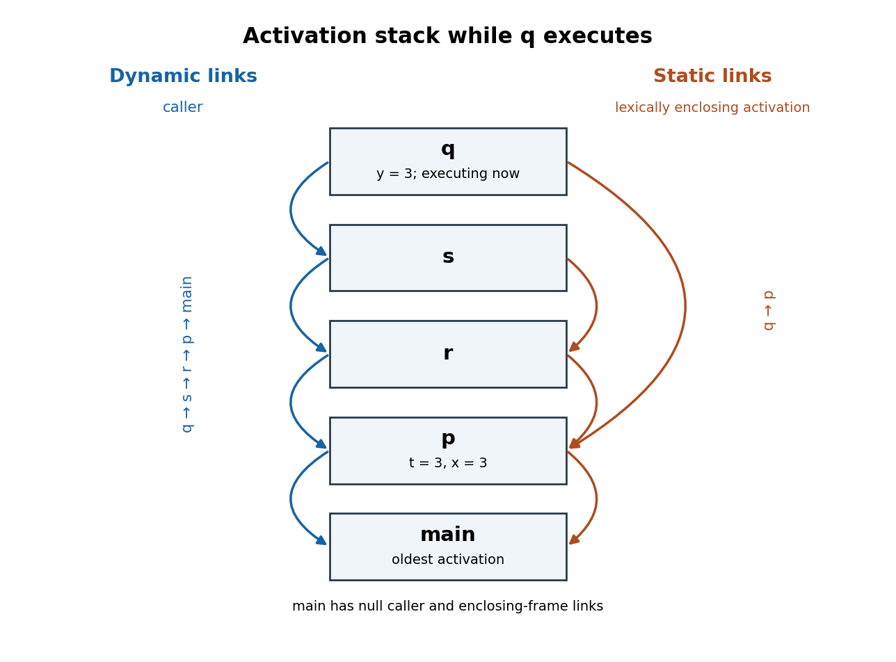

<h1 id="2/a/solution">Solution</h1>

↑ **Parent:** [A](../a.md)

The surviving [call stack](../../../../../call-stack.md), from oldest to newest, is `main, p, r, s, q`. A [dynamic link](../../../../../dynamic-link.md) identifies the caller's [stack frame](../../../../../stack-frame.md), whereas a [static link](../../../../../static-link.md) identifies the current activation of the lexically enclosing procedure. These need not identify the same [stack frame](../../../../../stack-frame.md).

**[Figure 1](#2/a/image-the-call-stack-during-q-with-dynamic-links-on-the-left-and-static-links-on-the-right-arrows-point-to-older-stack-frames). The call stack during `q`, with dynamic links on the left and static links on the right; arrows point to older stack frames**.

The [dynamic chain](../../../../../dynamic-chain.md) is

$$
q\longrightarrow s\longrightarrow r\longrightarrow p\longrightarrow\mathrm{main}.
$$

The individual [static links](../../../../../static-link.md) are

$$
\boxed{q\longrightarrow p,\qquad s\longrightarrow r,\qquad r\longrightarrow p,\qquad p\longrightarrow\mathrm{main}.}
$$

`main` has no enclosing procedure; its links can be null. The `p` [stack frame](../../../../../stack-frame.md) contains `t=3` and `x=3`, and the `q` [stack frame](../../../../../stack-frame.md) contains `y=3`. Return addresses are code addresses, not links to another [stack frame](../../../../../stack-frame.md). **In particular, `q` returns dynamically to `s` while obtaining `x` statically from `p`.**

## ↑ Ancestors (11)

1. [A](../a.md)
2. [2](../../2.md)
3. [Compilers](../../../compilers-split.md)
4. [2015](../../../split.md)
5. [Past exam of the computer science course of the University of Oxford](../../../../split.md)
6. [Computer science course of the University of Oxford](../../../../../computer-science-course-of-the-university-of-oxford.md)
7. [Undergraduate course of the University of Oxford](../../../../../undergraduate-course-of-the-university-of-oxford.md)
8. [Course of the University of Oxford](../../../../../course-of-the-university-of-oxford.md)
9. [University of Oxford](../../../../../university-of-oxford-split.md)
10. [List of universities](../../../../../list-of-universities.md)
11. [Codex Wiki](../../../../../split.md)
