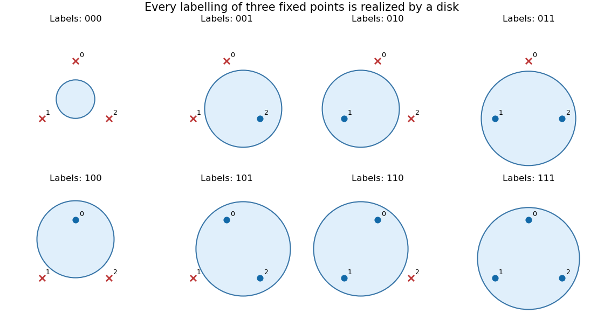

# Computational learning theory

↑ **Parent:** [2015](../2015.md)

The printed cover dates this paper to 12 June 2015. All three questions are solved below. The zero-dimensional exception in 1(b), the distinction between affine and homogeneous separators in 1(d), and the endpoint convention in the [AdaBoost](../../foundations-of-mathematics.md#adaboost) update are made explicit.

**Table of contents**

- [1](#1)
  - [a](#1/a)
    - [i](#1/a/i)
      - [Solution](#1/a/i/solution)
    - [ii](#1/a/ii)
      - [Solution](#1/a/ii/solution)
    - [iii](#1/a/iii)
      - [Solution](#1/a/iii/solution)
    - [iv](#1/a/iv)
      - [Solution](#1/a/iv/solution)
  - [b](#1/b)
    - [Solution](#1/b/solution)
  - [c](#1/c)
    - [Solution](#1/c/solution)
  - [d](#1/d)
    - [i](#1/d/i)
      - [Solution](#1/d/i/solution)
    - [ii](#1/d/ii)
      - [Solution](#1/d/ii/solution)
    - [iii](#1/d/iii)
      - [Solution](#1/d/iii/solution)
- [2](#2)
  - [a](#2/a)
    - [Solution](#2/a/solution)
  - [b](#2/b)
    - [Solution](#2/b/solution)
  - [c](#2/c)
    - [Solution](#2/c/solution)
  - [d](#2/d)
    - [Solution](#2/d/solution)
- [3](#3)
  - [a](#3/a)
    - [Solution](#3/a/solution)
  - [b](#3/b)
    - [Solution](#3/b/solution)
  - [c](#3/c)
    - [Solution](#3/c/solution)

## 1

↑ **Parent:** [Computational learning theory](computational-learning-theory.md)

<h3 id="1/a">a</h3>

↑ **Parent:** [1](#1)

<h4 id="1/a/i">i</h4>

↑ **Parent:** [A](#1/a)

<h5 id="1/a/i/solution">Solution</h5>

↑ **Parent:** [I](#1/a/i)

The [hypothesis class](../../foundations-of-mathematics.md#concept-class) $H$ [shatters a set](../../extremal-set-theory.md#set-shattering) $S$ when it realizes every binary labelling of $S$: for every [function](../../function.md) $g:S\to\{0,1\}$ there is an $h\in H$ with $h|_S=g$. Identifying each [classifier](../../foundations-of-mathematics.md#classifier) with its positive [set](../../set.md), this says

$$
\boxed{\{S\cap h:h\in H\}=\mathcal P(S),}
$$

where $\mathcal P(S)$ is the [power set](../../set.md#power-set). Different labellings may require different members of the [hypothesis class](../../foundations-of-mathematics.md#concept-class).

<h4 id="1/a/ii">ii</h4>

↑ **Parent:** [A](#1/a)

<h5 id="1/a/ii/solution">Solution</h5>

↑ **Parent:** [Ii](#1/a/ii)

The [VC dimension](../../foundations-of-mathematics.md#vc-dimension) is

$$
\boxed{\operatorname{VC}(H)=\sup\{|S|:S\subseteq X\text{ is finite and is shattered by }H\}.}
$$

It is infinite if arbitrarily large finite [sets](../../set.md) are shattered. A [hypothesis class](../../foundations-of-mathematics.md#concept-class) has [VC dimension](../../foundations-of-mathematics.md#vc-dimension) zero when it shatters no one-point [set](../../set.md); for a nonempty [hypothesis class](../../foundations-of-mathematics.md#concept-class), the empty [set](../../set.md) is always shattered.

<h4 id="1/a/iii">iii</h4>

↑ **Parent:** [A](#1/a)

<h5 id="1/a/iii/solution">Solution</h5>

↑ **Parent:** [Iii](#1/a/iii)

The [shattering coefficient](../../foundations-of-mathematics.md#shattering-coefficient), also called the [growth function of a hypothesis class](../../foundations-of-mathematics.md#shattering-coefficient), counts the largest number of labellings obtainable on $m$ inputs:

$$
\boxed{\Pi_H(m)=\sup_{x_1,\ldots,x_m\in X}\left|\{(h(x_1),\ldots,h(x_m)):h\in H\}\right|.}
$$

When $X$ has at least $m$ points, the same value is obtained by maximizing $|\{h|_S:h\in H\}|$ over $m$-point [sets](../../set.md) $S$. Always $\Pi_H(m)\leq2^m$, with equality exactly when some $m$-point [set](../../set.md) is shattered.

<h4 id="1/a/iv">iv</h4>

↑ **Parent:** [A](#1/a)

<h5 id="1/a/iv/solution">Solution</h5>

↑ **Parent:** [Iv](#1/a/iv)

The [Sauer-Shelah lemma](../../foundations-of-mathematics.md#sauer-shelah-lemma) says that a [hypothesis class](../../foundations-of-mathematics.md#concept-class) of finite [VC dimension](../../foundations-of-mathematics.md#vc-dimension) $d$ satisfies

$$
\boxed{\Pi_H(m)\leq\sum_{j=0}^{\min(d,m)}\binom mj.}
$$

In particular, for $m\geq d\geq1$,

$$
\Pi_H(m)\leq\left(\frac{em}{d}\right)^d.
$$

Here the [binomial coefficients](../../binomial-coefficient.md) count small subsets. One way to obtain the last inequality is to set $t=d/m\leq1$: since $t^j\geq t^d$ for $j\leq d$,

$$
t^d\sum_{j=0}^d\binom mj\leq\sum_{j=0}^d\binom mjt^j\leq(1+t)^m\leq e^{mt}=e^d.
$$

Thus finite [VC dimension](../../foundations-of-mathematics.md#vc-dimension) replaces the unrestricted exponential number of labellings by a polynomial bound in the sample size.

<h3 id="1/b">b</h3>

↑ **Parent:** [1](#1)

<h4 id="1/b/solution">Solution</h4>

↑ **Parent:** [B](#1/b)

Fix an $m$-point [set](../../set.md) $S$. The restriction of an [intersection](../../set.md#set-intersection) $c_1\cap c_2$ to $S$ is determined by the ordered pair of restrictions $c_1|_S,c_2|_S$. Some pairs can yield the same [intersection](../../set.md#set-intersection), so the [growth function of a hypothesis class](../../foundations-of-mathematics.md#shattering-coefficient) satisfies

$$
\Pi_{H_2}(m)\leq\Pi_H(m)^2.
$$

Assume first that $d\geq1$. If $12d$ points were shattered by $H_2$, the [Sauer-Shelah lemma](../../foundations-of-mathematics.md#sauer-shelah-lemma) would imply

$$
2^{12d}=\Pi_{H_2}(12d)\leq\Pi_H(12d)^2\leq(12e)^{2d}.
$$

But $e<3$, so $(12e)^2<36^2=1296<4096=2^{12}$. Raising this strict inequality to the positive integer power $d$ gives a contradiction. No $12d$-point [set](../../set.md) can therefore be shattered; neither can any larger [set](../../set.md), since shattering passes to subsets. Consequently

$$
\boxed{\operatorname{VC}(H_2)<12d\qquad(d\geq1).}
$$

**The printed strict inequality needs $d\geq1$.** For example, on a nonempty domain let $H$ contain only the identically zero [classifier](../../foundations-of-mathematics.md#classifier). Then $\operatorname{VC}(H)=\operatorname{VC}(H_2)=0$, whereas the stated conclusion would require $0<0$. More generally, a nonempty [hypothesis class](../../foundations-of-mathematics.md#concept-class) of [VC dimension](../../foundations-of-mathematics.md#vc-dimension) zero has only one distinct labelling [function](../../function.md), since two different [functions](../../function.md) would shatter a point on which they differ. Its self-[intersection](../../set.md#set-intersection) class also has [VC dimension](../../foundations-of-mathematics.md#vc-dimension) zero.

<h3 id="1/c">c</h3>

↑ **Parent:** [1](#1)

<h4 id="1/c/solution">Solution</h4>

↑ **Parent:** [C](#1/c)

Choose distinct points $x_1,\ldots,x_{d+2}$ of $S$. The $d+2$ [vectors](../../vector-space.md#vector) $(x_i,1)$ lie in the $(d+1)$-dimensional [vector space](../../vector-space.md) $\mathbb R^{d+1}$, so they are [linearly dependent](../../vector-space.md#linear-dependence). Hence there are real numbers $\lambda_i$, not all zero, such that

$$
\sum_{i=1}^{d+2}\lambda_i x_i=0,\qquad\sum_{i=1}^{d+2}\lambda_i=0.
$$

The second equality forces both a positive and a negative coefficient. Put $I_+=\{i:\lambda_i>0\}$, $I_-=\{i:\lambda_i<0\}$, and

$$
L=\sum_{i\in I_+}\lambda_i=-\sum_{i\in I_-}\lambda_i>0.
$$

Rearranging the first equality gives

$$
\boxed{z=\sum_{i\in I_+}\frac{\lambda_i}{L}x_i
=\sum_{i\in I_-}\frac{-\lambda_i}{L}x_i.}
$$

Each side is a [convex combination](../../convex-set.md#convex-combination): the coefficients are positive and sum to one. Thus $z$ belongs to both [convex hulls](../../convex-set.md#convex-hull). Place the points with indices in $I_+$ in $A$, those with indices in $I_-$ in $B$, and assign every zero-coefficient point and every remaining point of $S$ to $A$. Then $A,B$ are nonempty, disjoint, and have union $S$. Adding points cannot shrink a [convex hull](../../convex-set.md#convex-hull), so

$$
\boxed{\operatorname{conv}(A)\cap\operatorname{conv}(B)\ne\varnothing.}
$$

This proves the [intersecting convex hull partition theorem](../../convex-set.md#radon-s-theorem), including when $S$ has more than $d+2$ points or is infinite: only the initial finite collection was needed.

<h3 id="1/d">d</h3>

↑ **Parent:** [1](#1)

<h4 id="1/d/i">i</h4>

↑ **Parent:** [D](#1/d)

<h5 id="1/d/i/solution">Solution</h5>

↑ **Parent:** [I](#1/d/i)

Expanding the squared [Euclidean norm](../../normed-vector-space.md#euclidean-norm) gives

$$
x\in B(c,r)\quad\Longleftrightarrow\quad
\|x\|^2-2c\cdot x+\|c\|^2-r^2\leq0.
$$

In lifted coordinates $(z,t)=\Phi(x)=(x,\|x\|^2)$, this is the [closed half-space](../../convex-set.md#closed-half-space)

$$
\boxed{t-2c\cdot z+\|c\|^2-r^2\leq0.}
$$

Every labelling of the original points obtainable by a [Euclidean ball](../../normed-vector-space.md#euclidean-ball) is therefore obtainable on their lifted images by an [affine linear classifier](../../foundations-of-mathematics.md#affine-linear-classifier). The [feature map](../../positive-semidefinite-kernel.md#feature-map) is [injective](../../algebra.md#injective-function), since it preserves the first $d$ coordinates; distinct original points remain distinct. If the original points are shattered, every labelling of the lifted points is realized, as required.

Here “linear separator” means a separator with an intercept, namely an [affine hyperplane](../../vector-space.md#affine-hyperplane). If a convention demands strict separation on the finite sample, increase the constant term of the positive score $r^2-\|c\|^2+2c\cdot z-t$ by a sufficiently small positive amount. Positive points then have strictly positive score, and the finitely many negative scores remain strictly negative. A homogeneous separator can alternatively be obtained after adjoining one more constant coordinate; this distinction matters for dimension counts.

<h4 id="1/d/ii">ii</h4>

↑ **Parent:** [D](#1/d)

<h5 id="1/d/ii/solution">Solution</h5>

↑ **Parent:** [Ii](#1/d/ii)

For $d\geq1$, take the $d+1$ vertices $v_0,\ldots,v_d$ of a [regular simplex](../../algebraic-topology.md#regular-simplex) in $\mathbb R^d$, centered at zero and scaled so that $\|v_j\|=1$. For example, realize them as

$$
v_j=\sqrt{\frac{d+1}{d}}\left(e_j-\frac1{d+1}\mathbf1\right),\qquad 0\leq j\leq d,
$$

in the $d$-dimensional [vector subspace](../../vector-space.md#vector-subspace) $\{z\in\mathbb R^{d+1}:\sum_jz_j=0\}$, identified isometrically with $\mathbb R^d$. These vertices are [affinely independent](../../geometry-and-topology.md#affine-independence).

Assign arbitrary desired signs $s_j\in\{-1,1\}$, positive for inclusion. [Affine independence](../../geometry-and-topology.md#affine-independence) implies that there is an [affine function](../../vector-space.md#affine-function) $\ell(x)=a\cdot x+b$ with $\ell(v_j)=s_j$ for every $j$: the $d+1$ interpolation conditions form an invertible [linear system](../../linear-algebra.md#system-of-linear-equations). For a sufficiently small $\eta>0$, choose

$$
c=\frac\eta2a,\qquad r^2=1+\eta b+\frac{\eta^2}{4}\|a\|^2>0.
$$

At every vertex,

$$
r^2-\|v_j-c\|^2
=\eta(a\cdot v_j+b)=\eta s_j.
$$

Thus the [Euclidean ball](../../normed-vector-space.md#euclidean-ball) contains exactly the positively labelled vertices, with none on its boundary. This construction also covers the all-positive and all-negative labellings. Therefore

$$
\boxed{\{v_0,\ldots,v_d\}\text{ is shattered by }\mathcal B_d.}
$$

<a id="1/d/ii/image-closed-euclidean-balls-realize-all-eight-labellings-of-three-regular-simplex-vertices-in-the-plane"></a>


**[Figure 1](#1/d/ii/image-closed-euclidean-balls-realize-all-eight-labellings-of-three-regular-simplex-vertices-in-the-plane). Closed Euclidean balls realize all eight labellings of three regular simplex vertices in the plane**. Filled blue points are inside each shaded disk; red crosses are outside. The same three points are used in every panel.

<h4 id="1/d/iii">iii</h4>

↑ **Parent:** [D](#1/d)

<h5 id="1/d/iii/solution">Solution</h5>

↑ **Parent:** [Iii](#1/d/iii)

An [affine linear classifier](../../foundations-of-mathematics.md#affine-linear-classifier) in $\mathbb R^k$ has [VC dimension](../../foundations-of-mathematics.md#vc-dimension) $k+1$. The upper bound follows from the [intersecting convex hull partition theorem](../../convex-set.md#radon-s-theorem): for any $k+2$ points, label the two parts oppositely. The two [convex hulls](../../convex-set.md#convex-hull) cannot be strictly separated by an [affine hyperplane](../../vector-space.md#affine-hyperplane), since they intersect. A weak boundary convention gives the same contradiction: an affine score is nonnegative on the positive [convex hull](../../convex-set.md#convex-hull) and strictly negative on the negative [convex hull](../../convex-set.md#convex-hull). The lower bound comes from the $k+1$ [affinely independent](../../geometry-and-topology.md#affine-independence) vertices of a [simplex](../../algebraic-topology.md#simplex), because an affine score can interpolate arbitrary signs there.

Consequently, parts (i) and (ii) immediately give

$$
\boxed{d+1\leq\operatorname{VC}(\mathcal B_d)\leq d+2.}
$$

The one-sided orientation of the lifted separators permits the sharper, exact conclusion

$$
\boxed{\operatorname{VC}(\mathcal B_d)=d+1\qquad(d\geq1).}
$$

To prove the remaining upper bound, take any $d+2$ distinct points and a nonzero [affine dependence](../../geometry-and-topology.md#affine-dependence) $\lambda_i$ as in part (c). Write $Q=\sum_i\lambda_i\|x_i\|^2$. Reverse every coefficient if necessary so that $Q\geq0$. Prescribe positive labels when $\lambda_i>0$ and negative labels when $\lambda_i<0$; zero coefficients may be labelled arbitrarily. If a [Euclidean ball](../../normed-vector-space.md#euclidean-ball) realized these labels, its score $g(x)=r^2-\|x-c\|^2$ would satisfy

$$
\sum_i\lambda_i g(x_i)>0.
$$

Indeed, every positive-coefficient term is nonnegative and every negative-coefficient term is strictly positive, with at least one of the latter. On the other hand, expanding the score and using the two [affine dependence](../../geometry-and-topology.md#affine-dependence) identities gives

$$
\sum_i\lambda_i g(x_i)
=(r^2-\|c\|^2)\sum_i\lambda_i+2c\cdot\sum_i\lambda_i x_i-\sum_i\lambda_i\|x_i\|^2
=-Q\leq0,
$$

a contradiction. No $d+2$ points are shattered, completing the exact determination of the [VC dimension of Euclidean balls](../../foundations-of-mathematics.md#vc-dimension-of-euclidean-balls). In the exceptional zero-dimensional [Euclidean space](../../normed-vector-space.md#euclidean-norm), every positive-radius [Euclidean ball](../../normed-vector-space.md#euclidean-ball) is the whole singleton space, so the [VC dimension](../../foundations-of-mathematics.md#vc-dimension) is zero.

## 2

↑ **Parent:** [Computational learning theory](computational-learning-theory.md)

<h3 id="2/a">a</h3>

↑ **Parent:** [2](#2)

<h4 id="2/a/solution">Solution</h4>

↑ **Parent:** [A](#2/a)

Take labels $y_i\in\{-1,1\}$ and fix the standard normalization in which the squared weight penalty has coefficient $1/2$. The [squared-slack support vector machine](../../statistical-learning.md#squared-slack-support-vector-machine), a form of [soft-margin support vector machine](../../statistical-learning.md#soft-margin-support-vector-machine), has [primal problem](../../mathematical-optimization.md#primal-problem)

$$
\boxed{\begin{aligned}
\underset{w,b,\xi}{\operatorname{minimize}}\quad&\frac12\|w\|^2+C\sum_{i=1}^m\xi_i^2,\\
\text{subject to}\quad&y_i(w\cdot x_i+b)\geq1-\xi_i,\qquad i=1,\ldots,m,\\
&\xi_i\geq0,\qquad i=1,\ldots,m.
\end{aligned}}
$$

The [slack variables of a support vector machine](../../statistical-learning.md#slack-variables-of-a-support-vector-machine) permit margin violations. Penalizing $\|w\|^2$ favors a wide [support-vector-machine margin](../../statistical-learning.md#support-vector-machine-margin), while $C>0$ sets the cost of the violations. The intercept $b$ is unpenalized, and the resulting [classifier](../../foundations-of-mathematics.md#classifier) is $h(x)=\operatorname{sign}(w\cdot x+b)$, with a fixed choice at zero. The square on $\xi_i$ is essential to the [Lagrangian dual problem](../../linear-programming.md#lagrangian-dual-problem) below.

<h3 id="2/b">b</h3>

↑ **Parent:** [2](#2)

<h4 id="2/b/solution">Solution</h4>

↑ **Parent:** [B](#2/b)

Use [Lagrange multipliers](../../mathematical-optimization.md#lagrange-multiplier) $\alpha_i\geq0$ for $1-\xi_i-y_i(w\cdot x_i+b)\leq0$ and $\mu_i\geq0$ for $-\xi_i\leq0$. The [optimization Lagrangian](../../mathematical-optimization.md#optimization-lagrangian) is

$$
L(w,b,\xi;\alpha,\mu)
=\frac12\|w\|^2+C\sum_i\xi_i^2
+\sum_i\alpha_i\bigl(1-\xi_i-y_i(w\cdot x_i+b)\bigr)-\sum_i\mu_i\xi_i.
$$

The [Lagrange dual function](../../linear-programming.md#lagrange-dual-function) is the infimum over the now unconstrained primal variables. The [first-order optimality conditions](../../mathematical-optimization.md#first-order-optimality-condition) in $w$ and $b$ give

$$
w=\sum_i\alpha_i y_ix_i,\qquad\sum_i\alpha_i y_i=0.
$$

If the latter equality fails, the infimum over $b$ is $-\infty$. The [first-order optimality condition](../../mathematical-optimization.md#first-order-optimality-condition) in $\xi_i$ gives

$$
2C\xi_i-\alpha_i-\mu_i=0,\qquad\xi_i=\frac{\alpha_i+\mu_i}{2C}.
$$

Substitution, or completing the square separately in $w$ and each $\xi_i$, produces

$$
g(\alpha,\mu)=\sum_i\alpha_i
-\frac12\sum_{i,j}\alpha_i\alpha_jy_iy_j(x_i\cdot x_j)
-\frac1{4C}\sum_i(\alpha_i+\mu_i)^2,
$$

provided $\sum_i\alpha_iy_i=0$. For fixed nonnegative $\alpha_i$, this expression is maximized over $\mu_i\geq0$ at $\mu_i=0$. Thus the simplest [Lagrangian dual problem](../../linear-programming.md#lagrangian-dual-problem) is

$$
\boxed{\begin{aligned}
\underset{\alpha\in\mathbb R^m}{\operatorname{maximize}}\quad&
\sum_i\alpha_i-\frac12\sum_{i,j}\alpha_i\alpha_jy_iy_j(x_i\cdot x_j)-\frac1{4C}\sum_i\alpha_i^2,\\
\text{subject to}\quad&\alpha_i\geq0,\qquad\sum_i\alpha_i y_i=0.
\end{aligned}}
$$

In particular, **there is no upper box constraint $\alpha_i\leq C$**. That constraint belongs to the linear-slack penalty; squared slack instead contributes the displayed diagonal quadratic penalty. With $Y=\operatorname{diag}(y_1,\ldots,y_m)$ and [Gram matrix](../../inner-product.md#gram-matrix) $G_{ij}=x_i\cdot x_j$, the objective can also be written

$$
\mathbf1^T\alpha-\frac12\alpha^T\left(YGY+\frac1{2C}I\right)\alpha.
$$

Since $G$ is [positive semidefinite](../../quadratic-form.md#positive-semidefinite-matrix) and $C>0$, the matrix in parentheses is [positive-definite](../../bilinear-form.md#positive-definite-bilinear-form). The objective of the [Lagrangian dual problem](../../linear-programming.md#lagrangian-dual-problem) is therefore strictly concave, and the feasible maximizer is unique.

The [primal problem](../../mathematical-optimization.md#primal-problem) is a [convex optimization](../../convex-optimization.md) problem, and $w=0,b=0,\xi_i=2$ is strictly feasible for both families of inequalities. [Slater's condition](../../linear-programming.md#slater-s-condition) gives [strong duality](../../linear-programming.md#strong-duality), so an optimum of the [Lagrangian dual problem](../../linear-programming.md#lagrangian-dual-problem) yields a primal optimum. The [Karush-Kuhn-Tucker conditions](../../mathematical-optimization.md#karush-kuhn-tucker-conditions) supply

$$
\xi_i=\frac{\alpha_i}{2C},\qquad
\alpha_i\bigl(1-\xi_i-y_i(w\cdot x_i+b)\bigr)=0.
$$

For any $i$ with $\alpha_i>0$, the intercept is consequently

$$
\boxed{b=y_i\left(1-\frac{\alpha_i}{2C}\right)-w\cdot x_i.}
$$

All such choices agree at an exact optimum. If all labels have one sign, the optimal coefficients can all be zero: choose $w=0$, $\xi=0$, and any constant intercept of that sign with magnitude at least one.

<h3 id="2/c">c</h3>

↑ **Parent:** [2](#2)

<h4 id="2/c/solution">Solution</h4>

↑ **Parent:** [C](#2/c)

A real [positive-semidefinite kernel](../../positive-semidefinite-kernel.md) on an input [set](../../set.md) $X$ is a [function](../../function.md) $K:X\times X\to\mathbb R$ for which there is an [inner product space](../../inner-product.md#inner-product-space) $\mathcal F$ and a [feature map](../../positive-semidefinite-kernel.md#feature-map) $\phi:X\to\mathcal F$ satisfying

$$
\boxed{K(x,z)=\langle\phi(x),\phi(z)\rangle.}
$$

Equivalently, $K$ is symmetric and every finite [Gram matrix](../../inner-product.md#gram-matrix) $(K(x_i,x_j))_{i,j}$ is [positive semidefinite](../../quadratic-form.md#positive-semidefinite-matrix): $\sum_{i,j}a_ia_jK(x_i,x_j)\geq0$ for all real coefficients $a_i$. An infinite-dimensional [Hilbert space](../../hilbert-space.md) is allowed.

Replace every [inner product](../../inner-product.md) $x_i\cdot x_j$ in part (b) by $K(x_i,x_j)$ and solve

$$
\boxed{\max_{\alpha\geq0,\ y^T\alpha=0}
\left\{\mathbf1^T\alpha-\frac12\sum_{i,j}\alpha_i\alpha_jy_iy_jK(x_i,x_j)-\frac1{4C}\|\alpha\|^2\right\}.}
$$

This is precisely the [Lagrangian dual problem](../../linear-programming.md#lagrangian-dual-problem) obtained by replacing each original input by $\phi(x_i)$ in the [primal problem](../../mathematical-optimization.md#primal-problem). The weight [vector](../../vector-space.md#vector) it determines is

$$
w_{\mathcal F}=\sum_i\alpha_i y_i\phi(x_i),
$$

and the intercept follows from the same [Karush-Kuhn-Tucker conditions](../../mathematical-optimization.md#karush-kuhn-tucker-conditions). For example, if $\alpha_i>0$,

$$
b=y_i\left(1-\frac{\alpha_i}{2C}\right)-\sum_j\alpha_j y_jK(x_j,x_i).
$$

Thus training needs only the finite [Gram matrix](../../inner-product.md#gram-matrix), even if the [feature map](../../positive-semidefinite-kernel.md#feature-map) has infinitely many coordinates. This is the [kernel trick](../../positive-semidefinite-kernel.md#kernel-trick). The result is an **[affine linear classifier](../../foundations-of-mathematics.md#affine-linear-classifier) in the feature space**; its boundary in the original input space can be nonlinear. The squared-slack diagonal term and the equality constraint remain unchanged.

<h3 id="2/d">d</h3>

↑ **Parent:** [2](#2)

<h4 id="2/d/solution">Solution</h4>

↑ **Parent:** [D](#2/d)

An embedding is determined by its chosen increasing sequence of positions. Accordingly, the [all-subsequence embedding kernel](../../positive-semidefinite-kernel.md#all-subsequence-embedding-kernel) $K(x,y)$ counts pairs of embeddings, one in $x$ and one in $y$, that spell the same [subsequence](../../sequence-and-series.md#subsequence). The two embeddings are distinguished even when they spell the same word as another pair. The empty word contributes exactly one pair.

Let $n=|x|$, $p=|y|$, and define $F(i,j)=K(x_1\cdots x_i,y_1\cdots y_j)$ for prefixes. When either prefix is empty, only the empty word has an embedding in both, so

$$
F(0,j)=F(i,0)=1.
$$

To derive a [dynamic programming recurrence](../../mathematical-optimization.md#dynamic-programming-recurrence), count pairs that do not use position $i$ of $x$ or do not use position $j$ of $y$. [Inclusion-exclusion](../../combinatorics.md#inclusion-exclusion-principle) gives

$$
F(i-1,j)+F(i,j-1)-F(i-1,j-1).
$$

The remaining pairs use both final positions. These positions must be the final letters of the common word, so they contribute nothing if $x_i\ne y_j$. If $x_i=y_j$, deleting those two final positions is a [bijection](../../function.md#bijection) to arbitrary embedding pairs on the two shorter prefixes, including their empty pair. Their contribution is therefore $F(i-1,j-1)$. Hence

$$
\boxed{F(i,j)=F(i-1,j)+F(i,j-1)-F(i-1,j-1)
+\mathbf1_{\{x_i=y_j\}}F(i-1,j-1).}
$$

Equivalently, when the final symbols agree the recurrence simplifies to $F(i,j)=F(i-1,j)+F(i,j-1)$; when they differ, subtract the diagonal term. Fill the table in increasing prefix order and return $F(n,p)$. The boundary values and the disjoint counting argument prove correctness by [induction](../../foundations-of-mathematics.md#mathematical-induction) on $i+j$.

A one-row implementation of this [dynamic programming](../../mathematical-optimization.md#dynamic-programming) uses the saved old diagonal entry:
```
F[0..p] := 1
for i := 1 to n:
    diagonal := 1
    for j := 1 to p:
        above := F[j]
        if x[i] = y[j]:
            F[j] := above + F[j-1]
        else:
            F[j] := above + F[j-1] - diagonal
        diagonal := above
return F[p]
```
The assignment to `diagonal` retains the value from the previous row before `F[j]` was overwritten. Swapping $x$ and $y$ if necessary minimizes the row length. Thus the [time complexity](../../theoretical-computer-science.md#time-complexity) is **$O(|x||y|)$ arithmetic operations** and the extra [space complexity](../../theoretical-computer-science.md#space-complexity) is **$O(\min(|x|,|y|))$ integer cells**. Empty inputs return one immediately.

These counts include multiplicity: for $x=y=aa$, the empty word contributes $1$, the word $a$ contributes $2\cdot2=4$, and $aa$ contributes $1$, giving $K(aa,aa)=6$, not three. More generally, each result is at most $2^{n+p}$, since it counts some pairs of position subsets. Exact integers therefore require $O(n+p)$ bits; the stated quadratic bound is an arithmetic-operation bound, with a conservative $O(np(n+p))$ bound for elementary bit arithmetic.

The proposed [positive-semidefinite kernel](../../positive-semidefinite-kernel.md) is valid: for each finite string only finitely many coordinates $\phi_u(x)$ are nonzero, so $x\mapsto(\phi_u(x))_{u\in\Delta^*}$ is a well-defined [feature map](../../positive-semidefinite-kernel.md#feature-map) into the [inner product space](../../inner-product.md#inner-product-space) of finitely supported coordinate families, and its [inner product](../../inner-product.md) is exactly $K$.

## 3

↑ **Parent:** [Computational learning theory](computational-learning-theory.md)

<h3 id="3/a">a</h3>

↑ **Parent:** [3](#3)

<h4 id="3/a/solution">Solution</h4>

↑ **Parent:** [A](#3/a)

The [two-interval approximation by one interval](../../foundations-of-mathematics.md#two-interval-approximation-by-one-interval) supplies an approximation guarantee for every input [probability distribution](../../probability-distribution.md) $D$. Merge overlapping target [intervals](../../real-analysis.md#interval-mathematics), and write the target positive [set](../../set.md) as at most two disjoint ordered [intervals](../../real-analysis.md#interval-mathematics) $I_1,I_2$. Put $p_j=D(I_j)$ and $p=p_1+p_2$. If there is only one nonempty component, the target already belongs to the [interval](../../real-analysis.md#interval-mathematics) [hypothesis class](../../foundations-of-mathematics.md#concept-class) and has zero [misclassification risk](../../foundations-of-mathematics.md#misclassification-risk). If the [interval](../../real-analysis.md#interval-mathematics) notation permits empty [intervals](../../real-analysis.md#interval-mathematics) and the target is empty, choose that same empty [interval](../../real-analysis.md#interval-mathematics) in $H$.

In the two-component case, choosing the heavier component as the hypothesis loses only the lighter component, so its [misclassification risk](../../foundations-of-mathematics.md#misclassification-risk) is

$$
\min(p_1,p_2)\leq\frac p2.
$$

Alternatively, choose the single [interval](../../real-analysis.md#interval-mathematics) $J$ spanning both components. This produces no false negatives, and its false positives lie in the gap. Its [misclassification risk](../../foundations-of-mathematics.md#misclassification-risk) is at most $1-p$. Both candidates are in $H$, so there exists an [interval](../../real-analysis.md#interval-mathematics) $h^*$ with

$$
\operatorname{err}_D(h^*)\leq\min\left(\frac p2,1-p\right)\leq\frac13.
$$

For the last step, use $p/2\leq1/3$ if $p\leq2/3$, and $1-p\leq1/3$ if $p\geq2/3$. This avoids any assumption that an empty [interval](../../real-analysis.md#interval-mathematics) or the whole real line belongs to $H$.

Use [empirical risk minimization](../../foundations-of-mathematics.md#empirical-risk-minimization) over [intervals](../../real-analysis.md#interval-mathematics) on independent labelled examples. The generalization result needed here is the [VC uniform convergence theorem](../../foundations-of-mathematics.md#vc-uniform-convergence-theorem): for a binary [hypothesis class](../../foundations-of-mathematics.md#concept-class) of finite [VC dimension](../../foundations-of-mathematics.md#vc-dimension) $v$, there is a universal constant $A$ such that, for any labelled-data [probability distribution](../../probability-distribution.md) and $0<\eta,\delta<1$, a sample size

$$
m\geq\frac A{\eta^2}\left(v\log\frac2\eta+\log\frac2\delta\right)
$$

ensures, with probability at least $1-\delta$, that every hypothesis's [empirical misclassification risk](../../foundations-of-mathematics.md#empirical-misclassification-risk) differs from its [misclassification risk](../../foundations-of-mathematics.md#misclassification-risk) by at most $\eta$. This theorem does not require the labels to be realizable by the [hypothesis class](../../foundations-of-mathematics.md#concept-class).[Sections “Uniform Convergence implies Agnostic PAC Learnability” and “Fundamental Theorem of Learnability”](../../computer-science-bibliography.md#learnability-and-vc-dimension-in-mit-6-790)

The [interval](../../real-analysis.md#interval-mathematics) [hypothesis class](../../foundations-of-mathematics.md#concept-class) has [VC dimension](../../foundations-of-mathematics.md#vc-dimension) two: any two ordered points can receive all four labellings, whereas an [interval](../../real-analysis.md#interval-mathematics) cannot label three ordered points $1,0,1$. Take $\eta=1/24$ and choose an [interval](../../real-analysis.md#interval-mathematics) $\widehat h$ minimizing the [empirical misclassification risk](../../foundations-of-mathematics.md#empirical-misclassification-risk). On the simultaneous convergence event,

$$
\begin{aligned}
\operatorname{err}_D(\widehat h)
&\leq\widehat{\operatorname{err}}(\widehat h)+\eta\\
&\leq\widehat{\operatorname{err}}(h^*)+\eta\\
&\leq\operatorname{err}_D(h^*)+2\eta\\
&\leq\frac13+\frac1{12}=\frac5{12}=\frac12-\frac1{12}.
\end{aligned}
$$

Therefore

$$
\boxed{C\text{ is weakly PAC learnable using }H,\qquad\gamma=\frac1{12}.}
$$

Since $v$ and $\eta$ are fixed constants, **$O(1+\log(1/\delta))$ examples suffice**, which is polynomial in $1/\delta$ as required by the paper's definition of [weak PAC learning](../../foundations-of-mathematics.md#weak-pac-learning).

For completeness, [empirical risk minimization](../../foundations-of-mathematics.md#empirical-risk-minimization) over [intervals](../../real-analysis.md#interval-mathematics) is computationally effective. Sort the sample and group equal coordinates, since one [interval](../../real-analysis.md#interval-mathematics) cannot split identical inputs. Give each group weight equal to the number of positive labels minus the number of negative labels in that group. The number of empirical mistakes made by an [interval](../../real-analysis.md#interval-mathematics) is the total number of positives minus the total weight of the consecutive groups it contains. Select the consecutive block of maximum weight, or select a finite [interval](../../real-analysis.md#interval-mathematics) outside the sample if every nonempty block has negative weight. This enumerates all possible sample labellings by [intervals](../../real-analysis.md#interval-mathematics) and attains the minimum [empirical misclassification risk](../../foundations-of-mathematics.md#empirical-misclassification-risk); sorting and a maximum-block scan are sufficient. The [time complexity](../../theoretical-computer-science.md#time-complexity) is $O(m\log m)$.

<h3 id="3/b">b</h3>

↑ **Parent:** [3](#3)

<h4 id="3/b/solution">Solution</h4>

↑ **Parent:** [B](#3/b)

Use [weighted decision stump optimization](../../foundations-of-mathematics.md#weighted-decision-stump-optimization) with the convention $\operatorname{sign}(0)=+1$, and write $w_j=D((x_j,y_j))$. For each coordinate $i$, sort the examples by their $i$th coordinate and group all equal coordinate values. For a threshold between the $k$th and $(k+1)$st distinct values, the [decision stump](../../foundations-of-mathematics.md#decision-stump) predicts $-1$ on the left and $+1$ on the right. Its weighted [misclassification risk](../../foundations-of-mathematics.md#misclassification-risk) is

$$
\boxed{E_i(k)=\sum_{j\text{ left},\ y_j=+1}w_j
+\sum_{j\text{ right},\ y_j=-1}w_j.}
$$

Start with a threshold below the minimum observed value. Every prediction is then $+1$, and the initial error is $\sum_{y_j=-1}w_j$. Sweep the threshold from left to right. When it passes an entire group $G$ of equal coordinate values, that group's prediction changes from $+1$ to $-1$, so update

$$
\boxed{E\leftarrow E+\sum_{j\in G,\ y_j=+1}w_j-\sum_{j\in G,\ y_j=-1}w_j.}
$$

Record the smallest value and a threshold achieving it, including the final threshold above all observations, which predicts $-1$ everywhere on the sample. Representatives can be chosen strictly between successive distinct values; the two outer representatives are finite real numbers below the minimum and above the maximum.

Every threshold has exactly the same sample predictions as one of these representatives. In particular, if a threshold equals an observed value, the equality group is on the $+1$ side under the chosen [sign function](../../foundations-of-mathematics.md#sign-function) convention, which duplicates the representative immediately before that group. Thus the sweep includes every possible sample labelling by the stated [decision stump](../../foundations-of-mathematics.md#decision-stump). Repeating for all $n$ coordinates and returning the globally smallest error proves optimality.

Sorting costs $O(m\log m)$ per coordinate and the grouped sweep costs $O(m)$. The overall [time complexity](../../theoretical-computer-science.md#time-complexity) is

$$
\boxed{O(nm\log m),}
$$

with $O(m)$ working storage when coordinates are processed one at a time. Pre-sorted coordinate orders can be reused across repeated [AdaBoost](../../foundations-of-mathematics.md#adaboost) rounds, leaving $O(nm)$ work per round for changing weights. The paper allows only the orientation $\operatorname{sign}(x_i-b)$; reversing its polarity would enlarge the [hypothesis class](../../foundations-of-mathematics.md#concept-class) and is unnecessary here.

<h3 id="3/c">c</h3>

↑ **Parent:** [3](#3)

<h4 id="3/c/solution">Solution</h4>

↑ **Parent:** [C](#3/c)

Write $\varepsilon=\varepsilon_t$, $\alpha=\alpha_t$, and $s_i=y_i h_t(x_i)\in\{-1,1\}$. Correctly classified observations have $s_i=1$ and total $D_t$-weight $1-\varepsilon$; incorrectly classified observations have $s_i=-1$ and total weight $\varepsilon$. The [normalizing constant](../../continuous-probability-distribution.md#normalizing-constant) in the [AdaBoost](../../foundations-of-mathematics.md#adaboost) update is therefore

$$
Z_{t+1}=\sum_iD_t(i)e^{-\alpha s_i}
=(1-\varepsilon)e^{-\alpha}+\varepsilon e^\alpha.
$$

For $0<\varepsilon<1$, the definition of $\alpha$ gives

$$
e^\alpha=\sqrt{\frac{1-\varepsilon}{\varepsilon}},\qquad
e^{-\alpha}=\sqrt{\frac{\varepsilon}{1-\varepsilon}},\qquad
\boxed{Z_{t+1}=2\sqrt{\varepsilon(1-\varepsilon)}.}
$$

If observation $i$ is correct, its multiplier in the normalized update is

$$
\frac{e^{-\alpha}}{Z_{t+1}}=\frac1{2(1-\varepsilon)};
$$

if it is incorrect, the multiplier is

$$
\frac{e^\alpha}{Z_{t+1}}=\frac1{2\varepsilon}.
$$

The corresponding denominators are exactly $1+s_i(1-2\varepsilon)$: they are $2(1-\varepsilon)$ when $s_i=1$ and $2\varepsilon$ when $s_i=-1$. Consequently

$$
\boxed{D_{t+1}(i)=\frac{D_t(i)}{1+y_i h_t(x_i)(1-2\varepsilon_t)}.}
$$

As a check, the new total mass on correctly classified observations is $(1-\varepsilon)/(2(1-\varepsilon))=1/2$, and the mass on incorrectly classified observations is $\varepsilon/(2\varepsilon)=1/2$. The update thus produces a [probability distribution](../../probability-distribution.md) and assigns the two groups equal aggregate mass. When $\varepsilon=1/2$, $\alpha=0$ and every individual weight is unchanged.

The displayed finite update assumes **$0<\varepsilon_t<1$**. The usual [weak learner](../../foundations-of-mathematics.md#weak-learner) guarantees $\varepsilon_t<1/2$, but it can return a perfect [classifier](../../foundations-of-mathematics.md#classifier) with $\varepsilon_t=0$; then the logarithm is infinite and the normalized exponential formula is not defined. [AdaBoost](../../foundations-of-mathematics.md#adaboost) stops on that perfect hypothesis rather than executing this update. Similarly, the printed formula is not an ordinary finite update at $\varepsilon_t=1$.

## ↑ Ancestors (8)

1. [2015](../2015.md)
2. [Past exam of the computer science course of the University of Oxford](../../past-exam-of-the-computer-science-course-of-the-university-of-oxford.md)
3. [Computer science course of the University of Oxford](../../university-of-oxford.md#computer-science-course-of-the-university-of-oxford)
4. [Undergraduate course of the University of Oxford](../../university-of-oxford.md#undergraduate-course-of-the-university-of-oxford)
5. [Course of the University of Oxford](../../university-of-oxford.md#course-of-the-university-of-oxford)
6. [University of Oxford](../../university-of-oxford.md)
7. [List of universities](../../README.md#list-of-universities)
8. [Codex Wiki](../../README.md)
