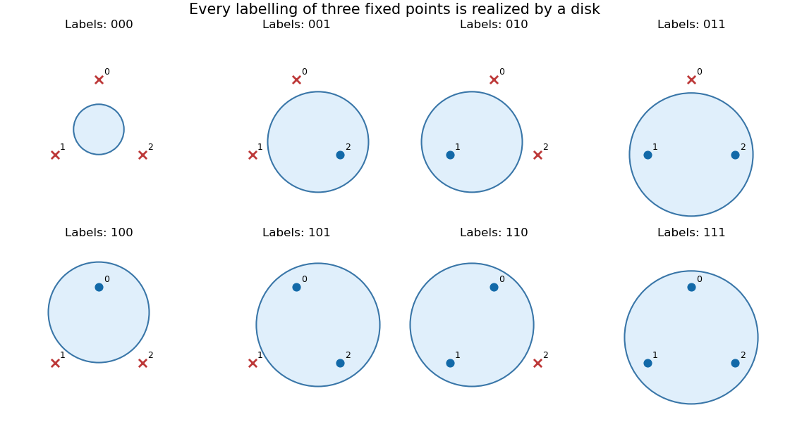

<h1 id="1/d/ii/solution">Solution</h1>

↑ **Parent:** [Ii](../ii.md)

For $d\geq1$, take the $d+1$ vertices $v_0,\ldots,v_d$ of a [regular simplex](../../../../../../regular-simplex.md) in $\mathbb R^d$, centered at zero and scaled so that $\|v_j\|=1$. For example, realize them as

$$
v_j=\sqrt{\frac{d+1}{d}}\left(e_j-\frac1{d+1}\mathbf1\right),\qquad 0\leq j\leq d,
$$

in the $d$-dimensional [vector subspace](../../../../../../vector-subspace.md) $\{z\in\mathbb R^{d+1}:\sum_jz_j=0\}$, identified isometrically with $\mathbb R^d$. These vertices are [affinely independent](../../../../../../affine-independence.md).

Assign arbitrary desired signs $s_j\in\{-1,1\}$, positive for inclusion. [Affine independence](../../../../../../affine-independence.md) implies that there is an [affine function](../../../../../../affine-function.md) $\ell(x)=a\cdot x+b$ with $\ell(v_j)=s_j$ for every $j$: the $d+1$ interpolation conditions form an invertible [linear system](../../../../../../system-of-linear-equations.md). For a sufficiently small $\eta>0$, choose

$$
c=\frac\eta2a,\qquad r^2=1+\eta b+\frac{\eta^2}{4}\|a\|^2>0.
$$

At every vertex,

$$
r^2-\|v_j-c\|^2
=\eta(a\cdot v_j+b)=\eta s_j.
$$

Thus the [Euclidean ball](../../../../../../euclidean-ball.md) contains exactly the positively labelled vertices, with none on its boundary. This construction also covers the all-positive and all-negative labellings. Therefore

$$
\boxed{\{v_0,\ldots,v_d\}\text{ is shattered by }\mathcal B_d.}
$$

**[Figure 1](#1/d/ii/image-closed-euclidean-balls-realize-all-eight-labellings-of-three-regular-simplex-vertices-in-the-plane). Closed Euclidean balls realize all eight labellings of three regular simplex vertices in the plane**. Filled blue points are inside each shaded disk; red crosses are outside. The same three points are used in every panel.

## ↑ Ancestors (12)

1. [Ii](../ii.md)
2. [D](../../d.md)
3. [1](../../../1.md)
4. [Computational learning theory](../../../../computational-learning-theory-split.md)
5. [2015](../../../../split.md)
6. [Past exam of the computer science course of the University of Oxford](../../../../../split.md)
7. [Computer science course of the University of Oxford](../../../../../../computer-science-course-of-the-university-of-oxford.md)
8. [Undergraduate course of the University of Oxford](../../../../../../undergraduate-course-of-the-university-of-oxford.md)
9. [Course of the University of Oxford](../../../../../../course-of-the-university-of-oxford.md)
10. [University of Oxford](../../../../../../university-of-oxford-split.md)
11. [List of universities](../../../../../../list-of-universities.md)
12. [Codex Wiki](../../../../../../split.md)
