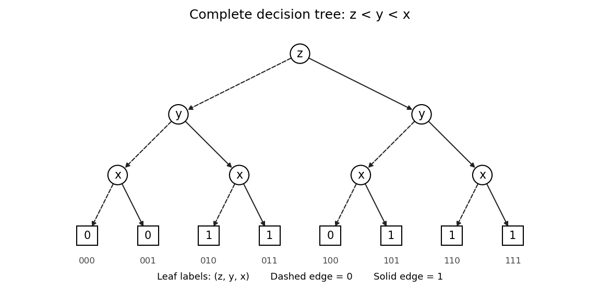
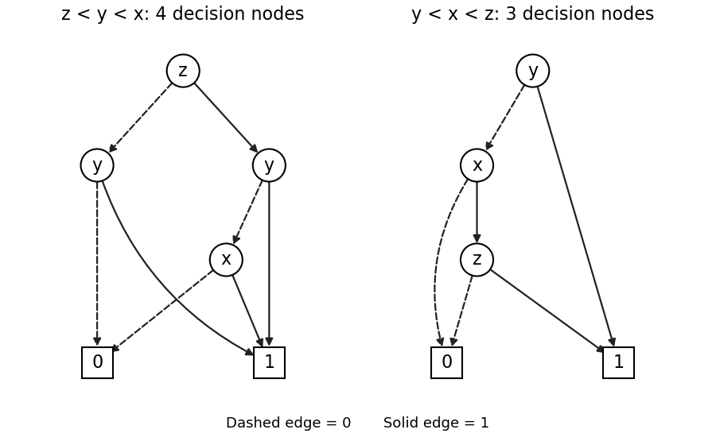
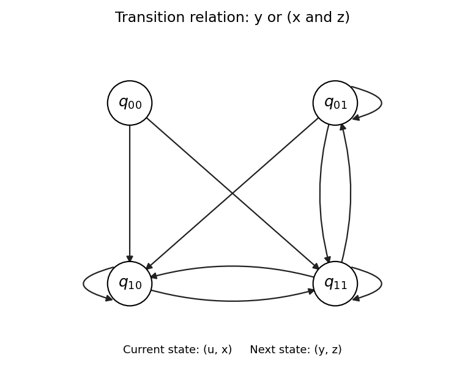

# Computer aided formal verification

↑ **Parent:** [2015](../2015.md)

Solutions to the paper whose cover dates the examination to 6 June 2015, 2:30–4:00 pm. Source: [released examination archive](https://www.whatdotheyknow.com/request/computer_science_past_exam_paper/response/956037/attach/3/Lawrence%20Attachment.zip?cookie_passthrough=1), member `2015-cafv.pdf`. All three questions are covered, although candidates were asked to attempt at most two. In the [binary decision diagrams](../../analysis-of-boolean-functions.md#binary-decision-diagram), dashed arrows mean zero and solid arrows mean one. In the [linear temporal logic](../../mathematical-logic.md#linear-temporal-logic) calculations, $F=\Diamond$, $G=\square$ and $X=\bigcirc$.

**Table of contents**

- [1](#1)
  - [a](#1/a)
    - [Solution](#1/a/solution)
  - [b](#1/b)
    - [Solution](#1/b/solution)
  - [c](#1/c)
    - [Solution](#1/c/solution)
  - [d](#1/d)
    - [Solution](#1/d/solution)
  - [e](#1/e)
    - [Solution](#1/e/solution)
  - [f](#1/f)
    - [Solution](#1/f/solution)
- [2](#2)
  - [a](#2/a)
    - [Solution](#2/a/solution)
  - [b](#2/b)
    - [Solution](#2/b/solution)
  - [c](#2/c)
    - [Solution](#2/c/solution)
- [3](#3)
  - [a](#3/a)
    - [Solution](#3/a/solution)
  - [b](#3/b)
    - [Solution](#3/b/solution)
  - [c](#3/c)
    - [Solution](#3/c/solution)
  - [d](#3/d)
    - [Solution](#3/d/solution)
  - [e](#3/e)
    - [Solution](#3/e/solution)
  - [f](#3/f)
    - [Solution](#3/f/solution)

## 1

↑ **Parent:** [Computer aided formal verification](computer-aided-formal-verification.md)

<h3 id="1/a">a</h3>

↑ **Parent:** [1](#1)

<h4 id="1/a/solution">Solution</h4>

↑ **Parent:** [A](#1/a)

Follow the [binary decision diagram](../../analysis-of-boolean-functions.md#binary-decision-diagram) from its top [decision node](../../analysis-of-boolean-functions.md#decision-node) to a [terminal node](../../analysis-of-boolean-functions.md#terminal-node), choosing the outgoing arrow specified by each tested [Boolean variable](../../theoretical-computer-science.md#boolean-variable). If $x=0$, the left $y$ [decision node](../../analysis-of-boolean-functions.md#decision-node) returns $y$, independently of $z$. If $x=1$, the right $y$ [decision node](../../analysis-of-boolean-functions.md#decision-node) returns one when $y=1$ and otherwise returns $z$. Thus the [truth table](../../mathematical-logic.md#truth-table), with rows in the order $(x,y,z)$, is:

| $x$ | $y$ | $z$ | $f(x,y,z)$ |
| --- | --- | --- | --- |
| 0 | 0 | 0 | 0 |
| 0 | 0 | 1 | 0 |
| 0 | 1 | 0 | 1 |
| 0 | 1 | 1 | 1 |
| 1 | 0 | 0 | 0 |
| 1 | 0 | 1 | 1 |
| 1 | 1 | 0 | 1 |
| 1 | 1 | 1 | 1 |

Thus the output column of the [truth table](../../mathematical-logic.md#truth-table), in the displayed order, is $\boxed{(0,0,1,1,0,1,1,1)}$. In particular, the skipped $z$ test on the left does not constrain $z$: both values give the same result.

<h3 id="1/b">b</h3>

↑ **Parent:** [1](#1)

<h4 id="1/b/solution">Solution</h4>

↑ **Parent:** [B](#1/b)

Splitting the [Boolean function](../../analysis-of-boolean-functions.md#boolean-function) according to the first tested [Boolean variable](../../theoretical-computer-science.md#boolean-variable) gives

$$
f=(\neg x\land y)\lor\bigl(x\land((\neg y\land z)\lor y)\bigr).
$$

The identity $y\lor(\neg y\land z)=y\lor z$ follows by considering $y=0$ and $y=1$. Using it and distributing [Boolean conjunction](../../mathematical-logic.md#logical-conjunction) over [Boolean disjunction](../../mathematical-logic.md#logical-disjunction),

$$
f=(\neg x\land y)\lor(x\land y)\lor(x\land z)
 =\boxed{y\lor(x\land z)}.
$$

The first two terms combine to $y$ because $x\lor\neg x=1$. This also explains the [truth table](../../mathematical-logic.md#truth-table): $y=1$ always makes the output one, while with $y=0$ the output is one exactly when both $x$ and $z$ are one.

<h3 id="1/c">c</h3>

↑ **Parent:** [1](#1)

<h4 id="1/c/solution">Solution</h4>

↑ **Parent:** [C](#1/c)

For a complete [binary decision tree](../../theoretical-computer-science.md#binary-decision-tree) with [variable ordering of a binary decision diagram](../../analysis-of-boolean-functions.md#variable-ordering-of-a-binary-decision-diagram) $z<y<x$, first test $z$, then $y$, then $x$ on every branch. The four [Boolean cofactors](../../analysis-of-boolean-functions.md#boolean-cofactor) after the first two tests are

| $z$ | $y$ | $f$ |
| --- | --- | --- |
| 0 | 0 | 0 |
| 0 | 1 | 1 |
| 1 | 0 | $x$ |
| 1 | 1 | 1 |

The eight [terminal nodes](../../analysis-of-boolean-functions.md#terminal-node), read from left to right in the figure, are $\boxed{0,0,1,1,0,1,1,1}$. The repeated tests are intentional: this is the full [binary decision tree](../../theoretical-computer-science.md#binary-decision-tree) before any reduction.

<a id="1/c/image-complete-decision-tree-for-the-ordering-z-y-x-dashed-edges-test-zero-and-solid-edges-test-one"></a>


**[Figure 1](#1/c/image-complete-decision-tree-for-the-ordering-z-y-x-dashed-edges-test-zero-and-solid-edges-test-one). Complete decision tree for the ordering z, y, x; dashed edges test zero and solid edges test one**.

For example, the branch $z=1,y=0,x=1$ ends at one, whereas $z=0,y=0,x=1$ ends at zero. This checks the dependence on $z$ that must survive the later reduction.

<h3 id="1/d">d</h3>

↑ **Parent:** [1](#1)

<h4 id="1/d/solution">Solution</h4>

↑ **Parent:** [D](#1/d)

A [reduced ordered binary decision diagram](../../analysis-of-boolean-functions.md#reduced-ordered-binary-decision-diagram) is obtained by sharing equal [terminal nodes](../../analysis-of-boolean-functions.md#terminal-node), removing a [decision node](../../analysis-of-boolean-functions.md#decision-node) whose two children are equal, and sharing [decision nodes](../../analysis-of-boolean-functions.md#decision-node) with the same tested [Boolean variable](../../theoretical-computer-science.md#boolean-variable) and the same ordered pair of children. Apply these rules to the [binary decision tree](../../theoretical-computer-science.md#binary-decision-tree) in part (c) as follows.

- Merge the three zero [terminal nodes](../../analysis-of-boolean-functions.md#terminal-node) into one zero [terminal node](../../analysis-of-boolean-functions.md#terminal-node), and merge the five one [terminal nodes](../../analysis-of-boolean-functions.md#terminal-node) into one one [terminal node](../../analysis-of-boolean-functions.md#terminal-node).
- At $(z,y)=(0,0)$ the $x$ [decision node](../../analysis-of-boolean-functions.md#decision-node) has children $(0,0)$. Remove it and redirect its incoming arrow to zero.
- At $(z,y)=(0,1)$ and $(z,y)=(1,1)$ the two $x$ [decision nodes](../../analysis-of-boolean-functions.md#decision-node) each have children $(1,1)$. Remove both and redirect their incoming arrows to one.
- The remaining $x$ [decision node](../../analysis-of-boolean-functions.md#decision-node), at $(z,y)=(1,0)$, has children $(0,1)$, so retain it.
- The $y$ [decision node](../../analysis-of-boolean-functions.md#decision-node) under $z=0$ now has children $(0,1)$, while the one under $z=1$ has children $(x,1)$. These are different, so neither can be merged or removed. The top $z$ [decision node](../../analysis-of-boolean-functions.md#decision-node) also has different children.

The left panel below is therefore the resulting [reduced ordered binary decision diagram](../../analysis-of-boolean-functions.md#reduced-ordered-binary-decision-diagram). Its full description is

| [Decision node](../../analysis-of-boolean-functions.md#decision-node) | Test | Zero child | One child |
| --- | --- | --- | --- |
| $r$ | $z$ | $u$ | $v$ |
| $u$ | $y$ | 0 | 1 |
| $v$ | $y$ | $w$ | 1 |
| $w$ | $x$ | 0 | 1 |

There are $\boxed{4+2=6}$ [vertices](../../graph.md#vertex-graph-theory): four [decision nodes](../../analysis-of-boolean-functions.md#decision-node) and two [terminal nodes](../../analysis-of-boolean-functions.md#terminal-node).

<a id="1/d/image-reduced-ordered-decision-diagrams-reversing-the-given-order-preserves-its-size-while-testing-y-first-saves-one-decision-node"></a>


**[Figure 2](#1/d/image-reduced-ordered-decision-diagrams-reversing-the-given-order-preserves-its-size-while-testing-y-first-saves-one-decision-node). Reduced ordered decision diagrams: reversing the given order preserves its size, while testing y first saves one decision node**.

The original [binary decision diagram](../../analysis-of-boolean-functions.md#binary-decision-diagram) also has four [decision nodes](../../analysis-of-boolean-functions.md#decision-node) and two [terminal nodes](../../analysis-of-boolean-functions.md#terminal-node), and is already reduced for $x<y<z$: the two $y$ [decision nodes](../../analysis-of-boolean-functions.md#decision-node) have different children and no [decision node](../../analysis-of-boolean-functions.md#decision-node) has two equal children. Thus **reversing the order has not made this example smaller**. Indeed $y\lor(x\land z)$ is unchanged by interchanging $x$ and $z$, and the new [binary decision diagram](../../analysis-of-boolean-functions.md#binary-decision-diagram) is the original one with those two labels exchanged. The uniqueness of a [reduced ordered binary decision diagram](../../analysis-of-boolean-functions.md#reduced-ordered-binary-decision-diagram) applies to a fixed [variable ordering of a binary decision diagram](../../analysis-of-boolean-functions.md#variable-ordering-of-a-binary-decision-diagram); it does not assert that every ordering has the same size.

<h3 id="1/e">e</h3>

↑ **Parent:** [1](#1)

<h4 id="1/e/solution">Solution</h4>

↑ **Parent:** [E](#1/e)

Choose the [variable ordering of a binary decision diagram](../../analysis-of-boolean-functions.md#variable-ordering-of-a-binary-decision-diagram) $y<x<z$. The [Boolean cofactor](../../analysis-of-boolean-functions.md#boolean-cofactor) with $y=1$ is the constant one, while the [Boolean cofactor](../../analysis-of-boolean-functions.md#boolean-cofactor) with $y=0$ is $x\land z$. Consequently the right panel in part (d) has the following arrows:

$$
\boxed{y:\ (0\to x,\ 1\to1),\qquad
x:\ (0\to0,\ 1\to z),\qquad
z:\ (0\to0,\ 1\to1).}
$$

Here an entry such as $0\to x$ denotes the zero arrow to the $x$ [decision node](../../analysis-of-boolean-functions.md#decision-node). There are $\boxed{3+2=5}$ [vertices](../../graph.md#vertex-graph-theory): three [decision nodes](../../analysis-of-boolean-functions.md#decision-node) and two [terminal nodes](../../analysis-of-boolean-functions.md#terminal-node), saving one [decision node](../../analysis-of-boolean-functions.md#decision-node) relative to either of the previous orderings. Testing $y$ first is effective because its one branch settles the entire [Boolean function](../../analysis-of-boolean-functions.md#boolean-function) immediately. The ordering $y<z<x$ works equally well.

This is also minimal among ordinary [binary decision diagrams](../../analysis-of-boolean-functions.md#binary-decision-diagram) for this [Boolean function](../../analysis-of-boolean-functions.md#boolean-function). Each [Boolean variable](../../theoretical-computer-science.md#boolean-variable) is essential: setting $y=0,z=1$ leaves $f=x$; setting $y=0,x=1$ leaves $f=z$; and setting $x=z=0$ leaves $f=y$. If a [Boolean variable](../../theoretical-computer-science.md#boolean-variable) were never tested, the represented [Boolean function](../../analysis-of-boolean-functions.md#boolean-function) could not depend on it. Thus at least three [decision nodes](../../analysis-of-boolean-functions.md#decision-node) are necessary, and the construction attains that bound.

<h3 id="1/f">f</h3>

↑ **Parent:** [1](#1)

<h4 id="1/f/solution">Solution</h4>

↑ **Parent:** [F](#1/f)

A [transition relation](../../algorithm.md#transition-relation) requires an explicit interpretation of the [Boolean variables](../../theoretical-computer-science.md#boolean-variable) as current and next [state](../../theoretical-computer-science.md#state-computer-science) bits. Take the four [states](../../theoretical-computer-science.md#state-computer-science) $q_{00},q_{01},q_{10},q_{11}$. Encode the current [state](../../theoretical-computer-science.md#state-computer-science) by $(u,x)$ and the next [state](../../theoretical-computer-science.md#state-computer-science) by $(y,z)$, and define

$$
\boxed{q_{ux}\to q_{yz}\quad\Longleftrightarrow\quad R(u,x,y,z)=y\lor(x\land z)=1.}
$$

The extra current bit $u$ is deliberately unused by the [Boolean formula](../../theoretical-computer-science.md#boolean-formula). A four-[state](../../theoretical-computer-science.md#state-computer-science) [transition system](../../algorithm.md#transition-system) normally needs four bits to describe a pair of [states](../../theoretical-computer-science.md#state-computer-science); a [Boolean formula](../../theoretical-computer-science.md#boolean-formula) using only three of them simply describes a [transition relation](../../algorithm.md#transition-relation) independent of the fourth bit.

When $x=0$, the condition is $y=1$, so the permitted next [states](../../theoretical-computer-science.md#state-computer-science) are $q_{10}$ and $q_{11}$. When $x=1$, the condition is $y\lor z$, so the permitted next [states](../../theoretical-computer-science.md#state-computer-science) are $q_{01},q_{10},q_{11}$. The resulting [adjacency matrix](../../graph-theory.md#adjacency-matrix), with rows and columns both ordered $q_{00},q_{01},q_{10},q_{11}$, is

$$
A_R=\begin{pmatrix}
0&0&1&1\\
0&1&1&1\\
0&0&1&1\\
0&1&1&1
\end{pmatrix}.
$$

The [directed graph](../../graph-theory.md#directed-graph) below plots all ten [directed edges](../../graph-theory.md#directed-edge), including the three [self-loops](../../graph.md#loop-graph-theory). No arrow enters $q_{00}$, but it is a valid [state](../../theoretical-computer-science.md#state-computer-science) with two outgoing arrows. Every [state](../../theoretical-computer-science.md#state-computer-science) has a successor. As permitted, no initial [states](../../theoretical-computer-science.md#state-computer-science) are distinguished.

<a id="1/f/image-four-state-transition-system-with-current-bits-u-x-next-bits-y-z-and-relation-y-or-x-and-z"></a>


**[Figure 3](#1/f/image-four-state-transition-system-with-current-bits-u-x-next-bits-y-z-and-relation-y-or-x-and-z). Four-state transition system with current bits (u, x), next bits (y, z), and relation y or (x and z)**

## 2

↑ **Parent:** [Computer aided formal verification](computer-aided-formal-verification.md)

<h3 id="2/a">a</h3>

↑ **Parent:** [2](#2)

<h4 id="2/a/solution">Solution</h4>

↑ **Parent:** [A](#2/a)

Use the two incoming initial arrows in the source figure: $I=\{s_0,s_3\}$. An [atomic proposition](../../mathematical-logic.md#atomic-proposition) is true precisely at the [states](../../theoretical-computer-science.md#state-computer-science) whose displayed labels contain it. In particular, $c$ is false at every [state](../../theoretical-computer-science.md#state-computer-science). Hence $GF\neg c$ is true on every infinite [path in a transition system](../../algorithm.md#path-in-a-transition-system), and the first implication in the [fairness assumption](../../algorithm.md#fairness-assumption) imposes no restriction.

Write $p=a\land b$. The remaining implication is $FGp\to GF\neg b$. By the [linear temporal logic](../../mathematical-logic.md#linear-temporal-logic) duality $\neg FGp=GF\neg p$, it is equivalent to

$$
GF\neg p\lor GF\neg b=GF\neg p,
$$

since $\neg b$ implies $\neg p$. Thus **a path is fair exactly when it visits states not labelled with both $a$ and $b$ infinitely often**. This condition also follows directly: if $p$ eventually holds forever, then $b$ eventually holds forever and the required $GF\neg b$ is impossible; if $p$ does not eventually hold forever, the implication has a false antecedent.

Every initial [path in a transition system](../../algorithm.md#path-in-a-transition-system) in the upper component either alternates forever between $s_0$ and $s_1$, or makes finitely many alternations and then stays at $s_2$. These are all fair: the first visits $s_1$ infinitely often, and the second visits $s_2$ infinitely often; neither [state](../../theoretical-computer-science.md#state-computer-science) satisfies $a\land b$.

In the lower component, a [path in a transition system](../../algorithm.md#path-in-a-transition-system) can stay at $s_3$ forever, or leave it after finitely many visits and pass through $s_4$ to $s_5$. The constant [path in a transition system](../../algorithm.md#path-in-a-transition-system) $s_3^\omega$ is unfair because $a\land b$ holds forever while $\neg b$ never holds. Every departing [path in a transition system](../../algorithm.md#path-in-a-transition-system) is fair because $s_5$ satisfies neither $a$ nor $b$. Here $v^\omega$ means infinite repetition of the finite word $v$. Therefore

$$
\boxed{\begin{aligned}
\operatorname{FairPaths}(TS)={}&\{(s_0s_1)^\omega\}\\
&\cup\{(s_0s_1)^n s_2^\omega:n\geq1\}\\
&\cup\{s_3^m s_4s_5^\omega:m\geq1\}.
\end{aligned}}
$$

This notation lists initial [paths in a transition system](../../algorithm.md#path-in-a-transition-system). If one instead allows arbitrary starting [states](../../theoretical-computer-science.md#state-computer-science), their suffixes starting at $s_1,s_2,s_4,s_5$ are fair as well; the fair [paths in a transition system](../../algorithm.md#path-in-a-transition-system) from each initial [state](../../theoretical-computer-science.md#state-computer-science), and hence all verdicts below, are unchanged.

<h3 id="2/b">b</h3>

↑ **Parent:** [2](#2)

<h4 id="2/b/solution">Solution</h4>

↑ **Parent:** [B](#2/b)

Denote the three families found in part (a) by $A=(s_0s_1)^\omega$, $B_n=(s_0s_1)^n s_2^\omega$ and $C_m=s_3^m s_4s_5^\omega$, where $n,m\geq1$. All are fair [paths in a transition system](../../algorithm.md#path-in-a-transition-system). The verdicts are

$$
\boxed{(TS\models_{\mathrm{fair}}\varphi_i)_{i=1}^6
=(\text{false},\text{false},\text{false},\text{false},\text{true},\text{false}).}
$$

Each verdict follows from the infinite [path in a transition system](../../algorithm.md#path-in-a-transition-system) semantics, rather than from a finite prefix alone.

For $\varphi_1=FGa$, take $C_1=s_3s_4s_5^\omega$. From $s_4$ onwards, $a$ is always false, so there is no time after which $a$ is always true. Therefore **the first specification fails**, with fair [counterexample](../../foundations-of-mathematics.md#counterexample) $C_1$. The [path in a transition system](../../algorithm.md#path-in-a-transition-system) $A$ is another fair [counterexample](../../foundations-of-mathematics.md#counterexample), because it encounters $s_1$, where $a$ is false, infinitely often. Each $B_n$ does satisfy $FGa$, since $s_2$ satisfies $a$ forever.

For $\varphi_2=(X\neg a)\to FGa$, take $A$. Its next [state](../../theoretical-computer-science.md#state-computer-science) is $s_1$, so $X\neg a$ is true, but $FGa$ is false as just shown. Thus **the second specification fails**, with fair [counterexample](../../foundations-of-mathematics.md#counterexample) $A$. Alternatively, $C_1$ has next [state](../../theoretical-computer-science.md#state-computer-science) $s_4$, making its antecedent true and its consequent false. For $C_m$ with $m\geq2$, the next [state](../../theoretical-computer-science.md#state-computer-science) is still $s_3$, so this implication is true there because its antecedent is false; this does not rescue a universally quantified specification.

For $\varphi_3=Ga$, the fair [path in a transition system](../../algorithm.md#path-in-a-transition-system) $C_1$ reaches $s_4$, where $a$ is false. Thus **the third specification fails**, with fair [counterexample](../../foundations-of-mathematics.md#counterexample) $C_1$. In fact every fair initial [path in a transition system](../../algorithm.md#path-in-a-transition-system) reaches $s_1$ or $s_4$, so none satisfies $Ga$.

For $\varphi_4=b\mathbin{\mathrm U}G\neg b$, [strong until](../../mathematical-logic.md#strong-until) requires an eventual position satisfying $G\neg b$, together with $b$ at every earlier position. On $A$, $b$ is true forever, so $G\neg b$ never holds. Thus **the fourth specification fails**, with fair [counterexample](../../foundations-of-mathematics.md#counterexample) $A$. On each $B_n$, $b$ holds until entry into $s_2$, after which $\neg b$ holds forever. On each $C_m$, $b$ holds until entry into $s_5$, after which $\neg b$ holds forever. These latter [paths in a transition system](../../algorithm.md#path-in-a-transition-system) satisfy the [strong until](../../mathematical-logic.md#strong-until) requirement.

For $\varphi_5=b\mathbin{\mathrm W}G\neg b$, [weak until](../../mathematical-logic.md#weak-until) permits either the preceding [strong until](../../mathematical-logic.md#strong-until) behavior or $Gb$. Every $B_n$ and $C_m$ satisfies the [strong until](../../mathematical-logic.md#strong-until) behavior, and $A$ satisfies $Gb$. These exhaust the fair initial [paths in a transition system](../../algorithm.md#path-in-a-transition-system). Therefore **the fifth specification holds on every fair initial path**. Allowing the left operand to continue forever is exactly what distinguishes this answer from the previous one.

For $\varphi_6=(XXb)\mathbin{\mathrm U}G\neg b$, the two [next-time operators](../../mathematical-logic.md#next-time-operator) belong to the left operand of [strong until](../../mathematical-logic.md#strong-until). The fair [path in a transition system](../../algorithm.md#path-in-a-transition-system) $C_1$ has $b$ true at positions zero and one, then false at every position from two onwards. Therefore $G\neg b$ first holds at position two. But $XXb$ is false already at position zero, since $b$ is false at position two. A witness for [strong until](../../mathematical-logic.md#strong-until) cannot occur at zero or one, where its right operand is false, or at two or later, where its left operand has already failed. Thus **the sixth specification fails**, with fair [counterexample](../../foundations-of-mathematics.md#counterexample) $C_1$.

Indeed, every fair initial [path in a transition system](../../algorithm.md#path-in-a-transition-system) fails the sixth specification. On $A$, the right operand never holds. On $B_n$ and $C_m$, let $j\geq2$ be the first position of the permanent $\neg b$ tail. The left operand $XXb$ is false at $j-2$, strictly before any possible right-operand witness. This also checks that the two [next-time operators](../../mathematical-logic.md#next-time-operator) cannot be ignored or shifted onto the whole [strong until](../../mathematical-logic.md#strong-until) formula.

<h3 id="2/c">c</h3>

↑ **Parent:** [2](#2)

<h4 id="2/c/solution">Solution</h4>

↑ **Parent:** [C](#2/c)

To apply [bounded model checking](../../algorithm.md#bounded-model-checking), seek an initial [path in a transition system](../../algorithm.md#path-in-a-transition-system) satisfying

$$
\mathrm{fair}\land\neg\varphi_1
\equiv GF\neg(a\land b)\land GF\neg a.
$$

A [satisfying assignment](../../theoretical-computer-science.md#satisfying-assignment) for its bounded encoding is enough to disprove the specification. Use a [lasso path](../../algorithm.md#lasso-path): positions $q_0,\ldots,q_k$ follow the [transition relation](../../algorithm.md#transition-relation), and a final arrow returns from $q_k$ to some $q_\ell$, $0\leq\ell\leq k$. The repeated part is $q_\ell\cdots q_k$. On such a [lasso path](../../algorithm.md#lasso-path), $GF r$ is equivalent to having $r$ true at some position of the repeated part.

For this example an explicit [Boolean formula](../../theoretical-computer-science.md#boolean-formula) for the bounded search is

$$
\begin{aligned}
E_k={}&I(q_0)\land\bigwedge_{i=0}^{k-1}T(q_i,q_{i+1})\\
&\land\bigvee_{\ell=0}^{k}\left(
T(q_k,q_\ell)
\land\bigvee_{i=\ell}^{k}\neg(a(q_i)\land b(q_i))
\land\bigvee_{i=\ell}^{k}\neg a(q_i)
\right).
\end{aligned}
$$

Here $I(q)$ means $q\in\{s_0,s_3\}$ and $T(q,r)$ means that the source diagram has the arrow $q\to r$; each can be encoded by finite [Boolean variables](../../theoretical-computer-science.md#boolean-variable) for the [states](../../theoretical-computer-science.md#state-computer-science). The loop requirements are the [fairness assumption](../../algorithm.md#fairness-assumption) and the negated specification respectively. Unrolling the [transition relation](../../algorithm.md#transition-relation) and adding a loop closure is the usual [bounded model checking](../../algorithm.md#bounded-model-checking) construction.[§2, worked example with an unrolled transition relation and a returning loop; §3, infinite-path semantics](../../computer-science-bibliography.md#symbolic-model-checking-without-bdds-by-armin-biere-and-others)

At bound $k=0$, an initial [self-loop](../../graph.md#loop-graph-theory) would be needed. The only such choice is $q_0=s_3$, whose repeated label satisfies $a\land b$ and $a$. It violates both loop requirements. The other initial [state](../../theoretical-computer-science.md#state-computer-science), $s_0$, has no [self-loop](../../graph.md#loop-graph-theory). Thus $E_0$ has no [satisfying assignment](../../theoretical-computer-science.md#satisfying-assignment).

At bound $k=1$, choose

$$
\boxed{q_0=s_0,\qquad q_1=s_1,\qquad\ell=0.}
$$

Both required arrows $s_0\to s_1$ and $s_1\to s_0$ exist. At $q_1$, $a$ is false and hence $a\land b$ is false, so both repeated-part requirements are true. Equivalently, the label values are $a(q_0)=b(q_0)=b(q_1)=1$ and $a(q_1)=c(q_0)=c(q_1)=0$. These values give a [satisfying assignment](../../theoretical-computer-science.md#satisfying-assignment) of $E_1$, representing the fair [counterexample](../../foundations-of-mathematics.md#counterexample) $(s_0s_1)^\omega$. Consequently

$$
\boxed{TS\not\models_{\mathrm{fair}}FGa.}
$$

Here the bound counts forward arrows before the returning arrow, so $k=1$ stores two positions and describes a two-[state](../../theoretical-computer-science.md#state-computer-science) repeated part. There is no need for a completeness bound: the exhibited fair [counterexample](../../foundations-of-mathematics.md#counterexample) settles the negative answer. These [satisfying assignments](../../theoretical-computer-science.md#satisfying-assignment) are checked directly; no claim of executing an external [SAT solver](../../theoretical-computer-science.md#sat-solver) is needed.

## 3

↑ **Parent:** [Computer aided formal verification](computer-aided-formal-verification.md)

<h3 id="3/a">a</h3>

↑ **Parent:** [3](#3)

<h4 id="3/a/solution">Solution</h4>

↑ **Parent:** [A](#3/a)

Write $A=\operatorname{Sat}(\Phi)\subseteq S$. All arguments depend only on this given [satisfaction set](../../algorithm.md#satisfaction-set); they do not require an additional convention for the printed notation $\Phi\in2^{AP}$. For a [state](../../theoretical-computer-science.md#state-computer-science) $s$, let $\operatorname{Post}(s)=\{t:s\to t\}$. The [power set](../../set.md#power-set) $2^S$ is ordered by [set inclusion](../../set.md#set-inclusion).

Take $X\subseteq Y\subseteq S$ and any $s\in H(X)$. By the definition of $H$, we have both $s\in A$ and $\operatorname{Post}(s)\subseteq X$. By transitivity of [set inclusion](../../set.md#set-inclusion), $\operatorname{Post}(s)\subseteq Y$, so $s\in H(Y)$. Since this applies to every member of $H(X)$,

$$
\boxed{X\subseteq Y\ \Longrightarrow\ H(X)\subseteq H(Y).}
$$

Thus $H$ is an [order-preserving function](../../set.md#order-preserving-function), which is the meaning of monotonicity here. This proof does not need either finiteness or the absence of [terminal states](../../algorithm.md#terminal-state).

<h3 id="3/b">b</h3>

↑ **Parent:** [3](#3)

<h4 id="3/b/solution">Solution</h4>

↑ **Parent:** [B](#3/b)

Let $G_\Phi=\operatorname{Sat}(\forall\square\Phi)$. By [computation tree logic](../../mathematical-logic.md#computation-tree-logic) semantics, a [state](../../theoretical-computer-science.md#state-computer-science) belongs to $G_\Phi$ exactly when every infinite [path in a transition system](../../algorithm.md#path-in-a-transition-system) starting there stays in $A=\operatorname{Sat}(\Phi)$ at every position, including position zero. There are no [terminal states](../../algorithm.md#terminal-state), so every [state](../../theoretical-computer-science.md#state-computer-science) lies at the start of an infinite [path in a transition system](../../algorithm.md#path-in-a-transition-system).

If $s\in G_\Phi$, then $s\in A$. For any successor $t$ of $s$, every infinite [path in a transition system](../../algorithm.md#path-in-a-transition-system) from $t$ can be prefixed with $s$. Hence every such continuation stays in $A$, so $t\in G_\Phi$. Thus $\operatorname{Post}(s)\subseteq G_\Phi$ and $s\in H(G_\Phi)$.

Conversely, if $s\in H(G_\Phi)$, then $s\in A$ and every successor belongs to $G_\Phi$. Every infinite [path in a transition system](../../algorithm.md#path-in-a-transition-system) from $s$ therefore has its first [state](../../theoretical-computer-science.md#state-computer-science) in $A$ and its entire remaining tail in $A$. Consequently $s\in G_\Phi$. Both inclusions give

$$
\boxed{H(G_\Phi)=G_\Phi,}
$$

so the desired [satisfaction set](../../algorithm.md#satisfaction-set) is a [fixed point](../../function.md#fixed-point) of $H$.

<h3 id="3/c">c</h3>

↑ **Parent:** [3](#3)

<h4 id="3/c/solution">Solution</h4>

↑ **Parent:** [C](#3/c)

Every [state](../../theoretical-computer-science.md#state-computer-science) has at least one successor, so $\operatorname{Post}(s)\nsubseteq\varnothing$ for every $s\in S$. Therefore

$$
\boxed{H(\varnothing)=A\cap\varnothing=\varnothing.}
$$

The [empty set](../../set.md#empty-set) is always a [fixed point](../../function.md#fixed-point). Whenever $G_\Phi$ is nonempty, it is therefore an additional, distinct [fixed point](../../function.md#fixed-point).

For an explicit example, take a one-[state](../../theoretical-computer-science.md#state-computer-science) [transition system](../../algorithm.md#transition-system) with $S=\{s\}$, the [self-loop](../../graph.md#loop-graph-theory) $s\to s$, and $A=S$. Then $G_\Phi=S$ and $H$ has the two distinct [fixed points](../../function.md#fixed-point) $\varnothing$ and $\{s\}$. This example meets the requirement of no [terminal states](../../algorithm.md#terminal-state).

The wording does not guarantee distinct additional [fixed points](../../function.md#fixed-point) for every instance. For example, if $A=\varnothing$, then $H(X)=\varnothing$ for every $X$ and its only [fixed point](../../function.md#fixed-point) is $G_\Phi=\varnothing$. Thus **additional fixed points can occur, but need not occur**. The universal example $\varnothing$ is distinct precisely when the desired [satisfaction set](../../algorithm.md#satisfaction-set) is nonempty, as also follows from the [greatest fixed point](../../function.md#greatest-fixed-point) argument below.

<h3 id="3/d">d</h3>

↑ **Parent:** [3](#3)

<h4 id="3/d/solution">Solution</h4>

↑ **Parent:** [D](#3/d)

Let $X$ be any [fixed point](../../function.md#fixed-point) of $H$. Then

$$
X=H(X)=A\cap\{s:\operatorname{Post}(s)\subseteq X\},
$$

so $X\subseteq A$ and every successor of every member of $X$ belongs to $X$. Take $s_0\in X$ and an arbitrary infinite [path in a transition system](../../algorithm.md#path-in-a-transition-system) $s_0s_1s_2\cdots$ from $s_0$. By [mathematical induction](../../foundations-of-mathematics.md#mathematical-induction), every $s_i$ belongs to $X$: the base case is the choice of $s_0$, and $s_i\in X$ implies $s_{i+1}\in\operatorname{Post}(s_i)\subseteq X$.

Since $X\subseteq A$, the whole [path in a transition system](../../algorithm.md#path-in-a-transition-system) stays in $A$. The [path in a transition system](../../algorithm.md#path-in-a-transition-system) was arbitrary, so $s_0\models\forall\square\Phi$. Thus $s_0\in G_\Phi$, and since $s_0$ was arbitrary in $X$,

$$
X\subseteq G_\Phi.
$$

Part (b) proves that $G_\Phi$ itself is a [fixed point](../../function.md#fixed-point). Therefore

$$
\boxed{\operatorname{Sat}(\forall\square\Phi)=\nu X.\,H(X),}
$$

the [greatest fixed point](../../function.md#greatest-fixed-point) with respect to [set inclusion](../../set.md#set-inclusion). In fact the same induction works for every $X\subseteq H(X)$, showing why a successor-closed [set](../../set.md) of good [states](../../theoretical-computer-science.md#state-computer-science) certifies this universal property.

<h3 id="3/e">e</h3>

↑ **Parent:** [3](#3)

<h4 id="3/e/solution">Solution</h4>

↑ **Parent:** [E](#3/e)

Start with every [state](../../theoretical-computer-science.md#state-computer-science), and repeatedly discard a [state](../../theoretical-computer-science.md#state-computer-science) that is outside $A=\operatorname{Sat}(\Phi)$ or has any successor outside the current candidate [set](../../set.md). Use a fresh [set](../../set.md) on each iteration so that the displayed procedure computes exactly $H(X)$:
```
function Sat_AG(S, Post, A):
    X = copy(S)
    repeat:
        Y = empty_set()
        for s in S:
            if s in A and every t in Post(s) belongs to X:
                insert s into Y
        if Y == X:
            return X
        X = Y
```
This is [fixed-point iteration](../../numerical-analysis.md#fixed-point-iteration) $X_0=S$, $X_{i+1}=H(X_i)$. The first step gives $X_1=A$, because every successor is a [state](../../theoretical-computer-science.md#state-computer-science) of $S$. Thus $X_1\subseteq X_0$. If $X_i\subseteq X_{i-1}$, the [order-preserving function](../../set.md#order-preserving-function) property gives

$$
X_{i+1}=H(X_i)\subseteq H(X_{i-1})=X_i.
$$

The candidate [sets](../../set.md) therefore form a descending chain under [set inclusion](../../set.md#set-inclusion).

Every [fixed point](../../function.md#fixed-point) $Z$ is contained in every $X_i$: initially $Z\subseteq S$, and $Z\subseteq X_i$ implies $Z=H(Z)\subseteq H(X_i)=X_{i+1}$. At return, $X=H(X)$, and $X$ contains every [fixed point](../../function.md#fixed-point). The returned [set](../../set.md) is consequently the [greatest fixed point](../../function.md#greatest-fixed-point), so $\boxed{X=\operatorname{Sat}(\forall\square\Phi)}$ by part (d).

The iteration also has a direct interpretation. $X_1$ contains precisely the [states](../../theoretical-computer-science.md#state-computer-science) satisfying $\Phi$ now; $X_2$ retains those satisfying it now and at all immediate successors; later rounds extend the checked horizon one step at a time. The stable [set](../../set.md) enforces the condition at every future position.

<h3 id="3/f">f</h3>

↑ **Parent:** [3](#3)

<h4 id="3/f/solution">Solution</h4>

↑ **Parent:** [F](#3/f)

**Yes: the procedure always terminates after finitely many steps.** If an iteration does not return, then $X_{i+1}\subsetneq X_i$. Thus at least one [state](../../theoretical-computer-science.md#state-computer-science) is permanently removed. A finite [set](../../set.md) of $|S|$ [states](../../theoretical-computer-science.md#state-computer-science) can suffer at most $|S|$ such strict decreases, after which the next equality test must return. Therefore the procedure makes at most

$$
\boxed{|S|+1\text{ evaluations of }H}
$$

when started from $X_0=S$, counting the final evaluation that detects equality. The bound also covers $S=\varnothing$, where the first evaluation already returns. Each evaluation inspects finitely many [states](../../theoretical-computer-science.md#state-computer-science) and successors, so every individual step terminates as well. Finiteness, rather than monotonicity alone, supplies this finite termination bound.

## ↑ Ancestors (8)

1. [2015](../2015.md)
2. [Past exam of the computer science course of the University of Oxford](../../past-exam-of-the-computer-science-course-of-the-university-of-oxford.md)
3. [Computer science course of the University of Oxford](../../university-of-oxford.md#computer-science-course-of-the-university-of-oxford)
4. [Undergraduate course of the University of Oxford](../../university-of-oxford.md#undergraduate-course-of-the-university-of-oxford)
5. [Course of the University of Oxford](../../university-of-oxford.md#course-of-the-university-of-oxford)
6. [University of Oxford](../../university-of-oxford.md)
7. [List of universities](../../README.md#list-of-universities)
8. [Codex Wiki](../../README.md)
