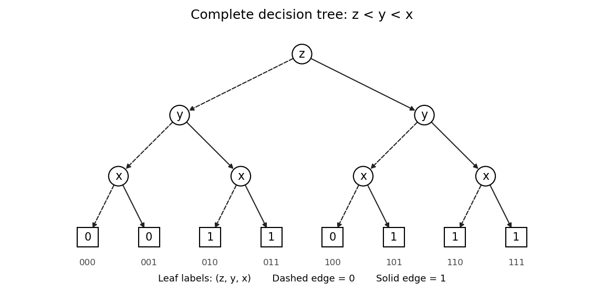

<h1 id="1/c/solution">Solution</h1>

↑ **Parent:** [C](../c.md)

For a complete [binary decision tree](../../../../../binary-decision-tree.md) with [variable ordering of a binary decision diagram](../../../../../variable-ordering-of-a-binary-decision-diagram.md) $z<y<x$, first test $z$, then $y$, then $x$ on every branch. The four [Boolean cofactors](../../../../../boolean-cofactor.md) after the first two tests are

| $z$ | $y$ | $f$ |
| --- | --- | --- |
| 0 | 0 | 0 |
| 0 | 1 | 1 |
| 1 | 0 | $x$ |
| 1 | 1 | 1 |

The eight [terminal nodes](../../../../../terminal-node.md), read from left to right in the figure, are $\boxed{0,0,1,1,0,1,1,1}$. The repeated tests are intentional: this is the full [binary decision tree](../../../../../binary-decision-tree.md) before any reduction.

**[Figure 1](#1/c/image-complete-decision-tree-for-the-ordering-z-y-x-dashed-edges-test-zero-and-solid-edges-test-one). Complete decision tree for the ordering z, y, x; dashed edges test zero and solid edges test one**.

For example, the branch $z=1,y=0,x=1$ ends at one, whereas $z=0,y=0,x=1$ ends at zero. This checks the dependence on $z$ that must survive the later reduction.

## ↑ Ancestors (11)

1. [C](../c.md)
2. [1](../../1.md)
3. [Computer aided formal verification](../../../computer-aided-formal-verification-split.md)
4. [2015](../../../split.md)
5. [Past exam of the computer science course of the University of Oxford](../../../../split.md)
6. [Computer science course of the University of Oxford](../../../../../computer-science-course-of-the-university-of-oxford.md)
7. [Undergraduate course of the University of Oxford](../../../../../undergraduate-course-of-the-university-of-oxford.md)
8. [Course of the University of Oxford](../../../../../course-of-the-university-of-oxford.md)
9. [University of Oxford](../../../../../university-of-oxford-split.md)
10. [List of universities](../../../../../list-of-universities.md)
11. [Codex Wiki](../../../../../split.md)
