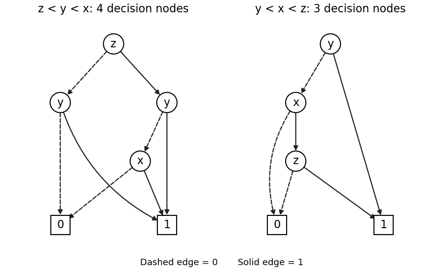

<h1 id="1/d/solution">Solution</h1>

↑ **Parent:** [D](../d.md)

A [reduced ordered binary decision diagram](../../../../../reduced-ordered-binary-decision-diagram.md) is obtained by sharing equal [terminal nodes](../../../../../terminal-node.md), removing a [decision node](../../../../../decision-node.md) whose two children are equal, and sharing [decision nodes](../../../../../decision-node.md) with the same tested [Boolean variable](../../../../../boolean-variable.md) and the same ordered pair of children. Apply these rules to the [binary decision tree](../../../../../binary-decision-tree.md) in part (c) as follows.

- Merge the three zero [terminal nodes](../../../../../terminal-node.md) into one zero [terminal node](../../../../../terminal-node.md), and merge the five one [terminal nodes](../../../../../terminal-node.md) into one one [terminal node](../../../../../terminal-node.md).
- At $(z,y)=(0,0)$ the $x$ [decision node](../../../../../decision-node.md) has children $(0,0)$. Remove it and redirect its incoming arrow to zero.
- At $(z,y)=(0,1)$ and $(z,y)=(1,1)$ the two $x$ [decision nodes](../../../../../decision-node.md) each have children $(1,1)$. Remove both and redirect their incoming arrows to one.
- The remaining $x$ [decision node](../../../../../decision-node.md), at $(z,y)=(1,0)$, has children $(0,1)$, so retain it.
- The $y$ [decision node](../../../../../decision-node.md) under $z=0$ now has children $(0,1)$, while the one under $z=1$ has children $(x,1)$. These are different, so neither can be merged or removed. The top $z$ [decision node](../../../../../decision-node.md) also has different children.

The left panel below is therefore the resulting [reduced ordered binary decision diagram](../../../../../reduced-ordered-binary-decision-diagram.md). Its full description is

| [Decision node](../../../../../decision-node.md) | Test | Zero child | One child |
| --- | --- | --- | --- |
| $r$ | $z$ | $u$ | $v$ |
| $u$ | $y$ | 0 | 1 |
| $v$ | $y$ | $w$ | 1 |
| $w$ | $x$ | 0 | 1 |

There are $\boxed{4+2=6}$ [vertices](../../../../../vertex-graph-theory.md): four [decision nodes](../../../../../decision-node.md) and two [terminal nodes](../../../../../terminal-node.md).

**[Figure 2](#1/d/image-reduced-ordered-decision-diagrams-reversing-the-given-order-preserves-its-size-while-testing-y-first-saves-one-decision-node). Reduced ordered decision diagrams: reversing the given order preserves its size, while testing y first saves one decision node**.

The original [binary decision diagram](../../../../../binary-decision-diagram.md) also has four [decision nodes](../../../../../decision-node.md) and two [terminal nodes](../../../../../terminal-node.md), and is already reduced for $x<y<z$: the two $y$ [decision nodes](../../../../../decision-node.md) have different children and no [decision node](../../../../../decision-node.md) has two equal children. Thus **reversing the order has not made this example smaller**. Indeed $y\lor(x\land z)$ is unchanged by interchanging $x$ and $z$, and the new [binary decision diagram](../../../../../binary-decision-diagram.md) is the original one with those two labels exchanged. The uniqueness of a [reduced ordered binary decision diagram](../../../../../reduced-ordered-binary-decision-diagram.md) applies to a fixed [variable ordering of a binary decision diagram](../../../../../variable-ordering-of-a-binary-decision-diagram.md); it does not assert that every ordering has the same size.

## ↑ Ancestors (11)

1. [D](../d.md)
2. [1](../../1.md)
3. [Computer aided formal verification](../../../computer-aided-formal-verification-split.md)
4. [2015](../../../split.md)
5. [Past exam of the computer science course of the University of Oxford](../../../../split.md)
6. [Computer science course of the University of Oxford](../../../../../computer-science-course-of-the-university-of-oxford.md)
7. [Undergraduate course of the University of Oxford](../../../../../undergraduate-course-of-the-university-of-oxford.md)
8. [Course of the University of Oxford](../../../../../course-of-the-university-of-oxford.md)
9. [University of Oxford](../../../../../university-of-oxford-split.md)
10. [List of universities](../../../../../list-of-universities.md)
11. [Codex Wiki](../../../../../split.md)
