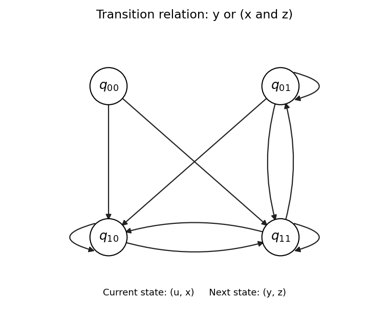

<h1 id="1/f/solution">Solution</h1>

↑ **Parent:** [F](../f.md)

A [transition relation](../../../../../transition-relation.md) requires an explicit interpretation of the [Boolean variables](../../../../../boolean-variable.md) as current and next [state](../../../../../state-computer-science.md) bits. Take the four [states](../../../../../state-computer-science.md) $q_{00},q_{01},q_{10},q_{11}$. Encode the current [state](../../../../../state-computer-science.md) by $(u,x)$ and the next [state](../../../../../state-computer-science.md) by $(y,z)$, and define

$$
\boxed{q_{ux}\to q_{yz}\quad\Longleftrightarrow\quad R(u,x,y,z)=y\lor(x\land z)=1.}
$$

The extra current bit $u$ is deliberately unused by the [Boolean formula](../../../../../boolean-formula.md). A four-[state](../../../../../state-computer-science.md) [transition system](../../../../../transition-system.md) normally needs four bits to describe a pair of [states](../../../../../state-computer-science.md); a [Boolean formula](../../../../../boolean-formula.md) using only three of them simply describes a [transition relation](../../../../../transition-relation.md) independent of the fourth bit.

When $x=0$, the condition is $y=1$, so the permitted next [states](../../../../../state-computer-science.md) are $q_{10}$ and $q_{11}$. When $x=1$, the condition is $y\lor z$, so the permitted next [states](../../../../../state-computer-science.md) are $q_{01},q_{10},q_{11}$. The resulting [adjacency matrix](../../../../../adjacency-matrix.md), with rows and columns both ordered $q_{00},q_{01},q_{10},q_{11}$, is

$$
A_R=\begin{pmatrix}
0&0&1&1\\
0&1&1&1\\
0&0&1&1\\
0&1&1&1
\end{pmatrix}.
$$

The [directed graph](../../../../../directed-graph.md) below plots all ten [directed edges](../../../../../directed-edge.md), including the three [self-loops](../../../../../loop-graph-theory.md). No arrow enters $q_{00}$, but it is a valid [state](../../../../../state-computer-science.md) with two outgoing arrows. Every [state](../../../../../state-computer-science.md) has a successor. As permitted, no initial [states](../../../../../state-computer-science.md) are distinguished.

**[Figure 3](#1/f/image-four-state-transition-system-with-current-bits-u-x-next-bits-y-z-and-relation-y-or-x-and-z). Four-state transition system with current bits (u, x), next bits (y, z), and relation y or (x and z)**

## ↑ Ancestors (11)

1. [F](../f.md)
2. [1](../../1.md)
3. [Computer aided formal verification](../../../computer-aided-formal-verification-split.md)
4. [2015](../../../split.md)
5. [Past exam of the computer science course of the University of Oxford](../../../../split.md)
6. [Computer science course of the University of Oxford](../../../../../computer-science-course-of-the-university-of-oxford.md)
7. [Undergraduate course of the University of Oxford](../../../../../undergraduate-course-of-the-university-of-oxford.md)
8. [Course of the University of Oxford](../../../../../course-of-the-university-of-oxford.md)
9. [University of Oxford](../../../../../university-of-oxford-split.md)
10. [List of universities](../../../../../list-of-universities.md)
11. [Codex Wiki](../../../../../split.md)
