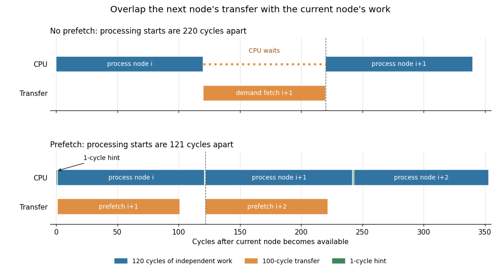

# Computer architecture

↑ **Parent:** [2015](../2015.md)

Solutions to all three questions of the examination dated 6 June 2015. The cover permits answers to two questions.[Cover, A10402W1; questions on printed pages 2–3 and 5–6](../../computer-science-bibliography.md#computer-architecture-examination-paper-by-the-university-of-oxford-2015)

**Table of contents**

- [1](#1)
  - [a](#1/a)
    - [Solution](#1/a/solution)
  - [b](#1/b)
    - [Solution](#1/b/solution)
  - [c](#1/c)
    - [Solution](#1/c/solution)
  - [d](#1/d)
    - [i](#1/d/i)
      - [Solution](#1/d/i/solution)
    - [ii](#1/d/ii)
      - [Solution](#1/d/ii/solution)
    - [iii](#1/d/iii)
      - [Solution](#1/d/iii/solution)
    - [iv](#1/d/iv)
      - [Solution](#1/d/iv/solution)
- [2](#2)
  - [a](#2/a)
    - [Solution](#2/a/solution)
  - [b](#2/b)
    - [Solution](#2/b/solution)
  - [c](#2/c)
    - [Solution](#2/c/solution)
  - [d](#2/d)
    - [Solution](#2/d/solution)
- [3](#3)
  - [a](#3/a)
    - [Solution](#3/a/solution)
  - [b](#3/b)
    - [Solution](#3/b/solution)
  - [c](#3/c)
    - [i](#3/c/i)
      - [Solution](#3/c/i/solution)
    - [ii](#3/c/ii)
      - [Solution](#3/c/ii/solution)
    - [iii](#3/c/iii)
      - [Solution](#3/c/iii/solution)

## 1

↑ **Parent:** [Computer architecture](computer-architecture.md)

<h3 id="1/a">a</h3>

↑ **Parent:** [1](#1)

<h4 id="1/a/solution">Solution</h4>

↑ **Parent:** [A](#1/a)

[Register forwarding](../../computer-science.md#register-forwarding) supplies a later instruction with a computed value before that value has reached the [register file](../../computer-science.md#register-file). It removes some [read-after-write hazards](../../computer-science.md#read-after-write-hazard) without changing the program's meaning. Consider these symbolic [machine instructions](../../computer-science.md#machine-instruction), with the destination first:
```
ADD r1, r2, r3
SUB r4, r1, r5
```
In the five-stage [in-order pipeline](../../computer-science.md#in-order-pipeline), the addition produces its result at the end of EX. In the next cycle the subtraction is in EX, although the addition has not yet reached WB. A bypass from the addition's EX/MEM [pipeline register](../../computer-science.md#pipeline-register) to the subtraction's [arithmetic logic unit](../../computer-science.md#arithmetic-logic-unit) input supplies the new `r1`; the old value read in ID must be overridden.

The bypass control compares source and destination [processor register](../../computer-science.md#processor-register) identifiers and selects the youngest applicable older producer. It must also check that the producer actually writes that [processor register](../../computer-science.md#processor-register). **Forward the newest available result instead of waiting for its writeback.** A [load instruction](../../computer-science.md#load-instruction) is different: its value is normally available only at the end of MEM, so an immediately following dependent instruction still needs a [pipeline stall](../../computer-science.md#pipeline-stall) in this five-stage arrangement.

$$
\boxed{\text{Forward the newest ready result directly to its dependent instruction.}}
$$

<h3 id="1/b">b</h3>

↑ **Parent:** [1](#1)

<h4 id="1/b/solution">Solution</h4>

↑ **Parent:** [B](#1/b)

A [store buffer](../../computer-memory.md#store-buffer) holds the [memory address](../../computer-memory.md#memory-address) and value of a [store instruction](../../computer-science.md#store-instruction) while the [memory cache](../../computer-memory.md#cache-computing) or backing [computer memory](../../computer-memory.md) completes the write. The [in-order pipeline](../../computer-science.md#in-order-pipeline) can continue after enqueueing the write, rather than waiting for a possibly long [memory access latency](../../computer-memory.md#memory-access-latency). A full [store buffer](../../computer-memory.md#store-buffer) eventually causes a [pipeline stall](../../computer-science.md#pipeline-stall); buffering hides finite delays, not an indefinitely inadequate service rate.

Without a [memory management unit](../../virtual-memory.md#memory-management-unit), the comparison can use the actual [physical addresses](../../computer-memory.md#physical-address); there is no [address translation](../../virtual-memory.md#address-translation) or synonym problem to solve. Suppose `x` initially contains zero and these operations execute in order:
```
STORE [x], 7
LOAD  r1, [x]
```
If the write is still in the [store buffer](../../computer-memory.md#store-buffer), reading only [computer memory](../../computer-memory.md) could incorrectly return zero. The [load instruction](../../computer-science.md#load-instruction) searches older buffered [store instructions](../../computer-science.md#store-instruction) for an overlapping [memory address](../../computer-memory.md#memory-address). If the newest matching write covers the requested [bytes](../../computer-memory.md#byte) and its data are ready, [store-to-load forwarding](../../computer-memory.md#store-to-load-forwarding) returns seven directly. With several pending writes to `x`, the youngest older matching write wins. If the relevant data are not ready, the [load instruction](../../computer-science.md#load-instruction) waits; partial overlaps require merging the covered [bytes](../../computer-memory.md#byte) or conservatively waiting for the writes to drain.

A [load instruction](../../computer-science.md#load-instruction) from an unrelated address `y` can bypass those buffered writes, subject to the architecture's [memory model](../../operating-system.md#memory-model). **Buffer writes to overlap them with useful execution, but preserve each load's dependence on older writes to the same bytes.** Device accesses through [memory-mapped input-output](../../computer-science.md#memory-mapped-input-output) need their specified ordering and should not be treated as ordinary cacheable [computer memory](../../computer-memory.md).

$$
\boxed{\text{Buffer stores, but forward or wait when a later load overlaps them.}}
$$

<h3 id="1/c">c</h3>

↑ **Parent:** [1](#1)

<h4 id="1/c/solution">Solution</h4>

↑ **Parent:** [C](#1/c)

[Speculative execution](../../computer-science.md#speculative-execution) allows younger instructions to proceed while some condition on an older instruction is unresolved. Here the prediction is that a [store instruction](../../computer-science.md#store-instruction) will pass its [memory management unit](../../virtual-memory.md#memory-management-unit)'s protection and translation checks. Successful prediction avoids waiting; failure requires discarding younger work and taking the older instruction's [synchronous processor exception](../../operating-system.md#synchronous-processor-exception). A result computed speculatively must not become an irreversible architectural change before it is safe.

In the displayed five-stage [in-order pipeline](../../computer-science.md#in-order-pipeline), the [store instruction](../../computer-science.md#store-instruction)'s [memory address](../../computer-memory.md#memory-address) is computed in EX and its memory operation is in MEM. Take the permission check to finish at the end of MEM, with a one-cycle [cache hit](../../computer-memory.md#cache-hit), no [data hazards](../../computer-science.md#data-hazard) and sufficient [store buffer](../../computer-memory.md#store-buffer) capacity. A concrete conservative implementation without [speculative execution](../../computer-science.md#speculative-execution) fetches no younger instruction until this check has passed. Compare the start of a stream of independent, nonfaulting [store instructions](../../computer-science.md#store-instruction):

| Instruction | Without speculation | With speculation |
| --- | --- | --- |
| First store | IF 1, ID 2, EX 3, MEM 4, WB 5 | IF 1, ID 2, EX 3, MEM 4, WB 5 |
| Second store | IF 5, ID 6, EX 7, MEM 8, WB 9 | IF 2, ID 3, EX 4, MEM 5, WB 6 |
| Third store | IF 9, ID 10, EX 11, MEM 12, WB 13 | IF 3, ID 4, EX 5, MEM 6, WB 7 |

The conservative version inserts three otherwise unnecessary cycles after each such [store instruction](../../computer-science.md#store-instruction), whereas the speculative version can start one instruction per cycle. For $N$ stores, counting through WB, the times are $4N+1$ and $N+4$ cycles. Thus

$$
\boxed{S_N=\frac{4N+1}{N+4}\longrightarrow4.}
$$

More generally, with a fraction $f$ of such [store instructions](../../computer-science.md#store-instruction) and no other delays, this particular interlock gives an asymptotic comparison $S=1+3f$. The maximum is four, not five: the permission check is resolved in MEM, so waiting for the empty store WB stage is unnecessary.

The baseline's interlock position matters. If it allows younger IF and ID work but prohibits younger EX until the end of the store's MEM stage, only one EX cycle is lost per store: successive stores reach EX in cycles $3,5,7,\ldots$, compared with $3,4,5,\ldots$ under [speculative execution](../../computer-science.md#speculative-execution), giving a limiting factor of two for that baseline. Holding at ID instead gives two lost cycles per store and a factor of three. **The fourfold figure compares against a pipeline that stops younger fetch; an implementation that already permits younger front-end work has a smaller remaining benefit.** The source specifies the five stages but does not prescribe this alternative's interlock position.[Question 1(c), printed p. 2, and Figure 1, printed p. 3](../../computer-science-bibliography.md#computer-architecture-examination-paper-by-the-university-of-oxford-2015)

On a protection failure detected at the end of MEM, younger instructions occupy EX, ID and IF and can be invalidated before their normal WB. Younger [store instructions](../../computer-science.md#store-instruction) must also be prevented from draining from a [store buffer](../../computer-memory.md#store-buffer) before validation. Earlier updates to [processor condition flags](../../computer-science.md#processor-condition-flag), if any, need delayed commitment or restoration too. This is what makes the prediction compatible with a [precise exception](../../operating-system.md#precise-exception); merely continuing to execute is insufficient.

<h3 id="1/d">d</h3>

↑ **Parent:** [1](#1)

<h4 id="1/d/i">i</h4>

↑ **Parent:** [D](#1/d)

<h5 id="1/d/i/solution">Solution</h5>

↑ **Parent:** [I](#1/d/i)

[Cache prefetching](../../computer-memory.md#cache-prefetching) moves a [cache line](../../computer-memory.md#cache-line) towards the [CPU](../../computer-science.md#central-processing-unit) before a demand access needs it. A correctly timed request overlaps the [cache miss penalty](../../computer-memory.md#cache-miss-penalty) with earlier computation, so a subsequent [load instruction](../../computer-science.md#load-instruction) can find a [cache hit](../../computer-memory.md#cache-hit) instead of stopping the [in-order pipeline](../../computer-science.md#in-order-pipeline) in MEM. Requests directed at several levels of a [cache hierarchy](../../computer-memory.md#cache-hierarchy) can prepare nearby data in a small fast [memory cache](../../computer-memory.md#cache-computing) while staging more distant future data in larger levels. The separate request [computer bus](../../computer-science.md#computer-bus) avoids making those address requests compete directly with returning data; returned [cache lines](../../computer-memory.md#cache-line) still consume transfer capacity.

For a [store instruction](../../computer-science.md#store-instruction), the gain depends on the write policy. With a [write-allocate cache](../../computer-memory.md#write-allocate-cache), fetching its target [cache line](../../computer-memory.md#cache-line) early can avoid the allocation [cache miss](../../computer-memory.md#cache-miss) and help the [store buffer](../../computer-memory.md#store-buffer) drain. On a [multicore processor](../../computer-science.md#multicore-processor), a write-oriented prefetch may additionally obtain [cache coherence](../../computer-memory.md#cache-coherence) ownership; an ordinary read prefetch alone does not guarantee write permission. A [store buffer](../../computer-memory.md#store-buffer) can already hide an individual write's [latency](../../computer-science.md#latency-engineering), so the visible gain may appear only when it would otherwise fill. With a [no-write-allocate cache](../../computer-memory.md#no-write-allocate-cache), fetching the [cache line](../../computer-memory.md#cache-line) just to overwrite it can be unnecessary. **Loads benefit directly from earlier data arrival; stores benefit when prefetching removes a required allocation or ownership delay.**

$$
\boxed{\text{Overlap cache filling with work before a demand access.}}
$$

<h4 id="1/d/ii">ii</h4>

↑ **Parent:** [D](#1/d)

<h5 id="1/d/ii/solution">Solution</h5>

↑ **Parent:** [Ii](#1/d/ii)

Define `PREFETCH [a]` as a [software prefetch](../../computer-memory.md#software-prefetch) hint: initiate a request for the [cache line](../../computer-memory.md#cache-line) containing [memory address](../../computer-memory.md#memory-address) `a`, then continue without waiting for that [cache line](../../computer-memory.md#cache-line) to arrive. It produces no value in a destination [processor register](../../computer-science.md#processor-register), changes no program data and creates no data-result dependence for later instructions. It may be ignored if resources are unavailable. A useful hint is nonfaulting for an inaccessible or untranslated target: a later real [load instruction](../../computer-science.md#load-instruction) must still perform its ordinary access checks. This is a proposed contract for the instruction, rather than a guarantee that the patent abstract alone fixes every detail of its semantics.

For example, after reading the next [pointer](../../computer-memory.md#pointer-computer-programming) of a [linked list node](../../data-structure.md#linked-list-node), prefetch that next [linked list node](../../data-structure.md#linked-list-node) while processing the current one. Replacing the hint by an otherwise unused ordinary [load instruction](../../computer-science.md#load-instruction) on this [in-order pipeline](../../computer-science.md#in-order-pipeline) would wait in MEM on a [cache miss](../../computer-memory.md#cache-miss) before the current computation could start. It would also consume a destination [processor register](../../computer-science.md#processor-register) and might raise a [synchronous processor exception](../../operating-system.md#synchronous-processor-exception). A harmless hint can be scheduled earlier, even on a path where the data will never be demanded. **The crucial semantic difference is that cache filling may continue after the prefetch instruction itself has finished.**

A [software prefetch](../../computer-memory.md#software-prefetch) is not a [memory barrier](../../operating-system.md#memory-barrier) and does not establish [acquire-release synchronization](../../operating-system.md#acquire-release-synchronization) or promise that later accesses will hit. Its purpose is performance; correctness must survive the hint being ignored.

$$
\boxed{\text{A nonblocking hint produces no register result and may be ignored.}}
$$

<h4 id="1/d/iii">iii</h4>

↑ **Parent:** [D](#1/d)

<h5 id="1/d/iii/solution">Solution</h5>

↑ **Parent:** [Iii](#1/d/iii)

In IF, fetch `PREFETCH` normally. In ID, recognize its opcode, read the base [processor register](../../computer-science.md#processor-register) and immediate offset, and set controls selecting a prefetch request rather than a [load instruction](../../computer-science.md#load-instruction) or [store instruction](../../computer-science.md#store-instruction). Ordinary [register forwarding](../../computer-science.md#register-forwarding) and [data hazard](../../computer-science.md#data-hazard) interlocks still apply to that base [processor register](../../computer-science.md#processor-register). In EX, use the [arithmetic logic unit](../../computer-science.md#arithmetic-logic-unit) to form the effective [memory address](../../computer-memory.md#memory-address).

Latch that [memory address](../../computer-memory.md#memory-address) and a prefetch-valid control into EX/MEM. In MEM, put the [memory address](../../computer-memory.md#memory-address) and any hint information on the dedicated request [computer bus](../../computer-science.md#computer-bus), or enqueue them in a small prefetch-request queue. The [cache prefetching](../../computer-memory.md#cache-prefetching) engine handles lookup, allocation and the later [cache line](../../computer-memory.md#cache-line) return independently. Do not wait for the fill or select the returned data as a [register file](../../computer-science.md#register-file) input. In WB, disable architectural [processor register](../../computer-science.md#processor-register) and [processor condition flag](../../computer-science.md#processor-condition-flag) writes; the instruction simply leaves the [in-order pipeline](../../computer-science.md#in-order-pipeline).

If the request path is busy, dropping the hint is compatible with the contract in part (ii), and preserves its nonblocking purpose. A design that instead stalls until queue space exists can still be correct but reduces the performance benefit. A [memory management unit](../../virtual-memory.md#memory-management-unit) must not turn a speculative hint into an ordinary protection fault: discard an invalid target, or use an appropriately checked nonfaulting translation path. Suppress device transactions for [memory-mapped input-output](../../computer-science.md#memory-mapped-input-output) and avoid speculative writes. **Use the existing address-generation datapath, add a prefetch request/control path, and disable demand-load waiting and writeback.**

$$
\boxed{\text{EX forms the address; MEM queues the hint; WB writes nothing.}}
$$

<h4 id="1/d/iv">iv</h4>

↑ **Parent:** [D](#1/d)

<h5 id="1/d/iv/solution">Solution</h5>

↑ **Parent:** [Iv](#1/d/iv)

The [pointer](../../computer-memory.md#pointer-computer-programming) to the next [linked list node](../../data-structure.md#linked-list-node) is unavailable until it has been read from the current [linked list node](../../data-structure.md#linked-list-node); a [software prefetch](../../computer-memory.md#software-prefetch) cannot invent that [pointer](../../computer-memory.md#pointer-computer-programming). Once it is available, however, the current node's computation is useful independent work. Assuming the `next` field shares the already loaded [cache line](../../computer-memory.md#cache-line), use this symbolic loop:
```
p := head
while p != null:
    q := LOAD [p + next_offset]
    if q != null:
        PREFETCH [q]
    process_payload(p)
    p := q
```
Here `process_payload` must not change the next [pointer](../../computer-memory.md#pointer-computer-programming), and its results must not be needed to determine `q`. Move the hint before this computation. The real [load instruction](../../computer-science.md#load-instruction) for the next node still occurs in the next iteration and waits if the prefetch has not finished. The null test can be omitted when the hint's contract safely ignores that target; its cost, when retained, belongs in the loop overhead.

Let $L$ be the additional demand [cache miss penalty](../../computer-memory.md#cache-miss-penalty) per node, $C$ the independent processing time after discovering `q`, and $P$ the cost of issuing one hint. Ignore common loop and [cache hit](../../computer-memory.md#cache-hit) overhead, assume requests do not contend, and assume the prefetched [cache line](../../computer-memory.md#cache-line) remains resident. Without prefetching, a long traversal takes approximately $L+C$ cycles per node. A hint followed by $C$ cycles of work leaves at most $\max(0,L-C)$ cycles of waiting, giving

$$
T_{\mathrm{plain}}\simeq L+C,\qquad T_{\mathrm{prefetch}}\simeq P+C+\max(0,L-C)=P+\max(L,C).
$$

Consequently the ideal steady-state speedup is

$$
\boxed{S\simeq\frac{L+C}{P+\max(L,C)}.}
$$

For $L=100$, $C=120$ and $P=1$, the comparison is $220/121\simeq1.82$. Each hint has enough independent work behind it to hide the entire additional [cache miss penalty](../../computer-memory.md#cache-miss-penalty). For $C=20$ instead, the comparison is $120/101\simeq1.19$: most of the wait remains. With negligible $P$ the one-node-ahead model approaches a factor of two when $C=L$, not an unlimited speedup.

<a id="1/d/iv/image-one-node-ahead-software-prefetch-overlaps-the-next-linked-list-node-s-transfer-with-processing-of-the-current-node-synthetic-costs-l-100-c-120-p-1-cycles-with-the-final-processing-interval-shown-only-in-part"></a>


**[Figure 1](#1/d/iv/image-one-node-ahead-software-prefetch-overlaps-the-next-linked-list-node-s-transfer-with-processing-of-the-current-node-synthetic-costs-l-100-c-120-p-1-cycles-with-the-final-processing-interval-shown-only-in-part). One-node-ahead software prefetch overlaps the next linked list node's transfer with processing of the current node; synthetic costs $L=100$, $C=120$, $P=1$ cycles, with the final processing interval shown only in part**.

The first [linked list node](../../data-structure.md#linked-list-node) still has a startup miss. A node occupying several [cache lines](../../computer-memory.md#cache-line) may need several hints, and a separately missing `next` field adds a genuine [pointer chasing](../../computer-memory.md#pointer-chasing) delay. Very short node computations, [cache pollution](../../computer-memory.md#cache-pollution) or saturation of the data-transfer path can eliminate the benefit. **The speedup comes from overlap with work on the current node; a prefetch does not remove the linked list's address dependence.**

## 2

↑ **Parent:** [Computer architecture](computer-architecture.md)

<h3 id="2/a">a</h3>

↑ **Parent:** [2](#2)

<h4 id="2/a/solution">Solution</h4>

↑ **Parent:** [A](#2/a)

In the illustrated [out-of-order execution](../../computer-science.md#out-of-order-execution) scheme without a [reorder buffer](../../computer-science.md#reorder-buffer), a [reservation station](../../computer-science.md#reservation-station) identifier acts as the producer tag for an outstanding result. A [register renaming](../../computer-science.md#register-renaming) map and waiting operands in other [reservation stations](../../computer-science.md#reservation-station) can refer to that tag. The tag must remain unique until the result has been broadcast and the required [register file](../../computer-science.md#register-file) update has occurred.

For example, issue a slow multiplication producing `r1` into [reservation station](../../computer-science.md#reservation-station) S, then an addition `r4 := r1 + r5` into another [reservation station](../../computer-science.md#reservation-station). The addition records S as the unresolved source of `r1`. Even after the multiplier has accepted its operands, the multiplication can take many cycles; S cannot be reassigned merely because its operands have left the [reservation station](../../computer-science.md#reservation-station). If an independent short instruction is assigned S and broadcasts first, the addition would mistake that unrelated value for the multiplication's result. A later multiplication result could likewise corrupt the new instruction's [register renaming](../../computer-science.md#register-renaming) mapping.

Finishing execution is also insufficient if the result is waiting for [common data bus](../../computer-science.md#common-data-bus) access: consumers and the [register file](../../computer-science.md#register-file) still name S until writeback. **Keep the producer tag allocated through broadcast/writeback, so no younger result can masquerade as the outstanding producer.** With a separate persistent producer tag, such as a [reorder buffer](../../computer-science.md#reorder-buffer) entry or a [physical register](../../computer-science.md#physical-register), a design can release the scheduling slot earlier; this changes the tag-ownership arrangement in the question.

$$
\boxed{\text{Do not reuse a producer tag before its result has been broadcast.}}
$$

<h3 id="2/b">b</h3>

↑ **Parent:** [2](#2)

<h4 id="2/b/solution">Solution</h4>

↑ **Parent:** [B](#2/b)

A [reorder buffer](../../computer-science.md#reorder-buffer) records instructions in program order, including those with no destination [processor register](../../computer-science.md#processor-register). Each entry needs a completion state before [instruction retirement](../../computer-science.md#instruction-retirement) can pass it. Thus a [store instruction](../../computer-science.md#store-instruction) must report that its [memory address](../../computer-memory.md#memory-address) and data are ready and whether execution detected a fault, even though it has no ordinary [register file](../../computer-science.md#register-file) result.

Suppose an older division occupies the head of the [reorder buffer](../../computer-science.md#reorder-buffer), followed by a [store instruction](../../computer-science.md#store-instruction) and an addition. The latter two can finish first. The [store instruction](../../computer-science.md#store-instruction)'s completion message identifies its [reorder buffer](../../computer-science.md#reorder-buffer) entry, carries or identifies the buffered [memory address](../../computer-memory.md#memory-address) and data, and supplies its status. The entry is then ready, but its write remains private until it is the oldest instruction allowed to commit. When the division retires successfully, the [store instruction](../../computer-science.md#store-instruction) can commit to the [store buffer](../../computer-memory.md#store-buffer) or memory system, and the addition can subsequently retire. If the division faults, the younger [store instruction](../../computer-science.md#store-instruction) is discarded without changing visible [computer memory](../../computer-memory.md).

If the [store instruction](../../computer-science.md#store-instruction) never reported completion, its [reorder buffer](../../computer-science.md#reorder-buffer) entry would remain unready and block [instruction retirement](../../computer-science.md#instruction-retirement) indefinitely. Conversely, treating it as completed at issue could commit missing data or suppress its later fault. **The common data bus carries tagged completion information as well as register values.** A false-predicated instruction also needs a completion indication even when it changes no data.

This answer uses the diagram's shared result/completion path. An architecture can instead provide a dedicated [store queue](../../computer-memory.md#store-queue) completion path to the [reorder buffer](../../computer-science.md#reorder-buffer); there is no universal requirement to send store data over the same physical wires as arithmetic results. What is essential is delivery of the tagged completion and exception status before [instruction retirement](../../computer-science.md#instruction-retirement).

$$
\boxed{\text{Stores need tagged completion before the ROB can retire them.}}
$$

<h3 id="2/c">c</h3>

↑ **Parent:** [2](#2)

<h4 id="2/c/solution">Solution</h4>

↑ **Parent:** [C](#2/c)

Consider a slow [load instruction](../../computer-science.md#load-instruction) controlling one conditional addition, followed by independent work. The following is schematic A32 [assembly language](../../programming-language.md#assembly-language); the plain `ADD` and `MUL` forms shown do not update [processor condition flags](../../computer-science.md#processor-condition-flag):
```
LDR r0, [r1]
CMP r0, #0
BNE skip
ADD r2, r2, #1
skip:
MUL r8, r9, r10
```
Without [branch prediction](../../computer-science.md#branch-prediction), the unresolved conditional branch prevents fetching beyond it until the [load instruction](../../computer-science.md#load-instruction), comparison and branch resolution complete. The multiplication does not depend on `r0`, yet the [out-of-order execution](../../computer-science.md#out-of-order-execution) machinery cannot execute it if it has not been fetched and issued.

[Conditional execution](../../computer-science.md#conditional-execution) removes that branch:
```
LDR   r0, [r1]
CMP   r0, #0
ADDEQ r2, r2, #1
MUL   r8, r9, r10
```
`ADDEQ` adds one exactly when the [zero flag](../../computer-science.md#zero-flag) from `CMP` is set; otherwise it preserves `r2`. The instruction stream has a known sequential continuation, so the [CPU](../../computer-science.md#central-processing-unit) can fetch and issue the multiplication while the [load instruction](../../computer-science.md#load-instruction) is outstanding. With available [reservation stations](../../computer-science.md#reservation-station) and a free multiplier, independent multiplication overlaps the [load instruction](../../computer-science.md#load-instruction)'s [latency](../../computer-science.md#latency-engineering).

**Predication removes a control-flow obstacle to finding independent work; it does not resolve the slow load or its dependent condition earlier.** The conditional addition must still select the correct result after the [processor condition flags](../../computer-science.md#processor-condition-flag) become known. The gain is especially useful for a short conditional region, since instructions whose predicates are false still occupy fetch and issue resources. On a strictly blocking [in-order pipeline](../../computer-science.md#in-order-pipeline), a slow demand [load instruction](../../computer-science.md#load-instruction) would still stop later work in MEM; the overlap here uses the question's [out-of-order execution](../../computer-science.md#out-of-order-execution) setting and a nonblocking memory path.

$$
\boxed{\text{Predication exposes independent later work while the condition waits.}}
$$

<h3 id="2/d">d</h3>

↑ **Parent:** [2](#2)

<h4 id="2/d/solution">Solution</h4>

↑ **Parent:** [D](#2/d)

Treat the condition as another instruction operand. At issue, capture the tag or value of the particular older [processor condition flags](../../computer-science.md#processor-condition-flag) that the instruction reads. Later flag writers must not redirect that dependence. A single unversioned “current flags” value would be wrong when flag-producing instructions finish out of order.

**Without a reorder buffer.** A conservative implementation keeps the conditional instruction in its [reservation station](../../computer-science.md#reservation-station) until its predicate and required data operands are ready. If the predicate is true, send the instruction to its [functional unit](../../computer-science.md#functional-unit); if false, suppress its specified changes. Independent unconditional instructions in other [reservation stations](../../computer-science.md#reservation-station) can execute meanwhile, which already gives the overlap in part (c). A conditional [store instruction](../../computer-science.md#store-instruction) must not write [computer memory](../../computer-memory.md) while its predicate is unresolved, and a false condition must not raise an exception associated with executing the suppressed operation.

[Register renaming](../../computer-science.md#register-renaming) makes the false case more subtle than simply throwing away an instruction. For a conditional update of destination `r2`, let $v_{\rm old}$ be its preceding logical value and let $v_{\rm calc}$ be the computed new value. The required result is

$$
\boxed{v_{\rm out}=\begin{cases}v_{\rm calc},&\text{predicate true},\\v_{\rm old},&\text{predicate false}.\end{cases}}
$$

If issue has already assigned a producer tag to the conditional instruction's destination, younger consumers wait for that tag in either case. Record the old destination as an additional input before changing its [register renaming](../../computer-science.md#register-renaming) map. When the predicate is false, broadcast $v_{\rm old}$ under the conditional instruction's new tag, or provide an equivalent correctly ordered mapping/merge mechanism. Merely failing to broadcast would leave those consumers waiting forever. Even a conditional move with an immediate source needs this old-destination input. A conditional instruction that sets [processor condition flags](../../computer-science.md#processor-condition-flag) needs the same preserve-or-replace treatment for the flags.

**With a reorder buffer.** Allocate a [reorder buffer](../../computer-science.md#reorder-buffer) entry at issue and use its tag, or a corresponding [physical register](../../computer-science.md#physical-register), as the persistent destination. The [CPU](../../computer-science.md#central-processing-unit) may use the same wait-for-predicate policy. It may also execute a candidate result early, retaining it and any exception privately in the [reorder buffer](../../computer-science.md#reorder-buffer) until the predicate is known. The [functional unit](../../computer-science.md#functional-unit) and possibly the [reservation station](../../computer-science.md#reservation-station) can then be released while the entry waits. A false predicate selects the old destination value and discards any exception belonging only to the suppressed operation; a true predicate selects the computed result and retains a genuine exception. [Instruction retirement](../../computer-science.md#instruction-retirement) changes architectural state only when the entry reaches the head and its predicate and status are resolved. [Store instructions](../../computer-science.md#store-instruction) similarly hold their writes until authorized [instruction retirement](../../computer-science.md#instruction-retirement).

A [reorder buffer](../../computer-science.md#reorder-buffer) by itself does not remove the destination ambiguity. For instance, a younger addition consuming `r2` must not irreversibly use $v_{\rm calc}$ if the predicate might be false. It can wait for the merged $v_{\rm out}$. A more aggressive design can predict the predicate, forward the predicted value and replay or squash dependent instructions if that prediction fails, using the [reorder buffer](../../computer-science.md#reorder-buffer) and saved [register renaming](../../computer-science.md#register-renaming) state for recovery.

**Performance comparison.** Let the predicate be available at time $L$, the candidate's ordinary source data at time $D$, and its [functional unit](../../computer-science.md#functional-unit) take $F$ cycles. Ignoring issue and selection overhead, waiting before execution gives a selected result at about $\max(L,D)+F$. Early execution into a [reorder buffer](../../computer-science.md#reorder-buffer) can give it at $\max(L,D+F)$, provided the old value is also ready when needed. For $D=0$, $L=50$ and $F=20$, that is $70$ versus $50$ cycles. Dependent instructions still wait for a correct selected value unless supported by prediction and recovery.

A [reorder buffer](../../computer-science.md#reorder-buffer) can therefore overlap useful candidate work with predicate computation and release scarce scheduling resources earlier, at the cost of buffered results and possible wasted execution. [Instruction retirement](../../computer-science.md#instruction-retirement) can still wait behind an older incomplete instruction. A design without a [reorder buffer](../../computer-science.md#reorder-buffer) could also retain a harmless early arithmetic result in its [reservation station](../../computer-science.md#reservation-station) until the predicate is ready, but it occupies that station longer and still must defer effects and exceptions. **The fundamental requirements are versioned predicate dependence, preservation of false-case values, and controlled commitment; the reorder buffer makes speculative completion and recovery more systematic.**

## 3

↑ **Parent:** [Computer architecture](computer-architecture.md)

<h3 id="3/a">a</h3>

↑ **Parent:** [3](#3)

<h4 id="3/a/solution">Solution</h4>

↑ **Parent:** [A](#3/a)

A small [memory cache](../../computer-memory.md#cache-computing) close to the [CPU](../../computer-science.md#central-processing-unit) can be accessed quickly, but cannot hold the entire useful data set. Increasing its capacity usually increases lookup, wiring and energy costs. A [cache hierarchy](../../computer-memory.md#cache-hierarchy) combines a small fast first level with progressively larger levels that reduce the number of accesses reaching slow main [computer memory](../../computer-memory.md).

In a simple serial two-level timing model, let $t_1$ be the first-level lookup time, $m_1$ its [cache miss rate](../../computer-memory.md#cache-miss-rate), $t_2$ the additional second-level lookup time, $m_2$ the second level's local [cache miss rate](../../computer-memory.md#cache-miss-rate) conditional on a first-level miss, and $t_M$ the remaining main-memory cost. Then

$$
\boxed{\operatorname{AMAT}=t_1+m_1(t_2+m_2t_M).}
$$

This [average memory access time](../../computer-memory.md#average-memory-access-time) combines the common fast path with a rarer large-capacity path. **Several levels balance hit latency, capacity, cost and traffic; making one cache very large does not preserve a tiny first-level hit time.** [Temporal locality](../../computer-science.md#temporal-locality) and [spatial locality](../../computer-science.md#spatial-locality) make this arrangement useful.

<h3 id="3/b">b</h3>

↑ **Parent:** [3](#3)

<h4 id="3/b/solution">Solution</h4>

↑ **Parent:** [B](#3/b)

Use two different shared locations `x` and `y`, initially zero, and two [CPU cores](../../computer-science.md#cpu-core). The following are architectural memory operations, with each result kept in its own [processor register](../../computer-science.md#processor-register):

| Core 0 | Core 1 |
| --- | --- |
| `STORE [x], 1` | `STORE [y], 1` |
| `LOAD r0, [y]` | `LOAD r1, [x]` |

Each [CPU core](../../computer-science.md#cpu-core) can retire its write into its own [store buffer](../../computer-memory.md#store-buffer). Before either write drains, Core 0's [load instruction](../../computer-science.md#load-instruction) misses its own [store buffer](../../computer-memory.md#store-buffer) because it asks for `y`, while Core 1's asks for `x`. Both can read the old shared values. Afterwards the buffers drain and both locations become one. Thus

$$
\boxed{r_0=r_1=0\quad\text{is possible with separate store buffers}.}
$$

There is no contradiction with [cache coherence](../../computer-memory.md#cache-coherence): each location still has an agreed write order. The unusual observation concerns ordering across two different locations. This is the standard store-buffering example, also permitted by [total store order](../../operating-system.md#total-store-order).[§2.1, “SB: Store Buffering”, printed p. 2](../../computer-science-bibliography.md#understanding-power-multiprocessors-2011)

On a single [CPU core](../../computer-science.md#cpu-core) executing the two logical participants in an ordinary [thread interleaving](../../operating-system.md#thread-interleaving), the same pair of zero observations is impossible under the usual shared-buffer and own-write-forwarding behavior. To read `y=0`, Core-0's logical read must precede the other participant's write of `y`; to read `x=0`, the other read must precede the write of `x`. Combining these requirements with each participant's program order gives the impossible cycle

$$
W_x<R_y<W_y<R_x<W_x.
$$

If a write is still buffered across a context switch on that single [CPU core](../../computer-science.md#cpu-core), a later read of the same address sees it through [store-to-load forwarding](../../computer-memory.md#store-to-load-forwarding) rather than returning an older value. Hence separate [store buffers](../../computer-memory.md#store-buffer) on different [CPU cores](../../computer-science.md#cpu-core) enable the observation; the comparison assumes ordinary coherent cacheable [computer memory](../../computer-memory.md) and no device accesses or additional writes. **A locally completed store need not yet be visible to another core.**

<h3 id="3/c">c</h3>

↑ **Parent:** [3](#3)

<h4 id="3/c/i">i</h4>

↑ **Parent:** [C](#3/c)

<h5 id="3/c/i/solution">Solution</h5>

↑ **Parent:** [I](#3/c/i)

With O1, even readers must acquire and release the same [mutex](../../operating-system.md#mutex). Acquiring it normally uses an [atomic read-modify-write](../../operating-system.md#atomic-read-modify-write) on the lock's [cache line](../../computer-memory.md#cache-line); releasing writes that [cache line](../../computer-memory.md#cache-line) again. As different [CPU cores](../../computer-science.md#cpu-core) repeatedly read the data, ownership of the lock's [cache line](../../computer-memory.md#cache-line) moves among them, causing [cache coherence](../../computer-memory.md#cache-coherence) traffic and serializing the protected operations. If the lock shares a [cache line](../../computer-memory.md#cache-line) with otherwise stable data, [false sharing](../../computer-memory.md#false-sharing) can also invalidate useful reader data. The actual data need not change for this lock traffic to occur.

With O2 and correctly ordered publication, readers perform only [load instructions](../../computer-science.md#load-instruction): copy `p` once into a [processor register](../../computer-science.md#processor-register), then read that version of the data. Multiple [CPU cores](../../computer-science.md#cpu-core) can keep read-only shared copies of its [cache lines](../../computer-memory.md#cache-line). No per-reader exclusive ownership transfer is needed. During an update, a writer fills newly allocated [computer memory](../../computer-memory.md) privately; the old version's [cache lines](../../computer-memory.md#cache-line) remain unchanged for readers already using it. Publishing the new [pointer](../../computer-memory.md#pointer-computer-programming) writes `p` and invalidates cached copies of that pointer's [cache line](../../computer-memory.md#cache-line), but this occurs only on updates.

**For many reads and rare updates, O2 avoids lock-line contention and permits concurrent readers, so it can be substantially faster.** The costs are [heap allocation](../../computer-memory.md#heap-allocation), construction or copying of a whole replacement, first accesses to its newly populated [cache lines](../../computer-memory.md#cache-line), and deferred [memory reclamation](../../computer-memory.md#memory-reclamation). Frequent updates or very large replacements can reverse the comparison. O1 can modify a small field in place and may then save copying and [computer memory](../../computer-memory.md). These are workload-dependent comparisons, not a claim that removing every [mutex](../../operating-system.md#mutex) always accelerates an operation.

$$
\boxed{\text{Read-mostly immutable versions avoid per-reader lock-line writes.}}
$$

<h4 id="3/c/ii">ii</h4>

↑ **Parent:** [C](#3/c)

<h5 id="3/c/ii/solution">Solution</h5>

↑ **Parent:** [Ii](#3/c/ii)

O1 supplies [mutual exclusion](../../operating-system.md#mutual-exclusion) over each complete operation. A reader sees the protected state from a serial order of readers and writers; a writer can safely mutate the existing object while holding the common [mutex](../../operating-system.md#mutex). If an update reads the old state and modifies it, the entire read-modify-write can be protected against a [lost update](../../operating-system.md#lost-update).

O2 has different semantics. Assume an indivisible aligned access to `p`, correct publication ordering, and no later mutation of a published version. A reader chooses one version when it loads `p`; the subsequent [load instructions](../../computer-science.md#load-instruction) use the same saved [pointer](../../computer-memory.md#pointer-computer-programming), so an overlapping writer need not block that reader. The reader may continue observing the old complete version after the writer has published the new one. A sufficiently specified snapshot read can still be [linearizable](../../operating-system.md#linearizability), with the load of `p` as its [linearization point](../../operating-system.md#linearization-point): a read overlapping a write is allowed to come before that write in the abstract order. Thus reading an old version during overlap does not by itself prove failure of [linearizability](../../operating-system.md#linearizability).

Multiple writers can each construct a valid replacement and race to publish it. If the operation is simply “replace the whole object”, atomic pointer stores give a last-publication order. If each writer instead computes a change from the previously published state, O2 alone does not preserve both changes. Two writers can both read a counter value zero, independently build a version containing one, and publish their respective versions; the final counter is one. A writer [mutex](../../operating-system.md#mutex) or [compare-and-swap](../../operating-system.md#compare-and-swap) with retry is needed when the required operation must avoid that [lost update](../../operating-system.md#lost-update). [Memory barriers](../../operating-system.md#memory-barrier) alone do not provide this exclusion.

Releasing the old object's [computer memory](../../computer-memory.md) immediately after publishing a replacement is unsafe. For example:
```
reader: q := LOAD [p]          // gets the old object
writer: STORE [p], new_object
writer: free(old_object)
reader: LOAD [q + field]       // accesses freed storage
```
The final operation is a [use-after-free](../../computer-memory.md#use-after-free): it may crash, see allocator metadata, or read a different object that reuses the same [memory address](../../computer-memory.md#memory-address). An atomic update of `p` does not update the reader's already copied [pointer](../../computer-memory.md#pointer-computer-programming). Freeing the new object immediately would of course also invalidate `p` itself.

**Publication and reclamation are separate: publish a fully initialized version, and retain every old version until all readers that might hold it have finished.** A [read-copy-update](../../computer-memory.md#read-copy-update) [grace period](../../computer-memory.md#grace-period) or a suitable [hazard pointer](../../computer-memory.md#hazard-pointer) protocol can provide that lifetime guarantee; naive reference-count acquisition after loading an unprotected [pointer](../../computer-memory.md#pointer-computer-programming) can itself race with freeing. Correct [memory barriers](../../operating-system.md#memory-barrier) in part (iii) ensure visibility, not object lifetime.

$$
\boxed{\text{Retain old versions until every possible reader has finished.}}
$$

<h4 id="3/c/iii">iii</h4>

↑ **Parent:** [C](#3/c)

<h5 id="3/c/iii/solution">Solution</h5>

↑ **Parent:** [Iii](#3/c/iii)

Separate the two required orders. A writer must make all initialization [store instructions](../../computer-science.md#store-instruction) to a fresh version visible before another [CPU core](../../computer-science.md#cpu-core) can use the publication of its address. A reader must load `p` before the [load instructions](../../computer-science.md#load-instruction) of fields addressed through the saved [pointer](../../computer-memory.md#pointer-computer-programming). Assume ordinary coherent cacheable [computer memory](../../computer-memory.md), atomic aligned pointer accesses, immutable published versions, and the lifetime guarantee from part (ii). The sequences below are architectural operations; a [compiler](../../programming-language.md#compiler) must preserve the stated accesses and dependencies.

**TSO.** [Total store order](../../operating-system.md#total-store-order) preserves store-to-store order, so initialization writes cannot become visible after the later pointer publication. It also preserves load-to-load order, so reading the pointer precedes reading its fields. Its store-to-load relaxation, illustrated in part (b), does not break either required ordering. Therefore

$$
\boxed{\text{TSO: no additional hardware fence is needed for this publication pattern}.}
$$

No drain of every reader's [store buffer](../../computer-memory.md#store-buffer) and no explicit cache flush is required. This statement is about hardware ordering; unsynchronized ordinary C or C++ accesses to `p` would still need the language's [atomic operation](../../operating-system.md#atomic-operation) and [acquire-release synchronization](../../operating-system.md#acquire-release-synchronization) facilities to avoid a [data race](../../operating-system.md#data-race) and unwanted [compiler](../../programming-language.md#compiler) transformations.

**Power/ARM.** These weaker [memory models](../../operating-system.md#memory-model) can expose a new pointer before all the writer's initialization [store instructions](../../computer-science.md#store-instruction) are visible. Put a write-ordering [memory barrier](../../operating-system.md#memory-barrier) between the last initialization write and the store of `p`. A sufficient sequence uses `lwsync` on [POWER architecture](../../computer-science.md#power-architecture) or an appropriately scoped `DMB`, such as `DMB ISH`, on the ARMv7 [ARM architecture family](../../computer-science.md#arm-architecture-family):
```
writer:
    STORE [new + field1], value1
    STORE [new + field2], value2
    publication_barrier
    STORE [p], new
```
The scope must include every participating [CPU core](../../computer-science.md#cpu-core). A broader full barrier is sufficient but can cost more. Without the writer barrier, observing the new `p` and stale initialization data is exactly the unwanted message-passing outcome.[§§2.1–2.2, message passing and ordering by `sync`/`lwsync`, printed pp. 2–4](../../computer-science-bibliography.md#understanding-power-multiprocessors-2011)

For the reader as actually specified, the saved [pointer](../../computer-memory.md#pointer-computer-programming) is an [address dependency](../../operating-system.md#address-dependency): the loaded value directly determines each subsequent field's [memory address](../../computer-memory.md#memory-address).
```
reader:
    q := LOAD [p]
    a := LOAD [q + field1_offset]
    b := LOAD [q + field2_offset]
```
Both [POWER architecture](../../computer-science.md#power-architecture) and the relevant ARM [memory models](../../operating-system.md#memory-model) respect such dependent reads. Thus **no additional reader hardware fence is needed when every data access retains this real address dependency**. The writer's publication barrier together with the dependent reads supplies the necessary ordering. A mere test of `p` followed by unrelated fixed-address reads would be a [control dependency](../../operating-system.md#control-dependency), which is not sufficient here.[§2.2, “Using dependencies” and “Control dependencies, observable speculative reads, and isync”, printed p. 3](../../computer-science-bibliography.md#understanding-power-multiprocessors-2011)

If that [address dependency](../../operating-system.md#address-dependency) is not retained, use an acquire operation or an explicit read-ordering [memory barrier](../../operating-system.md#memory-barrier) after loading `p` and before reading fields. `DMB ISH` on ARMv7 or `lwsync` on [POWER architecture](../../computer-science.md#power-architecture) is a conservative sufficient choice for this load-to-load ordering; a suitable conditional branch followed by `isync` is another POWER acquire implementation. On later ARM instruction sets an acquire [load instruction](../../computer-science.md#load-instruction) can express the reader requirement directly. Such stronger forms are often convenient even though they are not minimal for the dependent sequence in this question.

| Model | Before publishing `p` | After reading `p` |
| --- | --- | --- |
| [Total store order](../../operating-system.md#total-store-order) | No extra hardware fence | No extra hardware fence |
| Power/ARM, genuine dependent field reads | Write-ordering publication barrier | Address dependency suffices |
| Power/ARM, general reads without the dependency | Write-ordering publication barrier | Acquire or sufficient read-ordering barrier |

**The minimal answer is a writer publication barrier on Power/ARM, with the stated reader's address dependence doing the read-side ordering; TSO needs neither extra hardware fence.** None of these choices repairs an invalid [pointer](../../computer-memory.md#pointer-computer-programming), premature [memory reclamation](../../computer-memory.md#memory-reclamation), or a [lost update](../../operating-system.md#lost-update) between writers.

## ↑ Ancestors (8)

1. [2015](../2015.md)
2. [Past exam of the computer science course of the University of Oxford](../../past-exam-of-the-computer-science-course-of-the-university-of-oxford.md)
3. [Computer science course of the University of Oxford](../../university-of-oxford.md#computer-science-course-of-the-university-of-oxford)
4. [Undergraduate course of the University of Oxford](../../university-of-oxford.md#undergraduate-course-of-the-university-of-oxford)
5. [Course of the University of Oxford](../../university-of-oxford.md#course-of-the-university-of-oxford)
6. [University of Oxford](../../university-of-oxford.md)
7. [List of universities](../../README.md#list-of-universities)
8. [Codex Wiki](../../README.md)
