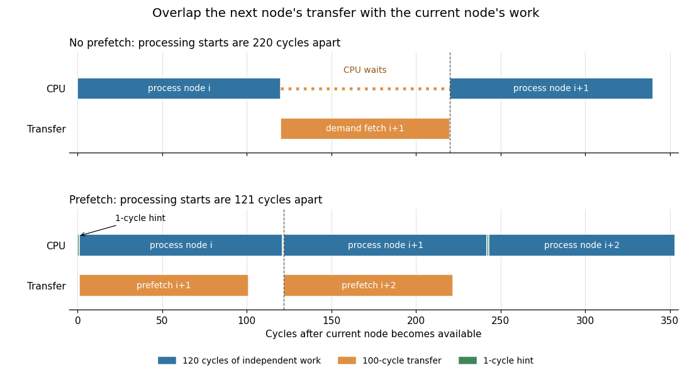

<h1 id="1/d/iv/solution">Solution</h1>

↑ **Parent:** [Iv](../iv.md)

The [pointer](../../../../../../pointer-computer-programming.md) to the next [linked list node](../../../../../../linked-list-node.md) is unavailable until it has been read from the current [linked list node](../../../../../../linked-list-node.md); a [software prefetch](../../../../../../software-prefetch.md) cannot invent that [pointer](../../../../../../pointer-computer-programming.md). Once it is available, however, the current node's computation is useful independent work. Assuming the `next` field shares the already loaded [cache line](../../../../../../cache-line.md), use this symbolic loop:
```
p := head
while p != null:
    q := LOAD [p + next_offset]
    if q != null:
        PREFETCH [q]
    process_payload(p)
    p := q
```
Here `process_payload` must not change the next [pointer](../../../../../../pointer-computer-programming.md), and its results must not be needed to determine `q`. Move the hint before this computation. The real [load instruction](../../../../../../load-instruction.md) for the next node still occurs in the next iteration and waits if the prefetch has not finished. The null test can be omitted when the hint's contract safely ignores that target; its cost, when retained, belongs in the loop overhead.

Let $L$ be the additional demand [cache miss penalty](../../../../../../cache-miss-penalty.md) per node, $C$ the independent processing time after discovering `q`, and $P$ the cost of issuing one hint. Ignore common loop and [cache hit](../../../../../../cache-hit.md) overhead, assume requests do not contend, and assume the prefetched [cache line](../../../../../../cache-line.md) remains resident. Without prefetching, a long traversal takes approximately $L+C$ cycles per node. A hint followed by $C$ cycles of work leaves at most $\max(0,L-C)$ cycles of waiting, giving

$$
T_{\mathrm{plain}}\simeq L+C,\qquad T_{\mathrm{prefetch}}\simeq P+C+\max(0,L-C)=P+\max(L,C).
$$

Consequently the ideal steady-state speedup is

$$
\boxed{S\simeq\frac{L+C}{P+\max(L,C)}.}
$$

For $L=100$, $C=120$ and $P=1$, the comparison is $220/121\simeq1.82$. Each hint has enough independent work behind it to hide the entire additional [cache miss penalty](../../../../../../cache-miss-penalty.md). For $C=20$ instead, the comparison is $120/101\simeq1.19$: most of the wait remains. With negligible $P$ the one-node-ahead model approaches a factor of two when $C=L$, not an unlimited speedup.

<a id="1/d/iv/image-one-node-ahead-software-prefetch-overlaps-the-next-linked-list-node-s-transfer-with-processing-of-the-current-node-synthetic-costs-l-100-c-120-p-1-cycles-with-the-final-processing-interval-shown-only-in-part"></a>


**[Figure 1](#1/d/iv/image-one-node-ahead-software-prefetch-overlaps-the-next-linked-list-node-s-transfer-with-processing-of-the-current-node-synthetic-costs-l-100-c-120-p-1-cycles-with-the-final-processing-interval-shown-only-in-part). One-node-ahead software prefetch overlaps the next linked list node's transfer with processing of the current node; synthetic costs $L=100$, $C=120$, $P=1$ cycles, with the final processing interval shown only in part**.

The first [linked list node](../../../../../../linked-list-node.md) still has a startup miss. A node occupying several [cache lines](../../../../../../cache-line.md) may need several hints, and a separately missing `next` field adds a genuine [pointer chasing](../../../../../../pointer-chasing.md) delay. Very short node computations, [cache pollution](../../../../../../cache-pollution.md) or saturation of the data-transfer path can eliminate the benefit. **The speedup comes from overlap with work on the current node; a prefetch does not remove the linked list's address dependence.**

## ↑ Ancestors (12)

1. [Iv](../iv.md)
2. [D](../../d.md)
3. [1](../../../1.md)
4. [Computer architecture](../../../../computer-architecture-split.md)
5. [2015](../../../../split.md)
6. [Past exam of the computer science course of the University of Oxford](../../../../../split.md)
7. [Computer science course of the University of Oxford](../../../../../../computer-science-course-of-the-university-of-oxford.md)
8. [Undergraduate course of the University of Oxford](../../../../../../undergraduate-course-of-the-university-of-oxford.md)
9. [Course of the University of Oxford](../../../../../../course-of-the-university-of-oxford.md)
10. [University of Oxford](../../../../../../university-of-oxford-split.md)
11. [List of universities](../../../../../../list-of-universities.md)
12. [Codex Wiki](../../../../../../split.md)
