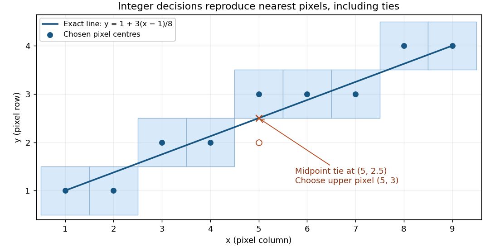

# Computer graphics

↑ **Parent:** [2015](../2015.md)

Solutions to all three questions of the paper dated 8 June 2015. Products of transformation [matrices](../../vector-space.md#matrix) act on column [vectors](../../vector-space.md#vector), with the rightmost factor acting first; the order issue in [iii](#2/b/iii) is discussed explicitly.[Cover and printed pp. 2–6, A10403W1](../../computer-science-bibliography.md#computer-graphics-examination-paper-by-the-university-of-oxford-2015)

**Table of contents**

- [1](#1)
  - [a](#1/a)
    - [Solution](#1/a/solution)
  - [b](#1/b)
    - [Solution](#1/b/solution)
  - [c](#1/c)
    - [Solution](#1/c/solution)
  - [d](#1/d)
    - [Solution](#1/d/solution)
  - [e](#1/e)
    - [Solution](#1/e/solution)
- [2](#2)
  - [a](#2/a)
    - [i](#2/a/i)
      - [Solution](#2/a/i/solution)
    - [ii](#2/a/ii)
      - [Solution](#2/a/ii/solution)
  - [b](#2/b)
    - [i](#2/b/i)
      - [Solution](#2/b/i/solution)
    - [ii](#2/b/ii)
      - [Solution](#2/b/ii/solution)
    - [iii](#2/b/iii)
      - [Solution](#2/b/iii/solution)
- [3](#3)
  - [a](#3/a)
    - [Solution](#3/a/solution)
  - [b](#3/b)
    - [Solution](#3/b/solution)
  - [c](#3/c)
    - [Solution](#3/c/solution)
  - [d](#3/d)
    - [Solution](#3/d/solution)
  - [e](#3/e)
    - [Solution](#3/e/solution)
  - [f](#3/f)
    - [Solution](#3/f/solution)
  - [g](#3/g)
    - [Solution](#3/g/solution)

## 1

↑ **Parent:** [Computer graphics](computer-graphics.md)

<h3 id="1/a">a</h3>

↑ **Parent:** [1](#1)

<h4 id="1/a/solution">Solution</h4>

↑ **Parent:** [A](#1/a)

Three advantages of [integer arithmetic](../../arithmetic.md#integer-arithmetic) for [raster graphics](../../computer-graphics.md#raster-graphics) are:

- **Cheap, fast operations.** Historically, [integer](../../integer.md) addition, subtraction and shifts needed much less hardware and execution time than [floating-point arithmetic](../../floating-point-arithmetic.md), especially on machines without a [floating-point unit](../../computer-science.md#floating-point-unit). An incremental [Bresenham's line algorithm](../../computer-graphics.md#bresenham-s-line-algorithm) needs only a few additions and a decision per [pixel](../../computer-graphics.md#pixel).
- **Exact decisions.** Provided [integer overflow](../../programming-language.md#integer-overflow) is excluded, the scaled [midpoint line decision](../../computer-graphics.md#midpoint-line-decision) is exact. There is no accumulated [rounding error](../../numerical-analysis.md#round-off-error) that can move a decision across a half-[pixel](../../computer-graphics.md#pixel) boundary; equality has a reproducible tie rule.
- **Simple storage and hardware.** [Integer](../../integer.md) coordinates already identify [pixels](../../computer-graphics.md#pixel). An implementation can keep coordinates and decision variables in ordinary registers and use a small add/compare datapath, avoiding conversion between [floating-point numbers](../../floating-point-arithmetic.md#floating-point-number) and [integer](../../integer.md) screen addresses.

These are historical and structural advantages, not a claim that every modern processor executes every [integer](../../integer.md) operation faster. An [integer](../../integer.md) implementation still needs sufficient width for its intermediate results. The compact answer is

$$
\boxed{\text{fast elementary operations; exact decisions; simple hardware and storage}.}
$$

<h3 id="1/b">b</h3>

↑ **Parent:** [1](#1)

<h4 id="1/b/solution">Solution</h4>

↑ **Parent:** [B](#1/b)

By exchanging axes, reversing endpoint order and reflecting coordinate signs where necessary, reduce a general [line segment](../../convex-set.md#line-segment) to the first octant:

$$
\Delta x=x_1-x_0>0,\qquad 0\leq\Delta y=y_1-y_0\leq\Delta x,\qquad m=\frac{\Delta y}{\Delta x}\in[0,1].
$$

The vertical case is handled by exchanging axes. In this octant, increasing $x$ by one requires increasing $y$ by either zero or one. Thus, from the currently plotted [pixel](../../computer-graphics.md#pixel) $(x,y)$ the candidates are $E=(x+1,y)$ and $NE=(x+1,y+1)$.

Use the [implicit equation](../../algebra.md#implicit-equation) of the [line](../../euclidean-geometry.md#straight-line)

$$
f(X,Y)=\Delta y(X-x_0)-\Delta x(Y-y_0).
$$

At a fixed $X$, $f(X,Y)>0$ means that $(X,Y)$ lies below the exact [line](../../euclidean-geometry.md#straight-line). The [midpoint line decision](../../computer-graphics.md#midpoint-line-decision) evaluates $M=(x+1,y+1/2)$, halfway between the two candidate [pixel](../../computer-graphics.md#pixel) centres. If $f(M)<0$, the exact [line](../../euclidean-geometry.md#straight-line) lies below $M$, so choose $E$; if $f(M)>0$, choose $NE$. At equality either candidate is equally near, but a fixed tie rule is essential. We choose $NE$ on a tie throughout these solutions:

$$
\boxed{f(x+1,y+1/2)<0\Rightarrow E;\qquad f(x+1,y+1/2)\geq0\Rightarrow NE.}
$$

This chooses the closest vertical-grid [pixel](../../computer-graphics.md#pixel) centre in each column, with ties rounded upward. Since $0\leq m\leq1$, the result has one [pixel](../../computer-graphics.md#pixel) per column and consecutive [pixels](../../computer-graphics.md#pixel) share an edge or a corner.

<h3 id="1/c">c</h3>

↑ **Parent:** [1](#1)

<h4 id="1/c/solution">Solution</h4>

↑ **Parent:** [C](#1/c)

Multiply the [midpoint line decision](../../computer-graphics.md#midpoint-line-decision) by two to remove the fraction. At the current [pixel](../../computer-graphics.md#pixel) $(x,y)$, maintain

$$
d=2f(x+1,y+1/2)=2\Delta y(x+1-x_0)-2\Delta x(y-y_0)-\Delta x.
$$

At the initial endpoint this is $d_0=2\Delta y-\Delta x$. If $E$ is chosen, the next decision midpoint is displaced by $(1,0)$ and $d$ increases by $2\Delta y$. If $NE$ is chosen, its displacement is $(1,1)$ and $d$ increases by $2(\Delta y-\Delta x)$. Both increments are constant, so the per-[pixel](../../computer-graphics.md#pixel) work uses only [integer arithmetic](../../arithmetic.md#integer-arithmetic):

$$
\boxed{d_0=2\Delta y-\Delta x,\quad \operatorname{incrE}=2\Delta y,\quad \operatorname{incrNE}=2(\Delta y-\Delta x).}
$$

The completed code, using the tie rule of part (b), is:

```
void midpointLine(int x0, int y0, int x1, int y1)
{
    int dx, dy, incrE, incrNE, d, x, y;
    x = x0; y = y0;
    dx = x1 - x0;
    dy = y1 - y0;
    incrE = 2 * dy;
    incrNE = 2 * (dy - dx);
    d = 2 * dy - dx;
    drawPoint(x, y);

    while (x < x1) {
        if (d < 0) {
            d += incrE;
        } else {
            d += incrNE;
            y++;
        }
        x++;
        drawPoint(x, y);
    }
    return;
}
```

Thus `guard1` is `x < x1`, and `guard2` is `d < 0`. Multiplication by two is the only multiplication. Signed decision variables are convenient because $d$ and `incrNE` can be negative; this remains an [integer arithmetic](../../arithmetic.md#integer-arithmetic) algorithm. A strictly unsigned hardware representation would need an equivalent biased or separated-sign encoding. As with the printed `int` skeleton, assume all intermediate values fit the chosen type; [integer overflow](../../programming-language.md#integer-overflow) would invalidate the mathematical decisions.

To verify the geometry, write $k=x-x_0$. The chosen ordinate is

$$
y(x)=y_0+\left\lfloor\frac{2\Delta y\,k+\Delta x}{2\Delta x}\right\rfloor.
$$

The [midpoint line decision](../../computer-graphics.md#midpoint-line-decision) selects exactly this nearest [integer](../../integer.md), rounding halves upward. Its increment between successive columns is zero or one. At $k=0$ and $k=\Delta x$, it gives exactly $y_0$ and $y_1$, respectively, so both endpoints are included and the [line segment](../../convex-set.md#line-segment) has precisely $\Delta x+1$ distinct [pixels](../../computer-graphics.md#pixel).

<a id="1/c/image-bresenham-pixels-for-a-slope-of-3-8-with-the-upper-pixel-selected-at-the-midpoint-tie"></a>


**[Figure 1](#1/c/image-bresenham-pixels-for-a-slope-of-3-8-with-the-upper-pixel-selected-at-the-midpoint-tie). Bresenham pixels for a slope of 3/8, with the upper pixel selected at the midpoint tie**.

For the illustrated endpoints $(1,1)$ and $(9,4)$, the ordinates are $1,1,2,2,3,3,3,4,4$. In particular the exact ordinate at $x=5$ is $5/2$, and the chosen [pixel](../../computer-graphics.md#pixel) is $(5,3)$.

<h3 id="1/d">d</h3>

↑ **Parent:** [1](#1)

<h4 id="1/d/solution">Solution</h4>

↑ **Parent:** [D](#1/d)

The verifier can check the final geometric criterion directly, independently of the incremental decision variable. Set $dx=x_1-x_0$, $dy=y_1-y_0$, and define the scaled vertical residual

$$
e=2dy(x-x_0)-2dx(y-y_0).
$$

The exact [line](../../euclidean-geometry.md#straight-line) ordinate is $y_* = y_0+dy(x-x_0)/dx$, so $e=2dx(y_*-y)$. Nearest-[integer](../../integer.md) selection with upward ties is precisely

$$
\boxed{x_0\leq x\leq x_1,\qquad -dx\leq e<dx.}
$$

The strictness matters: at a half-[integer](../../integer.md) ordinate the upper [pixel](../../computer-graphics.md#pixel) has $e=-dx$ and passes, whereas the lower [pixel](../../computer-graphics.md#pixel) has $e=dx$ and fails. Each column has exactly one accepted [integer](../../integer.md) ordinate.

With `reject()` terminating verification unsuccessfully, suitable outline code is:

```
void checkPoint(int x, int y)
{
    Wide a = Wide(x) - x0;
    if (a < 0) reject();                    // inequality 1
    Wide b = Wide(x1) - x;
    if (b < 0) reject();                    // inequality 2

    Wide dx = Wide(x1) - x0;
    Wide dy = Wide(y1) - y0;
    Wide e = 2 * dy * a - 2 * dx * (Wide(y) - y0);
    Wide lower = e + dx;
    if (lower < 0) reject();                // inequality 3
    Wide upper = dx - e;
    if (upper <= 0) reject();               // inequality 4

    counter[x]++;
}
```

`Wide` denotes a signed [integer](../../integer.md) type large enough for the products and differences, with conversion before subtraction. These are exactly four inequalities against zero, all applied to named [integer](../../integer.md) variables. The arithmetic restriction on the drawing loop in part (c) does not restrict multiplication in this verifier. The screen endpoints are assumed valid, with $0\leq x_0<x_1<\texttt{MAX\_SCREEN\_WIDTH}$ and valid endpoint ordinates, so indexing is safe after the first two checks. These endpoint and screen preconditions belong in initialization if they are not guaranteed by the caller.

No separate $y$-range tests are needed: for $x$ between the endpoints, $y_*$ lies in $[y_0,y_1]$, and its nearest [integer](../../integer.md) lies in the same interval because both bounds are [integers](../../integer.md). The counters defer detection of omissions and repetitions to part (e). As for every finite counter, use adequate capacity or a sticky failure on overflow; saturating each counter at two also suffices because only zero, one, and “more than one” matter.

<h3 id="1/e">e</h3>

↑ **Parent:** [1](#1)

<h4 id="1/e/solution">Solution</h4>

↑ **Parent:** [E](#1/e)

After every proposed [pixel](../../computer-graphics.md#pixel) has passed part (d), insist on exactly one call in every column of the closed endpoint interval:

```
void final()
{
    for (int x = x0; x <= x1; x++) {
        if (counter[x] != 1) reject();
    }
    accept();
}
```

Part (d) already rejected every out-of-range column and every incorrect ordinate. A zero counter now detects an omitted column; a counter greater than one detects a repeated call in that column. Because the residual interval in part (d) allows exactly one [integer](../../integer.md) ordinate in each column, accepted calls in a repeated column must address the same [pixel](../../computer-graphics.md#pixel). Conversely, a counter of one in every column forces the complete set of nearest [pixels](../../computer-graphics.md#pixel), including both endpoints. Consecutive correct columns differ in ordinate by at most one, which proves that there are no gaps in the resulting thin [line segment](../../convex-set.md#line-segment).

The verifier certifies the final plotted set; it need not require calls to arrive in increasing $x$ order. Its final condition is simply

$$
\boxed{\operatorname{counter}[x]=1\quad\text{for every }x=x_0,\ldots,x_1.}
$$

## 2

↑ **Parent:** [Computer graphics](computer-graphics.md)

<h3 id="2/a">a</h3>

↑ **Parent:** [2](#2)

<h4 id="2/a/i">i</h4>

↑ **Parent:** [A](#2/a)

<h5 id="2/a/i/solution">Solution</h5>

↑ **Parent:** [I](#2/a/i)

Represent a [point](../../geometry-and-topology.md#point-geometry) by the column of [homogeneous coordinates](../../projective-space.md#homogeneous-coordinate) $(X,Y,Z,1)^T$. The actions of the four [matrices](../../vector-space.md#matrix) are:

| Matrix | Geometric action and parameters |
| --- | --- |
| $G(\theta)$ | A [proper rotation](../../linear-algebra.md#proper-rotation) about the $x$-axis: $(X,Y,Z)\mapsto(X,Y\cos\theta-Z\sin\theta,Y\sin\theta+Z\cos\theta)$. The angle $\theta$ is in [radians](../../geometry-and-topology.md#radian), with the usual right-hand sense. |
| $H(x,y,z)$ | A [translation](../../geometry-and-topology.md#translation-geometry) by $(x,y,z)$: $(X,Y,Z)\mapsto(X+x,Y+y,Z+z)$. |
| $J(\lambda)$ | Uniform scaling by $\lambda$: $(X,Y,Z)\mapsto(\lambda X,\lambda Y,\lambda Z)$. Positive $\lambda$ gives a [uniform dilation](../../vector-space.md#uniform-dilation); $\lambda=0$ collapses the object to the origin; negative $\lambda$ additionally reverses its direction through the origin. |
| $K(f)$ | [Perspective projection](../../computer-graphics.md#perspective-projection) from the origin onto the plane $Z=f$, where $f\ne0$ is the [focal length](../../geometrical-optics.md#focal-length) in the chosen coordinate units. |

The last operation produces $(X,Y,Z,Z/f)^T$. It requires a [perspective divide](../../computer-graphics.md#perspective-divide): divide the first three components by the last. For $Z\ne0$,

$$
\boxed{K(f):\quad (X,Y,Z)\longmapsto\left(\frac{fX}{Z},\frac{fY}{Z},f\right).}
$$

This is why the last component of [homogeneous coordinates](../../projective-space.md#homogeneous-coordinate) cannot simply be discarded. [Points](../../geometry-and-topology.md#point-geometry) with $Z=0$ have no finite projected position, and a visible scene normally uses $Z>0$ under this forward-axis convention. The first three transformations leave the last component equal to one and need no nontrivial divide. The displayed $K$ retains no depth variation after division; it describes projection onto the image plane, rather than a complete depth-buffer mapping.

<h4 id="2/a/ii">ii</h4>

↑ **Parent:** [A](#2/a)

<h5 id="2/a/ii/solution">Solution</h5>

↑ **Parent:** [Ii](#2/a/ii)

Interpret the given focal point as the centre of [perspective projection](../../computer-graphics.md#perspective-projection), $C=(0,6,-8)$. First translate it to the origin with $H(0,-6,8)$. The direction from $C$ to the world origin is then $(0,-6,8)$, of length 10. Choose the [rotation matrix](../../linear-algebra.md#rotation-matrix) $G(\theta)$ so that this direction becomes $(0,0,10)$:

$$
\cos\theta=\frac45,\qquad \sin\theta=-\frac35,\qquad \theta=-\arctan\frac34.
$$

Indeed, the transformed $y$ component is $-6(4/5)-8(-3/5)=0$, and the transformed $z$ component is $(-6)(-3/5)+8(4/5)=10$. Thus the required mapping, followed by the [perspective divide](../../computer-graphics.md#perspective-divide), is

$$
\boxed{M=K(5)\,G\!\left(-\arctan\frac34\right)\,H(0,-6,8).}
$$

For a world [point](../../geometry-and-topology.md#point-geometry) $(x,y,z)$, its camera coordinates and projected device coordinates are

$$
X=x,\qquad Y=\frac45y+\frac35z,\qquad Z=10-\frac35y+\frac45z,
$$


$$
(u,v)=\left(\frac{5x}{10-3y/5+4z/5},\frac{4y+3z}{10-3y/5+4z/5}\right),\qquad Z>0.
$$

The world origin projects to $(0,0)$ and lies at camera depth 10. A [point](../../geometry-and-topology.md#point-geometry) five units along the unit viewing direction from $C$ has camera coordinates $(0,0,5)$, so it lies on the central image plane as expected. Here device coordinates are image-plane coordinates centred on the optical axis; an actual [pixel](../../computer-graphics.md#pixel) viewport would require its own specified scale and offset.

Only [rotations](../../riemannian-geometry.md#rotation-mathematics) about the $x$-axis are available. Consequently the camera's horizontal axis stays parallel to the world $x$-axis; the viewing direction lies in the world $yz$ plane. The available orientation has pitch but no independent yaw or roll. [Translations](../../geometry-and-topology.md#translation-geometry) move the camera and the projected origin but cannot supply the missing orientation degrees of freedom.

<h3 id="2/b">b</h3>

↑ **Parent:** [2](#2)

<h4 id="2/b/i">i</h4>

↑ **Parent:** [B](#2/b)

<h5 id="2/b/i/solution">Solution</h5>

↑ **Parent:** [I](#2/b/i)

In the solid-modelling convention used here, a [rigid-body transformation](../../euclidean-geometry.md#rigid-body-transformation) is an orientation-preserving [rigid transformation](../../euclidean-geometry.md#rigid-transformation), represented by a [proper rotation](../../linear-algebra.md#proper-rotation) and a [translation](../../geometry-and-topology.md#translation-geometry). The proposed upper-left block $S$ is [orthogonal](../../inner-product.md#orthogonal-vectors) but has

$$
S=\begin{pmatrix}0&1&0\\1&0&0\\0&0&1\end{pmatrix},\qquad S^TS=I,\qquad \det S=-1.
$$

It is a [reflection](../../linear-algebra.md#reflection-mathematics) in the [plane](../../geometry-and-topology.md#plane) $x=y$. It preserves distances, but reverses handedness, so it cannot describe continuous motion of a rigid solid through [proper rotations](../../linear-algebra.md#proper-rotation) and [translations](../../geometry-and-topology.md#translation-geometry). Some mathematical uses of [rigid transformation](../../euclidean-geometry.md#rigid-transformation) include this orientation-reversing case; the [determinant](../../multilinear-algebra.md#determinant) is the distinction relevant to the warning.

In a solid modeller, [triangle](../../euclidean-geometry.md#triangle) winding and outward [normal vectors](../../differential-geometry.md#normal-vector) must agree. A [reflection](../../linear-algebra.md#reflection-mathematics) reverses the winding: for edge [vectors](../../vector-space.md#vector) $a,b$,

$$
(Sa)\times(Sb)=\det(S)S(a\times b)=-S(a\times b).
$$

Simply transforming stored [normal vectors](../../differential-geometry.md#normal-vector) by $S$ while retaining the original vertex order therefore makes the geometric and stored normals disagree. [Back-face culling](../../computer-graphics.md#back-face-culling), inside/outside tests and [Phong reflection model](../../computer-graphics.md#phong-reflection-model) calculations can then use the wrong side. Code assuming a positive oriented volume can likewise interpret the reflected solid incorrectly. A modeller can support [reflections](../../linear-algebra.md#reflection-mathematics) if it deliberately corrects these orientation conventions.

A suitable alternative rotates by $-\pi/2$ about $z$ and then translates upward by `height`. Writing $h=\texttt{height}$,

$$
\boxed{T=\begin{pmatrix}0&1&0&0\\-1&0&0&h\\0&0&1&0\\0&0&0&1\end{pmatrix},\qquad (x,y,z)\mapsto(y,h-x,z).}
$$

Its [rotation matrix](../../linear-algebra.md#rotation-matrix) has determinant $+1$. The source bounds $0\leq x\leq h$, $0\leq y\leq w$, $z=0$ become $0\leq x'\leq w$, $0\leq y'\leq h$, $z'=0$, where $w=\texttt{width}$. A horizontal stripe $y=k\,\texttt{step}$ becomes the vertical stripe $x'=k\,\texttt{step}$, so even the stripe positions from the left edge are preserved. The face's $+z$ [normal vector](../../differential-geometry.md#normal-vector) is also preserved.

<h4 id="2/b/ii">ii</h4>

↑ **Parent:** [B](#2/b)

<h5 id="2/b/ii/solution">Solution</h5>

↑ **Parent:** [Ii](#2/b/ii)

The call constructs dimensions $(d,w,h)$ along the old $(x,y,z)$ axes. To obtain target dimensions $(w,h,d)$ and make an old layer $z=k\,\texttt{step}$ become a new layer $y'=k\,\texttt{step}$, use the cyclic permutation

$$
\boxed{P=\begin{pmatrix}0&1&0&0\\0&0&1&0\\1&0&0&0\\0&0&0&1\end{pmatrix},\qquad (x,y,z)\mapsto(y,z,x).}
$$

The new coordinate ranges are immediately $[0,w]$, $[0,h]$, $[0,d]$. Its spatial block is [orthogonal](../../inner-product.md#orthogonal-vectors) with determinant $+1$, since a three-cycle is an even [permutation](../../combinatorics.md#permutation). Hence this is a [proper rotation](../../linear-algebra.md#proper-rotation), through $-2\pi/3$ about the axis in direction $(1,1,1)$ under the right-hand convention. No [translation](../../geometry-and-topology.md#translation-geometry) is required.

<h4 id="2/b/iii">iii</h4>

↑ **Parent:** [B](#2/b)

<h5 id="2/b/iii/solution">Solution</h5>

↑ **Parent:** [Iii](#2/b/iii)

The multiplication order needs care. Use the standard right-hand [rotation matrices](../../linear-algebra.md#rotation-matrix), consistent with the printed $G$ and the stated positive $z$ [rotation](../../riemannian-geometry.md#rotation-mathematics). For column [vectors](../../vector-space.md#vector), direct multiplication of the two products _in the order printed_ gives

$$
R_y(-\pi/2)R_z(-\pi/2)=\begin{pmatrix}0&0&-1\\-1&0&0\\0&1&0\end{pmatrix},\qquad (x,y,z)\mapsto(-z,-x,y),
$$


$$
R_y(\pi/2)R_z(\pi/2)=\begin{pmatrix}0&0&1\\1&0&0\\0&1&0\end{pmatrix},\qquad (x,y,z)\mapsto(z,x,y).
$$

Both permute the dimensions $(d,w,h)$ into $(h,d,w)$, rather than the required $(w,h,d)$. Therefore, with ordinary column-vector [matrix multiplication](../../vector-space.md#matrix-multiplication), **neither printed product is the permutation in part (ii)**. A [translation](../../geometry-and-topology.md#translation-geometry) can correct the position of a cuboid, but cannot correct these permuted side lengths for general $w,h,d$. This order mismatch is present in the original printed question.[Printed p. 5, Question 2(b)(iii): the products are written with ROT\_y to the left of ROT\_z](../../computer-science-bibliography.md#computer-graphics-examination-paper-by-the-university-of-oxford-2015)

The apparent intended comparison is obtained if “chain” means apply the $y$ [rotation](../../riemannian-geometry.md#rotation-mathematics) first, then the $z$ [rotation](../../riemannian-geometry.md#rotation-mathematics). Under that interpretation the actual column-vector products have the reverse order:

$$
\boxed{R_z(-\pi/2)R_y(-\pi/2)=\begin{pmatrix}0&1&0\\0&0&1\\1&0&0\end{pmatrix}=P_{3\times3}.}
$$

Thus the _negative-angle sequence_ is correct when read as operations performed from left to right. The positive-angle sequence gives

$$
R_z(\pi/2)R_y(\pi/2)=\begin{pmatrix}0&-1&0\\0&0&1\\-1&0&0\end{pmatrix},\qquad (x,y,z)\mapsto(-y,z,-x).
$$

It occupies $[-w,0]\times[0,h]\times[-d,0]$. Apply the world-space [translation](../../geometry-and-topology.md#translation-geometry)

$$
\boxed{t=(w,0,d),\qquad (x',y',z')=(w-y,z,d-x).}
$$

This puts the cuboid in $[0,w]\times[0,h]\times[0,d]$ and still maps $z=k\,\texttt{step}$ to $y'=k\,\texttt{step}$. The distinction is purely the action order: ordinary products act rightmost first, while a library may describe an ordered sequence of operations in application order. Giving the coordinate maps makes either convention explicit. If one merely wanted to place the literal printed negative product in the positive octant, its [translation](../../geometry-and-topology.md#translation-geometry) would instead be $(h,d,0)$, producing dimensions $(h,d,w)$ and still failing the requested general bounds.

## 3

↑ **Parent:** [Computer graphics](computer-graphics.md)

<h3 id="3/a">a</h3>

↑ **Parent:** [3](#3)

<h4 id="3/a/solution">Solution</h4>

↑ **Parent:** [A](#3/a)

At a surface [point](../../geometry-and-topology.md#point-geometry) $p$, let $\hat N$ be the outward [unit normal vector](../../differential-geometry.md#unit-normal), $\hat V$ the [unit vector](../../vector-space.md#unit-vector) from $p$ toward the viewer, and $\hat L$ the [unit vector](../../vector-space.md#unit-vector) from $p$ toward the light. The incoming propagation direction is therefore $-\hat L$. The [specular reflection](../../optics.md#specular-reflection) direction $\hat R$ points away from the surface along the ideal reflected ray.

Resolve $\hat L$ into its normal and tangential components:

$$
\hat L=(\hat N\cdot\hat L)\hat N+\bigl(\hat L-(\hat N\cdot\hat L)\hat N\bigr).
$$

Reflection of the incoming direction preserves its tangential component and reverses its normal component. Equivalently, the outgoing direction has the same normal component as $\hat L$ and the opposite tangential component, giving

$$
\boxed{\hat R=2(\hat N\cdot\hat L)\hat N-\hat L.}
$$

The [dot product](../../inner-product.md#dot-product) identity shows $\|\hat R\|=1$ when $\|\hat L\|=\|\hat N\|=1$.

In the [Phong reflection model](../../computer-graphics.md#phong-reflection-model), ambient lighting approximates unmodelled indirect illumination and is independent of these directions. The diffuse term models [Lambertian reflectance](../../optics.md#lambertian-reflectance) and varies as $\max(0,\hat N\cdot\hat L)$. The specular term models a highlight around $\hat R$ and varies as $\max(0,\hat R\cdot\hat V)^n$, where $n>0$ controls its sharpness. For a visible front surface, a convenient per-colour-channel equation is

$$
\boxed{I=k_a I_a+I_L\left[k_d\max(0,\hat N\cdot\hat L)+k_s\,\chi\,\max(0,\hat R\cdot\hat V)^n\right],}
$$

where $I_a$ is ambient illumination, $I_L$ is the source strength at the surface including any chosen attenuation, $k_a,k_d,k_s\geq0$ are material weights, and $\chi$ is one when $\hat N\cdot\hat L>0$ and zero otherwise. The weights can be colour-dependent. An idealized point source's incident strength decreases as inverse distance squared; the empirical equation can also use a prescribed attenuation law.

In degenerate geometric cases the effective weights switch off. A light behind or tangent to the surface contributes neither direct diffuse nor specular illumination. If $\hat R\cdot\hat V\leq0$, the specular term is zero. A viewpoint on the back side is rejected by [back-face culling](../../computer-graphics.md#back-face-culling) for a one-sided surface. A material with no highlight has $k_s=0$; with no diffuse response, $k_d=0$; without ambient illumination the ambient term vanishes. These zeros do not require renormalizing the other weights, and the empirical [Phong reflection model](../../computer-graphics.md#phong-reflection-model) does not impose a universal condition $k_a+k_d+k_s=1$. At coincident light/surface or eye/surface positions a direction cannot be normalized; such singular configurations require a separate convention, rather than substituting an undefined [unit vector](../../vector-space.md#unit-vector) into the formula.

<h3 id="3/b">b</h3>

↑ **Parent:** [3](#3)

<h4 id="3/b/solution">Solution</h4>

↑ **Parent:** [B](#3/b)

A [bidirectional reflectance distribution function](../../radiometry.md#bidirectional-reflectance-distribution-function), or [BRDF](../../radiometry.md#bidirectional-reflectance-distribution-function), describes how a surface scatters incident illumination into each outgoing direction. At a fixed surface [point](../../geometry-and-topology.md#point-geometry) $p$ and [wavelength](../../wave-equation.md#wavelength), its inputs are two directions above the surface, $\omega_i$ toward the incident source and $\omega_o$ toward the observer; equivalently these are two pairs of angular coordinates. Its output is the ratio of differential reflected [radiance](../../radiometry.md#radiance) to differential incident [irradiance](../../radiometry.md#irradiance):

$$
\boxed{f_r(p,\omega_i,\omega_o)=\frac{dL_o(p,\omega_o)}{dE_i(p,\omega_i)},\qquad [f_r]=\mathrm{sr}^{-1}.}
$$

Position and [wavelength](../../wave-equation.md#wavelength) may be additional arguments when material properties vary. A colour implementation can return one value per colour channel. The [BRDF](../../radiometry.md#bidirectional-reflectance-distribution-function) is a material response, not the final outgoing light value: it must be combined with the incident illumination and the projected-angle factor.[§4.3.1, definition of the BRDF as differential outgoing radiance divided by differential incident irradiance](../../mathematics-bibliography.md#physically-based-rendering-from-theory-to-implementation-4th-edition-by-matt-pharr-and-others)

For incident [radiance](../../radiometry.md#radiance) $L_i$, the reflection part of the [rendering equation](../../computer-graphics.md#rendering-equation) is

$$
L_o(p,\omega_o)=\int_{\Omega^+}f_r(p,\omega_i,\omega_o)L_i(p,\omega_i)(\hat N\cdot\omega_i)\,d\omega_i.
$$

Emission is added separately if the surface itself emits. This integral explains how a [BRDF](../../radiometry.md#bidirectional-reflectance-distribution-function) replaces the assumed material response of a local lighting model. For [Lambertian reflectance](../../optics.md#lambertian-reflectance), $f_r=\rho_d/\pi$, so the cosine factor yields the diffuse term from part (a). A directional specular lobe supplies a highlight. The empirical [Phong reflection model](../../computer-graphics.md#phong-reflection-model) is an approximate angular-response model of this kind; its original direct specular term is not automatically a normalized, energy-conserving [BRDF](../../radiometry.md#bidirectional-reflectance-distribution-function). The ambient term approximates missing illumination and is not itself a third direction-independent material scattering mechanism. More general [BRDFs](../../radiometry.md#bidirectional-reflectance-distribution-function) can reproduce measured surface behaviour, while illumination from other surfaces supplies indirect light in the [rendering equation](../../computer-graphics.md#rendering-equation).

<h3 id="3/c">c</h3>

↑ **Parent:** [3](#3)

<h4 id="3/c/solution">Solution</h4>

↑ **Parent:** [C](#3/c)

Let the oriented vertices be $a,b,c$, in an order such that $n=(b-a)\times(c-a)$ points out of the front face. The given nondegeneracy guarantees $n\ne0$. A [ray](../../euclidean-geometry.md#ray-geometry) with nonzero direction $r$ approaches the front face only if

$$
n\cdot r<0.
$$

Reject $n\cdot r\geq0$. This combines [back-face culling](../../computer-graphics.md#back-face-culling) with rejection of parallel rays, including the coplanar case for this ordinary surface-hit test. The [ray-plane intersection](../../euclidean-geometry.md#ray-plane-intersection) parameter is

$$
\lambda=\frac{n\cdot(a-o)}{n\cdot r}.
$$

Reject $\lambda<0$; for rays launched from existing surfaces use a positive lower cutoff to avoid counting the launch surface. Form $p=o+\lambda r$.

Finally determine whether $p$ lies inside the [triangle](../../euclidean-geometry.md#triangle). For $u=b-a$, $v=c-a$, $w=p-a$, compute

$$
D=(u\cdot u)(v\cdot v)-(u\cdot v)^2>0,
$$


$$
\beta=\frac{(v\cdot v)(w\cdot u)-(u\cdot v)(w\cdot v)}D,\qquad
\gamma=\frac{(u\cdot u)(w\cdot v)-(u\cdot v)(w\cdot u)}D.
$$

These solve $p=a+\beta u+\gamma v$. The [barycentric coordinates](../../algebraic-topology.md#barycentric-coordinate-system) are $(1-\beta-\gamma,\beta,\gamma)$, so the complete acceptance criterion is

$$
\boxed{n\cdot r<0,\quad \lambda\geq0,\quad\beta\geq0,\quad\gamma\geq0,\quad\beta+\gamma\leq1;\qquad p=o+\lambda r.}
$$

The inequalities include the edges and vertices. A renderer sharing edges between [triangles](../../euclidean-geometry.md#triangle) should use a consistent numerical edge convention; small [floating-point arithmetic](../../floating-point-arithmetic.md) errors near a shared boundary should not create cracks. Normalizing $n$ is unnecessary for this intersection calculation because its scale cancels.

<h3 id="3/d">d</h3>

↑ **Parent:** [3](#3)

<h4 id="3/d/solution">Solution</h4>

↑ **Parent:** [D](#3/d)

For single-shot [ray tracing](../../computer-graphics.md#ray-tracing-computer-graphics), construct one primary [ray](../../euclidean-geometry.md#ray-geometry) per [pixel](../../computer-graphics.md#pixel), normally through its centre on the image plane, with the camera centre as origin for [perspective projection](../../computer-graphics.md#perspective-projection). Transform the [ray](../../euclidean-geometry.md#ray-geometry) into the scene's coordinates, or consistently transform all the scene geometry into camera coordinates.

Intersect that primary [ray](../../euclidean-geometry.md#ray-geometry) with the scene's [triangles](../../euclidean-geometry.md#triangle), using part (c), and retain the accepted hit with the smallest nonnegative parameter $\lambda$. This nearest-hit selection supplies visibility: farther surfaces cannot show through the first opaque surface. If there is no hit, write the background colour. At a hit $p$, obtain its material colour and front [unit normal vector](../../differential-geometry.md#unit-normal) and set $\hat V$ toward the camera.

For each point light at $\ell_j$, form $\hat L_j=(\ell_j-p)/\|\ell_j-p\|$, calculate the [specular reflection](../../optics.md#specular-reflection) direction, and evaluate its diffuse and specular contributions using the [Phong reflection model](../../computer-graphics.md#phong-reflection-model). Sum the contributions and add ambient illumination once:

$$
\boxed{I(p)=k_aI_a+\sum_j I_j(p)\left[k_d\max(0,\hat N\cdot\hat L_j)+k_s\chi_j\max(0,\hat R_j\cdot\hat V)^n\right].}
$$

The coloured surface can supply colour-dependent diffuse weights, and each source can have its own colour. Convert the result into the output image's colour encoding and range. Single-shot here means direct local shading after one primary visibility [ray](../../euclidean-geometry.md#ray-geometry); no reflected or transmitted secondary viewing rays are followed. Part (e) adds secondary visibility queries for the lights.

<h3 id="3/e">e</h3>

↑ **Parent:** [3](#3)

<h4 id="3/e/solution">Solution</h4>

↑ **Parent:** [E](#3/e)

At each primary hit $p$, send a [shadow ray](../../computer-graphics.md#shadow-ray) toward each point light. An especially clear parameterization is

$$
s_j(t)=p+t(\ell_j-p),\qquad 0<t<1.
$$

If an opaque scene surface intersects this open segment, the source is hidden. The finite interval is essential: an object beyond the light must not cast a shadow at $p$. Exclude the launch surface with a small geometrically appropriate origin offset or positive minimum parameter, so [floating-point arithmetic](../../floating-point-arithmetic.md) does not create a false self-intersection.

Introduce a visibility factor $V_j(p)$ equal to zero when blocked and one otherwise. The modified equation is

$$
\boxed{I(p)=k_aI_a+\sum_j V_j(p)I_j(p)\left[k_d\max(0,\hat N\cdot\hat L_j)+k_s\chi_j\max(0,\hat R_j\cdot\hat V)^n\right].}
$$

A blocked light loses both its diffuse and specular contributions. The simple ambient approximation remains. Opaque point lights produce hard shadow boundaries. Use a consistent sidedness policy for occluders: an opaque closed solid blocks from either crossing side, so a two-sided blocker test is appropriate even when primary visibility uses [back-face culling](../../computer-graphics.md#back-face-culling). An any-hit query can stop as soon as it finds one blocker before the light.

<h3 id="3/f">f</h3>

↑ **Parent:** [3](#3)

<h4 id="3/f/solution">Solution</h4>

↑ **Parent:** [F](#3/f)

A [bounding volume hierarchy](../../computer-aided-geometric-design.md#bounding-volume-hierarchy) is a [tree](../../tree-graph-theory.md) whose leaves contain geometric primitives, here [triangles](../../euclidean-geometry.md#triangle), and whose internal nodes store cheap-to-test [bounding volumes](../../computer-aided-geometric-design.md#bounding-volume) containing all descendant geometry. A [bounding volume](../../computer-aided-geometric-design.md#bounding-volume) may be an [axis-aligned bounding box](../../computer-aided-geometric-design.md#axis-aligned-bounding-box) or a [sphere](../../euclidean-geometry.md#sphere). The key containment guarantee is

$$
\boxed{\text{ray misses a node's bounding volume}\Rightarrow\text{ray misses every triangle below that node}.}
$$

Traverse from the root. Reject a whole subtree when its [bounding volume](../../computer-aided-geometric-design.md#bounding-volume) is missed; otherwise visit its children and perform the full [ray-triangle intersection](../../euclidean-geometry.md#ray-triangle-intersection) test only at surviving leaves. Hitting a [bounding volume](../../computer-aided-geometric-design.md#bounding-volume) is only permission to investigate, not evidence of hitting an enclosed [triangle](../../euclidean-geometry.md#triangle).

For nearest-hit queries, visit the nearer child first and keep the current nearest parameter. A second child whose volume begins farther away than this parameter can be pruned. For a [shadow ray](../../computer-graphics.md#shadow-ray), restrict the traversal to the segment before the source and terminate at any blocker.

A flat list of $N$ [triangles](../../euclidean-geometry.md#triangle) needs up to $N$ detailed tests per primary [ray](../../euclidean-geometry.md#ray-geometry) or [shadow ray](../../computer-graphics.md#shadow-ray). A well-built [bounding volume hierarchy](../../computer-aided-geometric-design.md#bounding-volume-hierarchy) can reject large groups with a few cheap tests and substantially reduce the average work. A balanced, well-separated scene often gives traversal resembling a short root-to-leaf search, but balance alone does not guarantee logarithmic query time: extensive overlap or an unfortunate [ray](../../euclidean-geometry.md#ray-geometry) can force examination of most or all leaves. Its advantage is spatial rejection, not a universal worst-case bound.

<h3 id="3/g">g</h3>

↑ **Parent:** [3](#3)

<h4 id="3/g/solution">Solution</h4>

↑ **Parent:** [G](#3/g)

[Path tracing](../../computer-graphics.md#path-tracing) estimates the [rendering equation](../../computer-graphics.md#rendering-equation) by a [Monte Carlo method](../../monte-carlo-method.md). Launch camera [rays](../../euclidean-geometry.md#ray-geometry); at each surface hit sample an outgoing continuation direction according to a chosen [probability density function](../../continuous-probability-distribution.md#probability-density-function), trace to the next hit, and continue through successive reflections. Accumulate emitted light or environment light with the product of scattering, cosine and inverse-density factors along the path. A bounce sampled with density $p(\omega)$ updates the path weight by

$$
\boxed{\beta\leftarrow\beta\,\frac{f_r(\omega,\omega_o)|\hat N\cdot\omega|}{p(\omega)}.}
$$

Average many independently sampled paths per [pixel](../../computer-graphics.md#pixel). Multiple bounces account for indirect illumination, including colour bleeding between surfaces, instead of approximating all of it by one ambient constant. Termination can use [Russian roulette](../../monte-carlo-method.md#russian-roulette-monte-carlo): continue with probability $q>0$ and divide surviving weights by $q$, preserving the expected contribution. A fixed bounce cutoff is simpler but truncates transport.

The elementary strategy that obtains illumination only when a randomly continued path _hits an emitter_ fails for ideal point lights. From a surface [point](../../geometry-and-topology.md#point-geometry), an ideal point source occupies zero [solid angle](../../euclidean-geometry.md#solid-angle); sampling a direction from an ordinary continuous [probability density function](../../continuous-probability-distribution.md#probability-density-function) hits that one direction with probability zero. Thus this strategy almost surely never discovers the light, regardless of the number of samples. An area emitter occupies nonzero [solid angle](../../euclidean-geometry.md#solid-angle) and can be hit.

The qualification matters: practical [path tracing](../../computer-graphics.md#path-tracing) can use point lights by explicitly sampling a source and connecting the current surface to it with a [shadow ray](../../computer-graphics.md#shadow-ray), a technique called [next-event estimation](../../computer-graphics.md#next-event-estimation). For a point source the connection direction is known exactly, rather than discovered by a random hemisphere hit. Thus the restriction applies to naive emitter-hit [path tracing](../../computer-graphics.md#path-tracing), not to all [path tracing](../../computer-graphics.md#path-tracing) algorithms.[§12.2: point lights have delta-position emission and deterministic incident directions; §13.4: direct-light sampling is combined with scattering-direction sampling](../../mathematics-bibliography.md#physically-based-rendering-from-theory-to-implementation-4th-edition-by-matt-pharr-and-others)

## ↑ Ancestors (8)

1. [2015](../2015.md)
2. [Past exam of the computer science course of the University of Oxford](../../past-exam-of-the-computer-science-course-of-the-university-of-oxford.md)
3. [Computer science course of the University of Oxford](../../university-of-oxford.md#computer-science-course-of-the-university-of-oxford)
4. [Undergraduate course of the University of Oxford](../../university-of-oxford.md#undergraduate-course-of-the-university-of-oxford)
5. [Course of the University of Oxford](../../university-of-oxford.md#course-of-the-university-of-oxford)
6. [University of Oxford](../../university-of-oxford.md)
7. [List of universities](../../README.md#list-of-universities)
8. [Codex Wiki](../../README.md)
