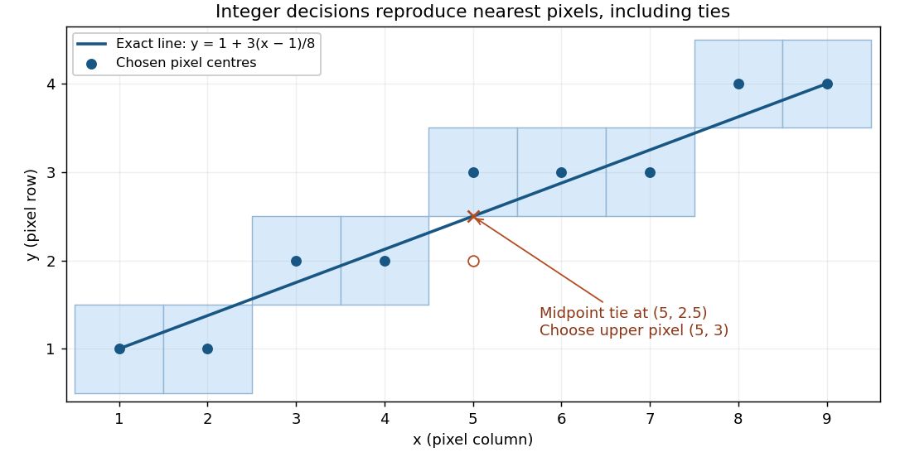

<h1 id="1/c/solution">Solution</h1>

↑ **Parent:** [C](../c.md)

Multiply the [midpoint line decision](../../../../../midpoint-line-decision.md) by two to remove the fraction. At the current [pixel](../../../../../pixel.md) $(x,y)$, maintain

$$
d=2f(x+1,y+1/2)=2\Delta y(x+1-x_0)-2\Delta x(y-y_0)-\Delta x.
$$

At the initial endpoint this is $d_0=2\Delta y-\Delta x$. If $E$ is chosen, the next decision midpoint is displaced by $(1,0)$ and $d$ increases by $2\Delta y$. If $NE$ is chosen, its displacement is $(1,1)$ and $d$ increases by $2(\Delta y-\Delta x)$. Both increments are constant, so the per-[pixel](../../../../../pixel.md) work uses only [integer arithmetic](../../../../../integer-arithmetic.md):

$$
\boxed{d_0=2\Delta y-\Delta x,\quad \operatorname{incrE}=2\Delta y,\quad \operatorname{incrNE}=2(\Delta y-\Delta x).}
$$

The completed code, using the tie rule of part (b), is:

```
void midpointLine(int x0, int y0, int x1, int y1)
{
    int dx, dy, incrE, incrNE, d, x, y;
    x = x0; y = y0;
    dx = x1 - x0;
    dy = y1 - y0;
    incrE = 2 * dy;
    incrNE = 2 * (dy - dx);
    d = 2 * dy - dx;
    drawPoint(x, y);

    while (x < x1) {
        if (d < 0) {
            d += incrE;
        } else {
            d += incrNE;
            y++;
        }
        x++;
        drawPoint(x, y);
    }
    return;
}
```

Thus `guard1` is `x < x1`, and `guard2` is `d < 0`. Multiplication by two is the only multiplication. Signed decision variables are convenient because $d$ and `incrNE` can be negative; this remains an [integer arithmetic](../../../../../integer-arithmetic.md) algorithm. A strictly unsigned hardware representation would need an equivalent biased or separated-sign encoding. As with the printed `int` skeleton, assume all intermediate values fit the chosen type; [integer overflow](../../../../../integer-overflow.md) would invalidate the mathematical decisions.

To verify the geometry, write $k=x-x_0$. The chosen ordinate is

$$
y(x)=y_0+\left\lfloor\frac{2\Delta y\,k+\Delta x}{2\Delta x}\right\rfloor.
$$

The [midpoint line decision](../../../../../midpoint-line-decision.md) selects exactly this nearest [integer](../../../../../integer-split.md), rounding halves upward. Its increment between successive columns is zero or one. At $k=0$ and $k=\Delta x$, it gives exactly $y_0$ and $y_1$, respectively, so both endpoints are included and the [line segment](../../../../../line-segment.md) has precisely $\Delta x+1$ distinct [pixels](../../../../../pixel.md).

<a id="1/c/image-bresenham-pixels-for-a-slope-of-3-8-with-the-upper-pixel-selected-at-the-midpoint-tie"></a>


**[Figure 1](#1/c/image-bresenham-pixels-for-a-slope-of-3-8-with-the-upper-pixel-selected-at-the-midpoint-tie). Bresenham pixels for a slope of 3/8, with the upper pixel selected at the midpoint tie**.

For the illustrated endpoints $(1,1)$ and $(9,4)$, the ordinates are $1,1,2,2,3,3,3,4,4$. In particular the exact ordinate at $x=5$ is $5/2$, and the chosen [pixel](../../../../../pixel.md) is $(5,3)$.

## ↑ Ancestors (11)

1. [C](../c.md)
2. [1](../../1.md)
3. [Computer graphics](../../../computer-graphics-split.md)
4. [2015](../../../split.md)
5. [Past exam of the computer science course of the University of Oxford](../../../../split.md)
6. [Computer science course of the University of Oxford](../../../../../computer-science-course-of-the-university-of-oxford.md)
7. [Undergraduate course of the University of Oxford](../../../../../undergraduate-course-of-the-university-of-oxford.md)
8. [Course of the University of Oxford](../../../../../course-of-the-university-of-oxford.md)
9. [University of Oxford](../../../../../university-of-oxford-split.md)
10. [List of universities](../../../../../list-of-universities.md)
11. [Codex Wiki](../../../../../split.md)
