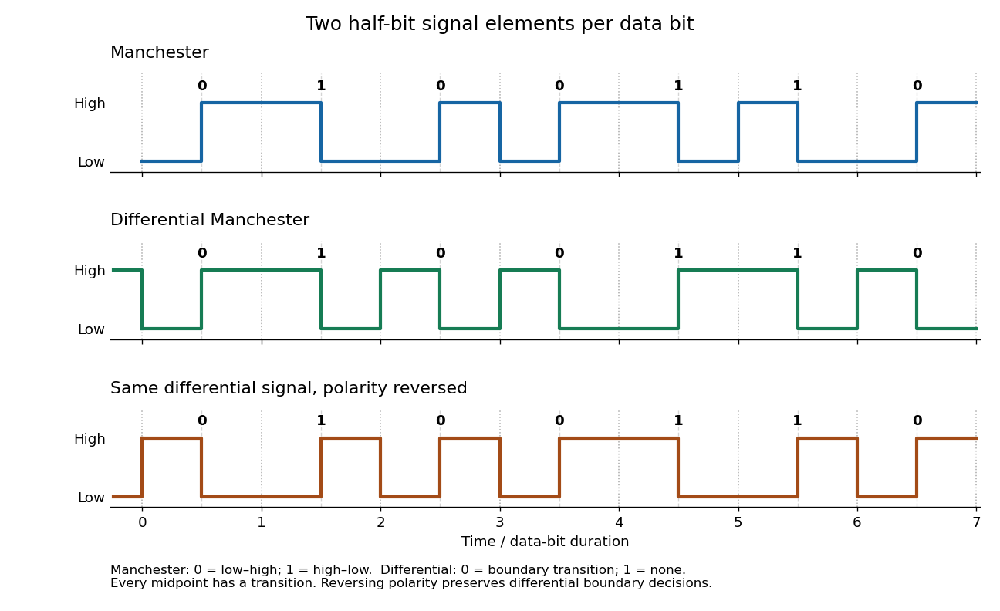

# Computer networks

↑ **Parent:** [2015](../2015.md)

Solutions to all three questions of the paper dated 13 June 2015.[Cover and printed pages 2–3, A12068W1](../../computer-science-bibliography.md#computer-networks-examination-paper-of-the-university-of-oxford-2015)

**Table of contents**

- [1](#1)
  - [a](#1/a)
    - [Solution](#1/a/solution)
  - [b](#1/b)
    - [Solution](#1/b/solution)
  - [c](#1/c)
    - [Solution](#1/c/solution)
  - [d](#1/d)
    - [Solution](#1/d/solution)
  - [e](#1/e)
    - [Solution](#1/e/solution)
  - [f](#1/f)
    - [Solution](#1/f/solution)
  - [g](#1/g)
    - [Solution](#1/g/solution)
  - [h](#1/h)
    - [Solution](#1/h/solution)
- [2](#2)
  - [a](#2/a)
    - [Solution](#2/a/solution)
  - [b](#2/b)
    - [Solution](#2/b/solution)
  - [c](#2/c)
    - [Solution](#2/c/solution)
  - [d](#2/d)
    - [Solution](#2/d/solution)
  - [e](#2/e)
    - [Solution](#2/e/solution)
- [3](#3)
  - [a](#3/a)
    - [Solution](#3/a/solution)
  - [b](#3/b)
    - [Solution](#3/b/solution)
  - [c](#3/c)
    - [Solution](#3/c/solution)
  - [d](#3/d)
    - [Solution](#3/d/solution)
  - [e](#3/e)
    - [Solution](#3/e/solution)
  - [f](#3/f)
    - [Solution](#3/f/solution)

## 1

↑ **Parent:** [Computer networks](computer-networks.md)

<h3 id="1/a">a</h3>

↑ **Parent:** [1](#1)

<h4 id="1/a/solution">Solution</h4>

↑ **Parent:** [A](#1/a)

The [bit rate](../../computer-network.md#bit-rate) counts data [bits](../../information-theory.md#bit) carried per second; the [baud rate](../../computer-network.md#symbol-rate) counts transmitted signal elements per second. A signal element need not carry one whole data [bit](../../information-theory.md#bit). In [Manchester encoding](../../computer-network.md#manchester-code), each data [bit](../../information-theory.md#bit) occupies two half-bit signal elements, one high and one low. For example, choose low–high for zero and high–low for one. The compulsory transition in the middle provides a timing reference for [clock recovery](../../computer-network.md#clock-recovery).

If one data [bit](../../information-theory.md#bit) lasts $T$ seconds, the [bit rate](../../computer-network.md#bit-rate) is $1/T$, while each half-bit signal element lasts $T/2$. With this binary signal-element convention,

$$
\boxed{R_b=1/T\ \text{bits/s},\qquad R_s=2/T=2R_b\ \text{baud}.}
$$

Thus a 10 Mbit/s [Manchester encoding](../../computer-network.md#manchester-code) signal uses 20 million half-bit signal elements per second. This is not a count of observed voltage transitions: some [bit](../../information-theory.md#bit) boundaries also contain a transition and others do not. Calling a whole two-element pattern a symbol gives a different symbol-counting convention; the physical fact is two half-bit elements per data [bit](../../information-theory.md#bit).

**[Figure 1](#1/a/image-manchester-encoding-and-differential-manchester-encoding-for-the-same-seven-bits-dotted-lines-mark-bit-boundaries-and-dashed-lines-mark-their-midpoints). Manchester encoding and differential Manchester encoding for the same seven bits; dotted lines mark bit boundaries and dashed lines mark their midpoints**.

<h3 id="1/b">b</h3>

↑ **Parent:** [1](#1)

<h4 id="1/b/solution">Solution</h4>

↑ **Parent:** [B](#1/b)

In [differential Manchester encoding](../../computer-network.md#differential-manchester-encoding), every data [bit](../../information-theory.md#bit) still has a compulsory transition at its midpoint for [clock recovery](../../computer-network.md#clock-recovery). The data value is specified by whether a transition occurs at the beginning of the [bit](../../information-theory.md#bit), rather than by the direction of the midpoint transition. One convention is beginning transition for zero and no beginning transition for one; interchanging the meanings consistently also works.

Reversing the signal polarity exchanges high and low everywhere, but preserves both the presence and the absence of transitions. A receiver using [differential Manchester encoding](../../computer-network.md#differential-manchester-encoding) therefore decodes the same data after a polarity reversal, provided it has acquired the timing and boundary reference. Ordinary [Manchester encoding](../../computer-network.md#manchester-code) with a fixed low–high/high–low interpretation would exchange the two data values. The advantage is

$$
\boxed{\text{self-clocking transmission insensitive to a global polarity reversal}.}
$$

<h3 id="1/c">c</h3>

↑ **Parent:** [1](#1)

<h4 id="1/c/solution">Solution</h4>

↑ **Parent:** [C](#1/c)

A [block code for line coding](../../computer-network.md#block-code-for-line-coding) divides the data into five-[bit](../../information-theory.md#bit) groups and assigns each of the $2^5=32$ possible groups a distinct eight-[bit](../../information-theory.md#bit) [codeword](../../coding-theory.md#codeword). The receiver reverses that assignment after finding the eight-[bit](../../information-theory.md#bit) boundaries. There are $2^8=256$ candidate [codewords](../../coding-theory.md#codeword), so the designer has substantial freedom to select 32 suitable ones and reserve other patterns for control or synchronization.

The choice can limit long runs of equal [bits](../../information-theory.md#bit) to help [clock recovery](../../computer-network.md#clock-recovery), balance high and low levels to reduce a persistent offset, and distinguish control patterns from data. These properties must hold across adjacent [codeword](../../coding-theory.md#codeword) boundaries too: two individually acceptable words can concatenate into an unacceptable run. The unused patterns can also help [error detection and correction](../../coding-theory.md#error-detection-and-correction): an invalid received pattern exposes some errors, and the [Hamming distance](../../coding-theory.md#hamming-distance) between valid [codewords](../../coding-theory.md#codeword) determines stronger guarantees. Redundancy alone does not imply that all errors are detected or correctable. Circuit complexity and propagation of a synchronization error also matter.

Before any further [line coding](../../computer-network.md#line-code) or [framing](../../computer-network.md#framing) overhead, the useful fraction and expansion are

$$
\boxed{\text{useful fraction}=\frac58=62.5\%,\qquad \text{transmitted bits per data bit}=\frac85.}
$$

The three extra [bits](../../information-theory.md#bit) per five input [bits](../../information-theory.md#bit) are 60% overhead relative to the input, or 37.5% of the encoded output.

<h3 id="1/d">d</h3>

↑ **Parent:** [1](#1)

<h4 id="1/d/solution">Solution</h4>

↑ **Parent:** [D](#1/d)

A physical link can deliver a continuous stream of [bits](../../information-theory.md#bit); the [data link layer](../../computer-network.md#data-link-layer) needs to identify where each separately meaningful unit begins and ends. [Framing](../../computer-network.md#framing) supplies those boundaries, so the receiver can separate the [data-link frame](../../computer-network.md#frame-networking) header, data and checking information, associate an [error detection and correction](../../coding-theory.md#error-detection-and-correction) result with a particular [data-link frame](../../computer-network.md#frame-networking), and regain alignment after damaged input.

Timing the individual [bits](../../information-theory.md#bit) is insufficient: knowing where each [bit](../../information-theory.md#bit) begins does not tell the receiver which [bit](../../information-theory.md#bit) starts a new [data-link frame](../../computer-network.md#frame-networking). Thus

$$
\boxed{\text{framing partitions a bit stream into recognizable data-link units}.}
$$

<h3 id="1/e">e</h3>

↑ **Parent:** [1](#1)

<h4 id="1/e/solution">Solution</h4>

↑ **Parent:** [E](#1/e)

Reserve a [frame delimiter](../../computer-network.md#frame-delimiter) that cannot occur inside encoded [data-link frame](../../computer-network.md#frame-networking) contents. For a concrete [bit stuffing](../../computer-network.md#bit-stuffing) rule, take the flag `01111110`. Between flags the sender inserts a zero after every run of five consecutive one [bits](../../information-theory.md#bit), including runs in the checking information. The receiver removes that zero when decoding. The flags themselves are transmitted without [bit stuffing](../../computer-network.md#bit-stuffing). For example, the six payload one [bits](../../information-theory.md#bit) `111111` are sent as `1111101`, so they cannot imitate the flag's run of six ones.[§§5.1–5.2: flag sequence and bit-stuffed transparency](../../computer-science-bibliography.md#ppp-in-hdlc-like-framing-rfc-1662)

The receiver recognizes the flag before treating input as payload. After five ones, a following zero is a stuffed [bit](../../information-theory.md#bit); a following one cannot be ordinary stuffed payload and requires the delimiter/error handling rules. Consequently a delimiter remains recognizable even if the unencoded data contained its exact pattern. [Bit stuffing](../../computer-network.md#bit-stuffing) also applies at the end of the payload, so a run cannot spill into a boundary ambiguously.

The [frame delimiter](../../computer-network.md#frame-delimiter) should be long and distinctive enough to support reliable synchronization in the presence of errors, but frequent flags and the run constraint cost capacity. For the usual family of flags with a longer run of ones, a longer forbidden run makes stuffing less frequent while making the delimiter itself longer. Valid stuffed data never contains an intact flag; false flags can arise when transmission errors damage that guarantee. Their likelihood depends on the error model, rather than merely on the raw frequency of the unencoded pattern.

The [data-link frame](../../computer-network.md#frame-networking) length balances fixed header/flag/check overhead against [network latency](../../computer-network.md#network-latency), receiver storage and the cost of a damaged [data-link frame](../../computer-network.md#frame-networking). If independent [bit](../../information-theory.md#bit) errors have [probability](../../probability-theory.md#probability) $p$, an $N$-[bit](../../information-theory.md#bit) transmission has no such error with [probability](../../probability-theory.md#probability) $(1-p)^N$. Longer [data-link frames](../../computer-network.md#frame-networking) amortize fixed overhead, but have more opportunities for corruption and, when [data retransmission](../../computer-network.md#retransmission-data-networks) is used, waste more work per failed attempt. They also delay delivery until the whole [data-link frame](../../computer-network.md#frame-networking) is available. A maximum length limits storage requirements and the damage from a lost boundary. The design balance is

$$
\boxed{\text{unambiguous flags; low stuffing overhead; bounded delay and error-recovery cost}.}
$$

<h3 id="1/f">f</h3>

↑ **Parent:** [1](#1)

<h4 id="1/f/solution">Solution</h4>

↑ **Parent:** [F](#1/f)

Represent the data [bits](../../information-theory.md#bit), most significant first, by a [polynomial](../../polynomial.md) $M(x)$ whose [polynomial coefficients](../../polynomial.md#coefficient-of-a-polynomial) lie in the [field with two elements](../../algebra.md#field-with-two-elements) $\mathbb F_2$. Here [addition](../../arithmetic.md#addition) and [subtraction](../../arithmetic.md#subtraction) are both [exclusive or](../../theoretical-computer-science.md#exclusive-or), with no carries. Choose a fixed [CRC generator polynomial](../../coding-theory.md#crc-generator-polynomial) $G(x)$ of [polynomial degree](../../polynomial.md#degree-of-a-polynomial) $r$, with leading and constant [polynomial coefficients](../../polynomial.md#coefficient-of-a-polynomial) one. Both [endpoints](../../computer-network.md#communication-endpoint) know $G$ and the [bit](../../information-theory.md#bit) ordering.

Multiply $M$ by $x^r$, which appends $r$ zero [bits](../../information-theory.md#bit). Use [polynomial division](../../polynomial.md#polynomial-division) to obtain

$$
x^rM(x)=Q(x)G(x)+R(x),\qquad R=0\ \text{or}\ \deg R<r.
$$

Replace the appended zeros by the $r$ [bits](../../information-theory.md#bit) of the [polynomial remainder](../../polynomial.md#remainder-of-polynomial-division) $R$, retaining leading zeros when necessary. The transmitted [polynomial](../../polynomial.md) is

$$
\boxed{T(x)=x^rM(x)+R(x),\qquad T(x)\bmod G(x)=0.}
$$

The last equality holds because adding $R$ cancels the existing [polynomial remainder](../../polynomial.md#remainder-of-polynomial-division) in the [field with two elements](../../algebra.md#field-with-two-elements). It is the simple systematic [cyclic redundancy check](../../coding-theory.md#cyclic-redundancy-check) convention used here; practical variants can add agreed initialization and final transformations.

The receiver divides the entire received [polynomial](../../polynomial.md) by $G$. A nonzero [polynomial remainder](../../polynomial.md#remainder-of-polynomial-division) detects corruption. If the received word is $T+E$, where the ones in the error [polynomial](../../polynomial.md) $E$ mark flipped [bits](../../information-theory.md#bit), its [polynomial remainder](../../polynomial.md#remainder-of-polynomial-division) is $E\bmod G$. Thus the undetected nonzero errors are exactly the multiples of $G$; a zero result does not prove that transmission was error-free. Operationally, [polynomial long division](../../polynomial.md#polynomial-long-division) repeatedly cancels a leading one using a shifted copy of $G$, implemented with [exclusive or](../../theoretical-computer-science.md#exclusive-or) operations.

<h3 id="1/g">g</h3>

↑ **Parent:** [1](#1)

<h4 id="1/g/solution">Solution</h4>

↑ **Parent:** [G](#1/g)

All the following [polynomial coefficients](../../polynomial.md#coefficient-of-a-polynomial) and sums lie in the [field with two elements](../../algebra.md#field-with-two-elements), so $a+a=0$. For the constant [polynomial](../../polynomial.md),

$$
a=(x+1)\cdot0+a.
$$

For the linear [polynomial](../../polynomial.md), subtracting the leading multiple means adding it:

$$
ax+b=(x+1)a+(a+b).
$$

For the quadratic [polynomial](../../polynomial.md), first cancel $ax^2$ using $ax(x+1)$, leaving $(a+b)x+c$; then cancel $(a+b)x$ using $(a+b)(x+1)$. Thus

$$
ax^2+bx+c=(x+1)\bigl(ax+a+b\bigr)+(a+b+c).
$$

The requested [polynomial quotients](../../polynomial.md#quotient-of-polynomial-division) and [polynomial remainders](../../polynomial.md#remainder-of-polynomial-division) are therefore

$$
\boxed{\begin{aligned}
a &: &&Q=0, &&R=a,\\
ax+b &: &&Q=a, &&R=a+b,\\
ax^2+bx+c &: &&Q=ax+a+b, &&R=a+b+c.
\end{aligned}}
$$

For a general [polynomial](../../polynomial.md) $P(x)=\sum_{i=0}^{n}p_i x^i$, write $P=(x+1)Q+R$ with constant $R$. Since $1+1=0$, [polynomial evaluation](../../polynomial.md#polynomial-evaluation) at $x=1$ gives $P(1)=R$. This is the [polynomial remainder theorem](../../polynomial.md#polynomial-remainder-theorem) with $-1=1$ in the [field with two elements](../../algebra.md#field-with-two-elements). Hence

$$
\boxed{P(x)\bmod(x+1)=P(1)=p_0+p_1+\cdots+p_n.}
$$

The [polynomial remainder](../../polynomial.md#remainder-of-polynomial-division) is precisely the [parity bit](../../coding-theory.md#parity-bit) obtained by taking the [exclusive or](../../theoretical-computer-science.md#exclusive-or) of all the [polynomial coefficients](../../polynomial.md#coefficient-of-a-polynomial).

<h3 id="1/h">h</h3>

↑ **Parent:** [1](#1)

<h4 id="1/h/solution">Solution</h4>

↑ **Parent:** [H](#1/h)

Let $M(x)=ax^6+bx^5+cx^4+dx^3+ex^2+fx+g$. With [CRC generator polynomial](../../coding-theory.md#crc-generator-polynomial) $x+1$, the appended check has one [bit](../../information-theory.md#bit). The preceding [polynomial remainder](../../polynomial.md#remainder-of-polynomial-division) rule gives $(xM)(1)=M(1)$, so put $h=a+b+c+d+e+f+g$ in the [field with two elements](../../algebra.md#field-with-two-elements). The eight transmitted [bits](../../information-theory.md#bit) are

$$
\boxed{\langle a,b,c,d,e,f,g,\ a\mathbin\oplus b\mathbin\oplus c\mathbin\oplus d\mathbin\oplus e\mathbin\oplus f\mathbin\oplus g\rangle.}
$$

They have even [Hamming weight](../../coding-theory.md#hamming-weight), so this [cyclic redundancy check](../../coding-theory.md#cyclic-redundancy-check) is a [single parity-check code](../../coding-theory.md#single-parity-check-code). For a substitution error [polynomial](../../polynomial.md) $E$, detection occurs exactly when $E(1)=1$: an odd number of the eight [bits](../../information-theory.md#bit), including the check [bit](../../information-theory.md#bit), have flipped. Therefore

$$
\boxed{\text{every odd number of bit flips is detected; every even number is undetected}.}
$$

In particular, every single-[bit](../../information-theory.md#bit) error is detected, while flipping any two distinct [bits](../../information-theory.md#bit) passes this check. This conclusion assumes that the eight-[bit](../../information-theory.md#bit) word's boundaries and length are retained; it supplies no general protection against insertions, deletions or lost [framing](../../computer-network.md#framing).

## 2

↑ **Parent:** [Computer networks](computer-networks.md)

<h3 id="2/a">a</h3>

↑ **Parent:** [2](#2)

<h4 id="2/a/solution">Solution</h4>

↑ **Parent:** [A](#2/a)

[Soft state](../../computer-science.md#soft-state) is information maintained by refreshes and allowed to expire when those refreshes cease. It can be reconstructed from continuing communication with the participants that still need it. [Hard state](../../computer-science.md#hard-state) instead persists until explicitly changed or removed; a lost deletion or failed participant can therefore leave stale information indefinitely. This distinction concerns the maintenance rules, rather than simply whether the information is in volatile memory.

For example, a [router](../../computer-network.md#router) can keep [IP multicast](../../computer-network.md#ip-multicast) membership information for a local network. Periodic membership queries and reports refresh that information; if no member reports within the prescribed interval, the membership expires. A host that crashes without unsubscribing is eventually forgotten. A lost report need not remove membership immediately, because repeated reports and a suitable expiry interval tolerate occasional loss. If the [router](../../computer-network.md#router) loses its membership information, subsequent queries and reports rebuild it.[Appendix I, §§I.1–I.3: queries, reports and membership timers](../../computer-science-bibliography.md#host-extensions-for-ip-multicasting-rfc-1112)

This is attractive in [Internet](../../computer-network.md#internet) components because [packet](../../computer-network.md#network-packet) loss, host crashes and [router](../../computer-network.md#router) restarts need not be repaired by a perfectly delivered sequence of explicit deletions. Refreshes repair some omissions, and expiry removes abandoned entries and releases resources. Components can recover local state without retaining an indefinitely accurate history of everyone else's actions. [Soft state](../../computer-science.md#soft-state) does have a cost: refresh traffic, timer storage and temporary stale or missing information, with a tradeoff between rapid expiry and tolerance of delayed refreshes. Its central benefit is

$$
\boxed{\text{refresh reconstructs live state; timeout removes abandoned state}.}
$$

<h3 id="2/b">b</h3>

↑ **Parent:** [2](#2)

<h4 id="2/b/solution">Solution</h4>

↑ **Parent:** [B](#2/b)

[Network address translation](../../computer-network.md#network-address-translation) lets a [router](../../computer-network.md#router) join a private [Internet Protocol](../../computer-network.md#internet-protocol) address realm to the public [Internet](../../computer-network.md#internet). On outbound [packets](../../computer-network.md#network-packet) it replaces the private source [IP address](../../computer-network.md#ip-address) by a public [IP address](../../computer-network.md#ip-address). On returning [packets](../../computer-network.md#network-packet) it applies the inverse mapping to the destination [IP address](../../computer-network.md#ip-address), then forwards to the internal host. Basic [network address translation](../../computer-network.md#network-address-translation) changes addresses; the common many-to-one form, [network address and port translation](../../computer-network.md#network-address-and-port-translation), also changes the source [transport port](../../computer-network.md#transport-port) so several internal hosts can share one public [IP address](../../computer-network.md#ip-address).[§§2.1–2.2 and 3.1–3.3: basic NAT, NAPT and translation phases](../../computer-science-bibliography.md#traditional-ip-network-address-translator-traditional-nat-rfc-3022)

For example, suppose the public-facing [router](../../computer-network.md#router) has [IP address](../../computer-network.md#ip-address) `198.51.100.7`. An internal [TCP](../../computer-network.md#transmission-control-protocol) exchange might be translated as follows; the addresses are illustrative:

$$
\begin{aligned}
(10.0.0.2:49152)\longrightarrow(192.0.2.80:80)
&\quad\mapsto\quad
(198.51.100.7:62001)\longrightarrow(192.0.2.80:80).
\end{aligned}
$$

An entry records that traffic returning to external [transport port](../../computer-network.md#transport-port) 62001 belongs to `10.0.0.2:49152` for this [transport protocol](../../computer-network.md#transport-protocol). The destination on the return path is rewritten accordingly. A second internal host using the same private [transport port](../../computer-network.md#transport-port) can receive a different public [transport port](../../computer-network.md#transport-port). The actual lookup may also use the remote [endpoint](../../computer-network.md#communication-endpoint), depending on the mapping and filtering policy.

The [router](../../computer-network.md#router) must update the [IPv4](../../computer-network.md#ipv4) header [checksum](../../coding-theory.md#checksum), and any affected [TCP](../../computer-network.md#transmission-control-protocol) or [UDP](../../computer-network.md#user-datagram-protocol) [checksum](../../coding-theory.md#checksum): transport checking includes the relevant [IP addresses](../../computer-network.md#ip-address) as well as the transport header. Bindings may be allocated dynamically and removed after inactivity or observed termination. Traffic for a live exchange must traverse a translator that possesses the binding, or equivalent shared information.

An unsolicited incoming [packet](../../computer-network.md#network-packet) generally has no dynamic inverse mapping, so exposing a private service usually needs a configured mapping or [port forwarding](../../computer-network.md#port-forwarding). Application data that embeds a private [IP address](../../computer-network.md#ip-address) can also need special handling. Address translation saves public address space, but changes the addressing visible to the two [endpoints](../../computer-network.md#communication-endpoint) and can disrupt an exchange if its mapping disappears. Its essential mechanism is

$$
\boxed{\text{rewrite outbound addresses/ports; remember the binding; invert it on replies}.}
$$

<h3 id="2/c">c</h3>

↑ **Parent:** [2](#2)

<h4 id="2/c/solution">Solution</h4>

↑ **Parent:** [C](#2/c)

Dynamic [network address and port translation](../../computer-network.md#network-address-and-port-translation) has an important [soft state](../../computer-science.md#soft-state) aspect: activity refreshes a binding's lifetime, and inactivity eventually expires it without a reliably delivered close message. This is especially useful for [UDP](../../computer-network.md#user-datagram-protocol), which supplies no connection-closing exchange. Even for [TCP](../../computer-network.md#transmission-control-protocol), the [router](../../computer-network.md#router) cannot assume that it will observe every closing [packet](../../computer-network.md#network-packet).

However, an expiring entry is not necessarily harmlessly disposable. Suppose the binding `10.0.0.2:49152` to `198.51.100.7:62001` disappears while the remote [endpoint](../../computer-network.md#communication-endpoint) is still using it. A reply to port 62001 no longer reveals the private destination. New outbound traffic might obtain a different public [transport port](../../computer-network.md#transport-port), which does not reconstruct the old connection as viewed by the remote [endpoint](../../computer-network.md#communication-endpoint). Losing the binding can therefore break the exchange even though both [endpoints](../../computer-network.md#communication-endpoint) remain alive. This conflicts with [fate-sharing](../../computer-network.md#fate-sharing) when indispensable connection information resides in a separate [router](../../computer-network.md#router).

Static address mappings and configured [port forwarding](../../computer-network.md#port-forwarding) are [hard state](../../computer-science.md#hard-state); a fixed translation rule need not even require a dynamic per-exchange table. Thus

$$
\boxed{\text{dynamic bindings use soft-state expiry, but may hold essential connection state}.}
$$

Describing all [network address translation](../../computer-network.md#network-address-translation) information as fully reconstructible [soft state](../../computer-science.md#soft-state) would overlook both this recovery limitation and the static configuration.

<h3 id="2/d">d</h3>

↑ **Parent:** [2](#2)

<h4 id="2/d/solution">Solution</h4>

↑ **Parent:** [D](#2/d)

[UDP](../../computer-network.md#user-datagram-protocol) fits [IP multicast](../../computer-network.md#ip-multicast) because each independent datagram can be delivered to a group without establishing a separate transport connection with every receiver. Ordinary [TCP](../../computer-network.md#transmission-control-protocol) defines a reliable ordered byte stream between two [endpoints](../../computer-network.md#communication-endpoint), with one peer's [acknowledgements](../../computer-network.md#acknowledgement), [receive window](../../computer-network.md#receive-window) and connection state. A group has many receivers with different losses and capacities, so that interface cannot simply be assigned to one group address. A reliable group service can be designed, but ordinary [TCP](../../computer-network.md#transmission-control-protocol) does not provide it. [UDP](../../computer-network.md#user-datagram-protocol) itself adds neither group reliability nor [congestion control](../../queueing-theory.md#congestion-control); applications must provide whatever additional behaviour they require.

A virtual [multicast distribution tree](../../computer-network.md#multicast-distribution-tree) lets one [packet](../../computer-network.md#network-packet) traverse a shared upstream link and be copied only where branches diverge. Compared with a separate [unicast](../../computer-network.md#unicast) copy per receiver, this saves repeated transmission over the common links. A [tree](../../tree-graph-theory.md) also supplies a unique parent route and avoids forwarding loops when the routing information is consistent. Branches with no interested receivers can be pruned.

For a source-specific [multicast distribution tree](../../computer-network.md#multicast-distribution-tree), a [router](../../computer-network.md#router) needs the group identifier and source identifier, the expected incoming interface, the set of outgoing interfaces leading to interested receivers, and information about local group membership. Timers and join/prune information maintain those decisions. This is naturally keyed by $(S,G)$ for source $S$ and group $G$; other [multicast routing](../../computer-network.md#multicast-routing) designs can use a shared group tree. A [router](../../computer-network.md#router) needs the relevant local forwarding entries, rather than a complete list of all group members everywhere. The result is

$$
\boxed{\text{one upstream copy; replication at branches; per-tree input/output interface state}.}
$$

<h3 id="2/e">e</h3>

↑ **Parent:** [2](#2)

<h4 id="2/e/solution">Solution</h4>

↑ **Parent:** [E](#2/e)

In [reverse path forwarding](../../computer-network.md#reverse-path-forwarding), a [router](../../computer-network.md#router) uses its [unicast](../../computer-network.md#unicast) routing information to ask which interface it would use to send a [packet](../../computer-network.md#network-packet) back towards source $S$. It accepts a [multicast](../../computer-network.md#multicast) [packet](../../computer-network.md#network-packet) from $S$ only when it arrives on that interface, and otherwise discards it. An accepted [packet](../../computer-network.md#network-packet) can be forwarded on the other eligible interfaces. This needs no globally computed [multicast distribution tree](../../computer-network.md#multicast-distribution-tree) before the first transmission.[§2: reverse-path broadcasting and truncation](../../computer-science-bibliography.md#distance-vector-multicast-routing-protocol-rfc-1075)

With stable, loop-free routes and a consistent choice of parent when routes tie, each non-source [router](../../computer-network.md#router) selects one upstream parent towards $S$. Following parent links reaches $S$, so the accepted parent links form a source-rooted [tree](../../tree-graph-theory.md) over reachable [routers](../../computer-network.md#router). A [packet](../../computer-network.md#network-packet) arriving across a cross-link from a non-parent fails the reverse-path test. Basic flooding can still transmit copies that will be discarded; downstream-neighbour information can suppress such useless transmissions, and a designated forwarder prevents duplicate delivery on a shared local network.

To adapt the forwarding structure to a particular [multicast](../../computer-network.md#multicast) group, retain branches with local members or interested descendants and prune the others. Leaf [routers](../../computer-network.md#router) with no interested receivers initiate pruning; a [router](../../computer-network.md#router) with no local members and no remaining interested children can propagate that condition upstream. A new subscriber requires a join/graft or later refresh to restore a pruned branch. Thus [reverse path forwarding](../../computer-network.md#reverse-path-forwarding) gives the source-rooted reachability structure, while membership and pruning restrict it to useful branches.

This [tree](../../tree-graph-theory.md) need not minimize total transmission cost. Even if the [unicast](../../computer-network.md#unicast) routes are [shortest paths](../../shortest-path-problem.md#shortest-path) under symmetric positive link costs, their union minimizes individual distances from the source, rather than the sum of the costs of all used links. For a small example, let $SA$ and $SB$ each cost 2 and let $AB$ cost 1, with receivers at $A$ and $B$. The [shortest-path tree](../../shortest-path-problem.md#shortest-path-tree) uses $SA$ and $SB$, costing 4 in total. Using $SA$ and $AB$ costs 3, although the route from $S$ to $B$ then has length 3 instead of 2. Moreover, real [unicast](../../computer-network.md#unicast) policies may optimize other criteria, and reverse routes need not be best forward routes when costs are asymmetric. Therefore

$$
\boxed{\text{reverse-path acceptance yields a delivery tree, not necessarily a minimum-cost tree}.}
$$

## 3

↑ **Parent:** [Computer networks](computer-networks.md)

<h3 id="3/a">a</h3>

↑ **Parent:** [3](#3)

<h4 id="3/a/solution">Solution</h4>

↑ **Parent:** [A](#3/a)

[Transport sequence numbers](../../computer-network.md#transport-sequence-number) identify the position of data within an exchange. They let a receiver restore order, recognize duplicates, identify missing data and state precisely what has been received in an [acknowledgement](../../computer-network.md#acknowledgement). In [TCP](../../computer-network.md#transmission-control-protocol) they count [bytes](../../computer-memory.md#byte), so one [packet](../../computer-network.md#network-packet) can contain several consecutively numbered [bytes](../../computer-memory.md#byte).

A [send window](../../computer-network.md#send-window) is the range of numbered data the sender is currently allowed to have outstanding. It permits several transmissions before their [acknowledgements](../../computer-network.md#acknowledgement) return, which keeps the path busy despite [network latency](../../computer-network.md#network-latency), while bounding unacknowledged data and the information needed for [data retransmission](../../computer-network.md#retransmission-data-networks). A [receive window](../../computer-network.md#receive-window) specifies the range the receiver is prepared to accept, limiting buffer use and rejecting data outside the current range; an implementation may retain acceptable out-of-order data until earlier data arrive. As [acknowledgements](../../computer-network.md#acknowledgement) and consumption advance, these ranges slide, giving a [sliding window protocol](../../computer-network.md#sliding-window-protocol). Thus

$$
\boxed{\text{numbers identify data; send/receive windows bound outstanding/acceptable data}.}
$$

<h3 id="3/b">b</h3>

↑ **Parent:** [3](#3)

<h4 id="3/b/solution">Solution</h4>

↑ **Parent:** [B](#3/b)

[Flow control](../../computer-network.md#flow-control) prevents a sender from overrunning the receiving [endpoint](../../computer-network.md#communication-endpoint)'s capacity to buffer and consume data. [Congestion control](../../queueing-theory.md#congestion-control) prevents the aggregate traffic from overloading the intervening [computer network](../../computer-network.md), especially shared links and [router](../../computer-network.md#router) queues. A fast receiver can still sit beyond a congested path; an uncongested path can still lead to a slow receiver. Consequently

$$
\boxed{\text{flow control protects the receiver; congestion control protects the network}.}
$$

<h3 id="3/c">c</h3>

↑ **Parent:** [3](#3)

<h4 id="3/c/solution">Solution</h4>

↑ **Parent:** [C](#3/c)

[TCP](../../computer-network.md#transmission-control-protocol) implements both restrictions at the sending [endpoint](../../computer-network.md#communication-endpoint), using information from different places. For [flow control](../../computer-network.md#flow-control), the receiving [TCP](../../computer-network.md#transmission-control-protocol) advertises its available [receive window](../../computer-network.md#receive-window) $\mathrm{rwnd}$ in [TCP](../../computer-network.md#transmission-control-protocol) headers. The sending [TCP](../../computer-network.md#transmission-control-protocol) tracks that advertised range together with the [acknowledgement](../../computer-network.md#acknowledgement) number, and must not send ordinary new data beyond its right edge. As the receiving application consumes data, the receiver can advertise more space. A zero [receive window](../../computer-network.md#receive-window) stops ordinary new data and invokes the separate probing mechanism.

For [congestion control](../../queueing-theory.md#congestion-control), the sender maintains a [congestion window](../../queueing-theory.md#congestion-window) $\mathrm{cwnd}$ representing its permitted amount of outstanding data given the path's condition. [Acknowledgements](../../computer-network.md#acknowledgement), duplicate [acknowledgements](../../computer-network.md#acknowledgement) and [data retransmission](../../computer-network.md#retransmission-data-networks) timeouts supply feedback; explicit congestion notifications can also contribute when negotiated. [Routers](../../computer-network.md#router) supply the underlying evidence through queuing, drops or marks, but ordinary [TCP](../../computer-network.md#transmission-control-protocol) [congestion window](../../queueing-theory.md#congestion-window) management takes place at the [endpoints](../../computer-network.md#communication-endpoint), rather than through a per-connection capacity reservation at each [router](../../computer-network.md#router).[§§2–3: cwnd, rwnd, flight size and sender mechanisms](../../computer-science-bibliography.md#tcp-congestion-control-rfc-5681)

Ignoring exceptional probe behaviour, let $F$ be the number of sent but not yet acknowledged [bytes](../../computer-memory.md#byte). The two controls combine approximately as

$$
\boxed{F\leq\min(\mathrm{rwnd},\mathrm{cwnd}),\qquad
\text{new-data allowance}=\max\{0,\min(\mathrm{rwnd},\mathrm{cwnd})-F\}.}
$$

The [send window](../../computer-network.md#send-window) is anchored by the acknowledged sequence position, rather than authorizing a fresh windowful on every send. [Acknowledgements](../../computer-network.md#acknowledgement) release room as old data leave flight. A sudden reduction of a limit can leave already transmitted data above it; the sender then waits instead of recalling those [bytes](../../computer-memory.md#byte). The [receive window](../../computer-network.md#receive-window) is explicit receiver feedback, whereas the [congestion window](../../queueing-theory.md#congestion-window) is a local sender variable. No details of their parameter-adjustment algorithms are needed for this distinction.

<h3 id="3/d">d</h3>

↑ **Parent:** [3](#3)

<h4 id="3/d/solution">Solution</h4>

↑ **Parent:** [D](#3/d)

For two competing [TCP](../../computer-network.md#transmission-control-protocol) connections, each sender's [congestion control](../../queueing-theory.md#congestion-control) aims to obtain useful throughput while adapting to shared capacity and avoiding persistent overload. For two comparable, continuously backlogged connections at one bottleneck, the usual fairness objective is approximately half the available capacity each, while keeping the bottleneck productively used. The goal is not for both senders independently to seize the whole link. Unequal delays, implementations, application demands and other bottlenecks mean that equal throughput is not guaranteed.

For two [UDP](../../computer-network.md#user-datagram-protocol) exchanges, there is no corresponding built-in transport [congestion control](../../queueing-theory.md#congestion-control) objective: [UDP](../../computer-network.md#user-datagram-protocol) sends datagrams without specifying a congestion response. The applications might implement well-behaved [congestion control](../../queueing-theory.md#congestion-control), rate limiting or no adaptation at all. Consequently two [UDP](../../computer-network.md#user-datagram-protocol) labels alone do not determine either a target share or the resulting allocation. Applications should still manage overload; that responsibility is outside the base [UDP](../../computer-network.md#user-datagram-protocol) service.

For a competing [TCP](../../computer-network.md#transmission-control-protocol) connection and an unresponsive high-rate [UDP](../../computer-network.md#user-datagram-protocol) application sharing an ordinary queue, losses cause the [TCP](../../computer-network.md#transmission-control-protocol) sender to reduce its offered load while the [UDP](../../computer-network.md#user-datagram-protocol) sender continues. The [UDP](../../computer-network.md#user-datagram-protocol) traffic can take much of the bottleneck capacity and severely reduce [TCP](../../computer-network.md#transmission-control-protocol) throughput. If the [UDP](../../computer-network.md#user-datagram-protocol) rate exceeds capacity, it too loses [packets](../../computer-network.md#network-packet); sending more does not guarantee useful delivery. A modest-rate or adaptive [UDP](../../computer-network.md#user-datagram-protocol) application, or a [router](../../computer-network.md#router) enforcing [fair queueing](../../queueing-theory.md#fair-queueing), gives a different outcome. Thus

$$
\boxed{\text{TCP seeks an adaptive fair share; UDP alone supplies no competing control law}.}
$$

<h3 id="3/e">e</h3>

↑ **Parent:** [3](#3)

<h4 id="3/e/solution">Solution</h4>

↑ **Parent:** [E](#3/e)

[Nagle's algorithm](../../computer-network.md#nagle-s-algorithm) prevents the small-packet problem: an application that writes one or a few [bytes](../../computer-memory.md#byte) at a time could generate a separate [TCP](../../computer-network.md#transmission-control-protocol) [TCP segment](../../computer-network.md#tcp-segment) for each write, with transport/link overhead and [router](../../computer-network.md#router) work far larger than the useful data. This is a sender-side cause of the [silly window syndrome](../../computer-network.md#silly-window-syndrome) family of inefficient tiny transmissions.

When no data are outstanding, send the first small [TCP segment](../../computer-network.md#tcp-segment) promptly. While data remain unacknowledged, accumulate further small writes instead of emitting another short [TCP segment](../../computer-network.md#tcp-segment). Release the accumulated data when either enough are available for a full-sized [TCP segment](../../computer-network.md#tcp-segment), subject to the allowed [send window](../../computer-network.md#send-window), or the outstanding data have been acknowledged. This makes the waiting adapt to the [round-trip time](../../computer-network.md#round-trip-time), rather than imposing one fixed batching interval.[The small-packet problem and the proposed unacknowledged-data rule](../../computer-science-bibliography.md#congestion-control-in-ip-tcp-internetworks-rfc-896)

The penalty is extra [network latency](../../computer-network.md#network-latency) for later small writes. A short application message split across writes may have its second piece delayed awaiting the [acknowledgement](../../computer-network.md#acknowledgement) of the first. If the receiver uses a [delayed acknowledgement](../../computer-network.md#delayed-acknowledgement) while its application awaits that second piece, progress can wait for the acknowledgement timer. It is a delay interaction, not a permanent deadlock while that timer works. Latency-sensitive applications can request that [Nagle's algorithm](../../computer-network.md#nagle-s-algorithm) be disabled, accepting the possible extra [packets](../../computer-network.md#network-packet). The tradeoff is

$$
\boxed{\text{fewer tiny segments, at the cost of waiting to coalesce subsequent small writes}.}
$$

<h3 id="3/f">f</h3>

↑ **Parent:** [3](#3)

<h4 id="3/f/solution">Solution</h4>

↑ **Parent:** [F](#3/f)

The decisive difficulty is that a [TCP](../../computer-network.md#transmission-control-protocol) [receive window](../../computer-network.md#receive-window) update is not itself delivered by a reliable notification channel. The receiver can advertise a newly nonzero [receive window](../../computer-network.md#receive-window), but the [packet](../../computer-network.md#network-packet) carrying that advertisement can be lost. With the sender stopped and the receiver expecting more data, neither side need send anything else. The sender can then wait forever despite available receiver space.

A [TCP](../../computer-network.md#transmission-control-protocol) [acknowledgement](../../computer-network.md#acknowledgement) containing only an updated [receive window](../../computer-network.md#receive-window) does not occupy new sequence space that would make its loss trigger normal [data retransmission](../../computer-network.md#retransmission-data-networks). Requiring an [acknowledgement](../../computer-network.md#acknowledgement) of every such notification would introduce a separate reliability rule; that new [acknowledgement](../../computer-network.md#acknowledgement) can itself be lost. Some participant still needs a timer and retry rule. Reordering can also deliver stale advertisements, so [transport sequence number](../../computer-network.md#transport-sequence-number) and [acknowledgement](../../computer-network.md#acknowledgement) checks are needed in addition to merely sending a notification.

The [persist timer](../../computer-network.md#persist-timer) assigns the repeated enquiry to the side that has data waiting: the sender periodically sends a [zero-window probe](../../computer-network.md#zero-window-probe), eliciting an [acknowledgement](../../computer-network.md#acknowledgement) with the receiver's current [receive window](../../computer-network.md#receive-window). If one enquiry or response is lost, a later attempt can succeed. Receiver window updates remain useful for prompt resumption; probes provide recovery when those updates disappear.[§4.2.2.17: zero-window probing prevents indefinite hangs when a reopening ACK is lost](../../computer-science-bibliography.md#requirements-for-internet-hosts-communication-layers-rfc-1122)

One could instead specify repeated receiver notifications, a response and suitable timers, but that replaces the recovery mechanism rather than eliminating its purpose. Therefore

$$
\boxed{\text{a lost reopening notification can deadlock the exchange; timed retries are needed}.}
$$

## ↑ Ancestors (8)

1. [2015](../2015.md)
2. [Past exam of the computer science course of the University of Oxford](../../past-exam-of-the-computer-science-course-of-the-university-of-oxford.md)
3. [Computer science course of the University of Oxford](../../university-of-oxford.md#computer-science-course-of-the-university-of-oxford)
4. [Undergraduate course of the University of Oxford](../../university-of-oxford.md#undergraduate-course-of-the-university-of-oxford)
5. [Course of the University of Oxford](../../university-of-oxford.md#course-of-the-university-of-oxford)
6. [University of Oxford](../../university-of-oxford.md)
7. [List of universities](../../README.md#list-of-universities)
8. [Codex Wiki](../../README.md)
