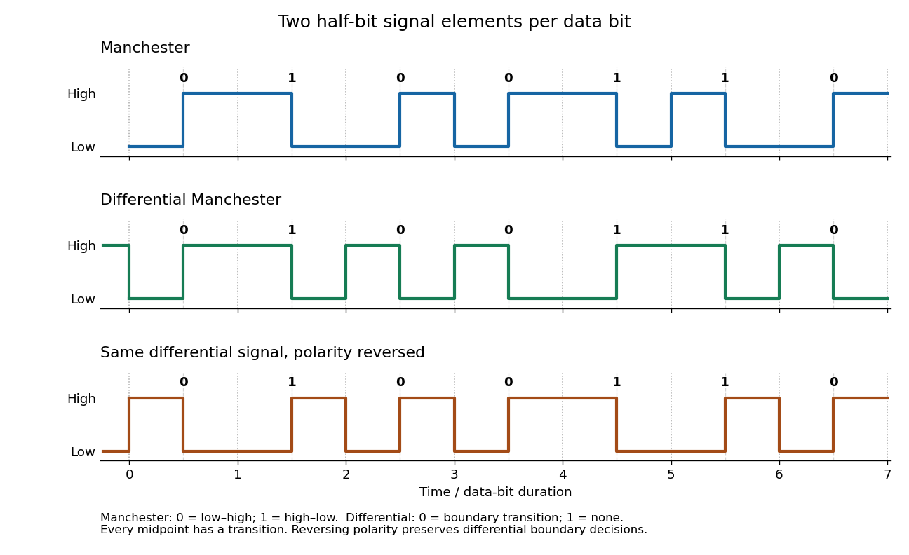

<h1 id="1/a/solution">Solution</h1>

↑ **Parent:** [A](../a.md)

The [bit rate](../../../../../bit-rate.md) counts data [bits](../../../../../bit.md) carried per second; the [baud rate](../../../../../symbol-rate.md) counts transmitted signal elements per second. A signal element need not carry one whole data [bit](../../../../../bit.md). In [Manchester encoding](../../../../../manchester-code.md), each data [bit](../../../../../bit.md) occupies two half-bit signal elements, one high and one low. For example, choose low–high for zero and high–low for one. The compulsory transition in the middle provides a timing reference for [clock recovery](../../../../../clock-recovery.md).

If one data [bit](../../../../../bit.md) lasts $T$ seconds, the [bit rate](../../../../../bit-rate.md) is $1/T$, while each half-bit signal element lasts $T/2$. With this binary signal-element convention,

$$
\boxed{R_b=1/T\ \text{bits/s},\qquad R_s=2/T=2R_b\ \text{baud}.}
$$

Thus a 10 Mbit/s [Manchester encoding](../../../../../manchester-code.md) signal uses 20 million half-bit signal elements per second. This is not a count of observed voltage transitions: some [bit](../../../../../bit.md) boundaries also contain a transition and others do not. Calling a whole two-element pattern a symbol gives a different symbol-counting convention; the physical fact is two half-bit elements per data [bit](../../../../../bit.md).

**[Figure 1](#1/a/image-manchester-encoding-and-differential-manchester-encoding-for-the-same-seven-bits-dotted-lines-mark-bit-boundaries-and-dashed-lines-mark-their-midpoints). Manchester encoding and differential Manchester encoding for the same seven bits; dotted lines mark bit boundaries and dashed lines mark their midpoints**.

## ↑ Ancestors (11)

1. [A](../a.md)
2. [1](../../1.md)
3. [Computer networks](../../../computer-networks-split.md)
4. [2015](../../../split.md)
5. [Past exam of the computer science course of the University of Oxford](../../../../split.md)
6. [Computer science course of the University of Oxford](../../../../../computer-science-course-of-the-university-of-oxford.md)
7. [Undergraduate course of the University of Oxford](../../../../../undergraduate-course-of-the-university-of-oxford.md)
8. [Course of the University of Oxford](../../../../../course-of-the-university-of-oxford.md)
9. [University of Oxford](../../../../../university-of-oxford-split.md)
10. [List of universities](../../../../../list-of-universities.md)
11. [Codex Wiki](../../../../../split.md)
