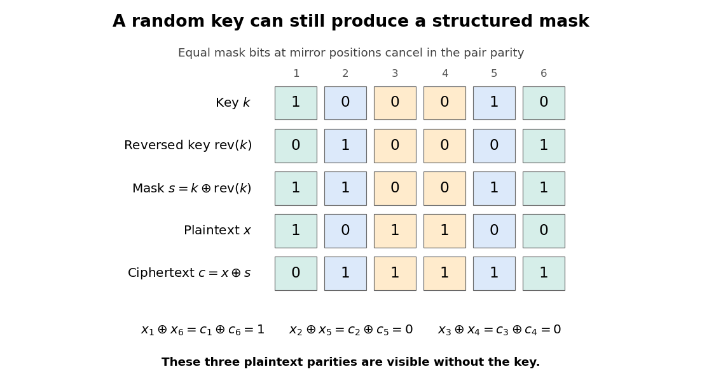

# Computer security

↑ **Parent:** [2015](../2015.md)

Solutions to all three questions of the examination dated 15 June 2015. The cover permits candidates to answer two questions.[Cover, A12073W1; questions on printed pages 2–7](../../computer-science-bibliography.md#computer-security-examination-paper-by-the-university-of-oxford-2015)

The [authentication](../../computer-science.md#authentication) claims in Question 2 require particular care: the printed third message permits substitution of Bob's key ticket after his [cryptographic nonce](../../computer-science.md#cryptographic-nonce) becomes public. The solutions distinguish the intended freshness argument from the [Dolev-Yao model](../../computer-science.md#dolev-yao-model) attack that defeats Bob's [authentication](../../computer-science.md#authentication). This is a property of the printed [protocol](../../computer-network.md#communication-protocol), rather than a missing part of the source.

**Table of contents**

- [1](#1)
  - [a](#1/a)
    - [i](#1/a/i)
      - [Solution](#1/a/i/solution)
    - [ii](#1/a/ii)
      - [Solution](#1/a/ii/solution)
    - [iii](#1/a/iii)
      - [Solution](#1/a/iii/solution)
  - [b](#1/b)
    - [i](#1/b/i)
      - [Solution](#1/b/i/solution)
    - [ii](#1/b/ii)
      - [Solution](#1/b/ii/solution)
  - [c](#1/c)
    - [i](#1/c/i)
      - [Solution](#1/c/i/solution)
    - [ii](#1/c/ii)
      - [Solution](#1/c/ii/solution)
  - [d](#1/d)
    - [i](#1/d/i)
      - [Solution](#1/d/i/solution)
    - [ii](#1/d/ii)
      - [Solution](#1/d/ii/solution)
    - [iii](#1/d/iii)
      - [Solution](#1/d/iii/solution)
- [2](#2)
  - [a](#2/a)
    - [i](#2/a/i)
      - [Solution](#2/a/i/solution)
    - [ii](#2/a/ii)
      - [Solution](#2/a/ii/solution)
    - [iii](#2/a/iii)
      - [Solution](#2/a/iii/solution)
  - [b](#2/b)
    - [i](#2/b/i)
      - [Solution](#2/b/i/solution)
    - [ii](#2/b/ii)
      - [Solution](#2/b/ii/solution)
    - [iii](#2/b/iii)
      - [Solution](#2/b/iii/solution)
    - [iv](#2/b/iv)
      - [Solution](#2/b/iv/solution)
    - [v](#2/b/v)
      - [Solution](#2/b/v/solution)
  - [c](#2/c)
    - [Solution](#2/c/solution)
  - [d](#2/d)
    - [Solution](#2/d/solution)
- [3](#3)
  - [a](#3/a)
    - [Solution](#3/a/solution)
  - [b](#3/b)
    - [i](#3/b/i)
      - [Solution](#3/b/i/solution)
    - [ii](#3/b/ii)
      - [Solution](#3/b/ii/solution)
  - [c](#3/c)
    - [Solution](#3/c/solution)
  - [d](#3/d)
    - [i](#3/d/i)
      - [Solution](#3/d/i/solution)
    - [ii](#3/d/ii)
      - [Solution](#3/d/ii/solution)
    - [iii](#3/d/iii)
      - [Solution](#3/d/iii/solution)
  - [e](#3/e)
    - [i](#3/e/i)
      - [Solution](#3/e/i/solution)
    - [ii](#3/e/ii)
      - [Solution](#3/e/ii/solution)
    - [iii](#3/e/iii)
      - [Solution](#3/e/iii/solution)
    - [iv](#3/e/iv)
      - [Solution](#3/e/iv/solution)

## 1

↑ **Parent:** [Computer security](computer-security.md)

<h3 id="1/a">a</h3>

↑ **Parent:** [1](#1)

<h4 id="1/a/i">i</h4>

↑ **Parent:** [A](#1/a)

<h5 id="1/a/i/solution">Solution</h5>

↑ **Parent:** [I](#1/a/i)

The [Bell-LaPadula model](../../computer-science.md#bell-lapadula-model) protects [information confidentiality](../../computer-science.md#information-confidentiality) by controlling information flow between security levels. Its [simple security property](../../computer-science.md#simple-security-property) says that a subject may read only objects whose classification does not exceed its maximum clearance:

$$
f_O(o)\le f_S(s).
$$

Thus a user cleared for confidential material cannot directly read a secret file. A [readwrite](../../computer-science.md#readwrite) permission includes reading and must satisfy the same restriction. This is an [access control](../../computer-science.md#access-control) rule about who can learn existing contents; it says nothing by itself about where a cleared subject can subsequently copy them.

$$
\boxed{\text{The ss-property enforces confidentiality: no reading above maximum clearance.}}
$$

<h4 id="1/a/ii">ii</h4>

↑ **Parent:** [A](#1/a)

<h5 id="1/a/ii/solution">Solution</h5>

↑ **Parent:** [Ii](#1/a/ii)

The [Bell-LaPadula star property](../../computer-science.md#bell-lapadula-star-property) restricts information flow using the subject's current level. With the paper's distinction between blind writing and reading, its usual current-level formulation is

| Access | Required comparison |
| --- | --- |
| Read | $f_O(o)\le f_C(s)$ |
| Blind write | $f_C(s)\le f_O(o)$ |
| Readwrite | $f_C(s)=f_O(o)$ |

Here $f_C(s)\le f_S(s)$ also holds. The first row means that reading above the current level is forbidden; the second is the familiar prohibition on writing down. Their conjunction gives the third row. Blind writing upwards is allowed because it need not disclose the higher file's contents to the writer.

For example, a subject operating at secret level cannot copy a secret file into a public file, even though its clearance would permit reading both files. More generally, any simultaneously readable object must be at most as highly classified as any writable object. A subject must not evade the rule by retaining secret information and then lowering its current level: level-changing transitions need their own safe treatment of retained information and open accesses.

$$
\boxed{\text{Read at or below the current level; write at or above it.}}
$$

<h4 id="1/a/iii">iii</h4>

↑ **Parent:** [A](#1/a)

<h5 id="1/a/iii/solution">Solution</h5>

↑ **Parent:** [Iii](#1/a/iii)

First, the [Bell-LaPadula model](../../computer-science.md#bell-lapadula-model) is a [information confidentiality](../../computer-science.md#information-confidentiality) policy. It permits a low-level subject to overwrite a more highly classified object by blind writing. That can destroy a high-level file or introduce false data without disclosing its old contents. Thus it does not supply a [data integrity](../../computer-science.md#data-integrity) policy, and it also does not ensure [service availability](../../computer-science.md#service-availability). Modern [multiuser operating systems](../../operating-system.md#multiuser-operating-system) require protection against modification and resource exhaustion as well as disclosure.

Second, a single hierarchy of classifications cannot express ordinary independent user ownership and selective collaboration. Two users at the same level may still need different permissions on their respective files; conversely, an authorised publication may deliberately release selected information to lower levels. The simple model lacks those owner-specific permissions and controlled release decisions. Adding [discretionary access control](../../computer-science.md#discretionary-access-control), categories and explicit [declassification](../../computer-science.md#declassification) mechanisms is substantial additional policy.

$$
\boxed{\text{It omits integrity requirements and cannot express ordinary selective sharing.}}
$$

<h3 id="1/b">b</h3>

↑ **Parent:** [1](#1)

<h4 id="1/b/i">i</h4>

↑ **Parent:** [B](#1/b)

<h5 id="1/b/i/solution">Solution</h5>

↑ **Parent:** [I](#1/b/i)

For distinct [prime numbers](../../prime-number.md) $p,q$, compute the [Euler totient function](../../number-theory.md#euler-totient-function)

$$
\varphi(n)=(p-1)(q-1).
$$

The [RSA cryptosystem](../../algebra.md#rsa-cryptosystem) private exponent is a [modular multiplicative inverse](../../number-theory.md#modular-multiplicative-inverse) of the public exponent:

$$
\boxed{d\equiv 3^{-1}\pmod{\varphi(n)},\qquad 3d\equiv1\pmod{\varphi(n)}.}
$$

Use the [extended Euclidean algorithm](../../number-theory.md#extended-euclidean-algorithm) on $3$ and $\varphi(n)$. It produces [integers](../../integer.md) $u,v$ with $3u+\varphi(n)v=1$, and reducing $u$ modulo $\varphi(n)$ gives a suitable positive $d$. Searching through possible exponents is unnecessary.

To see correctness even for a [plaintext](../../coding-theory.md#plaintext) sharing a factor with $n$, write $3d=1+t\varphi(n)$. Modulo $p$, either $m=0$ or [Fermat's little theorem](../../number-theory.md#fermat-little-theorem) gives $m^{3d}=m$; the same holds modulo $q$. The [Chinese remainder theorem](../../mathematics.md#chinese-remainder-theorem) then gives $c^d=m\pmod n$. One may alternatively invert $3$ modulo $\operatorname{lcm}(p-1,q-1)$, but inversion modulo $\varphi(n)$ is sufficient for this paper.

<h4 id="1/b/ii">ii</h4>

↑ **Parent:** [B](#1/b)

<h5 id="1/b/ii/solution">Solution</h5>

↑ **Parent:** [Ii](#1/b/ii)

The essential exponent condition is

$$
\gcd\bigl(3,(p-1)(q-1)\bigr)=1.
$$

Otherwise the [modular multiplicative inverse](../../number-theory.md#modular-multiplicative-inverse) defining $d$ does not exist. For large [prime numbers](../../prime-number.md) greater than three, this is equivalent to

$$
\boxed{p\equiv q\equiv2\pmod3.}
$$

If, for example, $p\equiv1\pmod3$, the multiplicative group modulo $p$ has order divisible by three, and cubing is not a [bijection](../../function.md#bijection); distinct [plaintexts](../../coding-theory.md#plaintext) can have the same [ciphertext](../../coding-theory.md#ciphertext). Unique [decryption](../../computer-science.md#decryption) of all messages would then be impossible.

The [prime numbers](../../prime-number.md) must also be distinct for the displayed totient formula, and selected sufficiently large and independently that [integer factorization](../../number-theory.md#integer-factorization) of $n=pq$ is infeasible. A small factor, equal factors, or an exceptionally small difference between $p$ and $q$ gives an avoidable factorisation weakness. These size and generation conditions address security; the congruence condition addresses invertibility of cubing.

<h3 id="1/c">c</h3>

↑ **Parent:** [1](#1)

<h4 id="1/c/i">i</h4>

↑ **Parent:** [C](#1/c)

<h5 id="1/c/i/solution">Solution</h5>

↑ **Parent:** [I](#1/c/i)

All calculations are in [modular arithmetic](../../modular-arithmetic.md) modulo $n$. Expand the two expressions appearing in the proposed quotient:

$$
\begin{aligned}
c_2+2c_1-1&\equiv(m+1)^3+2m^3-1\\
&=3m^3+3m^2+3m,\\
c_2-c_1+2&\equiv(m+1)^3-m^3+2\\
&=3m^2+3m+3.
\end{aligned}
$$

The first is exactly $m$ times the second. Multiplication by the assumed [modular multiplicative inverse](../../number-theory.md#modular-multiplicative-inverse) therefore gives

$$
\boxed{m\equiv(c_2+2c_1-1)(c_2-c_1+2)^{-1}\pmod n.}
$$

The representative in $\{0,\ldots,n-1\}$ is the [plaintext](../../coding-theory.md#plaintext). This [RSA related-message attack](../../algebra.md#rsa-related-message-attack) uses a relation between messages to turn two cubic equations into a linear equation; it does not recover the [private key](../../computer-science.md#private-key) or factor $n$ in the invertible case.

<h4 id="1/c/ii">ii</h4>

↑ **Parent:** [C](#1/c)

<h5 id="1/c/ii/solution">Solution</h5>

↑ **Parent:** [Ii](#1/c/ii)

For each candidate nonzero offset $k\in\{1,\ldots,2^{16}-1\}$, expansion gives

$$
\begin{aligned}
D_k&=c_2-c_1+2k^3\equiv3k(m^2+km+k^2),\\
N_k&=k(c_2+2c_1-k^3)\equiv3km(m^2+km+k^2).
\end{aligned}
$$

Consequently, if $D_k$ is invertible, the candidate is

$$
\boxed{m_k\equiv k(c_2+2c_1-k^3)(c_2-c_1+2k^3)^{-1}\pmod n.}
$$

Compute the [modular multiplicative inverse](../../number-theory.md#modular-multiplicative-inverse) using the [extended Euclidean algorithm](../../number-theory.md#extended-euclidean-algorithm), then verify both $m_k^3\equiv c_1$ and $(m_k+k)^3\equiv c_2\pmod n$. The [RSA cryptosystem](../../algebra.md#rsa-cryptosystem) cubing map is a [bijection](../../function.md#bijection), so an accepted candidate cannot be a different [plaintext](../../coding-theory.md#plaintext) with the same first [ciphertext](../../coding-theory.md#ciphertext). This costs fewer than $2^{16}$ trials, each involving polynomially many operations in the bit length of $n$.

There is a useful way to handle every denominator exception for a correct nonzero $k$. Compute $g=\gcd(D_k,n)$. If $1<g<n$, this [greatest common divisor](../../divisibility.md#greatest-common-divisor) factors $n$, allowing ordinary [RSA cryptosystem](../../algebra.md#rsa-cryptosystem) [decryption](../../computer-science.md#decryption). If $g=n$, then $D_k=0\pmod n$. The permitted [prime numbers](../../prime-number.md) are $2\pmod3$ and much larger than $k$, so $k$ is invertible modulo each. The equation $m^2+km+k^2=0$ would make $m/k$ a nontrivial cube root of one, impossible in a group of order [coprime](../../divisibility.md#coprime-integers) to three. Thus $g=n$ cannot occur for the correct nonzero offset under these hypotheses.

If the bound in the question is read as also allowing $k=0$, then $c_1=c_2$ and there is no additional information: the problem reduces to inverting a single ordinary [RSA cryptosystem](../../algebra.md#rsa-cryptosystem) [ciphertext](../../coding-theory.md#ciphertext). The small-offset attack requires a nonzero difference; that is the natural reading of distinct related messages.

<h3 id="1/d">d</h3>

↑ **Parent:** [1](#1)

<h4 id="1/d/i">i</h4>

↑ **Parent:** [D](#1/d)

<h5 id="1/d/i/solution">Solution</h5>

↑ **Parent:** [I](#1/d/i)

Avoid constructing the huge [integers](../../integer.md) $c^{3^j}$ explicitly. Maintain $a_0=c$ and $a_j=a_{j-1}^3\bmod n$, computing $g_j=\gcd(a_j-c,n)$ after each step.

In case (1), the nontrivial [greatest common divisor](../../divisibility.md#greatest-common-divisor) $g_k$ is one of the [prime factors](../../prime-number.md#prime-factor) $p,q$. Divide $n$ by it, compute $d$ with the [extended Euclidean algorithm](../../number-theory.md#extended-euclidean-algorithm), and return $c^d\bmod n$.

In case (2), $a_k=c\pmod n$. The preceding value satisfies $a_{k-1}^3=c\pmod n$. Cubing is a [bijection](../../function.md#bijection) on the [residue classes](../../modular-arithmetic.md#residue-class) modulo $n$, so there is only one such cube root, namely the original [plaintext](../../coding-theory.md#plaintext) $m$. Therefore

$$
\boxed{\begin{array}{ll}1<g_k<n:&\text{factor }n\text{ and decrypt};\\g_k=n:&m=a_{k-1}=c^{3^{k-1}}\bmod n.\end{array}}
$$

For $k=1$, the preceding value is $a_0=c$; a fixed point is its own [plaintext](../../coding-theory.md#plaintext). Keeping the previous iterate makes the recovery immediate once the [RSA cycling attack](../../algebra.md#rsa-cycling-attack) succeeds.

<h4 id="1/d/ii">ii</h4>

↑ **Parent:** [D](#1/d)

<h5 id="1/d/ii/solution">Solution</h5>

↑ **Parent:** [Ii](#1/d/ii)

Take the positive [integer](../../integer.md) $k$ whose existence is allowed by the question and write

$$
3^k=1+t(p-1)(q-1).
$$

Modulo $p$, if $c=0$ then $c^{3^k}=c$ directly. Otherwise [Fermat's little theorem](../../number-theory.md#fermat-little-theorem) applies, since $3^k-1$ is a multiple of $p-1$. Hence $c^{3^k}=c\pmod p$. The same two-case argument works modulo $q$. By the [Chinese remainder theorem](../../mathematics.md#chinese-remainder-theorem),

$$
c^{3^k}\equiv c\pmod n,
$$

so

$$
\boxed{g_k=\gcd(c^{3^k}-c,n)=n.}
$$

This also covers a [ciphertext](../../coding-theory.md#ciphertext) that is not [coprime](../../divisibility.md#coprime-integers) to $n$; applying [Euler's theorem](../../number-theory.md#euler-s-theorem) without checking that hypothesis would miss this detail. Equivalently, repeated application of a [permutation](../../combinatorics.md#permutation) on a finite set eventually returns to the starting point, although the arithmetic argument gives the requested sufficient exponent.

<h4 id="1/d/iii">iii</h4>

↑ **Parent:** [D](#1/d)

<h5 id="1/d/iii/solution">Solution</h5>

↑ **Parent:** [Iii](#1/d/iii)

The fact that a nontrivial factor usually appears before a full return does not say that either event appears soon. Each iteration of the [RSA cycling attack](../../algebra.md#rsa-cycling-attack) is inexpensive, but the number of iterations can be enormous. The [multiplicative orders](../../number-theory.md#multiplicative-order) governing returns modulo $p$ and $q$ need not be small, and writing down a large return exponent does not provide a fast way to search the preceding iterations.

If this procedure factored arbitrary well-generated [RSA cryptosystem](../../algebra.md#rsa-cryptosystem) moduli in feasible time with substantial success, it would solve the associated [integer factorization](../../number-theory.md#integer-factorization) problem efficiently. If it instead rapidly returned the predecessor of a [ciphertext](../../coding-theory.md#ciphertext) without factoring, it would solve the [RSA inversion problem](../../algebra.md#rsa-inversion-problem). Both are intended to be infeasible for appropriate parameters. Efficient [integer factorization](../../number-theory.md#integer-factorization) certainly breaks [RSA cryptosystem](../../algebra.md#rsa-cryptosystem) security; the reverse implication for general [RSA inversion problem](../../algebra.md#rsa-inversion-problem) algorithms is not known.

$$
\boxed{\text{A likely factor before a return does not establish a feasible running time.}}
$$

Thus the stated observation alone provides no serious general attack on well-generated parameters. It also does not prove a lower bound: special moduli or messages with short cycles can be weak, and the hardness claims are computational assumptions.

## 2

↑ **Parent:** [Computer security](computer-security.md)

<h3 id="2/a">a</h3>

↑ **Parent:** [2](#2)

<h4 id="2/a/i">i</h4>

↑ **Parent:** [A](#2/a)

<h5 id="2/a/i/solution">Solution</h5>

↑ **Parent:** [I](#2/a/i)

[Bilateral authentication](../../computer-science.md#bilateral-authentication) means that each participant obtains assurance of the other's identity and participation in the relevant run: Alice authenticates Bob and Bob authenticates Alice. An observed name in a message is not such assurance. The [protocol](../../computer-network.md#communication-protocol) must prevent an adversary from supplying the evidence while the named peer is absent.

[Session key transport](../../computer-science.md#session-key-transport) means conveying an already selected [session key](../../computer-science.md#session-key) securely to its intended users. Here Tim selects $k_{AB}$ and sends it inside separate public-key-encrypted tickets for Alice and Bob. This differs from having Alice and Bob jointly derive a key to which both contribute.

$$
\boxed{\text{Both peers authenticate; Tim chooses and transports their session key.}}
$$

<h4 id="2/a/ii">ii</h4>

↑ **Parent:** [A](#2/a)

<h5 id="2/a/ii/solution">Solution</h5>

↑ **Parent:** [Ii](#2/a/ii)

A [trusted third party](../../computer-science.md#trusted-third-party) is an additional participant whose correct behaviour and protection of its secret state are assumptions on which the other parties rely. Here Alice and Bob rely on Tim to associate identities with the right [public keys](../../computer-science.md#public-key), generate fresh [session keys](../../computer-science.md#session-key), and keep the long-term shared secrets confidential.

Tim is allowed to know $k_{AB}$, so the intended [cryptographic confidentiality](../../computer-science.md#cryptographic-confidentiality) claim excludes the network adversary, rather than excluding Tim. Correct behaviour by Tim does not make every message purportedly sent by Tim authentic: the recipients must still verify the relevant evidence.

$$
\boxed{\text{Tim's correctness and secrecy are explicit trust assumptions.}}
$$

<h4 id="2/a/iii">iii</h4>

↑ **Parent:** [A](#2/a)

<h5 id="2/a/iii/solution">Solution</h5>

↑ **Parent:** [Iii](#2/a/iii)

In the [Dolev-Yao model](../../computer-science.md#dolev-yao-model), an adversary controls the network: it can intercept, suppress, delay, replay and redirect messages, impersonate network senders, and construct messages from values it knows. In particular, it can concatenate or split unprotected tuples, and can apply [encryption](../../computer-science.md#encryption) using any known [public key](../../computer-science.md#public-key) or known symmetric key.

[Cryptography](../../computer-science.md#cryptography) is idealised. Without the required [private key](../../computer-science.md#private-key) or symmetric key, the adversary cannot recover a protected [plaintext](../../coding-theory.md#plaintext) or construct an otherwise unavailable protected value. It cannot invent an unknown long-term secret merely because the containing [ciphertext](../../coding-theory.md#ciphertext) is visible. [Protocol](../../computer-network.md#communication-protocol) failures arise from the arrangement of messages even when these cryptographic primitives behave perfectly.

$$
\boxed{\text{Complete network control, with perfect cryptographic operations.}}
$$

<h3 id="2/b">b</h3>

↑ **Parent:** [2](#2)

<h4 id="2/b/i">i</h4>

↑ **Parent:** [B](#2/b)

<h5 id="2/b/i/solution">Solution</h5>

↑ **Parent:** [I](#2/b/i)

Alice's own freshness evidence is the ticket

$$
U=E_{\mathit{pk}_A}(\mathit{nonce}_A\Vert\mathit{secret}_A\Vert A\Vert B\Vert k_{AB}).
$$

After [decryption](../../computer-science.md#decryption), she checks her pending [cryptographic nonce](../../computer-science.md#cryptographic-nonce), the long-term shared secret and both identities. Only Alice and Tim know $\mathit{secret}_A$; with honest Tim and an unpredictable new $\mathit{nonce}_A$, a valid matching ticket establishes that Tim generated this [session key](../../computer-science.md#session-key) after that challenge was issued. A merely unused but predictable challenge does not establish that temporal ordering.

The claimed [authentication](../../computer-science.md#authentication) of Alice to Bob, however, is false for the printed [protocol](../../computer-network.md#communication-protocol). To exhibit the failure, let $I$ initiate message 1 using Alice's name while Alice is absent. Bob and Tim carry out messages 2 and 3 normally. Write the genuine message 3 as $(U,b,V)$, where $b=\mathit{nonce}_B$ and $V=E_{\mathit{pk}_B}(A\Vert B\Vert k_{AB})$. The adversary intercepts it, learns the unencrypted $b$, and chooses a symmetric key $z$ of its own.

The adversary sends Bob

$$
\bigl(U,b,E_{\mathit{pk}_B}(A\Vert B\Vert z)\bigr).
$$

Bob's checks of $b$ and the ticket identities pass, because anyone can encrypt using his [public key](../../computer-science.md#public-key). Bob sends message 4 using $z$; the adversary suppresses that message and returns $E_z(\text{Hello Bob})$ as message 5. Bob accepts Alice, although Alice has done nothing. No [encryption](../../computer-science.md#encryption) has been broken.

$$
\boxed{\text{Alice can check her ticket's freshness, but Bob has not authenticated Alice.}}
$$

The tempting intended argument is that only Alice, Bob and Tim could know the transported key, so message 5 proves Alice's participation. The substituted ticket invalidates its premise: Bob's accepted key is $z$, which the adversary knows.

<h4 id="2/b/ii">ii</h4>

↑ **Parent:** [B](#2/b)

<h5 id="2/b/ii/solution">Solution</h5>

↑ **Parent:** [Ii](#2/b/ii)

Alice can still authenticate Bob when she accepts a genuine fresh ticket and successfully checks $E_{k_{AB}}(\text{Hello Alice})$. The [session key](../../computer-science.md#session-key) inside her ticket is Tim's genuine key, protected by her [public key](../../computer-science.md#public-key) together with $\mathit{secret}_A$. Tim gives that same key only to Alice and to the holder of Bob's [private key](../../computer-science.md#private-key). The adversary cannot derive it, and honest Tim does not send the greeting. Alice has not sent that greeting either. Thus the matching greeting is evidence that Bob obtained the key and participated. The different final greetings prevent simply reflecting Alice's own confirmation back at her.

Bob's intended freshness test is that $\mathit{nonce}_B$ was hidden in his request encrypted for Tim, so a matching answer must follow Tim's processing of that request. This establishes that Tim revealed that [cryptographic nonce](../../computer-science.md#cryptographic-nonce); it does not authenticate the adjacent ticket. The substitution attack in [solution](#2/b/i/solution) may use an old adversary-known $z$ instead of a fresh one. Bob accepts it even though its freshness is false.

$$
\boxed{\text{Alice's check can authenticate Bob; Bob's accepted key need not be fresh.}}
$$

The defect is the absence of a cryptographic binding between Bob's [cryptographic nonce](../../computer-science.md#cryptographic-nonce) and his key ticket. A repair must bind the identities, both [cryptographic nonces](../../computer-science.md#cryptographic-nonce) and the [session key](../../computer-science.md#session-key) under [message authentication](../../computer-science.md#message-authentication) verifiable as Tim's, for example a [digital signature](../../computer-science.md#digital-signature) by Tim over the response, checked before Bob accepts. Merely moving the nonce inside a public-key-encrypted ticket is insufficient once an attacker knows or predicts it: anyone can create such an [encryption](../../computer-science.md#encryption).

<h4 id="2/b/iii">iii</h4>

↑ **Parent:** [B](#2/b)

<h5 id="2/b/iii/solution">Solution</h5>

↑ **Parent:** [Iii](#2/b/iii)

The final messages contain fixed greetings, rather than a fresh challenge for their particular run. Their freshness is inherited entirely from the [session key](../../computer-science.md#session-key). If a key is reused, a previously recorded $E_k(\text{Hello Alice})$ or $E_k(\text{Hello Bob})$ becomes acceptable evidence again. An adversary can then mount a [replay attack](../../computer-science.md#replay-attack) without knowing $k$ and without the purported speaker taking part in the new run.

Reusing a previously compromised [session key](../../computer-science.md#session-key) is worse: the adversary can create both confirmations and read protected traffic. Fresh independent [session keys](../../computer-science.md#session-key) limit that reuse, although they cannot fix the unauthenticated-ticket flaw shown in [solution](#2/b/i/solution).

$$
\boxed{\text{Fixed confirmations are fresh only when their session key is fresh.}}
$$

<h4 id="2/b/iv">iv</h4>

↑ **Parent:** [B](#2/b)

<h5 id="2/b/iv/solution">Solution</h5>

↑ **Parent:** [Iv](#2/b/iv)

An unpredictable random $64$-[bit](../../information-theory.md#bit) [cryptographic nonce](../../computer-science.md#cryptographic-nonce) is better for Alice than a predictable counter, provided repetitions are detected or made sufficiently unlikely. Alice wants a matching ticket to imply a response to her present challenge, and the [protocol](../../computer-network.md#communication-protocol) lets anyone ask Tim for a ticket containing a chosen $\mathit{nonce}_A$.

Suppose an adversary predicts that Alice's next challenge for Bob will be $a$. Before Alice starts that run, the adversary sends $(A,B,a)$ to Bob as message 1. Bob asks Tim for a [session key](../../computer-science.md#session-key) $k$ and returns the genuine pair $(U,E_k(\text{Hello Alice}))$ in message 4. The adversary stores that pair and lets the early run lapse. Later, when Alice really emits $(A,B,a)$, the adversary blocks it and delivers the stored pair. Alice's ticket and greeting checks pass, despite the key and Bob's participation predating her run. This is a [preplay attack](../../computer-science.md#preplay-attack) on freshness and recent participation. Bob need not accept Alice's eventual message 5 for Alice's acceptance to have failed its freshness goal.

Success requires the predicted value and identities to match, an early run that yields the matching ticket and greeting, and Alice to accept solely from the outstanding value without additional expiry or run binding. No [session key](../../computer-science.md#session-key) disclosure is needed to defeat freshness; if that old key has also been compromised, impersonation and loss of [cryptographic confidentiality](../../computer-science.md#cryptographic-confidentiality) follow as well.

$$
\boxed{\text{Use an unpredictable fresh nonce to resist advance collection of valid replies.}}
$$

A guess at a particular uniformly random value has [probability](../../probability-theory.md#probability) $2^{-64}$ per independent attempt, with success approximately $r/2^{64}$ for $r$ distinct guesses when that ratio is small. Random choice does not itself guarantee uniqueness: among $t$ independent values the [birthday problem](../../probability-and-statistics.md#birthday-problem) collision scale is approximately $t(t-1)/2^{65}$. Counter uniqueness and unpredictability are different requirements.

<h4 id="2/b/v">v</h4>

↑ **Parent:** [B](#2/b)

<h5 id="2/b/v/solution">Solution</h5>

↑ **Parent:** [V](#2/b/v)

Bob especially needs unpredictability, because $\mathit{nonce}_B$ is intended to be secret until Tim processes the request. A predictable counter destroys even that limited assurance.

If the adversary knows Bob's next value $b$, it initiates a run with Alice's name and intercepts Bob's request. Without consulting Tim, it chooses a key $z$, constructs $V^*=E_{\mathit{pk}_B}(A\Vert B\Vert z)$, and sends $(U^*,b,V^*)$ as message 3, with any suitably shaped opaque ticket $U^*$ for Alice. Bob cannot inspect that ticket. He accepts $z$, sends message 4, and accepts the adversary's $E_z(\text{Hello Bob})$. Alice and Tim need not participate.

This [preplay attack](../../computer-science.md#preplay-attack) requires a correct prediction of Bob's outstanding value, knowledge of his [public key](../../computer-science.md#public-key), and the ability to intercept or race the genuine response. Observing an earlier unencrypted response may expose a counter value from which to predict the next. With an independent uniformly random hidden $64$-[bit](../../information-theory.md#bit) value, blind prediction succeeds with [probability](../../probability-theory.md#probability) $2^{-64}$ per attempt.

$$
\boxed{\text{A random hidden nonce blocks prediction, but not message-3 substitution.}}
$$

In particular, random [cryptographic nonces](../../computer-science.md#cryptographic-nonce) do not make the printed [protocol](../../computer-network.md#communication-protocol) sound. After the genuine message 3 reveals $b$, the adversary can use exactly the substitution in [solution](#2/b/i/solution). Predictability allows an earlier attack without Tim; lack of response binding allows an attack even with perfect unpredictability.

<h3 id="2/c">c</h3>

↑ **Parent:** [2](#2)

<h4 id="2/c/solution">Solution</h4>

↑ **Parent:** [C](#2/c)

A [denial-of-service attack](../../computer-science.md#denial-of-service-attack) can exploit both an honest relay and replay at Tim. The adversary repeatedly sends cheap unauthenticated message-1 requests naming Alice and Bob. Bob then performs the public-key [encryption](../../computer-science.md#encryption) in message 2, and Tim performs a private-key [decryption](../../computer-science.md#decryption), generates a [session key](../../computer-science.md#session-key), looks up the users' records and performs two public-key [encryptions](../../computer-science.md#encryption). The adversary's first messages contain no cryptographic work.

Alternatively, after observing one valid message 2, the adversary submits copies directly to Tim. It remains well formed; the printed [protocol](../../computer-network.md#communication-protocol) has no request-replay cache. Tim's promise to reject malformed requests does not imply duplicate suppression. Each replay can provoke the expensive operations again. If such a cache is added, the repeated-message-1 method still induces distinct requests through Bob unless admission is controlled.

$$
\boxed{\text{Unauthenticated initiations or replayed valid requests amplify work at Tim.}}
$$

<h3 id="2/d">d</h3>

↑ **Parent:** [2](#2)

<h4 id="2/d/solution">Solution</h4>

↑ **Parent:** [D](#2/d)

Place a [proof of work](../../computer-science.md#proof-of-work) gate before Tim performs the expensive private-key [decryption](../../computer-science.md#decryption) in message 2. Binding the puzzle to the whole request prevents solving a cheap puzzle once and reusing it with different tickets.

For example, let $R$ be the exact encoding of message 2, including identities, Alice's [cryptographic nonce](../../computer-science.md#cryptographic-nonce) and Bob's encrypted component. On receiving a proposed request, Tim does only cheap length and format checks and returns a fresh challenge $r$, an expiry time $t$, a difficulty $d$ and a cookie

$$
\tau=\operatorname{MAC}_{s_T}(\text{puzzle}\Vert h(R)\Vert r\Vert t\Vert d).
$$

Here $s_T$ is Tim's cookie secret and the [message authentication code](../../computer-science.md#message-authentication-code) prevents alteration of the challenge or difficulty. Tim need not retain large amounts of per-request state merely to issue the cookie.

The requester finds a suffix $w$ such that

$$
\boxed{h(\text{work}\Vert h(R)\Vert r\Vert t\Vert d\Vert w)\text{ begins with }d\text{ zero bits}.}
$$

Under the usual unpredictable-hash-output model, this takes an expected $2^d$ trials; verifying a proposed suffix needs one [cryptographic hash function](../../computer-science.md#cryptographic-hash-function) evaluation after checking the request digest and cookie. [Preimage resistance](../../computer-science.md#preimage-resistance) motivates search difficulty, but the exact $2^d$ estimate also uses that distribution assumption.

The requester returns $(R,r,t,d,\tau,w)$. Before any expensive [decryption](../../computer-science.md#decryption), Tim verifies the cookie, expiry, work and request binding, and atomically records that this challenge has been consumed. Repeated submissions of a consumed challenge are rejected cheaply. Short expiry bounds the storage needed for spent challenges. A cookie alone is insufficient: without one-use enforcement, the attacker could replay a single valid solved request indefinitely.

To charge the work to the initiator rather than Bob, Bob can relay the challenge to Alice and forward her solution. The adversary's fake Alice must then solve each puzzle instead of making honest Bob do it. Tim must issue challenges and reject bad proofs with bounded inexpensive processing, and difficulty should be chosen so that many verified requests require substantial aggregate work. This mitigates the computational [denial-of-service attack](../../computer-science.md#denial-of-service-attack); it does not correct the separate [authentication](../../computer-science.md#authentication) flaw.

## 3

↑ **Parent:** [Computer security](computer-security.md)

<h3 id="3/a">a</h3>

↑ **Parent:** [3](#3)

<h4 id="3/a/solution">Solution</h4>

↑ **Parent:** [A](#3/a)

In a [ciphertext-only attack](../../computer-science.md#ciphertext-only-attack), the adversary sees [ciphertexts](../../coding-theory.md#ciphertext) but has no supplied corresponding [plaintexts](../../coding-theory.md#plaintext). In a [known-plaintext attack](../../computer-science.md#known-plaintext-attack), it also knows one or more matching [plaintext](../../coding-theory.md#plaintext)–[ciphertext](../../coding-theory.md#ciphertext) pairs. In a [chosen-plaintext attack](../../computer-science.md#chosen-plaintext-attack), it can select [plaintexts](../../coding-theory.md#plaintext) and obtain their [encryptions](../../computer-science.md#encryption), possibly choosing later inputs from earlier results.

The ordinary [exhaustive key search](../../computer-science.md#exhaustive-key-search) is a [known-plaintext attack](../../computer-science.md#known-plaintext-attack): given $x$ and $c=E_k(x)$, try candidate keys $k'$ and compare $E_{k'}(x)$ with $c$. A uniformly selected $m$-[bit](../../information-theory.md#bit) key has average position $(2^m+1)/2$ in any fixed search order, so

$$
\boxed{\text{ordinary exhaustion: known plaintext; approximately }2^{m-1}\text{ encryptions}.}
$$

This counts testing until the actual key is reached. One known pair may leave false candidate keys when $m$ is large relative to the block length $n$; additional pairs distinguish them. If a [plaintext](../../coding-theory.md#plaintext) has recognisable redundancy, a [ciphertext-only attack](../../computer-science.md#ciphertext-only-attack) can sometimes test keys by that redundancy instead, but this is an additional assumption rather than the standard supplied-pair setting.

<h3 id="3/b">b</h3>

↑ **Parent:** [3](#3)

<h4 id="3/b/i">i</h4>

↑ **Parent:** [B](#3/b)

<h5 id="3/b/i/solution">Solution</h5>

↑ **Parent:** [I](#3/b/i)

[Perfect secrecy](../../coding-theory.md#perfect-secrecy) means that observing the [ciphertext](../../coding-theory.md#ciphertext) changes no [probability](../../probability-theory.md#probability) concerning the [plaintext](../../coding-theory.md#plaintext). For every distribution of the message $X$, and every $x,c$ with $\Pr(C=c)>0$,

$$
\boxed{\Pr(X=x\mid C=c)=\Pr(X=x).}
$$

Equivalently, for every pair $x,x'$ the conditional [probability distributions](../../probability-distribution.md) of the [ciphertext](../../coding-theory.md#ciphertext) are identical:

$$
\Pr(C=c\mid X=x)=\Pr(C=c\mid X=x').
$$

The randomness here comes from independent key generation and any [encryption](../../computer-science.md#encryption) randomness. The claim is information theoretic: unlimited computation cannot extract information about $X$ from $C$ beyond what was known beforehand.

<h4 id="3/b/ii">ii</h4>

↑ **Parent:** [B](#3/b)

<h5 id="3/b/ii/solution">Solution</h5>

↑ **Parent:** [Ii](#3/b/ii)

Let $s=k\oplus\operatorname{rev}(k)$ be the effective mask. For each position $i$,

$$
s_i=k_i\oplus k_{n+1-i}=s_{n+1-i}.
$$

Thus the mask is always a [palindrome](../../foundations-of-mathematics.md#palindrome), even though $k$ itself is uniformly random. The [exclusive or](../../theoretical-computer-science.md#exclusive-or) of the [ciphertext](../../coding-theory.md#ciphertext) bits in a mirror pair is

$$
c_i\oplus c_{n+1-i}=x_i\oplus x_{n+1-i},
$$

because the equal mask bits cancel. The observer learns the corresponding [plaintext](../../coding-theory.md#plaintext) parity exactly. If $n$ is odd, the middle mask bit is also zero, so the middle [plaintext](../../coding-theory.md#plaintext) bit is exposed directly.

An explicit failure of [perfect secrecy](../../coding-theory.md#perfect-secrecy) works for every $n\ge1$. Choose $X$ uniformly from $0^n$ and $10^{n-1}$. For $X=0^n$, the [ciphertext](../../coding-theory.md#ciphertext) is a [palindrome](../../foundations-of-mathematics.md#palindrome) with [probability](../../probability-theory.md#probability) one. For $X=10^{n-1}$ and $n\ge2$, toggling just the first bit breaks the mirror equality, so the [ciphertext](../../coding-theory.md#ciphertext) is a [palindrome](../../foundations-of-mathematics.md#palindrome) with [probability](../../probability-theory.md#probability) zero. For $n=1$, the effective mask is zero and $C=X$. Observing $C$ therefore distinguishes these two messages perfectly.

$$
\boxed{C\oplus\operatorname{rev}(C)=X\oplus\operatorname{rev}(X):\ \text{plaintext structure leaks}.}
$$

There are only $2^{\lfloor n/2\rfloor}$ possible effective masks, each equally likely. Hence even a fresh $n$-[bit](../../information-theory.md#bit) key supplies at most $\lfloor n/2\rfloor$ independent masking bits in this construction. Choosing a long, uniform, one-use key is insufficient if the [encryption](../../computer-science.md#encryption) transformation collapses its randomness.

**[Figure 1](#3/b/ii/image-mirror-paired-mask-bits-cancel-exposing-the-plaintext-parity-in-each-pair). Mirror-paired mask bits cancel, exposing the plaintext parity in each pair**.

<h3 id="3/c">c</h3>

↑ **Parent:** [3](#3)

<h4 id="3/c/solution">Solution</h4>

↑ **Parent:** [C](#3/c)

An [existential forgery](../../computer-science.md#existential-forgery) produces a valid [digital signature](../../computer-science.md#digital-signature) on at least one new message, even if the adversary has no useful control over that message's meaning. A [universal forgery](../../computer-science.md#universal-forgery) gives a way to forge a [digital signature](../../computer-science.md#digital-signature) on an arbitrary specified message. Recovering the [private key](../../computer-science.md#private-key) suffices for a [universal forgery](../../computer-science.md#universal-forgery), but is not required if another general signing method exists.

In a [key-only signature attack](../../computer-science.md#key-only-signature-attack), the adversary knows the verification [public key](../../computer-science.md#public-key) and the public scheme. In a [known-message signature attack](../../computer-science.md#known-message-signature-attack), it additionally obtains valid message–[digital signature](../../computer-science.md#digital-signature) pairs whose messages it did not choose. In a [chosen-message signature attack](../../computer-science.md#chosen-message-signature-attack), it can ask for [digital signatures](../../computer-science.md#digital-signature) on messages it chooses, possibly adaptively. Its final forged message must not be one of the messages already submitted for signing; otherwise simply returning a supplied pair would count as a forgery.

$$
\boxed{\text{Existential: some new message; universal: an arbitrary target message.}}
$$

<h3 id="3/d">d</h3>

↑ **Parent:** [3](#3)

<h4 id="3/d/i">i</h4>

↑ **Parent:** [D](#3/d)

<h5 id="3/d/i/solution">Solution</h5>

↑ **Parent:** [I](#3/d/i)

For authenticate-then-encrypt, write the intercepted pair as $(c,t)=(E_k(x),E_k(s))$, where $s=f(\mathit{sk},x)$. Each trial key $k'$ gives

$$
x'=D_{k'}(c),\qquad s'=D_{k'}(t).
$$

The adversary can check the public relation

$$
\boxed{g(\mathit{pk},s')\stackrel{?}=x'.}
$$

The true key always passes. An incorrect key will generally fail, and further intercepted pairs can eliminate accidental matches. This gives a [ciphertext-only attack](../../computer-science.md#ciphertext-only-attack) with a useful key-testing predicate even when the [plaintext](../../coding-theory.md#plaintext) has no recognisable format. It makes [exhaustive key search](../../computer-science.md#exhaustive-key-search) applicable with less prior information; it does not reduce the generic key-space size below $2^m$.

The usual approximate false-pass chance $2^{-n}$ is an ideal-behaviour estimate, not a consequence of the bare permutation identities alone. The decisive point is that the encrypted [digital signature](../../computer-science.md#digital-signature) supplies publicly checkable redundancy once a candidate [decryption](../../computer-science.md#decryption) key is tried.

<h4 id="3/d/ii">ii</h4>

↑ **Parent:** [D](#3/d)

<h5 id="3/d/ii/solution">Solution</h5>

↑ **Parent:** [Ii](#3/d/ii)

For encrypt-then-authenticate, choose any $n$-[bit](../../information-theory.md#bit) string $s$ and compute

$$
c=g(\mathit{pk},s).
$$

Send $(c,s)$. The receiver's correct check for this composition is $g(\mathit{pk},s)=c$ before [decryption](../../computer-science.md#decryption), so it passes by construction. The receiver obtains a [plaintext](../../coding-theory.md#plaintext) $x=D_k(c)$, although the adversary may not know it.

The finite domains justify the signature relation: $g\circ f$ is the identity on $2^n$ messages, so $f$ is injective and therefore bijective. Hence $g=f^{-1}$ and also $f\circ g$ is the identity. The chosen $s$ is therefore exactly $f(\mathit{sk},c)$, without the adversary ever evaluating $f$.

$$
\boxed{(g(\mathit{pk},s),s)\text{ is an existential forgery.}}
$$

This is a [key-only signature attack](../../computer-science.md#key-only-signature-attack) against raw unrestricted trapdoor signing. It does not invert $g$ at a chosen target and does not contradict the assumption that signing an independently specified new message is hard. It exploits choosing the [digital signature](../../computer-science.md#digital-signature) first. The observation concerns the paper's raw construction, rather than every encrypt-then-authenticate scheme.

<h4 id="3/d/iii">iii</h4>

↑ **Parent:** [D](#3/d)

<h5 id="3/d/iii/solution">Solution</h5>

↑ **Parent:** [Iii](#3/d/iii)

For encrypt-and-authenticate, the transmitted pair is $(E_k(x),s)$ with $s=f(\mathit{sk},x)$. The recovery map is public, so any observer computes

$$
\boxed{x=g(\mathit{pk},s).}
$$

No symmetric key, [exhaustive key search](../../computer-science.md#exhaustive-key-search) or oracle is needed. Publishing this message-recovery [digital signature](../../computer-science.md#digital-signature) reveals the entire [plaintext](../../coding-theory.md#plaintext) and breaks [cryptographic confidentiality](../../computer-science.md#cryptographic-confidentiality) outright. A [digital signature](../../computer-science.md#digital-signature) of a suitable digest would have different leakage properties, but the printed construction signs the raw block.

<h3 id="3/e">e</h3>

↑ **Parent:** [3](#3)

<h4 id="3/e/i">i</h4>

↑ **Parent:** [E](#3/e)

<h5 id="3/e/i/solution">Solution</h5>

↑ **Parent:** [I](#3/e/i)

The standard attack on this raw trapdoor construction chooses a candidate [digital signature](../../computer-science.md#digital-signature) $s$ first, computes $y=g(\mathit{pk},s)$, and uses a failure of [preimage resistance](../../computer-science.md#preimage-resistance) to find $x$ with $h(x)=y$. Then

$$
g(\mathit{pk},s)=h(x),
$$

so $(x,s)$ verifies. The resulting message is selected by the inversion procedure, rather than being an arbitrary prescribed document. This is an [existential forgery](../../computer-science.md#existential-forgery) under a [key-only signature attack](../../computer-science.md#key-only-signature-attack) whenever the inversion weakness applies with nonnegligible success to those sampled digests.

$$
\boxed{\text{Invert }g(\mathit{pk},s)\text{ under }h:\ \text{existential, key-only, on covered digests}.}
$$

The phrase “fails to be preimage resistant” must be read with its target distribution. Since $g$ is a [permutation](../../combinatorics.md#permutation), uniform $s$ gives a uniform $n$-[bit](../../information-theory.md#bit) digest; if inversion works only on a tiny identifiable exceptional set, this sampling method need not be feasible. Merely knowing a valid signed message and recovering that same message from its digest is not a new forgery. Producing a different message there requires a failure of [second-preimage resistance](../../computer-science.md#second-preimage-resistance). Part [solution](#3/e/iii/solution) removes the coverage qualification by explicitly granting inversion at every digest.

<h4 id="3/e/ii">ii</h4>

↑ **Parent:** [E](#3/e)

<h5 id="3/e/ii/solution">Solution</h5>

↑ **Parent:** [Ii](#3/e/ii)

A failure of [collision resistance](../../computer-science.md#collision-resistance) supplies distinct messages $x,x'$ with

$$
h(x)=h(x').
$$

Ask the legitimate signer to sign $x$, obtaining $s=f(\mathit{sk},h(x))$. Output $(x',s)$ without ever requesting a [digital signature](../../computer-science.md#digital-signature) on $x'$. Its verification succeeds because

$$
g(\mathit{pk},s)=h(x)=h(x').
$$

Thus

$$
\boxed{\text{Collision finding gives an existential forgery under chosen-message attack.}}
$$

The adversary chooses the collision pair, but cannot in general insist that one member equal an independently specified target. A [known-message signature attack](../../computer-science.md#known-message-signature-attack) would require the stronger ability to collide with an already signed message; finding an arbitrary collision alone does not provide that.

<h4 id="3/e/iii">iii</h4>

↑ **Parent:** [E](#3/e)

<h5 id="3/e/iii/solution">Solution</h5>

↑ **Parent:** [Iii](#3/e/iii)

Choose any candidate [digital signature](../../computer-science.md#digital-signature) $s$, compute $y=g(\mathit{pk},s)$, and invoke the granted algorithm to find $x$ with $h(x)=y$. Output $(x,s)$. Every chosen $s$ now leads to a valid message, with no need to search for a digest on which inversion happens to work.

$$
\boxed{\text{Every-digest inversion gives an existential forgery under key-only attack.}}
$$

This is stronger coverage than the generic failure discussed in [solution](#3/e/i/solution), but it does not by itself give a [universal forgery](../../computer-science.md#universal-forgery). For a target message $x_*$ fixed beforehand, the adversary needs $s$ satisfying $g(\mathit{pk},s)=h(x_*)$, which inverts the trapdoor map $g$. Inverting $h$ instead produces some message for a chosen digest and does not compute that $s$.

Nor does an arbitrary preimage algorithm necessarily produce a message different from $x_*$ when invoked on $h(x_*)$: it may return $x_*$ itself. Thus a [universal forgery](../../computer-science.md#universal-forgery) under a [chosen-message signature attack](../../computer-science.md#chosen-message-signature-attack) needs an additional alternative-preimage guarantee, precisely the distinction supplied in [solution](#3/e/iv/solution).

<h4 id="3/e/iv">iv</h4>

↑ **Parent:** [E](#3/e)

<h5 id="3/e/iv/solution">Solution</h5>

↑ **Parent:** [Iv](#3/e/iv)

The stated ability is a complete failure of [second-preimage resistance](../../computer-science.md#second-preimage-resistance). Given an arbitrary target message $x$, compute $x'\ne x$ with $h(x')=h(x)$. Ask the signer for a [digital signature](../../computer-science.md#digital-signature) on $x'$ only, obtaining $s=f(\mathit{sk},h(x'))$. Then

$$
g(\mathit{pk},s)=h(x')=h(x),
$$

so $(x,s)$ is a forgery of the chosen target. The inequality $x'\ne x$ ensures that the adversary has not requested the target's own [digital signature](../../computer-science.md#digital-signature).

$$
\boxed{\text{Alternative preimages for every message give universal chosen-message forgery.}}
$$

Under a [known-message signature attack](../../computer-science.md#known-message-signature-attack), the same weakness also gives an [existential forgery](../../computer-science.md#existential-forgery): take an observed signed $x$, find its different second preimage, and reuse the [digital signature](../../computer-science.md#digital-signature). The [universal forgery](../../computer-science.md#universal-forgery) claim uses the stronger [chosen-message signature attack](../../computer-science.md#chosen-message-signature-attack) capability to request the companion of whichever target was specified.

## ↑ Ancestors (8)

1. [2015](../2015.md)
2. [Past exam of the computer science course of the University of Oxford](../../past-exam-of-the-computer-science-course-of-the-university-of-oxford.md)
3. [Computer science course of the University of Oxford](../../university-of-oxford.md#computer-science-course-of-the-university-of-oxford)
4. [Undergraduate course of the University of Oxford](../../university-of-oxford.md#undergraduate-course-of-the-university-of-oxford)
5. [Course of the University of Oxford](../../university-of-oxford.md#course-of-the-university-of-oxford)
6. [University of Oxford](../../university-of-oxford.md)
7. [List of universities](../../README.md#list-of-universities)
8. [Codex Wiki](../../README.md)
