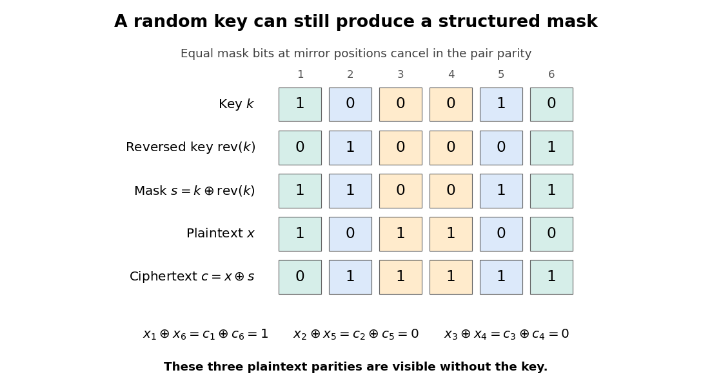

<h1 id="3/b/ii/solution">Solution</h1>

↑ **Parent:** [Ii](../ii.md)

Let $s=k\oplus\operatorname{rev}(k)$ be the effective mask. For each position $i$,

$$
s_i=k_i\oplus k_{n+1-i}=s_{n+1-i}.
$$

Thus the mask is always a [palindrome](../../../../../../palindrome.md), even though $k$ itself is uniformly random. The [exclusive or](../../../../../../exclusive-or.md) of the [ciphertext](../../../../../../ciphertext.md) bits in a mirror pair is

$$
c_i\oplus c_{n+1-i}=x_i\oplus x_{n+1-i},
$$

because the equal mask bits cancel. The observer learns the corresponding [plaintext](../../../../../../plaintext.md) parity exactly. If $n$ is odd, the middle mask bit is also zero, so the middle [plaintext](../../../../../../plaintext.md) bit is exposed directly.

An explicit failure of [perfect secrecy](../../../../../../perfect-secrecy.md) works for every $n\ge1$. Choose $X$ uniformly from $0^n$ and $10^{n-1}$. For $X=0^n$, the [ciphertext](../../../../../../ciphertext.md) is a [palindrome](../../../../../../palindrome.md) with [probability](../../../../../../probability.md) one. For $X=10^{n-1}$ and $n\ge2$, toggling just the first bit breaks the mirror equality, so the [ciphertext](../../../../../../ciphertext.md) is a [palindrome](../../../../../../palindrome.md) with [probability](../../../../../../probability.md) zero. For $n=1$, the effective mask is zero and $C=X$. Observing $C$ therefore distinguishes these two messages perfectly.

$$
\boxed{C\oplus\operatorname{rev}(C)=X\oplus\operatorname{rev}(X):\ \text{plaintext structure leaks}.}
$$

There are only $2^{\lfloor n/2\rfloor}$ possible effective masks, each equally likely. Hence even a fresh $n$-[bit](../../../../../../bit.md) key supplies at most $\lfloor n/2\rfloor$ independent masking bits in this construction. Choosing a long, uniform, one-use key is insufficient if the [encryption](../../../../../../encryption.md) transformation collapses its randomness.

**[Figure 1](#3/b/ii/image-mirror-paired-mask-bits-cancel-exposing-the-plaintext-parity-in-each-pair). Mirror-paired mask bits cancel, exposing the plaintext parity in each pair**.

## ↑ Ancestors (12)

1. [Ii](../ii.md)
2. [B](../../b.md)
3. [3](../../../3.md)
4. [Computer security](../../../../computer-security-split.md)
5. [2015](../../../../split.md)
6. [Past exam of the computer science course of the University of Oxford](../../../../../split.md)
7. [Computer science course of the University of Oxford](../../../../../../computer-science-course-of-the-university-of-oxford.md)
8. [Undergraduate course of the University of Oxford](../../../../../../undergraduate-course-of-the-university-of-oxford.md)
9. [Course of the University of Oxford](../../../../../../course-of-the-university-of-oxford.md)
10. [University of Oxford](../../../../../../university-of-oxford-split.md)
11. [List of universities](../../../../../../list-of-universities.md)
12. [Codex Wiki](../../../../../../split.md)
