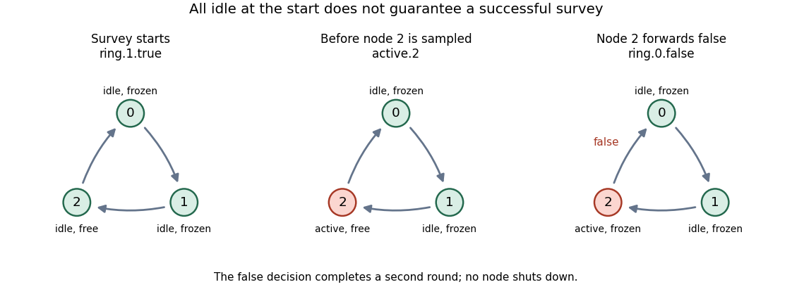

# Concurrency

↑ **Parent:** [2015](../2015.md)

Solutions to all three questions of the examination dated 1 June 2015. The cover permits answers to two questions.[Cover; questions on printed pp. 2–5](../../computer-science-bibliography.md#concurrency-examination-paper-by-the-university-of-oxford-2015)

Throughout, $\Sigma$ is the visible [CSP event](../../computer-science.md#csp-event) alphabet, $\tau$ is a [CSP internal action](../../computer-science.md#csp-internal-action), and $\mathrm{STOP}$ has no transitions. There is no successful termination event. Write $S\sqsubseteq_M I$ when implementation $I$ refines specification $S$ in model $M$: the implementation's recorded behaviours are contained in the specification's. We use $T$, $F$ and $FD$ for the [CSP traces model](../../computer-science.md#csp-traces-model), [CSP stable-failures model](../../computer-science.md#csp-stable-failures-model) and [CSP failures-divergences model](../../computer-science.md#csp-failures-divergences-model).

**Table of contents**

- [1](#1)
  - [a](#1/a)
    - [Solution](#1/a/solution)
  - [b](#1/b)
    - [Solution](#1/b/solution)
  - [c](#1/c)
    - [Solution](#1/c/solution)
  - [d](#1/d)
    - [i](#1/d/i)
      - [Solution](#1/d/i/solution)
    - [ii](#1/d/ii)
      - [Solution](#1/d/ii/solution)
  - [e](#1/e)
    - [Solution](#1/e/solution)
- [2](#2)
  - [a](#2/a)
    - [Solution](#2/a/solution)
  - [b](#2/b)
    - [Solution](#2/b/solution)
  - [c](#2/c)
    - [Solution](#2/c/solution)
  - [d](#2/d)
    - [Solution](#2/d/solution)
  - [e](#2/e)
    - [Solution](#2/e/solution)
  - [f](#2/f)
    - [Solution](#2/f/solution)
- [3](#3)
  - [a](#3/a)
    - [Solution](#3/a/solution)
  - [b](#3/b)
    - [Solution](#3/b/solution)
  - [c](#3/c)
    - [Solution](#3/c/solution)
  - [d](#3/d)
    - [Solution](#3/d/solution)
  - [e](#3/e)
    - [Solution](#3/e/solution)
  - [f](#3/f)
    - [Solution](#3/f/solution)

## 1

↑ **Parent:** [Concurrency](concurrency.md)

<h3 id="1/a">a</h3>

↑ **Parent:** [1](#1)

<h4 id="1/a/solution">Solution</h4>

↑ **Parent:** [A](#1/a)

The [unique fixed point principle](../../computer-science.md#unique-fixed-point-principle) says that a suitably [guarded recursion](../../algorithm.md#guarded-recursion) has a unique solution in the chosen [CSP semantic model](../../computer-science.md#csp-semantic-model). In particular, for a guarded process expression $F(X)$,

$$
\boxed{P=F(P),\quad Q=F(Q)\quad\Longrightarrow\quad P=Q.}
$$

The same principle applies to a mutually recursive system: two tuples satisfying the same guarded equations are componentwise equal. Thus an algebraic proof may show that a candidate satisfies the defining equations, instead of comparing arbitrarily long executions individually.

A [guarded recursion](../../algorithm.md#guarded-recursion) must make visible progress before re-entering its recursive dependency. For an equation built from [CSP prefixing](../../computer-science.md#csp-prefixing) and [CSP choice](../../computer-science.md#csp-choice), the usual sufficient condition is that every recursive occurrence lies behind a visible [CSP prefixing](../../computer-science.md#csp-prefixing) operation. For mutually recursive equations, every dependency cycle must pass such a guard. The guard must survive enclosing operators: an event subsequently removed by [CSP hiding](../../computer-science.md#csp-hiding) does not provide visible progress. Equivalently, in the usual semantic formulation the recursion functional must be contractive in observable depth. Merely seeing an arrow somewhere before the variable is insufficient.

<h3 id="1/b">b</h3>

↑ **Parent:** [1](#1)

<h4 id="1/b/solution">Solution</h4>

↑ **Parent:** [B](#1/b)

Take a fresh [CSP event](../../computer-science.md#csp-event) $h$ and define

$$
\boxed{P=(h\to P)\setminus\{h\}.}
$$

The apparent guard is removed by [CSP hiding](../../computer-science.md#csp-hiding). Each unfolding can perform a [CSP internal action](../../computer-science.md#csp-internal-action) and return to the same situation without any visible [CSP event](../../computer-science.md#csp-event). Operationally this is an infinite internal loop, a [CSP divergence](../../computer-science.md#csp-divergence), so the equation is not a [guarded recursion](../../algorithm.md#guarded-recursion). This is precisely why a syntactic test that counts every occurrence of $\to$ would be wrong.

<h3 id="1/c">c</h3>

↑ **Parent:** [1](#1)

<h4 id="1/c/solution">Solution</h4>

↑ **Parent:** [C](#1/c)

Let $X=P\ {}_{\{a,b,d\}}\Vert_{\{a,b,c\}}\ Q$. In this [CSP alphabetized parallel composition](../../computer-science.md#csp-alphabetized-parallel-composition), $a,b$ require both participants, $d$ belongs only to the left participant and $c$ only to the right participant. Expand the reachable states using [CSP prefixing](../../computer-science.md#csp-prefixing) and [CSP external choice](../../computer-science.md#csp-external-choice):

$$
\begin{aligned}
X&=a\to Y,\\
Y&=b\to Z\mathbin\square d\to W,\\
W&=b\to Z,\\
Z&=c\to X.
\end{aligned}
$$

For example, after the synchronized $b$, the left participant is back at $P$ but the right participant is at $c\to Q$. The left participant's proposed $a$ is blocked until the right participant has performed $c$. Similarly, after $a,d$, only the synchronized $b$ is possible. Thus there is no extra interleaving to include.

Eliminating $Y,W,Z$ gives the guarded equation

$$
X=a\to\bigl(b\to c\to X\mathbin\square d\to b\to c\to X\bigr).
$$

Consequently choose the sequential [CSP process](../../computer-science.md#csp-process)

$$
\boxed{R=a\to\bigl(b\to c\to R\mathbin\square d\to b\to c\to R\bigr).}
$$

The [unique fixed point principle](../../computer-science.md#unique-fixed-point-principle) first establishes $R=X$.

Now let $E=X\mathbin\Theta_{\{c\}}X$. The [CSP exception](../../computer-science.md#csp-exception) operator follows its left operand until that operand performs $c$, includes this $c$ in the visible behaviour, and then switches to its right operand. Applying its [CSP step law](../../computer-science.md#csp-step-law) to the four-state expansion yields

$$
E=a\to\bigl(b\to c\to X\mathbin\square d\to b\to c\to X\bigr)=X.
$$

The switch occurs exactly where the ordinary execution already returns to $X$. Therefore $E=X=R$. The answer uses neither a [CSP exception](../../computer-science.md#csp-exception) operator nor a [CSP parallel composition](../../computer-science.md#csp-parallel-composition) operator, and the argument gives equality in all three standard [CSP semantic models](../../computer-science.md#csp-semantic-model).

<h3 id="1/d">d</h3>

↑ **Parent:** [1](#1)

<h4 id="1/d/i">i</h4>

↑ **Parent:** [D](#1/d)

<h5 id="1/d/i/solution">Solution</h5>

↑ **Parent:** [I](#1/d/i)

Use a chain of identical storage cells, each retaining the first value it sees and passing later values to the next cell. On the return journey it passes the next cell's reversed output before emitting its own retained value. This turns the chain into a distributed [LIFO stack](../../data-structure.md#stack-data-structure).

Here is one cell template. Its ports $l,r$ carry incoming values towards the tail; $v,u$ carry returning values towards the front. Each port carries values in $T\cup\{\mathit{end}\}$, with the [sentinel value](../../data-structure.md#sentinel-value) outside $T$:

$$
\begin{aligned}
\mathrm{Cell}&=l?x:T\to\mathrm{Hold}(x),\\
\mathrm{Hold}(x)&=\bigl(l?y:T\to r!y\to\mathrm{Hold}(x)\bigr)\\
&\quad\mathbin\square\bigl(l.\mathit{end}\to r.\mathit{end}\to\mathrm{Drain}(x)\bigr),\\
\mathrm{Drain}(x)&=\bigl(v?y:T\to u!y\to\mathrm{Drain}(x)\bigr)\\
&\quad\mathbin\square\bigl(v.\mathit{end}\to u!x\to u.\mathit{end}\to\mathrm{STOP}\bigr).
\end{aligned}
$$

An input such as $l?x:T$ abbreviates an indexed [CSP external choice](../../computer-science.md#csp-external-choice) over the corresponding [CSP events](../../computer-science.md#csp-event). An output $r!y$ is the [CSP prefixing](../../computer-science.md#csp-prefixing) action $r.y$. There is no extra controller process.

For $n\geq1$, take $n$ copies of this same template. Introduce channels $d_i,u_i$ for $0\leq i\leq n$ and apply port [CSP event renaming](../../computer-science.md#csp-event-renaming) to copy $i$, for $1\leq i\leq n$, as follows:

$$
l.x\mapsto d_{i-1}.x,\quad r.x\mapsto d_i.x,\quad v.x\mapsto u_i.x,\quad u.x\mapsto u_{i-1}.x.
$$

At the front put $d_0=\mathit{in}$ and $u_0=\mathit{out}$. Adjacent cells synchronize on every shared $d_i$ or $u_i$ [CSP event](../../computer-science.md#csp-event). The two tail channels $d_n,u_n$ are sentinel-only: $d_n.\mathit{end}$ and $u_n.\mathit{end}$ are local tail [CSP events](../../computer-science.md#csp-event), with no other participant required. Disable all $d_n.x,u_n.x$ for $x\in T$. Formally, use a partial relational [CSP event renaming](../../computer-science.md#csp-event-renaming) for the last copy, omitting the pairs for its $r.x,v.x$ with $x\in T$; an unmapped transition is blocked. This explicitly prevents a fictitious tail from generating data.

Let $C_i$ be the resulting port-renamed cell and $A_i$ its visible alphabet. With $H$ consisting of the internal link [CSP events](../../computer-science.md#csp-event), including the two tail [CSP events](../../computer-science.md#csp-event), the answer is

$$
\boxed{\mathrm{Reverse}_n=\left(\mathop{\Vert}_{i=1}^{n}[A_i]\ C_i\right)\setminus H.}
$$

Here the indexed operator is [CSP alphabetized parallel composition](../../computer-science.md#csp-alphabetized-parallel-composition): each [CSP event](../../computer-science.md#csp-event) is synchronized by all cells whose alphabets contain it. There are exactly $n$ storage-cell processes; port wiring and the sentinel-only tail adapt their interfaces, without adding a helper process. The local tail [CSP events](../../computer-science.md#csp-event) are hidden, as are all inter-cell communications.

To see correctness, after inputs $x_1,\ldots,x_n$ have propagated, cell $i$ retains $x_i$. The input [sentinel value](../../data-structure.md#sentinel-value) propagates to the tail. The last cell performs its two local tail [CSP events](../../computer-science.md#csp-event), then returns $x_n,\mathit{end}$. Inductively, if the suffix after cell $i$ returns $x_n,\ldots,x_{i+1},\mathit{end}$, cell $i$ relays those values, replaces the final [sentinel value](../../data-structure.md#sentinel-value) by $x_i,\mathit{end}$, and stops. Hence the external output is

$$
\boxed{\mathit{out}.x_n,\ldots,\mathit{out}.x_1,\mathit{out}.\mathit{end},}
$$

and starts only after $\mathit{in}.\mathit{end}$. Shared links provide [synchronization](../../operating-system.md#synchronization-computing) rather than an assumption that all cells take steps simultaneously. For the degenerate known-empty input, no storage is needed: the interface is simply $\mathit{in}.\mathit{end}\to\mathit{out}.\mathit{end}\to\mathrm{STOP}$.

<h4 id="1/d/ii">ii</h4>

↑ **Parent:** [D](#1/d)

<h5 id="1/d/ii/solution">Solution</h5>

↑ **Parent:** [Ii](#1/d/ii)

In the displayed network, the first $k$ cells retain values and cell $k+1$ is still in its initial $\mathrm{Cell}$ state. It accepts only a value in $T$, so it cannot accept the incoming [sentinel value](../../data-structure.md#sentinel-value). For $k=0$ the first cell blocks the external [sentinel value](../../data-structure.md#sentinel-value); for $0<k<n$ a stored cell blocks while trying to pass it to an empty neighbour. Thus

$$
\boxed{k<n\quad\Longrightarrow\quad\text{deadlock before any reversed output}.}
$$

To handle shorter inputs, add an empty-cell branch $l.\mathit{end}\to u.\mathit{end}\to\mathrm{STOP}$ to the initial state. An empty cell then terminates the downward scan and immediately returns an empty sequence. Earlier occupied cells append their retained values exactly as before; later cells need not participate. This works for every $0\leq k\leq n$, because the occupied prefix of the chain alone produces the required output. For $k=n$, the original sentinel-only tail still supplies the empty suffix. Every cell receives the same modification.

<h3 id="1/e">e</h3>

↑ **Parent:** [1](#1)

<h4 id="1/e/solution">Solution</h4>

↑ **Parent:** [E](#1/e)

The obstruction is that the property is about where a transition originates, whereas the three standard [CSP semantic models](../../computer-science.md#csp-semantic-model) identify processes that can disagree about this fact. Take fresh $h\ne a$ and compare

$$
G=a\to\mathrm{STOP},\qquad B=\bigl(a\to\mathrm{STOP}\mathbin\square h\to a\to\mathrm{STOP}\bigr)\setminus\{h\}.
$$

In $G$, the only $a$ transition leaves a [CSP stable state](../../computer-science.md#csp-stable-state), so the property holds. Initially $B$ has both an $a$ transition to $\mathrm{STOP}$ and a [CSP internal action](../../computer-science.md#csp-internal-action) to $a\to\mathrm{STOP}$. Its initial state is therefore not a [CSP stable state](../../computer-science.md#csp-stable-state), and its direct $a$ transition violates the property.

Nevertheless both have exactly the [CSP traces](../../computer-science.md#csp-trace) $\langle\rangle$ and $\langle a\rangle$. Initially their possible stable observations offer exactly $a$, so their initial [CSP stable failures](../../computer-science.md#csp-stable-failure) are precisely $(\langle\rangle,X)$ with $a\notin X$. After $a$, both can refuse every [CSP event](../../computer-science.md#csp-event). Neither has a [CSP divergence](../../computer-science.md#csp-divergence): the hidden $h$ can occur at most once. Therefore

$$
\boxed{G=_T B,\quad G=_F B,\quad G=_{FD}B,\qquad\text{but the property separates }G\text{ and }B.}
$$

No [CSP refinement](../../computer-science.md#csp-refinement) test in one of these models can separate semantically equal operands. This also rules out placing the operand in a fixed context of ordinary CSP operators before the test, since those operators respect the model's equality. A model recording more about the interleaving of stability and acceptance, or an additional operator that explicitly observes stability, would be needed.

## 2

↑ **Parent:** [Concurrency](concurrency.md)

<h3 id="2/a">a</h3>

↑ **Parent:** [2](#2)

<h4 id="2/a/solution">Solution</h4>

↑ **Parent:** [A](#2/a)

For a finite [CSP trace](../../computer-science.md#csp-trace) $s$, let $L(s)$ be its sequence of values on $\mathit{left}$ and $O(s)$ its sequence of values on $\mathit{right}$, with channel names removed. Restrict the external alphabet to these two channels. The behavioural [CSP trace](../../computer-science.md#csp-trace) specification for an unbounded [FIFO buffer](../../data-structure.md#fifo-buffer) is

$$
\boxed{\forall s\in\operatorname{traces}(P):\quad O(s)\preceq L(s),}
$$

where $\preceq$ means [prefix of a list](../../data-structure.md#prefix-of-a-list), not merely [subsequence](../../sequence-and-series.md#subsequence). Outputs must therefore occur in input order, cannot duplicate or invent values, and cannot precede their inputs. Applying the condition to every [CSP trace](../../computer-science.md#csp-trace) also checks every execution prefix.

For a legal $s$, write $L(s)=O(s)\mathbin{\frown}q(s)$, so $q(s)$ is the pending [FIFO queue](../../data-structure.md#fifo-queue) content. Define the events that must remain available by

$$
E(q)=\{\mathit{left}.x:x\in T\}\cup\begin{cases}\varnothing,&q=\langle\rangle,\\\{\mathit{right}.\operatorname{head}(q)\},&q\ne\langle\rangle.\end{cases}
$$

In addition to the [CSP trace](../../computer-science.md#csp-trace) condition, require the behavioural [CSP stable failure](../../computer-science.md#csp-stable-failure) condition

$$
\boxed{\forall(s,X)\in\operatorname{failures}(P):\quad X\cap E(q(s))=\varnothing.}
$$

Thus an unbounded [FIFO buffer](../../data-structure.md#fifo-buffer) cannot stably refuse any new input, and a nonempty [FIFO buffer](../../data-structure.md#fifo-buffer) cannot stably refuse its oldest pending output. An empty [FIFO buffer](../../data-structure.md#fifo-buffer) can refuse every output. Readiness of an input and readiness of an output are required together; the environment may choose either. These conditions do not require an output while the environment refuses to accept it. In a [CSP failures-divergences model](../../computer-science.md#csp-failures-divergences-model) specification, also exclude [CSP divergence](../../computer-science.md#csp-divergence); the stable-readiness condition alone does not rule out an implementation that loops internally forever without reaching a [CSP stable state](../../computer-science.md#csp-stable-state).

<h3 id="2/b">b</h3>

↑ **Parent:** [2](#2)

<h4 id="2/b/solution">Solution</h4>

↑ **Parent:** [B](#2/b)

First define the ordinary unbounded [FIFO buffer](../../data-structure.md#fifo-buffer):

$$
\begin{aligned}
\mathrm{BUF}(q)&=\bigl(\mathit{left}?x:T\to\mathrm{BUF}(q\mathbin{\frown}\langle x\rangle)\bigr)\\
&\quad\mathbin\square\begin{cases}\mathrm{STOP},&q=\langle\rangle,\\\mathit{right}.\operatorname{head}(q)\to\mathrm{BUF}(\operatorname{tail}(q)),&q\ne\langle\rangle.\end{cases}
\end{aligned}
$$

Now use [CSP internal choice](../../computer-science.md#csp-internal-choice) to permit an immediate stop:

$$
\boxed{P=\mathrm{BUF}(\langle\rangle)\sqcap\mathrm{STOP}.}
$$

An execution choosing the first branch can perform every legal [CSP trace](../../computer-science.md#csp-trace) satisfying the [prefix of a list](../../data-structure.md#prefix-of-a-list) condition in part (a). Conversely that condition excludes all other [CSP traces](../../computer-science.md#csp-trace), so no process satisfying it can have more [CSP traces](../../computer-science.md#csp-trace). The second branch adds no new [CSP trace](../../computer-science.md#csp-trace), since the empty [CSP trace](../../computer-science.md#csp-trace) is already present.

The second branch does add the [CSP stable failure](../../computer-science.md#csp-stable-failure) $(\langle\rangle,\{\mathit{left}.x\})$ for any $x\in T$. This violates mandatory input readiness. Therefore the process has the maximum possible [CSP trace](../../computer-science.md#csp-trace) set and fails the [CSP stable failure](../../computer-science.md#csp-stable-failure) specification. The qualification is $T\ne\varnothing$, as is implicit for a useful [FIFO buffer](../../data-structure.md#fifo-buffer); with an empty value type there is no input-readiness event to violate. Maximizing the number of [CSP traces](../../computer-science.md#csp-trace) does not pick a unique process in the finer models: other processes with the same complete legal [CSP trace](../../computer-science.md#csp-trace) set and extra refusals also qualify.

<h3 id="2/c">c</h3>

↑ **Parent:** [2](#2)

<h4 id="2/c/solution">Solution</h4>

↑ **Parent:** [C](#2/c)

If $f$ is [injective](../../algebra.md#injective-function), the equation is true:

$$
\boxed{f(P\underset A\Vert Q)=f(P)\underset{f(A)}\Vert f(Q)\qquad(f\text{ injective}).}
$$

For a [CSP event](../../computer-science.md#csp-event) $a\in A$, the original [CSP parallel composition](../../computer-science.md#csp-parallel-composition) permits $a$ exactly when both operands can perform $a$. After [CSP event renaming](../../computer-science.md#csp-event-renaming), the corresponding rule requires the same image $f(a)$ in both operands. [Injectivity](../../algebra.md#injective-function) ensures that matching images came from the same event, and that an event outside $A$ cannot acquire the image of one inside $A$. Independent transitions remain independent, and [CSP internal actions](../../computer-science.md#csp-internal-action) are unchanged. Matching these transition rules gives a [strong bisimulation](../../graph-theory.md#strong-bisimulation), hence equality in all three standard [CSP semantic models](../../computer-science.md#csp-semantic-model).

For a non-injective $f$, the equation need not hold. Let

$$
P=a\to\mathrm{STOP},\quad Q=b\to\mathrm{STOP},\quad A=\{a,b\},\quad a\ne b,\quad f(a)=f(b)=c.
$$

On the left, both events require [synchronization](../../operating-system.md#synchronization-computing) but the other operand offers the wrong event, so $P\underset A\Vert Q=\mathrm{STOP}$. On the right, both renamed operands offer $c$, which can synchronize:

$$
\boxed{f(P\underset A\Vert Q)=\mathrm{STOP}\ne c\to\mathrm{STOP}=f(P)\underset{f(A)}\Vert f(Q).}
$$

The failure is already visible in the [CSP traces model](../../computer-science.md#csp-traces-model). A particular non-injective [CSP event renaming](../../computer-science.md#csp-event-renaming) may still preserve a particular composition; it is the unrestricted equivalence that fails.

<h3 id="2/d">d</h3>

↑ **Parent:** [2](#2)

<h4 id="2/d/solution">Solution</h4>

↑ **Parent:** [D](#2/d)

Write $J_A(P,Q)=P\mathbin\triangle_AQ$. The following five [CSP operational semantics](../../computer-science.md#csp-operational-semantics) rules suffice, with $a$ always visible:

$$
\frac{P\xrightarrow{\tau}P'}{J_A(P,Q)\xrightarrow{\tau}J_A(P',Q)}\qquad
\frac{Q\xrightarrow{\tau}Q'}{J_A(P,Q)\xrightarrow{\tau}J_A(P,Q')},
$$

$$
\frac{P\xrightarrow aP'\quad a\notin A}{J_A(P,Q)\xrightarrow aJ_A(P',Q)}\qquad
\frac{Q\xrightarrow aQ'\quad a\notin A}{J_A(P,Q)\xrightarrow aQ'},
$$

$$
\boxed{\frac{P\xrightarrow aP'\quad Q\xrightarrow aQ'\quad a\in A}{J_A(P,Q)\xrightarrow aJ_A(P',Q')}.}
$$

Thus a [CSP internal action](../../computer-science.md#csp-internal-action) of either operand preserves the wrapper. A visible action outside $A$ by the left operand also preserves it, whereas such an action by the right operand performs an ordinary [CSP interrupt](../../computer-science.md#csp-interrupt) and discards the left operand. An action in $A$ requires both operands and advances both without discarding either. If both can perform the same event outside $A$, there are two transitions with the same visible label and potentially different derivatives; neither should be deleted. The paper excludes successful termination, so no extra termination rules are needed.

<h3 id="2/e">e</h3>

↑ **Parent:** [2](#2)

<h4 id="2/e/solution">Solution</h4>

↑ **Parent:** [E](#2/e)

Suppose the operands are initially stable and written in [CSP external choice](../../computer-science.md#csp-external-choice) normal form,

$$
P=\mathop{\square}_{a\in B}a\to P_a,\qquad Q=\mathop{\square}_{a\in C}a\to Q_a.
$$

The [CSP step law](../../computer-science.md#csp-step-law) is

$$
\boxed{\begin{aligned}
J_A(P,Q)
&=\mathop{\square}_{a\in B\setminus A}a\to J_A(P_a,Q)\\
&\quad\mathbin\square\mathop{\square}_{a\in C\setminus A}a\to Q_a\\
&\quad\mathbin\square\mathop{\square}_{a\in B\cap C\cap A}a\to J_A(P_a,Q_a).
\end{aligned}}
$$

An empty indexed [CSP external choice](../../computer-science.md#csp-external-choice) denotes $\mathrm{STOP}$. A label appearing in both of the first two lines must retain both continuations: after that common label the result is the [CSP internal choice](../../computer-science.md#csp-internal-choice) between the continuations. A label in $A$ appears only in the third line and only if both operands offer it. These are exactly the three visible-transition rules from part (d); the two [CSP internal action](../../computer-science.md#csp-internal-action) rules handle operands that are not initially stable.

As a check, for the paper's example the initial shared $a$ leads to $J_{\{a\}}(b\to\mathrm{STOP},c\to\mathrm{STOP})$. Its expansion is

$$
b\to J_{\{a\}}(\mathrm{STOP},c\to\mathrm{STOP})\mathbin\square c\to\mathrm{STOP}
=b\to c\to\mathrm{STOP}\mathbin\square c\to\mathrm{STOP},
$$

which recovers the displayed example after prefixing by $a$.

<h3 id="2/f">f</h3>

↑ **Parent:** [2](#2)

<h4 id="2/f/solution">Solution</h4>

↑ **Parent:** [F](#2/f)

Use fresh event tags to tell apart an action by $P$ and an interrupting action by $Q$. Put $B=\Sigma\setminus A$ and introduce a disjoint copy $B'=\{a':a\in B\}$. Let $f$ fix $A$ and map each $a\in B$ to $a'$, and put $S=A\cup B'$. Define a process that always accepts an event from $S$ by

$$
\mathrm{RUN}(S)=\mathop{\square}_{x\in S}x\to\mathrm{RUN}(S),
$$

and an ordinary [CSP interrupt](../../computer-science.md#csp-interrupt) handler by

$$
I=\mathop{\square}_{a\in B}a'\to\mathrm{RUN}(S).
$$

Finally let $g$ fix every original event and send $a'$ back to $a$. A simulation containing no occurrence of the new operator is

$$
\boxed{R=g\left((P\mathbin\triangle I)\underset S\Vert f(Q)\right).}
$$

Here $\triangle$ is the ordinary [CSP interrupt](../../computer-science.md#csp-interrupt), and the [CSP event renaming](../../computer-science.md#csp-event-renaming) $g$ is applied after the [CSP parallel composition](../../computer-science.md#csp-parallel-composition). It is non-injective, so part (c) explains why moving it inside would be unsafe.

Before the interrupt, $P$'s events in $A$ synchronize with $f(Q)$ on the same events. Its events outside $A$ are unprimed and do not synchronize with $f(Q)$. Meanwhile $Q$'s events outside $A$ are primed; they synchronize with $I$ and thereby interrupt and discard $P$. After the first such event, the left operand is $\mathrm{RUN}(S)$, so it imposes no further restriction on $f(Q)$; final [CSP event renaming](../../computer-science.md#csp-event-renaming) then yields exactly the remaining behaviour of $Q$.

For a formal [strong bisimulation](../../graph-theory.md#strong-bisimulation), relate a pre-interrupt state $J_A(P_0,Q_0)$ to

$$
g\left((P_0\mathbin\triangle I)\underset S\Vert f(Q_0)\right),
$$

and an already-interrupted state $Q_0$ to

$$
g\left(\mathrm{RUN}(S)\underset S\Vert f(Q_0)\right).
$$

The three visible cases match the rules in part (d), including both transitions when both operands offer the same event outside $A$. A [CSP internal action](../../computer-science.md#csp-internal-action) of $Q_0$ never activates $I$, while a [CSP internal action](../../computer-science.md#csp-internal-action) of $P_0$ remains possible exactly until the interrupt. The controller adds no [CSP internal actions](../../computer-science.md#csp-internal-action). Thus transitions match in both directions and related derivatives remain related.

Consequently this simulation is stronger than merely [CSP trace](../../computer-science.md#csp-trace) equivalent:

$$
\boxed{R=_T J_A(P,Q),\qquad R=_F J_A(P,Q),\qquad R=_{FD}J_A(P,Q).}
$$

It preserves [CSP stable states](../../computer-science.md#csp-stable-state), their enabled-event sets and their [CSP stable failures](../../computer-science.md#csp-stable-failure), and matches every possible infinite run of [CSP internal actions](../../computer-science.md#csp-internal-action). In particular, it introduces neither a premature commitment nor a new [CSP divergence](../../computer-science.md#csp-divergence). A different simulation that guesses an interrupt with a hidden handshake would need a separate refusal analysis; the visible tagging construction above needs no hidden handshake.

## 3

↑ **Parent:** [Concurrency](concurrency.md)

<h3 id="3/a">a</h3>

↑ **Parent:** [3](#3)

<h4 id="3/a/solution">Solution</h4>

↑ **Parent:** [A](#3/a)

Use the intended nontrivial [ring network](../../computer-network.md#ring-network), with $N\geq2$, and let $n\oplus1=(n+1)\bmod N$. A [CSP event](../../computer-science.md#csp-event) $\mathit{ring}.n.b$ is one synchronized transfer from the predecessor to receiver $n$, rather than a separate enqueue and dequeue. Let $s$ be the [Boolean](../../programming-language.md#boolean-data-type) saying whether node $n$ is active. For $1\leq n<N$, define

$$
\begin{aligned}
V(n,s)&=\begin{cases}\mathit{idle}.n\to\mathrm{Free}(n,\mathrm{false}),&s=\mathrm{true},\\\mathit{active}.n\to\mathrm{Free}(n,\mathrm{true}),&s=\mathrm{false},\end{cases}\\
\mathrm{Free}(n,s)&=V(n,s)\mathbin\square\bigl(\mathit{ring}.n?b:\mathrm{Bool}\to\mathit{ring}.(n\oplus1).(b\land\neg s)\to\mathrm{Second}(n,s)\bigr),\\
\mathrm{Second}(n,s)&=\mathit{ring}.n?b:\mathrm{Bool}\to\mathit{ring}.(n\oplus1).b\to\begin{cases}\mathit{shutdown}.n\to\mathrm{STOP},&b=\mathrm{true},\\\mathrm{Free}(n,s),&b=\mathrm{false}.
\end{cases}
\end{aligned}
$$

Initially the node is active:

$$
\boxed{\mathrm{Node}(n)=\mathrm{Free}(n,\mathrm{true}).}
$$

The [CSP external choice](../../computer-science.md#csp-external-choice) in $\mathrm{Free}$ always offers both possible incoming message values as well as the permitted status change. Thus a decision to change status cannot internally withdraw readiness to receive a message. When the first message arrives, an active node forces its forwarded bit to false; an idle node preserves the bit. The status $s$ is retained until the second-round message has been forwarded. Neither the forwarding prefix nor $\mathrm{Second}$ offers status-change events, enforcing the protocol's freeze. On a false second-round message the node resumes its previous status; on a true one it forwards the bit before announcing shutdown.

<h3 id="3/b">b</h3>

↑ **Parent:** [3](#3)

<h4 id="3/b/solution">Solution</h4>

↑ **Parent:** [B](#3/b)

The coordinator has the following states:

$$
\begin{aligned}
C_{\mathrm{active}}&=\mathit{idle}.0\to C_{\mathrm{idle}},\\
C_{\mathrm{idle}}&=\mathit{active}.0\to C_{\mathrm{active}}\mathbin\square\mathit{ring}.1.\mathrm{true}\to C_{\mathrm{first}},\\
C_{\mathrm{first}}&=\mathit{ring}.0?b:\mathrm{Bool}\to\mathit{ring}.1.b\to C_{\mathrm{return}}(b),\\
C_{\mathrm{return}}(b)&=\mathit{ring}.0.b\to\begin{cases}\mathit{shutdown}.0\to\mathrm{STOP},&b=\mathrm{true},\\C_{\mathrm{idle}},&b=\mathrm{false}.
\end{cases}
\end{aligned}
$$

Thus

$$
\boxed{\mathrm{Coordinator}=C_{\mathrm{active}}.}
$$

The coordinator starts a round only while idle and sends true to node $1$. After the first returning message it sends exactly the received bit on the second round, without modifying it. The second return is required before its own shutdown; if the attempt failed it remains idle and may try again or become active. It offers no status-change event between starting and finishing the protocol. The two round states are essential: the first $\mathit{ring}.0.\mathrm{true}$ means that the first survey succeeded, whereas the next one acknowledges the circulating decision.

As in part (a), the choices between observable events are expressed using [CSP external choice](../../computer-science.md#csp-external-choice). Execution is nondeterministic, but there is no hidden irrevocable decision to become active while refusing a message. This keeps the readiness required by the question.

<h3 id="3/c">c</h3>

↑ **Parent:** [3](#3)

<h4 id="3/c/solution">Solution</h4>

↑ **Parent:** [C](#3/c)

For each node let

$$
\begin{aligned}
A_n&=\{\mathit{active}.n,\mathit{idle}.n,\mathit{shutdown}.n\}\\
&\quad\cup\{\mathit{ring}.n.b,\mathit{ring}.(n\oplus1).b:b\in\mathrm{Bool}\},\\
P_0&=\mathrm{Coordinator},\qquad P_n=\mathrm{Node}(n)\quad(1\leq n<N).
\end{aligned}
$$

The required [CSP alphabetized parallel composition](../../computer-science.md#csp-alphabetized-parallel-composition) is

$$
\boxed{\mathrm{System}=\mathop{\Vert}_{n=0}^{N-1}[A_n]\ P_n.}
$$

Each message [CSP event](../../computer-science.md#csp-event) belongs to exactly the sender's and receiver's alphabets and synchronizes those two processes. A status signal belongs only to its own node. Using the common set of all message events as an all-node synchronization alphabet would be incorrect: unrelated nodes would then have to participate in each point-to-point transfer. The initial definitions in parts (a) and (b) make every node active. Keep the message [CSP events](../../computer-science.md#csp-event) visible here; later checks can apply [CSP hiding](../../computer-science.md#csp-hiding) as needed.

<h3 id="3/d">d</h3>

↑ **Parent:** [3](#3)

<h4 id="3/d/solution">Solution</h4>

↑ **Parent:** [D](#3/d)

This is a [safety property](../../operating-system.md#safety-property): a bad shutdown or a later reactivation has a finite bad [CSP trace](../../computer-science.md#csp-trace). Use the [CSP traces model](../../computer-science.md#csp-traces-model). Let $V=\{0,\ldots,N-1\}$, let $A\subseteq V$ track active nodes, and let $D\subseteq V$ track nodes that have announced shutdown. Let $\mathrm{Ring}$ contain every message [CSP event](../../computer-science.md#csp-event). Define the following specification over the status-signal alphabet:

$$
\begin{aligned}
\mathrm{Safe}(A,D)
&=\mathop{\square}_{n\in A\setminus D}\mathit{idle}.n\to\mathrm{Safe}(A\setminus\{n\},D)\\
&\quad\mathbin\square\mathop{\square}_{\substack{n\in V\setminus(A\cup D)\\D=\varnothing}}\mathit{active}.n\to\mathrm{Safe}(A\cup\{n\},D)\\
&\quad\mathbin\square\mathop{\square}_{\substack{n\in V\setminus D\\A=\varnothing}}\mathit{shutdown}.n\to\mathrm{Safe}(A,D\cup\{n\}).
\end{aligned}
$$

Use the [CSP refinement](../../computer-science.md#csp-refinement) check

$$
\boxed{\mathrm{Safe}(V,\varnothing)\sqsubseteq_T\mathrm{System}\setminus\mathrm{Ring}.}
$$

The specification offers a shutdown only if the active set is empty, and offers no activation once $D$ is nonempty. A trace violating either requirement is therefore absent from the specification. Recording $D$ also prevents duplicate shutdowns and any status change by an already shut-down node. [CSP hiding](../../computer-science.md#csp-hiding) removes message details irrelevant to this finite bad-prefix check; a [CSP traces model](../../computer-science.md#csp-traces-model) check alone does not assert eventual progress.

The system satisfies the check. After the first message has passed nodes $1,\ldots,i$, its bit is the [Boolean conjunction](../../mathematical-logic.md#logical-conjunction) of their being idle when sampled. Every sampled node is then frozen until it forwards the second-round decision. A true bit returning to node $0$ therefore means that every non-coordinator is idle and still frozen; the coordinator has itself remained idle. A true decision consequently reaches only idle nodes, each of which proceeds to shutdown rather than returning to $\mathrm{Free}$. No node can subsequently become active. A false decision permits no shutdown at all.

<h3 id="3/e">e</h3>

↑ **Parent:** [3](#3)

<h4 id="3/e/solution">Solution</h4>

↑ **Parent:** [E](#3/e)

The trigger is specifically the first-round reception $\mathit{ring}.0.\mathrm{true}$. A [CSP trace](../../computer-science.md#csp-trace) restriction cannot by itself guarantee progress after this event, because a finite prefix is compatible with both completion and an indefinitely delayed completion. We need to exclude both a stable refusal to continue and [CSP divergence](../../computer-science.md#csp-divergence), so use the [CSP failures-divergences model](../../computer-science.md#csp-failures-divergences-model).

Here is an explicit conditional check that imposes no progress requirement before the trigger. Build the reachable [labelled transition system](../../algorithm.md#labelled-transition-system) of $\mathrm{System}$ and observe coordinator rounds with a two-phase monitor: it starts in the first-return phase and toggles on each $\mathit{ring}.0.b$. Collect the set $\mathcal H$ of system derivatives immediately after a true return in the first-return phase. This distinguishes the survey's return from the decision's return, without changing any system transitions. For fixed finite $N$, the set is finite. Define

$$
\begin{aligned}
\mathrm{Shut}&=\{\mathit{shutdown}.n:n\in V\},\\
\mathrm{Post}&=\mathop{\sqcap}_{H\in\mathcal H}\left(H\setminus(\Sigma\setminus\mathrm{Shut})\right),\\
\mathrm{Finish}(D)&=\begin{cases}\mathrm{STOP},&D=V,\\\displaystyle\mathop{\sqcap}_{n\in V\setminus D}\mathit{shutdown}.n\to\mathrm{Finish}(D\cup\{n\}),&D\ne V.
\end{cases}
\end{aligned}
$$

Here $\sqcap$ denotes [CSP internal choice](../../computer-science.md#csp-internal-choice). Perform the single [CSP refinement](../../computer-science.md#csp-refinement) check

$$
\boxed{\mathrm{Finish}(\varnothing)\sqsubseteq_{FD}\mathrm{Post}.}
$$

Equivalently, check each post-trigger derivative $H$ individually against $\mathrm{Finish}(\varnothing)$ after the displayed [CSP hiding](../../computer-science.md#csp-hiding). If the trigger is unreachable, the conditional property is vacuously true and there is no post-trigger check to perform.

The [CSP internal choice](../../computer-science.md#csp-internal-choice) in $\mathrm{Finish}$ deliberately permits any next shutdown, including an implementation that offers only one of the remaining shutdowns. It forbids a stable refusal of all remaining shutdowns, has no [CSP divergence](../../computer-science.md#csp-divergence), and permits at most $N$ distinct shutdowns before $\mathrm{STOP}$. A [CSP external choice](../../computer-science.md#csp-external-choice) over all remaining nodes would instead demand simultaneous readiness for every remaining shutdown and would unnecessarily reject the protocol's sequential delivery.

After hiding all other actions, endless internal work becomes a [CSP divergence](../../computer-science.md#csp-divergence) and a blocked unfinished state becomes a forbidden [CSP stable failure](../../computer-science.md#csp-stable-failure). Since there are only $N$ possible shutdown actions and duplicates are excluded by [CSP traces](../../computer-science.md#csp-trace), every maximal progressing execution must complete all $N$. As usual for untimed CSP, this progress claim assumes the environment allows shutdown signals to occur; it supplies no wall-clock deadline. No fairness assumption requiring the coordinator eventually to initiate a survey has been smuggled into this conditional check.

For the defined system the check succeeds. Immediately after the trigger all statuses are idle and frozen. The only message work left is the second round: node $0$ sends the decision to node $1$, nodes $1$ through $N-1$ forward it, and node $0$ receives it. These are exactly $N$ more message transfers. Each node then has its one shutdown action, and the message can advance even while an earlier node's shutdown is pending. Thus there are no remaining status changes, no message cycle, and no unfinished global state in which every action is blocked. The measure

$$
\boxed{\text{remaining second-round transfers}+\text{remaining shutdown signals}}
$$

starts at $2N$, is nonnegative, and decreases on every subsequent transition. This excludes any hidden infinite run; before all shutdowns finish there is either an enabled message transfer or an enabled shutdown signal. The operational argument proves the conditional claim for every $N\geq2$; finite state enumeration is only a supporting check.

<h3 id="3/f">f</h3>

↑ **Parent:** [3](#3)

<h4 id="3/f/solution">Solution</h4>

↑ **Parent:** [F](#3/f)

For a general ring, no. Being idle at the instant the coordinator starts is not the same as remaining idle until sampled. A downstream node that has not yet received the first-round message is still in its $\mathrm{Free}$ state and may become active.

For a concrete $N=3$ example, first perform $\mathit{idle}.0,\mathit{idle}.1,\mathit{idle}.2$, so all nodes are idle. Then take this [CSP trace](../../computer-science.md#csp-trace):

$$
\begin{aligned}
&\mathit{ring}.1.\mathrm{true},\quad\mathit{active}.2,\quad\mathit{ring}.2.\mathrm{true},\quad\mathit{ring}.0.\mathrm{false},\\
&\mathit{ring}.1.\mathrm{false},\quad\mathit{ring}.2.\mathrm{false},\quad\mathit{ring}.0.\mathrm{false},\quad\mathit{idle}.2.
\end{aligned}
$$

At the first displayed event the coordinator has started and all nodes are idle. Node $1$ has received true and is frozen, but node $2$ can still activate before receiving the token. It forwards false, so the entire second round carries false and nobody shuts down. After the final $\mathit{idle}.2$, all nodes are idle again. The coordinator may then perform $\mathit{active}.0,\mathit{idle}.0$ forever without starting another survey. This is an infinite execution with no shutdown and no assumption of fairness that would exclude it.

**[Figure 1](#3/f/image-a-node-can-activate-after-the-survey-starts-but-before-the-token-reaches-it). A node can activate after the survey starts but before the token reaches it**.

Therefore

$$
\boxed{\text{The proposed eventual-shutdown property fails in general, already for }N=3.}
$$

This does not contradict part (e): its stronger trigger, the true first-round return, never occurs in the failed survey. For the special $N=2$ ring, starting by $\mathit{ring}.1.\mathrm{true}$ already samples and freezes the only non-coordinator. If both nodes are idle at that event, this particular counterexample is impossible and the successful-survey progress argument applies. The general claim in the question must cover larger rings, where the unsampled downstream node exists.

## ↑ Ancestors (8)

1. [2015](../2015.md)
2. [Past exam of the computer science course of the University of Oxford](../../past-exam-of-the-computer-science-course-of-the-university-of-oxford.md)
3. [Computer science course of the University of Oxford](../../university-of-oxford.md#computer-science-course-of-the-university-of-oxford)
4. [Undergraduate course of the University of Oxford](../../university-of-oxford.md#undergraduate-course-of-the-university-of-oxford)
5. [Course of the University of Oxford](../../university-of-oxford.md#course-of-the-university-of-oxford)
6. [University of Oxford](../../university-of-oxford.md)
7. [List of universities](../../README.md#list-of-universities)
8. [Codex Wiki](../../README.md)
