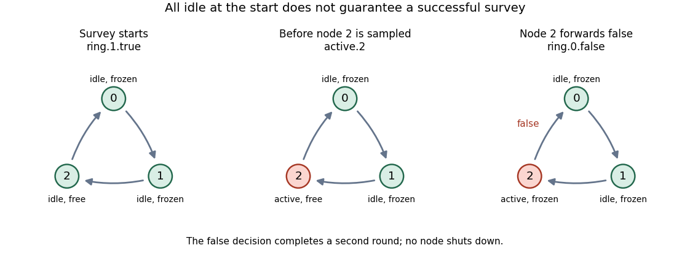

<h1 id="3/f/solution">Solution</h1>

↑ **Parent:** [F](../f.md)

For a general ring, no. Being idle at the instant the coordinator starts is not the same as remaining idle until sampled. A downstream node that has not yet received the first-round message is still in its $\mathrm{Free}$ state and may become active.

For a concrete $N=3$ example, first perform $\mathit{idle}.0,\mathit{idle}.1,\mathit{idle}.2$, so all nodes are idle. Then take this [CSP trace](../../../../../csp-trace.md):

$$
\begin{aligned}
&\mathit{ring}.1.\mathrm{true},\quad\mathit{active}.2,\quad\mathit{ring}.2.\mathrm{true},\quad\mathit{ring}.0.\mathrm{false},\\
&\mathit{ring}.1.\mathrm{false},\quad\mathit{ring}.2.\mathrm{false},\quad\mathit{ring}.0.\mathrm{false},\quad\mathit{idle}.2.
\end{aligned}
$$

At the first displayed event the coordinator has started and all nodes are idle. Node $1$ has received true and is frozen, but node $2$ can still activate before receiving the token. It forwards false, so the entire second round carries false and nobody shuts down. After the final $\mathit{idle}.2$, all nodes are idle again. The coordinator may then perform $\mathit{active}.0,\mathit{idle}.0$ forever without starting another survey. This is an infinite execution with no shutdown and no assumption of fairness that would exclude it.

**[Figure 1](#3/f/image-a-node-can-activate-after-the-survey-starts-but-before-the-token-reaches-it). A node can activate after the survey starts but before the token reaches it**.

Therefore

$$
\boxed{\text{The proposed eventual-shutdown property fails in general, already for }N=3.}
$$

This does not contradict part (e): its stronger trigger, the true first-round return, never occurs in the failed survey. For the special $N=2$ ring, starting by $\mathit{ring}.1.\mathrm{true}$ already samples and freezes the only non-coordinator. If both nodes are idle at that event, this particular counterexample is impossible and the successful-survey progress argument applies. The general claim in the question must cover larger rings, where the unsampled downstream node exists.

## ↑ Ancestors (11)

1. [F](../f.md)
2. [3](../../3.md)
3. [Concurrency](../../../concurrency-split.md)
4. [2015](../../../split.md)
5. [Past exam of the computer science course of the University of Oxford](../../../../split.md)
6. [Computer science course of the University of Oxford](../../../../../computer-science-course-of-the-university-of-oxford.md)
7. [Undergraduate course of the University of Oxford](../../../../../undergraduate-course-of-the-university-of-oxford.md)
8. [Course of the University of Oxford](../../../../../course-of-the-university-of-oxford.md)
9. [University of Oxford](../../../../../university-of-oxford-split.md)
10. [List of universities](../../../../../list-of-universities.md)
11. [Codex Wiki](../../../../../split.md)
