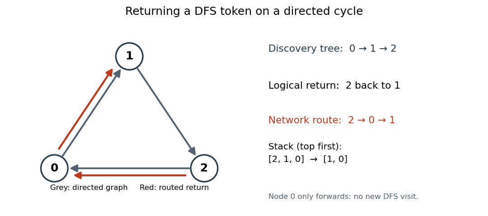

<h1 id="2/a/ii/solution">Solution</h1>

↑ **Parent:** [Ii](../ii.md)

Use one logical traversal token carrying the discovered [vertex set](../../../../../../vertex-set.md) and the active [LIFO stack](../../../../../../stack-data-structure.md) of [vertices](../../../../../../vertex-graph-theory.md). The current [vertex](../../../../../../vertex-graph-theory.md) either discovers its first still-unvisited outgoing [graph neighbour](../../../../../../neighbour-of-a-vertex.md), or returns to its preceding [stack](../../../../../../stack-data-structure.md) entry. The former records both the child's [parent in a rooted tree](../../../../../../parent-in-a-rooted-tree.md) and the parent's child. Unlike concurrent flooding discovery, this visits one entire branch before the next, giving an actual [depth-first search](../../../../../../depth-first-search.md).

The important directed-graph detail is that a child's parent need not be an outgoing [graph neighbour](../../../../../../neighbour-of-a-vertex.md). Return the token by routing it through the original [directed graph](../../../../../../directed-graph.md); a routing hop does not count as a traversal visit. The following duplicate-suppressed flooding route requires no previously known topology and sends only to immediate outgoing [graph neighbours](../../../../../../neighbour-of-a-vertex.md).

```
final case class Token(visited: Set[NodeId], stack: List[NodeId], serial: Int)
sealed trait Msg
final case class Route(serial: Int, target: NodeId, token: Token) extends Msg
case object Finished extends Msg
```

Here `stack.head` is the current [vertex](../../../../../../vertex-graph-theory.md). Use the same paired `toNode` and `fromNode` ports as in (i), now with the new `Msg` type. Set mailbox capacity to $B=N(2N+1)$, normalize neighbours with `distinct`, and again leave the mailboxes open until all processes have joined. The following helpers are local functions inside each node's generated process.

```
def span: PROC = proc {
  val adj = neighbours.distinct
  val routed = scala.collection.mutable.Set[Int]()
  var entered = false
  var done = false

  def flood(message: Msg): Unit =
    for (w <- adj) toNode(w) ! message

  def move(target: NodeId, state: Token): Unit = {
    val s = state.serial + 1
    routed += s
    flood(Route(s, target, state.copy(serial = s)))
  }

  def step(t: Token): Unit = {
    assert(t.stack.head == me)
    if (!entered) {
      entered = true
      parent = if (t.stack.tail.isEmpty) me else t.stack.tail.head
      children = Nil
    }
    adj.find(w => !t.visited(w)) match {
      case Some(w) =>
        children = children :+ w
        move(w, Token(t.visited + w, w :: t.stack, t.serial))
      case None =>
        t.stack.tail match {
          case p :: rest => move(p, t.copy(stack = p :: rest))
          case Nil => flood(Finished); done = true
        }
    }
  }

  if (me == 0) step(Token(Set(0), List(0), 0))
  while (!done) {
    fromNode(me) ? () match {
      case r @ Route(s, target, t) =>
        if (!routed(s)) {
          routed += s
          if (target == me) step(t) else flood(r)
        }
      case Finished => flood(Finished); done = true
    }
  }
}
```

Every route number is globally unique: there is one logical token, and its serial increases at every move. The sender inserts that serial in its own `routed` set before flooding; this stops a returning copy from circulating again. Intermediate [vertices](../../../../../../vertex-graph-theory.md) forward the first copy of an envelope and ignore later copies. Its target consumes exactly one copy without forwarding it. Because the [directed graph](../../../../../../directed-graph.md) is strongly connected, a simple [directed path](../../../../../../directed-path.md) from sender to target exists; its intermediate [vertices](../../../../../../vertex-graph-theory.md) eventually relay the envelope. Thus each move eventually finishes.

A routed return can pass through a [vertex](../../../../../../vertex-graph-theory.md) not yet discovered by the [depth-first search](../../../../../../depth-first-search.md). That [vertex](../../../../../../vertex-graph-theory.md) only forwards the envelope: it does not run `step`, change `entered`, or assign a parent. This distinction is essential. For the directed cycle $0\to1\to2\to0$, returning from two to one uses $2\to0\to1$, while the logical traversal [stack](../../../../../../stack-data-structure.md) changes from $(2,1,0)$ to $(1,0)$.

<a id="2/a/ii/image-a-depth-first-search-return-follows-a-routed-directed-path-when-the-child-has-no-reverse-directed-edge"></a>


**[Figure 1](#2/a/ii/image-a-depth-first-search-return-follows-a-routed-directed-path-when-the-child-has-no-reverse-directed-edge). A depth-first search return follows a routed directed path when the child has no reverse directed edge**.

The discovered [vertex set](../../../../../../vertex-set.md) only grows. Each newly discovered [vertex](../../../../../../vertex-graph-theory.md) is pushed once and later popped once; an exhausted [vertex](../../../../../../vertex-graph-theory.md) can never acquire a new unvisited neighbour as this set grows. Consequently there are exactly $N-1$ downward moves and $N-1$ return moves. When the root exhausts its outgoing [graph neighbours](../../../../../../neighbour-of-a-vertex.md), every [vertex](../../../../../../vertex-graph-theory.md) has been visited, by the standard [reachability](../../../../../../reachability-in-a-graph.md) argument for [depth-first search](../../../../../../depth-first-search.md). Each nonroot parent was recorded along the actual downward [directed edge](../../../../../../directed-edge.md), and `children` records exactly those assignments in discovery order.

There are $2(N-1)$ route envelopes, each forwarded at most once per outgoing [directed edge](../../../../../../directed-edge.md), and one final `Finished` flood. Each node forwards `Finished` before exiting; [strong connectivity](../../../../../../strong-connectivity.md) therefore delivers it everywhere. There are at most $N(2N-1)$ total messages into any mailbox, below the proposed capacity. Even a mailbox whose process has already exited cannot block later sends. All processes terminate with

$$
\boxed{\text{the parent and ordered children of a depth-first spanning tree rooted at }0.}
$$

This deliberately trades communication efficiency for a simple valid solution on a genuinely [directed graph](../../../../../../directed-graph.md). A direct parent acknowledgement would instead require an additional bidirectional-edge assumption, which the question does not supply.

## ↑ Ancestors (12)

1. [Ii](../ii.md)
2. [A](../../a.md)
3. [2](../../../2.md)
4. [Concurrent programming](../../../../concurrent-programming-split.md)
5. [2015](../../../../split.md)
6. [Past exam of the computer science course of the University of Oxford](../../../../../split.md)
7. [Computer science course of the University of Oxford](../../../../../../computer-science-course-of-the-university-of-oxford.md)
8. [Undergraduate course of the University of Oxford](../../../../../../undergraduate-course-of-the-university-of-oxford.md)
9. [Course of the University of Oxford](../../../../../../course-of-the-university-of-oxford.md)
10. [University of Oxford](../../../../../../university-of-oxford-split.md)
11. [List of universities](../../../../../../list-of-universities.md)
12. [Codex Wiki](../../../../../../split.md)
