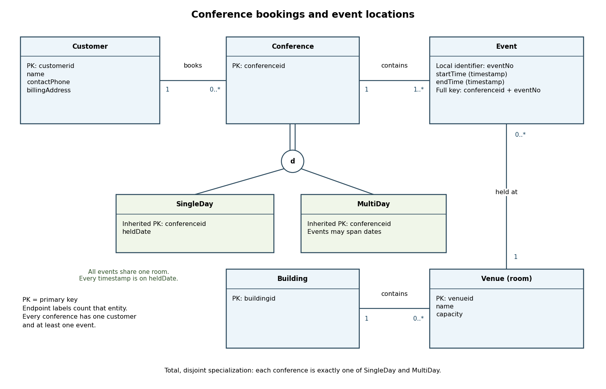

# Databases

↑ **Parent:** [2015](../2015.md)

Solutions to all three questions of the examination dated 3 June 2015. The cover permits answers to two questions.[Cover and printed pp. 2–4](../../computer-science-bibliography.md#databases-examination-paper-by-the-university-of-oxford-2015)

Use classical [relational algebra](../../computer-science.md#relational-algebra) with [set semantics](../../computer-science.md#set-semantics). Write $C,S,U,P$ for the paper's `Car`, `Sales`, `Customer` and `Salesperson` [database relations](../../computer-science.md#database-relation). A [natural join](../../computer-science.md#natural-join) between $C$ and $S$ matches `serialnumber`; joins involving a salesperson explicitly match `salespersonid` to `empid`. Identifiers, rather than names, distinguish customers and salespeople. The calculations use the ordinary non-null [relational model](../../computer-science.md#relational-model); the [SQL](../../computer-science.md#sql) aggregate below also explains its empty-input behavior.

**Table of contents**

- [1](#1)
  - [a](#1/a)
    - [i](#1/a/i)
      - [Solution](#1/a/i/solution)
    - [ii](#1/a/ii)
      - [Solution](#1/a/ii/solution)
    - [iii](#1/a/iii)
      - [Solution](#1/a/iii/solution)
  - [b](#1/b)
    - [Solution](#1/b/solution)
  - [c](#1/c)
    - [i](#1/c/i)
      - [Solution](#1/c/i/solution)
    - [ii](#1/c/ii)
      - [Solution](#1/c/ii/solution)
- [2](#2)
  - [a](#2/a)
    - [Solution](#2/a/solution)
  - [b](#2/b)
    - [Solution](#2/b/solution)
  - [c](#2/c)
    - [Solution](#2/c/solution)
  - [d](#2/d)
    - [Solution](#2/d/solution)
- [3](#3)
  - [a](#3/a)
    - [Solution](#3/a/solution)
  - [b](#3/b)
    - [Solution](#3/b/solution)
  - [c](#3/c)
    - [Solution](#3/c/solution)
  - [d](#3/d)
    - [Solution](#3/d/solution)

## 1

↑ **Parent:** [Databases](databases.md)

<h3 id="1/a">a</h3>

↑ **Parent:** [1](#1)

<h4 id="1/a/i">i</h4>

↑ **Parent:** [A](#1/a)

<h5 id="1/a/i/solution">Solution</h5>

↑ **Parent:** [I](#1/a/i)

First use [relational selection](../../computer-science.md#relational-selection) to keep the Saab cars, then a [natural join](../../computer-science.md#natural-join) to find their sales, and finally a [relational join](../../computer-science.md#relational-join) to identify the corresponding salespeople. A [relational projection](../../computer-science.md#relational-projection) gives

$$
\boxed{\pi_{\mathsf{name}}\!\left(P\bowtie_{\mathsf{empid=salespersonid}}\left(S\bowtie\sigma_{\mathsf{make}=\text{Saab}}C\right)\right).}
$$

The [foreign keys](../../computer-science.md#foreign-key) ensure that every sale has the referenced car and salesperson. Several qualifying sales by the same person produce just one occurrence of their name under [set semantics](../../computer-science.md#set-semantics). Two distinct people with the same name also yield that name only once: this is the requested [relational projection](../../computer-science.md#relational-projection) onto names.

<h4 id="1/a/ii">ii</h4>

↑ **Parent:** [A](#1/a)

<h5 id="1/a/ii/solution">Solution</h5>

↑ **Parent:** [Ii](#1/a/ii)

Construct the required models and the actual customer–model purchases using [relational projection](../../computer-science.md#relational-projection) and a [natural join](../../computer-science.md#natural-join):

$$
M=\pi_{\mathsf{model}}C,\qquad I=\pi_{\mathsf{customerid}}U,\qquad V=\pi_{\mathsf{customerid,model}}(S\bowtie C).
$$

The [Cartesian product](../../set-theory.md#cartesian-product) $I\times M$ lists every obligation: every customer paired with every model present in `Car`. The [relational difference](../../computer-science.md#relational-difference) $(I\times M)-V$ consists of unfulfilled obligations. Remove the customer identifiers occurring in this [database relation](../../computer-science.md#database-relation) and only then recover names:

$$
\begin{aligned}
G&=I-\pi_{\mathsf{customerid}}\bigl((I\times M)-V\bigr),\\
&\boxed{\text{answer}=\pi_{\mathsf{name}}(U\bowtie G).}
\end{aligned}
$$

This is an explicit [relational division](../../computer-science.md#relational-division) construction with all customers as the candidate universe. If there are no models, there are no missing obligations, so every customer qualifies. A version starting solely from customers occurring in $V$ would incorrectly omit customers with no purchases in that empty-model case.

The quantified object here is the `model` [database attribute](../../computer-science.md#database-attribute), so two makes sharing a model value contribute one required value. If a different application identified a model by the pair `(make, model)`, both the required and purchased [relational projections](../../computer-science.md#relational-projection) would use that pair. Also, `Car` contains unsold cars: a model available only in unsold inventory is still a required model, and then nobody qualifies. Testing identifiers before names prevents different customers with the same name from pooling their purchases.

<h4 id="1/a/iii">iii</h4>

↑ **Parent:** [A](#1/a)

<h5 id="1/a/iii/solution">Solution</h5>

↑ **Parent:** [Iii](#1/a/iii)

An [arithmetic mean](../../arithmetic.md#arithmetic-mean) is [database aggregation](../../computer-science.md#database-aggregation), which is outside classical [relational algebra](../../computer-science.md#relational-algebra). Use [SQL](../../computer-science.md#sql):
```
SELECT AVG(s.price) AS average_sale_price
FROM Sales AS s
JOIN Car AS c ON c.serialnumber = s.serialnumber
WHERE c.make = 'Saab';
```
For non-null prices $p_1,\ldots,p_n$ of qualifying sales, the result is

$$
\boxed{\overline p=\frac{p_1+\cdots+p_n}{n}\quad(n>0).}
$$

Each sale contributes once, even when a car was sold on several invoices. Do not use `DISTINCT` inside `AVG`: two different sales at the same price must both count. The car's [database primary key](../../computer-science.md#database-primary-key) makes the [relational join](../../computer-science.md#relational-join) match each sale to exactly one car, so the [relational join](../../computer-science.md#relational-join) introduces no extra weighting.

If there are no qualifying non-null prices, `AVG` returns [SQL NULL](../../computer-science.md#sql-null). It ignores null prices if the implementation permits them; it does not replace an absent [arithmetic mean](../../arithmetic.md#arithmetic-mean) with zero.[Section 9.21, `avg` and the paragraph on aggregates with no selected rows](../../computer-science-bibliography.md#aggregate-functions-in-the-postgresql-documentation)

<h3 id="1/b">b</h3>

↑ **Parent:** [1](#1)

<h4 id="1/b/solution">Solution</h4>

↑ **Parent:** [B](#1/b)

The right-hand [relational projection](../../computer-science.md#relational-projection) lists the models of cars for which at least one recorded sale was made by a salesperson earning strictly more than $30000$. The outer [relational difference](../../computer-science.md#relational-difference) removes precisely those models from all models present in `Car`. Thus the answer is

$$
\boxed{\text{Models present in Car with no sale by a salesperson earning more than }30000.}
$$

This includes models with no sales at all, as well as models sold exclusively by salespeople whose salaries are at most $30000$. A model sold by both a low-paid salesperson and a high-paid salesperson is excluded. A salary exactly equal to $30000$ does not trigger exclusion. These are model-level statements: one unsold car of a model does not rescue that model if a different car of the same model had a qualifying sale.

<h3 id="1/c">c</h3>

↑ **Parent:** [1](#1)

<h4 id="1/c/i">i</h4>

↑ **Parent:** [C](#1/c)

<h5 id="1/c/i/solution">Solution</h5>

↑ **Parent:** [I](#1/c/i)

Assume the two [database queries](../../computer-science.md#database-query) have compatible output [database attributes](../../computer-science.md#database-attribute). Then

$$
\boxed{\text{True: }Q_1-Q_2\text{ is safe.}}
$$

For a finite input [database](../../computer-science.md#database), the result of the [relational difference](../../computer-science.md#relational-difference) is a subset of the finite result of $Q_1$, so it is finite and introduces no new values. For the usual [domain independence of a database query](../../computer-science.md#domain-independence-of-a-database-query), let $D$ be the input [database](../../computer-science.md#database) and let $A\subseteq A'$ be two ambient value domains containing its data and the query constants. [Database query safety](../../computer-science.md#database-query-safety) gives

$$
Q_i^A(D)=Q_i^{A'}(D)\quad(i=1,2),
$$

and therefore

$$
Q_1^A(D)\setminus Q_2^A(D)=Q_1^{A'}(D)\setminus Q_2^{A'}(D).
$$

Although a [domain relational calculus](../../computer-science.md#domain-relational-calculus) expression for the [relational difference](../../computer-science.md#relational-difference) uses negation, its positive membership requirement in $Q_1$ supplies the necessary range restriction. Negation is not by itself a reason for failure of [database query safety](../../computer-science.md#database-query-safety).

<h4 id="1/c/ii">ii</h4>

↑ **Parent:** [C](#1/c)

<h5 id="1/c/ii/solution">Solution</h5>

↑ **Parent:** [Ii](#1/c/ii)

Take a unary [database relation](../../computer-science.md#database-relation) $R$ and the positive [domain relational calculus](../../computer-science.md#domain-relational-calculus) query

$$
\boxed{Q=\{(x,y)\mid R(x)\lor R(y)\}.\quad\text{The assertion is false.}}
$$

For the finite input $R=\{0\}$, every pair $(0,d)$ and $(d,0)$ belongs to $Q$, for every value $d$ in the ambient domain. On an infinite ambient domain the answer is infinite. Even if one compares only finite ambient domains, adding a fresh value $d$ changes the answer while leaving $R$ fixed, violating [domain independence of a database query](../../computer-science.md#domain-independence-of-a-database-query).

The [logical disjunction](../../mathematical-logic.md#logical-disjunction) leaves $y$ unrestricted in its first branch and $x$ unrestricted in its second branch. Thus both variables occur in relational atoms somewhere in the formula, yet [database query safety](../../computer-science.md#database-query-safety) still fails. No negation or implication symbol occurs.

## 2

↑ **Parent:** [Databases](databases.md)

<h3 id="2/a">a</h3>

↑ **Parent:** [2](#2)

<h4 id="2/a/solution">Solution</h4>

↑ **Parent:** [A](#2/a)

Find the salesperson identifiers satisfying each price condition using [relational selection](../../computer-science.md#relational-selection) and [relational projection](../../computer-science.md#relational-projection):

$$
L=\pi_{\mathsf{salespersonid}}(\sigma_{\mathsf{price}=10000}S),\qquad H=\pi_{\mathsf{salespersonid}}(\sigma_{\mathsf{price}=30000}S).
$$

Intersect these identifier sets, [relational join](../../computer-science.md#relational-join) the result to the salesperson records, and apply [relational projection](../../computer-science.md#relational-projection) to names:

$$
\boxed{\pi_{\mathsf{name}}\left(P\bowtie_{\mathsf{empid=salespersonid}}(L\cap H)\right).}
$$

If intersection is not a primitive of the chosen [relational algebra](../../computer-science.md#relational-algebra), use $L\cap H=L-(L-H)$ with [relational difference](../../computer-science.md#relational-difference). There is no need to access `Car`: the [foreign key](../../computer-science.md#foreign-key) already ensures that every sale refers to a car.

Intersecting names instead of identifiers is wrong. Two different salespeople called Alex, one making only $10000$ sales and the other only $30000$ sales, would make Alex appear in both name sets although neither person satisfies the condition. Nor can one sale satisfy both price tests: the two distinct prices require distinct sale records.

<h3 id="2/b">b</h3>

↑ **Parent:** [2](#2)

<h4 id="2/b/solution">Solution</h4>

↑ **Parent:** [B](#2/b)

A simple valid [database query plan](../../computer-science.md#database-query-plan) uses a [block nested-loop join](../../computer-science.md#block-nested-loop-join) with the salesperson records on the outside, checking both sale conditions during the same inner scan. It avoids materializing the potentially much larger set of matching sale pairs.

- Read a block of salesperson records. Retain each `empid`, its name, and two initially false flags, one for each target price.
- Scan all of `Sales`. Apply [relational selection](../../computer-science.md#relational-selection) to disregard other prices. For each retained sale, match `salespersonid` against the identifiers in the current outer block, and set the corresponding price flag. Several matching sales only set the same flag again.
- After the inner scan, output the names of outer records with both flags true. Repeat for the next outer block, then eliminate repeated names to implement [set semantics](../../computer-science.md#set-semantics).

Let $p\leq SPT$ be the actual number of salesperson data pages and $k$ the number of outer data pages that fit along with the flags and working buffers. With the usual convention of $B-2$ outer pages, one inner input page and one output page, take $k=B-2$ for $B\geq3$. If flag storage requires an extra reserved page, reduce $k$ accordingly. The number of outer records is at most $p\,SPR$, and there are $\lceil p/k\rceil$ outer blocks. Every such block requires a complete scan of the $ST$ sales data pages.

Count a [database page](../../computer-science.md#database-page) read or write as one I/O. Conservatively charge $H_{SP}$ to locate the first salesperson leaf and $H_S$ to locate the start of each inner scan; this permits a small double charge if a definition of height includes a data leaf. The estimated read cost is

$$
\boxed{C_{\mathrm{read}}=H_{SP}+p+\left\lceil\frac{p}{k}\right\rceil(H_S+ST),\qquad p\leq SPT.}
$$

In the common convention that scan startup and cached internal pages are ignored, the usual upper estimate is

$$
\boxed{SPT+\left\lceil\frac{SPT}{B-2}\right\rceil ST.}
$$

For an empty outer input there are no inner scans. This [database query plan](../../computer-science.md#database-query-plan) requires neither a sorted sale input nor a price index. In particular, the [clustered database index](../../computer-science.md#clustered-database-index) on `invoiceno` cannot locate records by price. The quantities $TN$ and $THO$ describe the amount of qualifying data; they do not justify replacing a complete scan cost $ST$ by $TN+THO$. They can bound the retained work within each scan by roughly $(TN+THO)SR$ sale records, if those page counts describe packed qualifying records. Comparison cost against the outer block is CPU work rather than additional I/O.

Finally let $D_\delta$ be the extra I/O for eliminating repeated output names, including any temporary writes and reads, and let $w$ be the final result size in [database pages](../../computer-science.md#database-page) if materialization is required. The total estimate is

$$
\boxed{C=C_{\mathrm{read}}+D_\delta+w.}
$$

If enough additional memory is available to retain all distinct qualifying names while producing the stream, then $D_\delta=0$. This extra memory is an additional assumption, separate from the $B$ join buffers. More generally, for $q$ pages of raw qualifying names, [external merge sort](../../algorithm.md#external-merge-sort) gives $D_\delta=O\!\left(q\left[1+\log_{B-1}\max\{1,\lceil q/B\rceil\}\right]\right)$ for $B\geq3$, including spooling. Names can be deduplicated during the merges. Counting this work matters because a [database primary key](../../computer-science.md#database-primary-key) on `empid` does not make names unique. No claim of optimality is needed for this [database query plan](../../computer-science.md#database-query-plan).

<h3 id="2/c">c</h3>

↑ **Parent:** [2](#2)

<h4 id="2/c/solution">Solution</h4>

↑ **Parent:** [C](#2/c)

Use fan-out four to mean at most four child pointers per internal node. A height increase requires a [B+ tree node split](../../data-structure.md#b-plus-tree-node-split) at the root. Immediately after that [B+ tree node split](../../data-structure.md#b-plus-tree-node-split), the new root has exactly two children.

One further insertion follows one search path. Any chain of [B+ tree node splits](../../data-structure.md#b-plus-tree-node-split) along that path can pass at most one additional separator and child pointer to the root. Its number of children therefore rises from two to at most three, below the maximum four. Thus

$$
\boxed{\text{No: two consecutive insertions cannot both increase the height.}}
$$

The argument includes an initially leaf-only [B+ tree](../../data-structure.md#b-plus-tree): its first root split likewise creates a root with two children. Even if the next insertion causes a child split immediately, the new root still has room. The conclusion assumes the standard insertion operation with one overflowing node split into two; it does not depend on whether height counts edges or levels.

<h3 id="2/d">d</h3>

↑ **Parent:** [2](#2)

<h4 id="2/d/solution">Solution</h4>

↑ **Parent:** [D](#2/d)

A [serial database schedule](../../computer-science.md#serial-database-schedule) is obtained by running the three [database transactions](../../computer-science.md#database-transaction) in the order $T_1,T_2,T_3$:

$$
\boxed{W_1(A),R_1(B),W_1(C),\ W_2(A),W_2(C),R_2(B),\ R_3(B),R_3(A),R_3(D).}
$$

A genuinely interleaved [conflict-serializable database schedule](../../computer-science.md#conflict-serializable-database-schedule) with the same serial order is

$$
\boxed{W_1(A),R_3(B),R_1(B),W_1(C),W_2(A),W_2(C),R_2(B),R_3(A),R_3(D).}
$$

The early $R_3(B)$ conflicts with nothing: all accesses to $B$ are reads. The conflicts on $A$ give edges $T_1\to T_2$, $T_1\to T_3$ and $T_2\to T_3$ in the [database precedence graph](../../computer-science.md#database-precedence-graph), while the writes to $C$ give the already present edge $T_1\to T_2$. This [database precedence graph](../../computer-science.md#database-precedence-graph) has no directed cycle and admits the order $T_1,T_2,T_3$. Moving the early $R_3(B)$ after $R_2(B)$ swaps it only past non-conflicting operations, recovering the displayed [serial database schedule](../../computer-science.md#serial-database-schedule).

For a [database schedule](../../computer-science.md#database-schedule) that is not a [conflict-serializable database schedule](../../computer-science.md#conflict-serializable-database-schedule), take

$$
\boxed{W_1(A),W_2(A),W_2(C),R_1(B),W_1(C),R_2(B),R_3(B),R_3(A),R_3(D).}
$$

On $A$, $W_1(A)$ before $W_2(A)$ forces $T_1\to T_2$. On $C$, $W_2(C)$ before $W_1(C)$ forces $T_2\to T_1$. The resulting directed cycle prevents any serial ordering from preserving all conflicts. Each of the three displayed [database schedules](../../computer-science.md#database-schedule) preserves the operation order inside every [database transaction](../../computer-science.md#database-transaction).

## 3

↑ **Parent:** [Databases](databases.md)

<h3 id="3/a">a</h3>

↑ **Parent:** [3](#3)

<h4 id="3/a/solution">Solution</h4>

↑ **Parent:** [A](#3/a)

Use an [entity-relationship model](../../computer-science.md#entity-relationship-model) with `Customer`, `Conference`, `Event`, `Venue` and `Building`. The following [entity-relationship diagram](../../computer-science.md#entity-relationship-diagram) uses minimum–maximum cardinalities at each end: the label beside an entity counts how many instances of that entity can be associated with one instance at the opposite end. A double link into the specialization circle means total specialization; its `d` means disjoint.

<a id="3/a/image-conference-booking-entity-relationship-diagram-with-total-disjoint-conference-subtypes"></a>


**[Figure 1](#3/a/image-conference-booking-entity-relationship-diagram-with-total-disjoint-conference-subtypes). Conference booking entity-relationship diagram with total disjoint conference subtypes**.

Every conference belongs to exactly one customer and contains at least one event. A customer may book zero or more conferences. Every event belongs to exactly one conference and occurs at exactly one venue; a venue may host zero or more events. The event identifier is local to its conference, so its full [candidate key](../../computer-science.md#candidate-key) is `(conferenceid, eventNo)`. Choosing an event number is an explicit additional identifier assumption; a globally unique event identifier would be another valid design.

Every conference is exactly one of the two [entity subtypes](../../computer-science.md#entity-subtype), `SingleDay` and `MultiDay`. Both inherit the conference identifier and the customer and event relationships. For `SingleDay`, store `heldDate`, and enforce

$$
\boxed{\begin{gathered}
\text{all events have one common venue},\\
\operatorname{date}(\mathsf{startTime})=\operatorname{date}(\mathsf{endTime})=\mathsf{heldDate}.
\end{gathered}}
$$

These cross-event [database integrity constraints](../../computer-science.md#database-integrity-constraint) accompany the diagram; simple endpoint cardinalities alone cannot express them. Since there is at least one event, their common venue determines the conference's single room.

For this design, a venue is a room with the given identifier, name and capacity, and each room belongs to exactly one building. A building may contain zero or more rooms. Introducing `Building` and its identifier is an explicit modeling choice that makes the single-building requirement enforceable: one common room implies one common building. If an application also used non-room venues, it could instead introduce a room [entity subtype](../../computer-science.md#entity-subtype) and restrict `SingleDay` events to it.

The start and end values are full timestamps, not times of day alone, and each event has $\mathsf{startTime}<\mathsf{endTime}$. `MultiDay` events may use different dates and rooms; the design does not force every pair of events to use different rooms or dates. It imposes no uniqueness of customer names, no venue-exclusivity rule, and no attendance–capacity rule because no attendance data are supplied. Such extra scheduling restrictions could be added as further [database integrity constraints](../../computer-science.md#database-integrity-constraint) without altering the basic [entity-relationship model](../../computer-science.md#entity-relationship-model).

<h3 id="3/b">b</h3>

↑ **Parent:** [3](#3)

<h4 id="3/b/solution">Solution</h4>

↑ **Parent:** [B](#3/b)

Abbreviate the [database attributes](../../computer-science.md#database-attribute) by $E,C,B,S,T,O$ for `EventId`, `ConfId`, `BuildingId`, `StartTime`, `EndTime` and `ConfOrganizer`. Write $\mathcal A=\{E,C,B,S,T,O\}$ for the full [relational schema](../../computer-science.md#relational-schema).

The explicit event assumptions give the [functional dependency](../../computer-science.md#functional-dependency)

$$
EC\to BSTO.
$$

I additionally interpret the conference's organizer as a single organizer for the whole conference, giving $C\to O$. This is the natural reading of `ConfOrganizer`, but it is stronger than saying only that each event has one organizer. Under this interpretation a compact generating basis of [functional dependencies](../../computer-science.md#functional-dependency) is

$$
\boxed{F=\{EC\to BST,\ C\to O\}.}
$$

There is no premise that an `EventId` is globally unique, that a conference has one building, or that a start time determines an end time. In particular, the single-room requirement for one subtype in part (a) must not be imposed on this entire [database relation](../../computer-science.md#database-relation).

To specify **all** non-trivial [functional dependencies](../../computer-science.md#functional-dependency) without listing every augmented version, the [attribute closure](../../computer-science.md#attribute-closure) is

$$
X^+=\begin{cases}
\mathcal A,&\{E,C\}\subseteq X,\\
X\cup\{O\},&C\in X,\ E\notin X,\\
X,&C\notin X.
\end{cases}
$$

Exactly the [functional dependencies](../../computer-science.md#functional-dependency) $X\to Y$ with $Y\subseteq X^+$ and $Y\not\subseteq X$ are non-trivial consequences of the assumptions. In particular, $EC$ is the only [candidate key](../../computer-science.md#candidate-key): both $E$ and $C$ must be present because neither is generated from other [database attributes](../../computer-science.md#database-attribute).

Every [functional dependency](../../computer-science.md#functional-dependency) implies the corresponding [multivalued dependency](../../computer-science.md#multivalued-dependency). Thus $C\twoheadrightarrow O$ and, by complementation, $C\twoheadrightarrow EBST$ hold. Also $EC\twoheadrightarrow Y$ holds for every $Y\subseteq\mathcal A$, with the usual trivial cases omitted. A complete compact description, including all augmented and complemented cases, is

$$
\boxed{F\models X\twoheadrightarrow Y\quad\Longleftrightarrow\quad
Y\subseteq X^+\ \text{or}\ \mathcal A\setminus(X\cup Y)\subseteq X^+.}
$$

For a non-trivial [multivalued dependency](../../computer-science.md#multivalued-dependency), additionally require $Y\not\subseteq X$ and $X\cup Y\ne\mathcal A$. To see the criterion, if either side of the split is determined by $X$, swapping that side requires no new [database tuple](../../computer-science.md#database-tuple). Conversely, if both sides contain a [database attribute](../../computer-science.md#database-attribute) outside $X^+$, choose two [database tuples](../../computer-science.md#database-tuple) agreeing exactly on $X^+$. They satisfy every [functional dependency](../../computer-science.md#functional-dependency) in $F$, but a mixed [database tuple](../../computer-science.md#database-tuple) required by the proposed [multivalued dependency](../../computer-science.md#multivalued-dependency) is neither of them. The two-row [database relation](../../computer-science.md#database-relation) is therefore a counterexample.

There is no independent many-valued fact such as buildings freely combining with event times. For example, two events of one conference might have $(E,B,S,T)=(e_1,b_1,s_1,t_1)$ and $(e_2,b_2,s_2,t_2)$. A [multivalued dependency](../../computer-science.md#multivalued-dependency) $C\twoheadrightarrow B$ would require the building to be swappable independently of the event and its times, which these assumptions do not require and the event [functional dependency](../../computer-science.md#functional-dependency) may forbid.

Since $C$ is not a [superkey](../../computer-science.md#superkey), $C\to O$ violates [Boyce-Codd normal form](../../computer-science.md#boyce-codd-normal-form). The corresponding non-trivial [multivalued dependency](../../computer-science.md#multivalued-dependency) $C\twoheadrightarrow O$ violates [fourth normal form](../../computer-science.md#fourth-normal-form). Use the decomposition

$$
\boxed{\begin{aligned}
\mathsf{ConferenceOrganizer}&(C,O),\\
\mathsf{EventSchedule}&(E,C,B,S,T).
\end{aligned}}
$$

Their common [database attribute](../../computer-science.md#database-attribute) is $C$, which determines the whole first component. Consequently the decomposition is a [lossless-join decomposition](../../computer-science.md#lossless-join-decomposition): each event joins to exactly its own conference's organizer, producing no spurious [database tuples](../../computer-science.md#database-tuple).

In the first component, the only basic non-trivial [functional dependency](../../computer-science.md#functional-dependency) is $C\to O$, whose determinant is a [candidate key](../../computer-science.md#candidate-key). In the second it is $EC\to BST$, again with a [candidate key](../../computer-science.md#candidate-key) determinant. No independent non-trivial [multivalued dependencies](../../computer-science.md#multivalued-dependency) with determinants that are not [superkeys](../../computer-science.md#superkey) are implied in either component, so both are in [fourth normal form](../../computer-science.md#fourth-normal-form), and therefore in [Boyce-Codd normal form](../../computer-science.md#boyce-codd-normal-form). This reaches the strongest normal form tested here. The decomposition is a [dependency-preserving decomposition](../../computer-science.md#dependency-preserving-decomposition): $C\to O$ is enforced in the first component, $EC\to BST$ in the second, and together they imply $EC\to O$.

If only the explicitly stated event-level organizer uniqueness is assumed, omit $C\to O$. The basis is then just $EC\to BSTO$; $X^+=\mathcal A$ when $EC\subseteq X$ and $X^+=X$ otherwise. Under those weaker assumptions the original [database relation](../../computer-science.md#database-relation) is already in [fourth normal form](../../computer-science.md#fourth-normal-form) and [Boyce-Codd normal form](../../computer-science.md#boyce-codd-normal-form), so no decomposition is necessary. In particular, separating $(C,O)$ under that reading could create extra [database tuples](../../computer-science.md#database-tuple) when different events of one conference have different organizers.

<h3 id="3/c">c</h3>

↑ **Parent:** [3](#3)

<h4 id="3/c/solution">Solution</h4>

↑ **Parent:** [C](#3/c)

Take the [relational schema](../../computer-science.md#relational-schema) and [functional dependency](../../computer-science.md#functional-dependency)

$$
\boxed{R(b,a),\qquad F=\{b\to a\}.}
$$

The [attribute closure](../../computer-science.md#attribute-closure) of $\{b\}$ is $\{b,a\}$, so $\{b\}$ is a [candidate key](../../computer-science.md#candidate-key). The [attribute closure](../../computer-science.md#attribute-closure) of $\{a\}$ is just $\{a\}$, so it is not a [superkey](../../computer-science.md#superkey). The set $\{a,b\}$ is a [superkey](../../computer-science.md#superkey) but is not a [candidate key](../../computer-science.md#candidate-key), because removing $a$ leaves the [superkey](../../computer-science.md#superkey) $\{b\}$. Thus the only [candidate key](../../computer-science.md#candidate-key) is $\{b\}$, and $a$ occurs in none.

For example, records $(b,a)=(1,7),(2,7)$ illustrate that the same $a$ value may occur at different $b$ values. The conclusion about [candidate keys](../../computer-science.md#candidate-key) follows from the declared [functional dependencies](../../computer-science.md#functional-dependency), rather than from accidental uniqueness in any one sample.

<h3 id="3/d">d</h3>

↑ **Parent:** [3](#3)

<h4 id="3/d/solution">Solution</h4>

↑ **Parent:** [D](#3/d)

Let $\mathcal A$ contain the $n$ [database attributes](../../computer-science.md#database-attribute) of $R$, and let $F$ contain the given [functional dependencies](../../computer-science.md#functional-dependency) for $R$. To compute the [attribute closure](../../computer-science.md#attribute-closure) $X^+$, start with $X$ and repeatedly add $V$ for every [functional dependency](../../computer-science.md#functional-dependency) $U\to V$ with $U\subseteq X^+$, stopping when a full scan adds nothing.

Enumerate every $X\subseteq\mathcal A\setminus\{a\}$. For each, test whether $X$ is not a [superkey](../../computer-science.md#superkey) but becomes one on adding $a$:

$$
\boxed{\text{return yes if }X^+\ne\mathcal A\quad\text{and}\quad(X\cup\{a\})^+=\mathcal A.}
$$

If no enumerated $X$ passes both tests, return no. A direct implementation is
```
for each subset X of attributes(R) minus {a}:
    if closure(X, F) != attributes(R):
        if closure(X union {a}, F) == attributes(R):
            return yes
return no
```
If a [candidate key](../../computer-science.md#candidate-key) $K$ contains $a$, choose $X=K\setminus\{a\}$. Minimality makes $X$ fail the [superkey](../../computer-science.md#superkey) test while $X\cup\{a\}=K$ passes it, so the [algorithm](../../algorithm.md) finds a witness.

Conversely, suppose an enumerated $X$ passes. Starting from $X\cup\{a\}$, repeatedly discard any [database attribute](../../computer-science.md#database-attribute) other than $a$ whose removal preserves the [superkey](../../computer-science.md#superkey) property. The process terminates at a [superkey](../../computer-science.md#superkey) $K$ minimal with respect to these deletions. Removing $a$ cannot leave a [superkey](../../computer-science.md#superkey): $K\setminus\{a\}\subseteq X$, and a subset of $X$, which is not a [superkey](../../computer-science.md#superkey), cannot determine more [database attributes](../../computer-science.md#database-attribute) than $X$. Hence $K$ is a [candidate key](../../computer-science.md#candidate-key) containing $a$. The [algorithm](../../algorithm.md) need not carry out this minimization to return the correct yes/no answer; it establishes why the witness test suffices.

For an explicit [analysis of algorithms](../../algorithm.md#analysis-of-algorithms), let $L$ be the total encoded length of the [functional dependencies](../../computer-science.md#functional-dependency), counting their left and right [database attribute](../../computer-science.md#database-attribute) occurrences and delimiters. With Boolean membership arrays, one complete dependency scan costs $O(L)$. There are at most $n$ productive scans, followed by one unproductive scan, so a naive [attribute closure](../../computer-science.md#attribute-closure) costs $O(nL+n)$. There are $2^{n-1}$ subsets and at most two [attribute closure](../../computer-science.md#attribute-closure) computations per subset. Thus

$$
\boxed{\text{time }O\!\left(2^n n(L+1)\right),\qquad\text{space }O(n+L).}
$$

This is an exponential-time [algorithm](../../algorithm.md) in the number of [database attributes](../../computer-science.md#database-attribute), not a polynomial-time claim. Subsets can be generated successively rather than stored all at once. The argument applies to [functional dependencies](../../computer-science.md#functional-dependency) within the [database relation](../../computer-science.md#database-relation) $R$; dependencies belonging to unrelated [database relations](../../computer-science.md#database-relation) do not constrain its [candidate keys](../../computer-science.md#candidate-key).

## ↑ Ancestors (8)

1. [2015](../2015.md)
2. [Past exam of the computer science course of the University of Oxford](../../past-exam-of-the-computer-science-course-of-the-university-of-oxford.md)
3. [Computer science course of the University of Oxford](../../university-of-oxford.md#computer-science-course-of-the-university-of-oxford)
4. [Undergraduate course of the University of Oxford](../../university-of-oxford.md#undergraduate-course-of-the-university-of-oxford)
5. [Course of the University of Oxford](../../university-of-oxford.md#course-of-the-university-of-oxford)
6. [University of Oxford](../../university-of-oxford.md)
7. [List of universities](../../README.md#list-of-universities)
8. [Codex Wiki](../../README.md)
