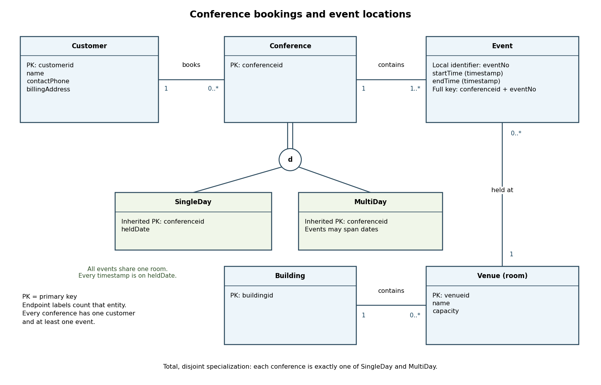

<h1 id="3/a/solution">Solution</h1>

↑ **Parent:** [A](../a.md)

Use an [entity-relationship model](../../../../../entity-relationship-model.md) with `Customer`, `Conference`, `Event`, `Venue` and `Building`. The following [entity-relationship diagram](../../../../../entity-relationship-diagram.md) uses minimum–maximum cardinalities at each end: the label beside an entity counts how many instances of that entity can be associated with one instance at the opposite end. A double link into the specialization circle means total specialization; its `d` means disjoint.

**[Figure 1](#3/a/image-conference-booking-entity-relationship-diagram-with-total-disjoint-conference-subtypes). Conference booking entity-relationship diagram with total disjoint conference subtypes**.

Every conference belongs to exactly one customer and contains at least one event. A customer may book zero or more conferences. Every event belongs to exactly one conference and occurs at exactly one venue; a venue may host zero or more events. The event identifier is local to its conference, so its full [candidate key](../../../../../candidate-key.md) is `(conferenceid, eventNo)`. Choosing an event number is an explicit additional identifier assumption; a globally unique event identifier would be another valid design.

Every conference is exactly one of the two [entity subtypes](../../../../../entity-subtype.md), `SingleDay` and `MultiDay`. Both inherit the conference identifier and the customer and event relationships. For `SingleDay`, store `heldDate`, and enforce

$$
\boxed{\begin{gathered}
\text{all events have one common venue},\\
\operatorname{date}(\mathsf{startTime})=\operatorname{date}(\mathsf{endTime})=\mathsf{heldDate}.
\end{gathered}}
$$

These cross-event [database integrity constraints](../../../../../database-integrity-constraint.md) accompany the diagram; simple endpoint cardinalities alone cannot express them. Since there is at least one event, their common venue determines the conference's single room.

For this design, a venue is a room with the given identifier, name and capacity, and each room belongs to exactly one building. A building may contain zero or more rooms. Introducing `Building` and its identifier is an explicit modeling choice that makes the single-building requirement enforceable: one common room implies one common building. If an application also used non-room venues, it could instead introduce a room [entity subtype](../../../../../entity-subtype.md) and restrict `SingleDay` events to it.

The start and end values are full timestamps, not times of day alone, and each event has $\mathsf{startTime}<\mathsf{endTime}$. `MultiDay` events may use different dates and rooms; the design does not force every pair of events to use different rooms or dates. It imposes no uniqueness of customer names, no venue-exclusivity rule, and no attendance–capacity rule because no attendance data are supplied. Such extra scheduling restrictions could be added as further [database integrity constraints](../../../../../database-integrity-constraint.md) without altering the basic [entity-relationship model](../../../../../entity-relationship-model.md).

## ↑ Ancestors (11)

1. [A](../a.md)
2. [3](../../3.md)
3. [Databases](../../../databases-split.md)
4. [2015](../../../split.md)
5. [Past exam of the computer science course of the University of Oxford](../../../../split.md)
6. [Computer science course of the University of Oxford](../../../../../computer-science-course-of-the-university-of-oxford.md)
7. [Undergraduate course of the University of Oxford](../../../../../undergraduate-course-of-the-university-of-oxford.md)
8. [Course of the University of Oxford](../../../../../course-of-the-university-of-oxford.md)
9. [University of Oxford](../../../../../university-of-oxford-split.md)
10. [List of universities](../../../../../list-of-universities.md)
11. [Codex Wiki](../../../../../split.md)
